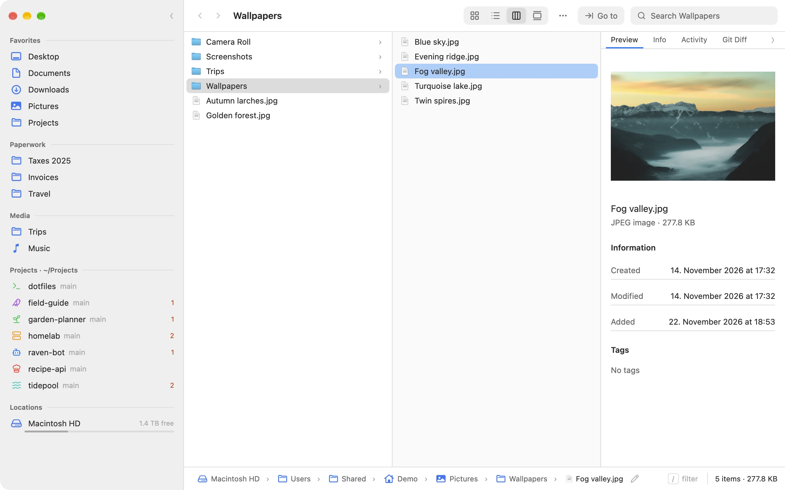
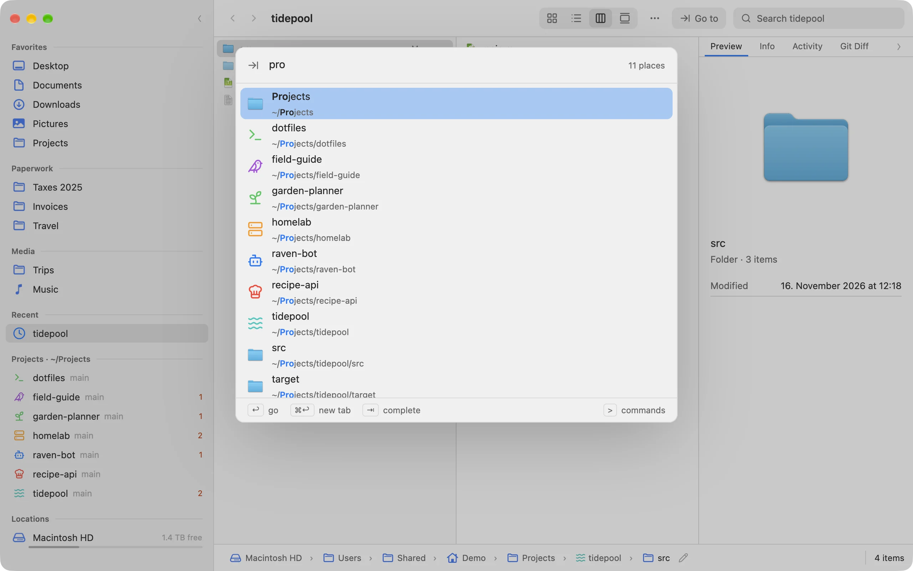
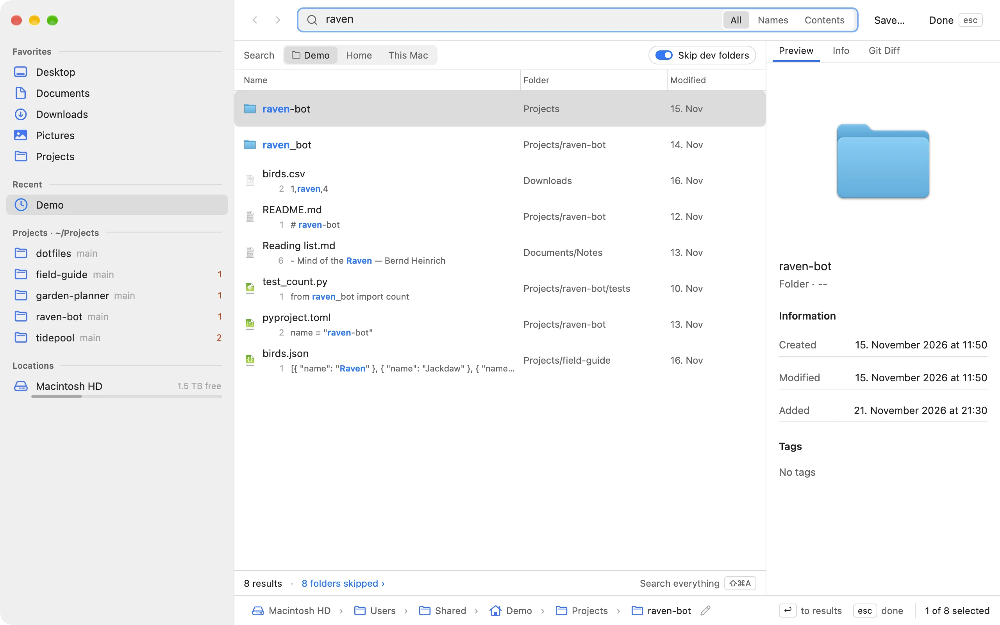
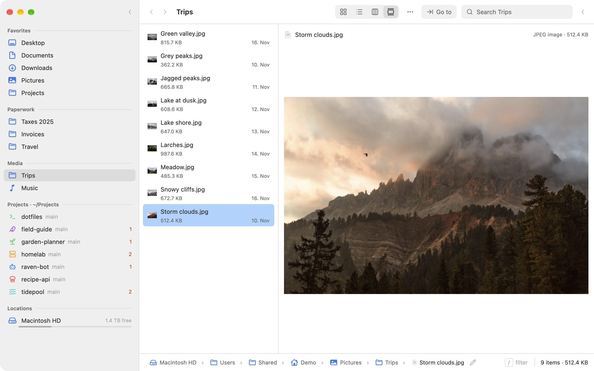
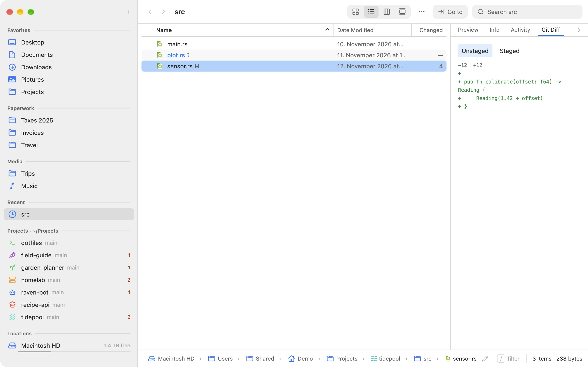
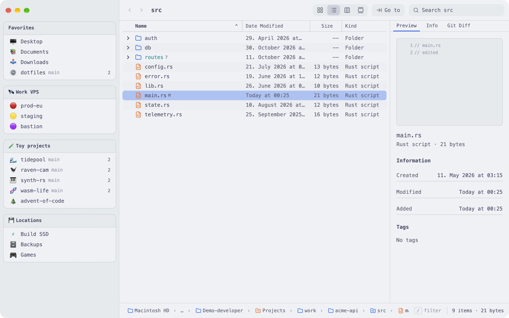
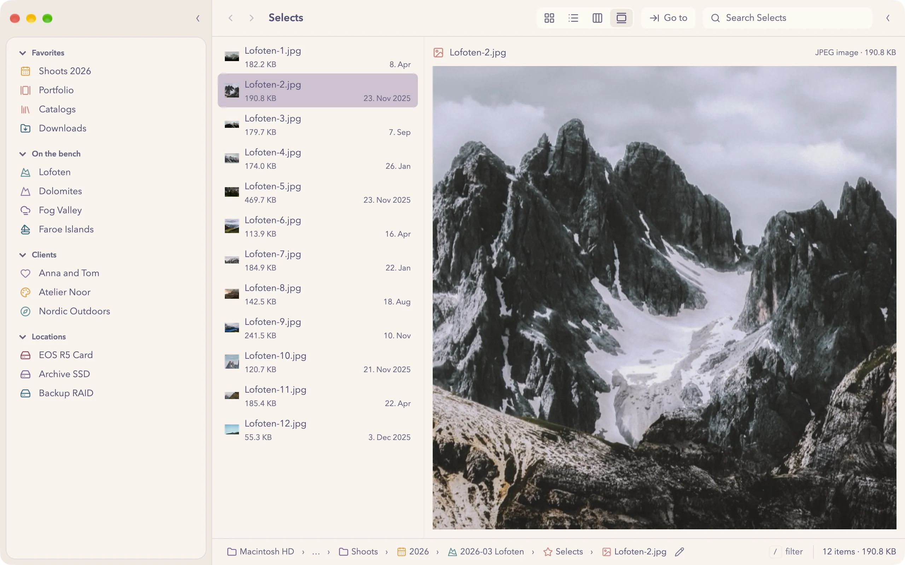

# Crow

**Everything you like about Finder. Nothing you’ve learned to put up with.**

<picture>
  <source srcset="docs/media/hero-dark.webp" media="(prefers-color-scheme: dark)">
  
</picture>

Crow is a Finder-style file manager for macOS that keeps Finder’s directness and adds speed, predictability and a keyboard-first layer.
It’s native Rust on [GPUI](https://github.com/zed-industries/zed/tree/main/crates/gpui), the GPU-accelerated framework behind the Zed editor.

[Download](https://github.com/paraversal/crow/releases/latest) · [Install guide](docs/install.md) · [Website](https://paraversal.github.io/crow/) · [Manual](docs/manual/index.html) · [All features](docs/features.md)

## What it does

<table>
<tr>
<td width="50%"><picture><source srcset="docs/media/palette-dark.webp" media="(prefers-color-scheme: dark)"></picture><br><b>⌘K goes anywhere.</b> Folders, files and every command, by a few letters.</td>
<td width="50%"><picture><source srcset="docs/media/search-dark.webp" media="(prefers-color-scheme: dark)"></picture><br><b>Search as you type.</b> Names and contents, skipping the junk, with the skipped folders listed.</td>
</tr>
<tr>
<td><picture><source srcset="docs/media/view-gallery-dark.webp" media="(prefers-color-scheme: dark)"></picture><br><b>Four views, remembered per folder.</b> Icons, list, columns and gallery, with Preview and Info beside them.</td>
<td><picture><source srcset="docs/media/git-list-dark.webp" media="(prefers-color-scheme: dark)"></picture><br><b>Git, in the listing.</b> Badges, lines changed and a diff beside the file, from an optional bundled plugin.</td>
</tr>
<tr>
<td><picture><source srcset="docs/media/persona-developer-dark.webp" media="(prefers-color-scheme: dark)"></picture><br><b>Make it yours.</b> Themes, icon packs, five sidebar styles, a Vim layer, rebindable keys.</td>
<td><picture><source srcset="docs/media/persona-photographer-dark.webp" media="(prefers-color-scheme: dark)"></picture><br><b>Your setup, not ours.</b> A floating-panel sidebar, Lucide icons and Rosé Pine Dawn: one person’s config of many.</td>
</tr>
</table>

## Crow vs Finder

**What Crow adds**
- A ⌘K palette for folders, files and every command; `/` filters the folder you’re in.
- Content search with live results and visible skip rules (`node_modules` never slows you down).
- Undo for every file operation, trash and batch rename included; a copy queue you can pause, with conflicts shown before it starts.
- A Vim layer, and every key rebindable.
- Views that follow the folder (`views.toml`), with Why This View? to explain them.
- Git badges, lines changed and a review sheet; Projects in the sidebar.
- A path bar you can type into, folder sizes, Open Terminal Here, spring-loaded folders with a way back.
- Plain-text config with live reload, themes shared with your other apps, icon packs, plugins.

**What Finder does that Crow doesn’t (yet)**
AirDrop and Share, iCloud sharing, Quick Actions and Services, Get Info editing (permissions, default app), Spotlight smart folders, compress and archive, Connect to Server, Time Machine, Finder extensions such as Dropbox badges, and a signed and notarized build. The full list is in [docs/features.md](docs/features.md).

## Fast

Rendering is on the GPU: a folder of 100,000 files paints its first rows in about 10 ms and scrolls with a 99th-percentile frame of about 9 ms at 120 Hz (the project’s own bench, [docs/testing.md](docs/testing.md#performance)). Search walks 200,000 nested files in about 1.5 s with the first hit in a millisecond or two. Matching uses ripgrep’s libraries and an fzf-style matcher, in-process.

## Install

Crow needs macOS 14 or later, on Apple Silicon or Intel. It is not signed or notarized yet, so macOS asks you to approve the first open; the [install guide](docs/install.md) has the steps.

```bash
brew install --cask paraversal/tap/crow    # or download the DMG from Releases
```

From source:

```bash
./scripts/fetch-gpui.sh && ./scripts/bundle.sh --install    # Crow.app in /Applications and `crow` on your PATH
```

`crow ~/Downloads` opens a folder, `crow notes.txt` reveals a file, `crow` alone brings Crow to the front.

## Documentation

| | |
| --- | --- |
| [Manual](docs/manual/index.html) | Getting started and every task, with screenshots |
| [Features](docs/features.md) | Everything Crow does today |
| [Keys](docs/keys.md) | Every shortcut, Finder and Vim layers |
| [Configuration](docs/configuration.md) | The TOML files and every key |
| [Themes and icon packs](docs/themes.md) | Built-in themes, the global index, writing your own |
| [Plugins](docs/plugins.md) | Writing a package |
| [Motion](docs/motion.md) | What moves, and in which mode |
| [Architecture](docs/architecture.md) | Crates, threads, file operations |
| [Testing](docs/testing.md) | Tests, fuzzing, bench, hand checks |
| [Roadmap](docs/ROADMAP.md) · [Changelog](CHANGELOG.md) | What shipped, what’s next |

## Status

Version 0.1.0, the first public release. Crow is a daily driver for its author, but young: expect rough edges, and please [open an issue](https://github.com/paraversal/crow/issues) for any you find.

## Development

```bash
cargo fmt --check && cargo clippy --workspace --all-targets -- -D warnings && cargo test --workspace
```

See [CONTRIBUTING.md](CONTRIBUTING.md) and [AGENTS.md](AGENTS.md).

## Licence

[GPL-3.0-or-later](LICENSE). Third-party notices are in [THIRD-PARTY-NOTICES.md](THIRD-PARTY-NOTICES.md).
