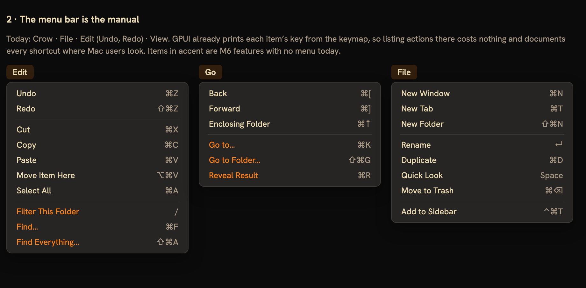

# U2 Menu bar

Audience: an implementing agent. Follow `.claude/skills/execute-plan/SKILL.md`; read `AGENTS.md` and `docs/plans/ui-overhaul/README.md` first.
Needs: PR #7 (M6) merged to `main`. Independent of U1.
Branch: `ui-u2-menu-bar` from `main`.
Progress file: `docs/plans/ui-overhaul/u2-menu-bar.progress.md`.
PR title: "UI U2: Menu bar built from the command registry".
Design reference: canvas board "Discovery kit" §2 "The menu bar is the manual" (Edit, Go, File); "Today, annotated" (the "Not on screen, from the code" note). Canvas: https://claude.ai/artifact/EbZ7gFCy24MaccdpbSsFtE

## Why
"Today, annotated" (note under the eight findings): the menu bar is Crow, File, Edit (Undo/Redo only), View. There is no Go or Find menu, so ⌘F, ⌘K, `/`, ⇧⌘G and ⌘R are not listed anywhere a Mac user looks (finding 1, "a toolbar with nothing to say", is the same problem in the window). GPUI already prints each menu item's key from the keymap, so listing every user-facing action in the menu bar documents every shortcut for free. Today the menu list in `main.rs` and the palette list in `palette.rs` are two hand-kept lists that already disagree (labels, coverage). This plan makes one registry the source of both.

## Decided
- Scope (from the combined draft (since folded into these plans) §U2, kept as is):
  - **Edit**: Undo, Redo · Cut, Copy, Paste, Move Item Here, Select All · Filter This Folder (`/`), Find… (⌘F), Find Everything… (⇧⌘A).
  - **Go** (new): Back, Forward, Enclosing Folder · Go to… (⌘K), Go to Folder… (⇧⌘G).
  - **File**: New Window, New Tab, New Folder · Rename, Duplicate, Quick Look, Move to Trash, Delete Permanently… · Add to Sidebar.
  - **View**: today's items plus Show Activity.
  - Each item is enabled only where its context applies. `/` may not display as a key equivalent; if GPUI can't show it, list "Filter This Folder" without a key and note it.
  - Test: the menu list contains each action (unit test on a menu builder function extracted from `main`).
- Q8 (index): "Edit ▸ Find Everything… (⇧⌘A) with no search open: open search in the current folder with every rule set off." Bind ⇧⌘A in the `Crow` context too, unless it collides with a Finder-layer key (record the check).
- Q7 (index): the user wants an in-app settings page eventually, not in these plans. Nothing here builds it.
- Design point from the orchestrator: ONE registry (`palette.rs` `COMMANDS`) is the source of truth for both the menu bar and the palette. `Command` gains a `menu` field (which menu and section) so U7 can show the menu name in palette rows. The menu builder is a function outside `main.rs` that tests call.
- AGENTS.md: every new key behavior gets a keystroke test; adding a key binding not in the plan needs the user's OK (so ⌘M, ⌘H, ⌘, etc. are questions below, not decisions).

## Current state


Take from it: the right-hand note "Menu bar: Crow, File, Edit (Undo/Redo only), View. No Go or Find menu".

**Menus.** `crates/crow-app/src/main.rs:180-215` calls `cx.set_menus([...])` inline inside `application().run`, after `cx.bind_keys` for the Finder, Vim and text-input keymaps (`main.rs:172-174`) and two global handlers, `Quit` and `NewWindow` (`main.rs:175-179`; NewWindow opens the home folder). Menus today:
- Crow: Quit Crow.
- File: New Window, New Tab, New Folder, —, Add to Sidebar.
- Edit: Undo, Redo.
- View: as List, as Columns, —, Why This View?, Use as Defaults, Reset View for This Folder, —, Show Hidden Files, Theme….
No Go, Window or Help menu. The imports are `main.rs:29-34`.

**Actions and keymaps.** `crates/crow-app/src/actions.rs:8-84` declares every action (`crow` namespace). `finder_keymap()` `actions.rs:86-171`, `vim_keymap()` `actions.rs:174-209`. Contexts: `Crow` (window root), `FileList` (+ `ColumnView`, `Filtered`, `vim`, `VimPending`), `Filter`, `Sidebar`, `Sheet`, `ThemePicker`, `Palette`, `Search`, `SearchResults`, `TextInput` (`text_input.rs:48-68`, `:638`). The bindings the menus will show (first binding of each action, see "GPUI facts"):
| Action | First binding (context) | Line |
| --- | --- | --- |
| Undo / Redo | cmd-z / cmd-shift-z (Crow) | 111-112 |
| CutFiles / CopyFiles / PasteFiles / PasteMoveFiles | cmd-x / cmd-c / cmd-v / cmd-alt-v (FileList) | 107-110 |
| SelectAll | cmd-a (FileList) | 94 |
| StartFilter | `/` (FileList) | 95 |
| ShowSearch | cmd-f (Crow) | 152 |
| SearchEverything | cmd-shift-a (**Search** only) | 153 |
| GoBack / GoForward / OpenParent | cmd-[ / cmd-] / cmd-up (Crow) | 128, 129, 127 |
| ShowCommandPalette / GoToFolder | cmd-k / cmd-shift-g (Crow) | 151, 130 |
| NewWindow | cmd-n (none) | 137 |
| NewTab / NewFolder | cmd-t (Crow) / cmd-shift-n (FileList) | 131, 103 |
| Rename | `enter` (FileList) | 101 |
| Duplicate / QuickLook | cmd-d / `space` (FileList) | 104, 102 |
| MoveToTrash / DeletePermanently | cmd-backspace / cmd-alt-backspace (FileList) | 105-106 |
| AddToSidebar | ctrl-cmd-t (Crow) | 141 |
| ViewAsList / ViewAsColumns | cmd-2 / cmd-3 (Crow) | 121-122 |
| WhyThisView / ShowThemePicker / ToggleHiddenFiles / ToggleActivity | cmd-j / cmd-alt-t / cmd-shift-. / cmd-alt-l (Crow) | 146, 147, 139, 114 |
| UseViewAsDefaults / ResetFolderView | none | — |
| SearchReveal | cmd-r (SearchResults) | 161 |
| Quit | cmd-q (none) | 140 |
`cmd-shift-a` appears nowhere else in `finder_keymap`, `vim_keymap` or `text_input::keymap` (checked): adding it in `Crow` collides with nothing. GPUI prefers the deeper context, so inside the search view the existing `Search` binding still wins.

**Where listeners live** (this decides menu enablement, see GPUI facts):
- Window root `CrowWindow::render`, `window.rs:1747-1782`, key context `Crow`: NewTab, CloseTab, NextTab, PreviousTab, SwitchFocus, ToggleHiddenFiles, OpenParent, GoBack, GoForward, GoToFolder, ViewAsList, ViewAsColumns, Undo, Redo, CancelOperation, AddToSidebar, WhyThisView, UseViewAsDefaults, ResetFolderView, ShowThemePicker, ShowCommandPalette, ShowSearch, ToggleActivity. **No SearchEverything listener here.**
- Pane list `pane.rs:1816-1849` (`FileList`): moves, SelectAll, Open, Rename, QuickLook, NewFolder, Duplicate, MoveToTrash, DeletePermanently, Copy/Cut/Paste/PasteMove, marks, StartFilter, ClearFilter. The filter bar is a sibling above the list (`pane.rs:1876`), so it is outside `FileList` today (U4 moves it inside the column).
- Sidebar `sidebar.rs:619-630` (`Sidebar`): moves, open, RemoveFromSidebar, MoveFavoriteUp/Down, Eject.
- Search `search.rs:977-983` (`Search`): SearchEverything (`search.rs:485-489`, flips `everything` and reruns), CloseSearch. Results `search.rs:720-736` (`SearchResults`): moves, open, SearchReveal, QuickLook, SelectAll, Copy, Cut, MoveToTrash, DeletePermanently, CloseSearch.
- Sheets (`window.rs:876-883`, `:1123-1128`) and overlays are children of the root div (`window.rs:1794-1799`), so Crow-level actions stay reachable while a sheet is open (same as the keyboard today).

**Search entry points.** `CrowWindow::show_search` `window.rs:1267-1285`: if search is open it focuses the field; refuses while picker, Go to, sheet or palette is open; otherwise builds `SearchView::new(folder, home, show_hidden, cx)` (`search.rs:106-153`, `everything: false` at `:134`) and focuses its input. `close_search` `window.rs:1287-1293`. `SearchView::everything()` `search.rs:384`. Test `search_everything_turns_the_rules_off` `window.rs:2206-2229` covers ⇧⌘A inside search.

**Palette registry.** `crates/crow-app/src/palette.rs:11-52` `CommandId` (39 variants), `Command { id, label, keys }` `palette.rs:54-60`, `COMMANDS` `palette.rs:63-103` (order = empty `>` order; `keys` hardcoded Finder strings). `items()` `palette.rs:154-185` fuzzy-matches `label`. Palette commands do **not** dispatch actions: `CrowWindow::run_command` `window.rs:1423-1462` calls handlers directly, sends sidebar commands to `Sidebar::run_command` (`sidebar.rs:330-335`) and the rest to `Pane::run_command` (`pane.rs:418-432`). Palette commands missing from the menus today: Back, Forward, Go to Parent Folder, Go to Folder…, Cut/Copy/Paste/Move Here, Select All, Filter, Rename, Duplicate, Quick Look, Move to Trash, Delete Permanently, Show Activity, Close/Next/Previous Tab, Switch Focus, Open Selected, sidebar commands. Menu-worthy actions missing from the palette: ShowSearch, SearchEverything, ShowCommandPalette, SearchReveal. Row rendering reads `command.label` and `command.keys` (`window.rs:1549`). Test `command_palette_runs_a_command` `window.rs:2295-2313` types `>toggle hidden`, so the palette label "Toggle Hidden Files" must stay matchable.

**GPUI facts (read in `vendor/zed/crates`):**
- `Menu { name, items, disabled }`, `MenuItem::{action, os_action, separator, submenu, os_submenu}`, `.checked()`, `.disabled()`, `OsAction::{Cut, Copy, Paste, SelectAll, Undo, Redo}`, `SystemMenuType::Services`: `gpui/src/platform/app_menu.rs:4-149, 311-329`.
- `cx.set_menus` passes the keymap **at call time** (`gpui/src/app.rs:3007-3010`); bind keys first (already so). Menus are static: no live rebuild; each `set_menus` appends to `menu_actions` without clearing (`gpui_macos/src/platform.rs:1166-1176`), so don't call it per frame.
- Key equivalent shown: `keymap.bindings_for_action(action).find_or_first(pred)` where `pred` accepts bindings with no context or matching Zed's `Workspace > Pane > Editor` context (`gpui_macos/src/platform.rs:345-369`). No Crow binding matches that, so the menu shows the action's **first registered binding**, i.e. the Finder layer (it is bound before `vim_keymap`, `main.rs:172-173`). Multi-stroke bindings show no key (`platform.rs:414-421`).
- The key string goes through `key_to_menu_equivalent` (`gpui_macos/src/events.rs:46-99`): `space`, `backspace`, arrows, `escape`, F-keys are mapped; anything else is passed through as is. `/` → "/" (displayable, no modifiers). `space` → " ". **`enter` is not mapped**: Rename would get the literal key equivalent string "enter" (display unknown; verify).
- Enabled state: `validateMenuItem:` → `cx.is_action_available(action)` (`app_menu.rs:341-349`, `app.rs:2991-3004`): true if any element on the dispatch path of the active window's focused element has an `on_action` listener of that type (`key_dispatch.rs:382-394`), or a global `cx.on_action` exists. Key contexts play no part; listeners do.
- Choosing an item calls `cx.dispatch_action(action)` (`app_menu.rs:351-358`, `app.rs:3047-3057`): dispatched along the focused element's path in the active window; with no window, to global listeners. If no listener is on the path nothing happens (and the item was disabled anyway).
- Opening a menu clears pending multi-key sequences (`app_menu.rs:332-339`), e.g. Vim `g`.
- macOS: a menu named exactly "Window" becomes `NSApp.windowsMenu` (`platform.rs:298-301`). GPUI never sets `helpMenu`; whether AppKit adds the Help search field to a menu titled "Help" on its own must be verified.
- Key events: GPUI's window gets `performKeyEquivalent:` first (`gpui_macos/src/window.rs:2735-2741, 2815-2957`). A bound keystroke in the focused context is handled by GPUI and never reaches the menu. An unhandled keystroke with no modifiers returns NO (`window.rs:2945-2947`), after which AppKit may try the main menu. Printable keys typed into a focused text field are not handled as bindings (GPUI `InputPreference::CharacterInput`, `gpui/src/window.rs:6410-6427`). So a plain `/` or Space menu equivalent could fire the menu item while a text field inside `FileList` (the rename field, U4's filter field) has focus. **Verify first** (I1).
- Tests: the test platform stores menus (`gpui/src/platform/test/platform.rs:755-761`, `cx.get_menus()` returns `OwnedMenu`); `window.is_action_available(&dyn Action, cx)` (`gpui/src/window.rs:3674`) and `window.dispatch_action(Box<dyn Action>, cx)` (`gpui/src/window.rs:2846`) work in `VisualTestContext::update`.
- Window helpers that exist if a Window menu is wanted: `Window::minimize_window` (`gpui/src/window.rs:7063`), `zoom_window` (`:3311`), `toggle_fullscreen` (`:7068`); app: `App::hide`, `hide_other_apps`, `unhide_other_apps` (`gpui/src/app.rs:1691-1701`). No About-panel API in GPUI; `crow_macos` has none either.

## Target


Take from it: item names, order, separators and keys. Not taken: "Reveal Result ⌘R" under Go (not in the agreed scope; Question 1). The board omits Delete Permanently…, which the scope adds after Move to Trash. Accent color in the board is only a marker for the reader; real menus are native AppKit menus (no theme roles, no custom drawing).

Menu bar order (macOS convention): **Crow · File · Edit · View · Go** (+ Window, Help if Questions 3-4 say yes). Native menus follow the system light/dark appearance and font; no styling work.

| Menu | Section | Title | Action | Key shown | Enabled when focus is in |
| --- | --- | --- | --- | --- | --- |
| Crow | 0 | Quit Crow | Quit | ⌘Q | always (global) |
| File | 0 | New Window | NewWindow | ⌘N | always (global) |
| File | 0 | New Tab | NewTab | ⌘T | any Crow window |
| File | 0 | New Folder | NewFolder | ⇧⌘N | list |
| File | 1 | Rename | Rename | ↵ or none (I1/Q2) | list |
| File | 1 | Duplicate | Duplicate | ⌘D | list |
| File | 1 | Quick Look | QuickLook | Space or none (I1/Q2) | list, search results |
| File | 1 | Move to Trash | MoveToTrash | ⌘⌫ | list, search results |
| File | 1 | Delete Permanently… | DeletePermanently | ⌥⌘⌫ | list, search results |
| File | 2 | Add to Sidebar | AddToSidebar | ⌃⌘T | any |
| Edit | 0 | Undo / Redo | Undo / Redo | ⌘Z / ⇧⌘Z | any |
| Edit | 1 | Cut / Copy | CutFiles / CopyFiles | ⌘X / ⌘C | list, search results |
| Edit | 1 | Paste / Move Item Here | PasteFiles / PasteMoveFiles | ⌘V / ⌥⌘V | list |
| Edit | 1 | Select All | SelectAll | ⌘A | list, search results |
| Edit | 2 | Filter This Folder | StartFilter | / or none (I1/Q2) | list |
| Edit | 2 | Find… | ShowSearch | ⌘F | any |
| Edit | 2 | Find Everything… | SearchEverything | ⇧⌘A | any (new Crow listener) |
| View | 0 | as List / as Columns | ViewAsList / ViewAsColumns | ⌘2 / ⌘3 | any |
| View | 1 | Why This View? | WhyThisView | ⌘J | any |
| View | 1 | Use as Defaults / Reset View for This Folder | UseViewAsDefaults / ResetFolderView | none | any |
| View | 2 | Show Hidden Files | ToggleHiddenFiles | ⇧⌘. | any |
| View | 2 | Show Activity | ToggleActivity | ⌥⌘L | any |
| View | 2 | Theme… | ShowThemePicker | ⌥⌘T | any |
| Go | 0 | Back / Forward | GoBack / GoForward | ⌘[ / ⌘] | any |
| Go | 0 | Enclosing Folder | OpenParent | ⌘↑ | any |
| Go | 1 | Go to… | ShowCommandPalette | ⌘K | any |
| Go | 1 | Go to Folder… | GoToFolder | ⇧⌘G | any |
"any" = any focus inside a Crow window (root `Crow` listener). View keeps today's order; Show Activity goes between Show Hidden Files and Theme…. Titles of View items stay as today (Question 6 covers unifying with palette labels).

Behavior:
- Choosing an item does exactly what its key does in the focused context (same action, same listener).
- Find Everything… (menu or ⇧⌘A) with no search open: open search in the current folder (Scope Folder, as ⌘F) with `everything = true`, focus in the query field; the field is empty so nothing runs until the user types. With search open: inside the search view the `Search` binding flips the rules as today; with search open and focus outside it (sidebar), see Question 5. While the palette, Go to Folder, a sheet or the theme picker is open: nothing (as `show_search` does today).
- Vim layer: menus show Finder-layer keys (they still work with `keymap = "vim"`; the Vim layer is additive). Question 7.
- VoiceOver: native menus are read by macOS; nothing to add. No new on-screen elements, so no new roles or labels.
- Performance: menus are built once at launch from a static table; no per-frame work, no I/O. No bench needed.

Registry shape (in `palette.rs`):
```rust
#[derive(Clone, Copy, Debug, PartialEq, Eq, PartialOrd, Ord)]
pub enum MenuName { Crow, File, Edit, View, Go }          // + Window, Help per Q3/Q4
impl MenuName { pub fn title(self) -> &'static str; pub const ALL: &[MenuName] }

#[derive(Clone, Copy, Debug)]
pub struct MenuSlot { pub menu: MenuName, pub section: u8, pub title: &'static str }

pub struct Command {
    pub id: CommandId,
    pub label: &'static str,       // palette label (unchanged)
    pub keys: &'static str,        // unchanged; U1 I1 may replace with live keymap lookup
    pub menu: Option<MenuSlot>,    // None = palette only
    pub palette: bool,             // false = menu only (Go to…)
}
```
Menu item order = `COMMANDS` order filtered by menu, grouped by `section`; separators between sections. So `COMMANDS` order must be arranged so each menu's items appear in menu order (the empty `>` palette list order changes accordingly; it is not a tested contract, but record the new order in the progress file). If that reordering is unwanted, add a `rank: u8` to `MenuSlot` instead (record the choice; code convention, no need to ask).

## Items

### I1 Verify GPUI/AppKit menu behavior (spike, no product code)
*Where*: a throwaway local change to `main.rs` menus, built with `./scripts/bundle.sh --open`; nothing committed except the progress file.
*Change*: add temporary items for StartFilter (`/`), QuickLook (`space`), Rename (`enter`), plus a "Help" menu with one item and a "Window" menu with one item. Check and write in the progress file under "Decisions":
1. Does `/` show as a key equivalent? Does Space? What does Rename show with the string "enter"?
2. With the rename field focused (Return on a row), type `/` and Space: does the text field get them, or does the menu item fire (filter opens, Quick Look opens)? Same in the `/` filter field and Go to Folder field (⇧⌘G; StartFilter is not on that path, so the item should be disabled).
3. In the list (no text field), does `/` still start the filter exactly once (not twice: GPUI binding and menu)?
4. Does a menu titled "Help" get the system search field? Does typing "find" in it list Edit ▸ Find…?
5. What does AppKit add on its own: "Start Dictation"/"Emoji & Symbols" in Edit, "Enter Full Screen" in View, tab items ("Show Tab Bar", "Merge All Windows") in Window? Note anything that conflicts with Crow's own tabs.
6. Menu item enabled state: focus in list, sidebar (Tab), search field, search results, palette: Filter/Rename/Copy follow the "Enabled" column above.
*Done when*: each answer is recorded with "seen by hand on <date>, macOS version". Then ask Question 2 with the facts.

### I2 One command registry with menu slots

*Where*: `crates/crow-app/src/palette.rs`, `window.rs` `run_command` and palette row rendering.
*Change*:
- Add `MenuName`, `MenuSlot`, `Command.menu`, `Command.palette` as in Target.
- Add `CommandId::{ShowSearch, SearchEverything, ShowCommandPalette}` (and `SearchReveal` only if Question 1 = yes). Labels: "Find…", "Find Everything…", "Go to…". `ShowCommandPalette` gets `palette: false` (running it from the palette would reopen the palette). `SearchReveal` (if added) gets `palette: false` (the palette can't open over search, `window.rs:1341-1348`).
- Fill `menu` for every row in the Target table; every other command gets `menu: None` (Question 8 lists them). `Quit` gets `MenuName::Crow`.
- `items()` (`palette.rs:154-165`) skips `palette: false`.
- `run_command` (`window.rs:1423`): `ShowSearch => self.show_search(&ShowSearch, …)`, `SearchEverything => self.search_everything(&SearchEverything, …)` (I4 adds it; until then call `show_search`), `ShowCommandPalette => {}` unreachable from the palette (keep the match exhaustive, no `unreachable!`).
- `keys` for the new rows: "⌘F", "⇧⌘A", "⌘K" (note: existing strings write modifiers as "⌘⇧"; keep the existing style "⌘⇧A" for consistency inside the palette, record it).
*Edge cases*: `Command` stays `Copy`; `CommandId` stays exhaustive in `Pane::run_command`'s `other =>` fallback (`window.rs:1460`) — the new ids are handled before it, so `Pane::run_command` never sees them; keep its match total.
*Tests* (`palette.rs` `#[cfg(test)] mod tests`, plain `#[test]`):
- `command_ids_are_unique`: no `CommandId` twice in `COMMANDS`.
- `menu_slots_are_unique`: no `(menu, title)` twice.
- `menu_sections_are_contiguous`: within each menu, `section` never decreases along `COMMANDS` order (or ranks sort cleanly if `rank` was chosen).
- `palette_hides_menu_only_commands`: `items(">", &[])` has no `ShowCommandPalette`; `items(">find", &[])` lists "Find…" and "Find Everything…".
- Keystroke test in `window.rs`: `palette_find_opens_search`: cmd-k, `>find`, enter → `w.search.is_some()`, focus in the search input.
*Done when*: tests pass; existing `command_palette_runs_a_command` still passes unchanged.

### I3 Menu builder from the registry

*Where*: new `crates/crow-app/src/menus.rs` (`mod menus;` in `main.rs`); `main.rs:29-34, 175-215`.
*Change*:
- `pub fn action(id: CommandId) -> Box<dyn gpui::Action>`: exhaustive `match` from every `CommandId` to its action (`Open → OpenSelection`, `Copy → CopyFiles`, `Cut → CutFiles`, `Paste → PasteFiles`, `PasteMove → PasteMoveFiles`, `ShowSearch → ShowSearch`, …). Exhaustiveness makes a new command without an action a compile error.
- `pub fn app_menus() -> Vec<gpui::Menu>`: for each `MenuName` in bar order, the commands with that menu in registry order, `MenuItem::separator()` between sections, `MenuItem::action(slot.title, …)` for each. Use `MenuItem::os_action` with `OsAction::{Undo, Redo, Cut, Copy, Paste, SelectAll}` for those six (GPUI routes them through the same handler, `platform.rs:100-124, 371-381`; it lets system panels use the keys). Items from Question 3-4 (app, Window, Help) are added here, not in the registry, if they are not palette commands.
- `pub fn init(cx: &mut App)`: registers the global `Quit` and `NewWindow` handlers now in `main.rs:175-179` and calls `cx.set_menus(app_menus())`. Must run after all `cx.bind_keys`; say so in a doc comment. `main.rs` calls `menus::init(cx)` in place of the inline block and drops the unused imports.
*Edge cases*:
- An action whose listener is not on the focused path is disabled by GPUI; nothing extra to code. Record in the progress file which items I1 found enabled where.
- Rename/QuickLook/StartFilter key equivalents: per Question 2. If the answer is "no native key", add menu-only proxy actions `MenuRename`, `MenuQuickLook`, `MenuStartFilter` (no bindings, so no key equivalent) with listeners next to the real ones (`pane.rs:1836-1848`, `search.rs:730`) that call the same methods, and map those three ids to the proxies in `menus::action` only for the menu (the palette keeps calling `run_command`).
- NewWindow from the menu opens Home (global handler); from the palette it opens the current folder (`window.rs:1430-1433`). Keep both; Question 9.
*Tests*:
- `menus.rs` `#[test] every_menu_command_is_in_the_menus`: for each `COMMANDS` row with `menu: Some(slot)`, `app_menus()` has exactly one `MenuItem::Action` in menu `slot.menu.title()` named `slot.title` whose action `partial_eq`s `action(id)`; and every action item in `app_menus()` is either from the registry or in an explicit `APP_ITEMS` list (Quit, plus Q3/Q4 items).
- `#[test] menus_are_in_bar_order`: top-level names are `["Crow", "File", "Edit", "View", "Go", …]`; Edit's titles in order are exactly `Undo, Redo, —, Cut, Copy, Paste, Move Item Here, Select All, —, Filter This Folder, Find…, Find Everything…`; same exact-list assertion for File, View and Go (copy from the Target table).
- `#[gpui::test] menu_keys_are_the_finder_keys` (`window.rs` tests): after `open()`, for each menu action, the first binding from `cx.key_bindings().borrow().bindings_for_action(&*action).next()` equals the expected Finder keystroke (table: Find… `cmd-f`, Find Everything… `cmd-shift-a`, Enclosing Folder `cmd-up`, Undo `cmd-z` (not Vim `u`), Copy `cmd-c` (not `y y`), Go to… `cmd-k`, Go to Folder… `cmd-shift-g`, Show Activity `cmd-alt-l`). This mirrors GPUI's choice (`platform.rs:348-369`) and fails if a Vim binding is ever registered first.
- `#[gpui::test] menu_items_are_enabled_by_focus`: list focused → `window.is_action_available` true for every File/Edit/View/Go action; `tab` to the sidebar → false for StartFilter, Rename, CopyFiles, PasteFiles, NewFolder, QuickLook; true for GoBack, ShowSearch, SearchEverything, Undo; cmd-f then `tab` into results → true for CopyFiles, SelectAll, MoveToTrash, QuickLook; false for PasteFiles, StartFilter.
- `#[gpui::test] menu_items_dispatch`: `cx.update(|cx| menus::init_for_tests(cx))` (sets the menus without global handlers if needed), read `cx.get_menus()`, and dispatch these items' actions with `window.dispatch_action(action.boxed_clone(), cx)`, asserting the effect: Go ▸ Enclosing Folder from `root/alpha` → `dir == root`; Back → `root/alpha`; Edit ▸ Filter This Folder → pane filtering; Edit ▸ Find… → `w.search.is_some()`; Go ▸ Go to… after closing search → `w.palette.is_some()`; View ▸ Show Activity → `w.show_activity` flips; File ▸ New Tab → `w.tabs.len() == 2`. Skip Quit and NewWindow (global, would quit/open a window) and destructive items (covered by their key tests).
*Done when*: the menu bar in the bundle matches the Target table (hand check), all tests pass.

### I4 Find Everything with no search open (Q8)
*Where*: `actions.rs:153`, `window.rs` (root listeners `:1756-1782`, new handler next to `show_search` `:1267`), `search.rs` (new setter near `:485`).
*Change*:
- `actions.rs`: add `KeyBinding::new("cmd-shift-a", SearchEverything, Some("Crow"))` right after line 153 (keep the `Search` line first; both show ⇧⌘A). Record "no collision in finder/vim/text-input keymaps" in the progress file.
- `SearchView::set_everything(&mut self, on: bool, cx)`: sets the flag and reruns the current query if non-empty (reuse `start_search`); used by the window handler. Keep `search_everything` (toggle) as is.
- Shared entry point (U3 reuses it with exactly this shape; don't rename):
  ```rust
  pub struct SearchStart { pub folder: PathBuf, pub query: String, pub everything: bool }
  impl CrowWindow {
      /// Opens the search panel (Scope Folder) on `folder`, with `query` in the field and the rules set by `everything`.
      /// Returns false and does nothing while the picker, Go to Folder, a sheet or the palette is open, or search is already open.
      fn open_search(&mut self, start: SearchStart, window: &mut Window, cx: &mut Context<Self>) -> bool
  }
  ```
  Move the body of `show_search` (`window.rs:1272-1284`: the overlay guard, `SearchView::new`, the two subscriptions, focus) into `open_search`. `SearchView::new` gains the `everything` flag (set before the first search) and, if `query` is non-empty, sets the input text and starts the search; U2 only ever passes an empty query, so the non-empty path is for U3 (implement it, cover it with one test). `show_search` becomes: if search is open, focus its field (as today); else `open_search(SearchStart { folder: current, query: String::new(), everything: false })`.
- `CrowWindow::search_everything(&mut self, _: &SearchEverything, window, cx)`: if `self.search` is `Some`: per Question 5 (recommended: toggle the open search's rules and focus its field, via `set_everything(!everything)`). Else `self.open_search(SearchStart { folder: self.pane().read(cx).current_dir(cx), query: String::new(), everything: true }, window, cx)`. Register it with `.on_action(cx.listener(Self::search_everything))` on the root div.
- `run_command`: `CommandId::SearchEverything => self.search_everything(…)`.
*Edge cases*: palette/sheet/picker/Go to open → `show_search` refuses, so nothing happens and nothing is half-set. Search open with focus in its field or results → the `Search` listener is deeper and handles it first (GPUI dispatches bubble-phase from the focused node up, and the search view does not propagate), so behavior there is unchanged. U6 later turns the "Search everything" button into a "Skip … folders" switch; `everything = true` = switch off, so this stays correct.
*Tests* (`window.rs`):
- `find_everything_from_the_list_opens_search_with_rules_off`: fixture with `node_modules/pkg/needle.txt`; with the list focused `cmd-shift-a` → search open, `search.everything()` true, scope Folder, focus in the search input; `simulate_input("needle")`, `wait_for_search` → the node_modules file is in the results, `skipped_count() == 0`.
- `find_everything_does_nothing_over_the_palette`: cmd-k, cmd-shift-a → `w.search.is_none()`, palette still open.
- `find_everything_from_the_sidebar_with_search_open` (per Question 5): cmd-f, `simulate_input("needle")`, focus the sidebar (click or `tab` until sidebar), cmd-shift-a → `everything()` flipped and focus back in the search field.
- `open_search_with_a_query_runs_it`: call `open_search(SearchStart { folder: root, query: "needle".into(), everything: false })` through `view.update_in`; after `wait_for_search` the field holds "needle", results are in, `everything()` false. (Guards the U3 path.)
- Existing `search_everything_turns_the_rules_off` and `search_panel_streams_names_and_contents` still pass unchanged.
*Done when*: tests pass; Edit ▸ Find Everything… is enabled with the list focused (covered by I3's availability test once I4 lands; update its expectation).

### I5 App, Window and Help menus (only what Questions 3-4 approve)
*Where*: `menus.rs`, `actions.rs` (new actions/bindings), `crow-macos` (only if About is wanted).
*Change* (recommended set; build only the approved parts):
- Crow menu: About Crow · Settings… (Question 3) · — · Services (`MenuItem::os_submenu("Services", SystemMenuType::Services)`) · — · Hide Crow ⌘H (`App::hide`), Hide Others ⌥⌘H (`hide_other_apps`), Show All (`unhide_other_apps`) · — · Quit Crow ⌘Q. New actions `About`, `OpenSettings`, `HideApp`, `HideOthers`, `ShowAll` with global `cx.on_action` handlers in `menus::init`. About needs a `crow_macos::show_about_panel()` calling `NSApp orderFrontStandardAboutPanel:` (AppKit stays in `crow-macos`). Settings… opens `<config_dir>/settings.toml` with the default app via the same mechanism U5 uses for its "Open" button (check U5's choice; if U5 is not merged, add `crow_macos::open_in_default_app(path)` and let U5 reuse it); file open happens off the main thread (`background_spawn`).
- Window menu (Question 4): Minimize ⌘M (`Window::minimize_window`), Zoom (`zoom_window`), — , Show Previous Tab ⇧⌘[ (`PreviousTab`), Show Next Tab ⇧⌘] (`NextTab`), Close Tab ⌘W (`CloseTab`) — these three move from `menu: None` to `MenuName::Window` in the registry. New actions `Minimize`, `Zoom` with listeners on the Crow root. Name the menu exactly "Window" so AppKit adds the window list.
- Help menu (Question 4): titled exactly "Help"; one item "Crow Keyboard Shortcuts" that opens the palette in command mode (`>` pre-filled). If I1 showed the search field needs `NSApp.helpMenu`, add `crow_macos::set_help_menu()` or drop the search-field claim and record it.
*Tests*: extend `menus_are_in_bar_order` with the approved menus and titles; `#[gpui::test] window_menu_tab_items_switch_tabs` (dispatch NextTab/PreviousTab via the menu items, assert active tab); keystroke test for any new binding approved (e.g. `cmd-m` dispatches `Minimize`: assert via a test-only counter or `window.is_action_available(&Minimize)` plus handler call, since the test platform does not minimize). Global handlers (About, Hide) get no GPUI test; hand check.
*Done when*: approved menus present, tests pass, hand checks pass.

### I6 Docs
*Where*: `README.md` "Keys" (around lines 60-71), `docs/testing.md` hand table.
*Change*: README: one paragraph "Menus list every command with its key: File, Edit (including Filter This Folder, Find…, Find Everything…), View, Go (Back, Forward, Enclosing Folder, Go to…, Go to Folder…)" plus "Cmd-Shift-A from anywhere opens search with every `exclude.toml` set off". Note any item that has no key equivalent (I1/Q2). testing.md: rows from "Hand checks" below; extend the automated-tests paragraph with "the menu bar (every registry command listed, Finder keys, enabled by focus)".

## Seams with other U plans
- **U1** (keys from the live keymap, I1): independent. `Command.keys` stays a fallback string here; if U1 merges first and removed or changed `keys`, follow U1's shape and keep `menu`/`palette`. Menu keys come from GPUI's own lookup either way. Do not add any Keycap/tooltip here.
- **U7** (palette sections, menu name in rows): relies on `Command.menu: Option<MenuSlot>` and `MenuName::title()`. Keep both public. U7 may display `menu.title()` as the row's first line; commands with `menu: None` show nothing there.
- **U3** ("Go to ⌘K" button, search field) and **U6** (search switch, "Search everything ⇧⌘A" footer): rely on ⇧⌘A working from the `Crow` context (I4), on `SearchView::set_everything`, and on `CrowWindow::open_search(SearchStart { folder, query, everything })`, which U2 adds and U3 reuses unchanged (U3's ⌘F escalation from the filter passes the filter text as `query`). Leave the Search-context toggle intact.
- **U4** moves the filter field inside `FileList`; that is exactly the case I1 step 2 checks for a plain `/` key equivalent. If Question 2 keeps native plain keys, U4 must re-run that hand check.
- **U5** "Open" button for config errors: share the "open file in default app" helper with Settings… (I5).
- Leave alone: `run_command` direct calls (the palette does not dispatch actions; changing that would alter which pane/sidebar receives sidebar commands), all keymaps except the one ⇧⌘A line (and bindings approved in Questions 3-4).

## Risks and things to measure first
- **Plain-key equivalents stealing typing** (`/`, Space, `enter`): the main risk; I1 settles it before I3 ships those three items. Fallback: proxy actions with no key (I3 edge case).
- `enter` key equivalent string: GPUI passes "enter" to AppKit unmapped (`events.rs:96`); display is unknown. Likely needs the proxy fallback for Rename regardless.
- Menus are static: titles can't follow state (Show/Hide Hidden Files, check marks). Rebuilding on every toggle leaks `menu_actions` entries (`platform.rs:1170`) and `show_hidden` is per window. Question 10.
- Text fields: Edit ▸ Cut/Copy/Paste/Select All dispatch Crow's file actions, which have no listener inside a `TextInput`, so those items are disabled while typing in a field (⌘C/⌘V keys still work there, handled by `text_input::keymap` before the menu). Question 11.
- Undo is a root listener: Edit ▸ Undo while typing in a field undoes the last file operation (same as ⌘Z today). Out of scope; noted.
- Items reachable while a sheet is open (Back, New Tab…) are as reachable as their keys are today; no new hole. Do not add guards in this plan.
- No perf impact; no bench.

## Questions to ASK
1. **Reveal Result ⌘R under Go?** The Discovery board shows it; the agreed scope omits it. It would be enabled only with search results focused (`SearchReveal` listener `search.rs:729`). Recommend: **yes**, add it as Go section 1, menu-only (`palette: false`): it's the one search key not listed anywhere else, and greyed out elsewhere is the macOS norm.
2. **Plain keys `/`, Space, ↵ in menus** (after I1's findings): if they steal typing in text fields or show oddly, recommend **list Filter This Folder, Quick Look and Rename without a key equivalent** (proxy actions) and rely on the U5 hints and palette keycaps to teach those keys. If I1 shows AppKit ignores unmodified menu equivalents while GPUI handles the key, keep `/` and Space native and use the proxy only for Rename.
3. **Crow (app) menu**: recommend **About Crow** (standard panel via `crow_macos`), **Services**, **Hide Crow ⌘H / Hide Others ⌥⌘H / Show All**, Quit. Settings…: recommend **"Settings… ⌘," opening `settings.toml` in the default app** until the in-app settings page exists (Q7 says the page comes later; this gives ⌘, a meaning now and the page can take it over). Alternative: leave Settings out. New bindings `cmd-h`, `cmd-alt-h`, `cmd-,` need your OK.
4. **Window and Help menus**: recommend a **Window** menu with Minimize ⌘M, Zoom, then Crow's tabs: Show Previous Tab ⇧⌘[, Show Next Tab ⇧⌘], Close Tab ⌘W (Finder puts Close Tab in File; Window is where Mac users look for tab switching), and a **Help** menu whose only item is "Crow Keyboard Shortcuts" (opens the palette in command mode), mainly so macOS adds its menu search field (type "trash" → shows File ▸ Move to Trash). New binding `cmd-m` needs your OK.
5. **⇧⌘A with search open but focus outside it** (e.g. in the sidebar): recommend **flip the open search's rules and focus its field**, the same as ⇧⌘A inside search (one key, one meaning while search is open). Alternative: always turn rules on.
6. **Labels: menu titles vs palette labels.** Today they differ ("as List" vs "View as List", "Enclosing Folder" vs "Go to Parent Folder", "Move Item Here" vs "Move Here", "Show Hidden Files" vs "Toggle Hidden Files"). Recommend **keep both** (`MenuSlot.title` for the menu, `label` for the palette) in U2, and let U7 decide whether palette rows show "Menu ▸ title". Unifying now would break `>toggle hidden` and change palette search words.
7. **Vim layer keys in menus**: menus show the Finder-layer key (first binding); Vim keys (`u`, `yy`, `dd`, `p`) are multi-stroke or plain letters and can't be native equivalents anyway. Recommend **Finder keys only**, documented in README.
8. **Commands left out of the menus** (`menu: None`): Open Selected (⌘↓; Finder has File ▸ Open ⌘O), Switch Focus (⇥), Remove from Sidebar, Move Favorite Up/Down, Eject (Finder: File ▸ Eject ⌘E), plus Close/Next/Previous Tab if Question 4 is no. Recommend **add Open (File §0, after New Folder) and Eject (File §2, after Add to Sidebar)**, leave the rest palette-only.
9. **New Window location**: the menu/⌘N opens Home (`main.rs:176-179`), the palette's New Window opens the current folder (`window.rs:1430-1433`). Recommend **current folder for both** when a window is focused (Home only when no window), so the menu and palette agree. Alternative: leave as is.
10. **Check marks / Show–Hide titles** for Show Hidden Files and Show Activity: recommend **no** (static titles; GPUI menus are built once and hidden-files state is per window; U7 shows on/off chips in the palette).
11. **Edit ▸ Cut/Copy/Paste/Select All while a text field has focus**: they are disabled there (file actions only). Recommend **make `TextInput` also listen for `CopyFiles`, `CutFiles`, `PasteFiles` and `crow::SelectAll` and treat them as its own text copy/cut/paste/select-all**, so the menu works in fields like it does in Finder. Small change in `text_input.rs`; keys are unaffected. Alternative: leave disabled.

## Hand checks (add to `docs/testing.md`)
| Check | How |
| --- | --- |
| Menu bar | Open each of File, Edit, View, Go (and Window/Help if built): every item shows the key it has in the list (⌘F, ⇧⌘A, ⌘K, ⇧⌘G, ⌘[ …); items without a key are the ones the README names. |
| Menus follow focus | With the list focused, Edit ▸ Filter This Folder, Copy, Paste and File ▸ Rename are enabled; Tab to the sidebar: they grey out, Go ▸ Back stays enabled. In search results, Copy and Move to Trash are enabled, Paste is not. |
| Menus act | Choose Go ▸ Enclosing Folder, Back, Go to…, Go to Folder…; Edit ▸ Find…, Filter This Folder; View ▸ Show Activity: each does what its key does. |
| Find Everything | From the list press ⇧⌘A (or Edit ▸ Find Everything…): search opens in the current folder with the rules off; typing finds files inside `node_modules`. |
| Typing is not stolen | Rename a file and type `/` and a space in the name; in the filter field type `a/b`: the characters land in the field (only relevant if `/` or Space are native key equivalents, Question 2). |
| Help search | (If built) Help ▸ search "trash": macOS points at File ▸ Move to Trash. |

## Finish
- README "Keys" paragraph on menus and ⇧⌘A (I6); `docs/testing.md` rows above and the automated-tests sentence.
- No row rendering changed: no bench needed (say so in the PR).
- `cargo fmt --check`, `cargo clippy --workspace --all-targets -- -D warnings`, `cargo test --workspace`.
- `./scripts/bundle.sh`, run the hand checks, record results in the progress file.
- Push `ui-u2-menu-bar`, open the PR "UI U2: Menu bar built from the command registry" (body: each item, approach, how verified, I1 findings, answers to the questions; end with the required attribution). Don't merge. Set the progress file state to "PR open".
