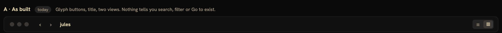
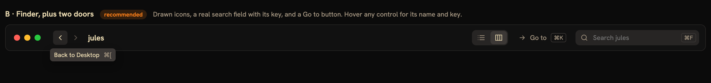
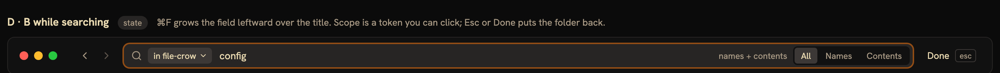
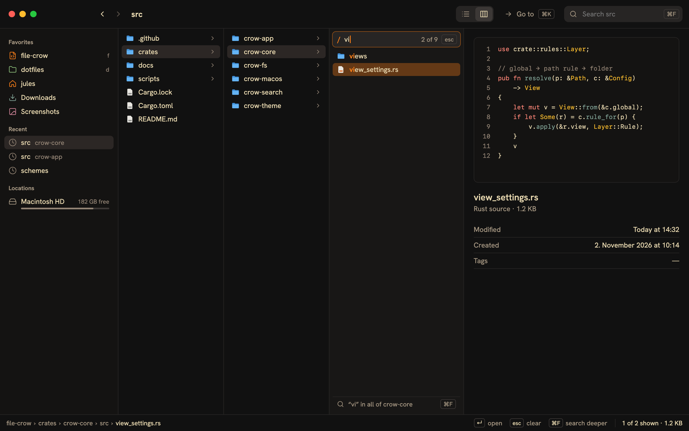

# U3 Top band

Audience: an implementing agent. Follow `.claude/skills/execute-plan/SKILL.md`; read `AGENTS.md` and `docs/plans/ui-overhaul/README.md` first.

- Needs: U1 (keycaps from the live keymap, `Keycap`, `with_tooltip`, SVG `icons::glyph(name, size, role)` + `Assets`) merged to `main`. U2 is not required (see Seams).
- Branch: `ui-u3-top-band` from `main`.
- Progress file: `docs/plans/ui-overhaul/u3-top-band.progress.md`.
- PR title: "UI U3: Top band with search field, Go to and match modes". Don't merge.
- Design reference: canvas board "Top band", variants **B** (idle) and **D** (searching); the two assembled boards "Overhaul" and "OverhaulSearch" for how it sits in the window. https://claude.ai/artifact/EbZ7gFCy24MaccdpbSsFtE

## Why
"Today, annotated" finding 1, *a toolbar with nothing to say*: Back, Forward and the title, with no search field, no ⌘K entry and no tooltips, so every M6 feature is invisible until you already know its key. Finding 2, *glyph buttons*: the view switch is ☰ and ▥ text on different baselines with no hover text, Back/Forward are ‹ › at 18 px. And from the hidden list: the search panel stacks three header rows (field, scope pills, a help sentence) before the results. U3 puts a Finder-style search field with ⌘F and a "Go to ⌘K" button in the band, swaps the glyphs for drawn icons with tooltips, and moves the search query field into the band while searching, with All / Names / Contents.

## Decided
From the index (`docs/plans/ui-overhaul/README.md`, answers 2026-11-12):
- Q2 Icons: embedded SVGs (an `AssetSource` with `include_bytes!`, rendered with GPUI `svg()`, tinted by theme role). Built in U1; U3 only uses them.
- Q3 "Search field gets **All / Names / Contents**, default All (= M6 behavior). Names skips reading contents; Contents hides name-only hits." Orchestrator detail: Names passes no contents query to `crow_search` (no file reads); Contents drops name-only hits; on This Mac (Spotlight, names only) the control shows Names and is disabled.
- Q5 The Everywhere scope is renamed **This Mac**: done by U6. U3 uses whatever `Scope` label exists (see I3).
- Q8 Edit ▸ Find Everything… (⇧⌘A) with no search open opens search in the current folder with every rule off: built by U2; U3 provides the entry point it should call (I3).
- Ground rules: theme roles only; every interactive element has a role and aria label, tooltips never replace them; every key behavior gets a keystroke test; don't merge.
- Combined draft (the combined draft (since folded into these plans) §U3): B with drawn icons, disabled = 40 % opacity (not a second grey), view switch 32×26 targets as a radiogroup, "Go to ⌘K" button opening the palette, search field 220–240 px with placeholder "Search <folder>" and an Outline ⌘F keycap; clicking it or ⌘F starts search. D: the field grows over the title (flex 1), accent focus ring, holds the query `TextInput` that today sits in `SearchView::render_header`, shows All / Names / Contents and "Done esc". Tooltips with keys on every button. Tests listed there are all kept below.

## Current state
Images: `today-annotated.png` is the whole window; this crop is the band as built.

Take from it: what exists today. Grey traffic lights stand in for the window's own; ‹ › and ☰ ▥ are text.

**Window and band.** `window.rs:32` `open` creates the window with `appears_transparent: true` and `traffic_light_position: point(px(14.), px(16.))` (`window.rs:42`). No `window_min_size` is set, so the window can get arbitrarily narrow. `render_title_bar(&self, title, cx)` (`window.rs:301`) draws a 44 px row, `pl(px(86.))` (traffic-light inset), `pr_3`, `gap_1`, bottom border `border`:
- `nav_button` closure (`window.rs:306`): 26×26 div, `Role::Button`, aria "Back"/"Forward", glyph ‹ › at 18 px, color `fg-muted` enabled or `fg-subtle` disabled (the "second grey"). Clicks call `pane.go_back/go_forward` (no-ops when disabled). No tooltip, no hover state.
- Title: `id("title")`, `Role::Heading`, `aria_level(1)`, 14 px semibold `fg` (`window.rs:333`). No truncation (no `min_w_0`/ellipsis).
- `div().flex_1()` spacer, then `view-switcher` (`Role::RadioGroup`, aria "View", `surface` background, 2 px padding) with two `view_button`s (`window.rs:555`: 28×22, `Role::RadioButton`, aria "as List"/"as Columns", `aria_selected`, selected fill `surface-raised`).
- The title string comes from `Render for CrowWindow` (`window.rs:1727`): `folder_name(&self.pane().read(cx).current_dir(cx))`; `Pane::current_dir` (`pane.rs:302`) is the *focused column's* folder in column view, the list's folder in list view. The same string is the window title (`window.set_window_title`, `window.rs:1729`).

**Search lifecycle (per window, not per tab).** `CrowWindow.search: Option<Entity<SearchView>>` (`window.rs:68`), one per window. `show_search` (`window.rs:1267`): if search is open, focus its input and return; if the theme picker, Go to Folder, a sheet or the palette is open, do nothing; else create `SearchView::new(folder, home, show_hidden)` with `folder` = active pane's `current_dir`, observe it, subscribe to `SearchEvent`, focus the input. While open, `Render` shows the search view in place of the pane (`window.rs:1743`) and hides the list preview (`window.rs:1735`). `close_search` (`window.rs:1287`) cancels and `focus_pane`s. `on_search_event` (`window.rs:1295`) handles Close, FocusResults, Reveal, Open, Run, Copy. `PaneEvent::Entered` (any navigation, including Back/Forward) closes search (`window.rs:616`). Tab switching (`cycle_tab` `window.rs:178`, `new_tab`, `close_tab`) does **not** close search: it focuses the new tab's pane, which isn't rendered while search covers the center, and the search keeps the folder it opened with. See Questions.

**SearchView** (`search.rs:54`). Owns `input: Entity<TextInput>` (created in `new`, `search.rs:107`, placeholder "Search names and contents"), `focus` (results list), `scope: Scope { Folder, Home, Everywhere }` (`search.rs:37`), `everything`, results, `cancel: Arc<AtomicBool>`, `generation`. The input subscription (`search.rs:109`): `Changed` → `start_search(text)`; `Confirmed` → open selected; `Cancelled` (Esc) → `SearchEvent::Close`; `CompletionRequested` (Tab) → `FocusResults`. **No debounce**: every keystroke calls `start_search` (`search.rs:180`), which sets the old `cancel` flag, bumps `generation` (stale updates are dropped in the receive loop, `search.rs:258`), clears results, and spawns either Spotlight (`crow_macos::spotlight_names`, `Scope::Everywhere`) or `crow_search::search` with `Query { names: Some(q), contents: Some(q), show_hidden, rules, everything }` (`search.rs:233`). `query()` (`search.rs:356`) reads the input. `set_scope` (`search.rs:393`) reruns. `focus_input` / `focus_results` (`search.rs:155`, `:160`).
- `render_header` (`search.rs:553`): column of the input, a row of three `scope_button`s (`search.rs:604`, accent-filled when selected, `Role::Button` + `aria_selected`, no debug selector) plus the "Search everything" button, and the help sentence "⇧⌘A turns every exclusion set off · contents are literal; /pattern/ is a regex".
- `Render` (`search.rs:973`): root `key_context("Search")` with `SearchEverything` and `CloseSearch` handlers, then header, summary (`render_summary` `:623`), results (`render_results` `:676`, `key_context("SearchResults")`, `CloseSearch` on Esc via `actions.rs:154`), skipped list.

**crow-search.** `Query` (`crates/crow-search/src/engine.rs:25`): `names: Option<String>`, `contents: Option<String>`. `search` (`engine.rs:96`) treats `None` or empty as "off"; with `contents: None` no `ContentSearch` is built and no file is opened (`engine.rs:126`, `:155`); with `names: None` no fuzzy matcher runs, so only `HitKind::Content` hits come back (folders never, since contents skip dirs, `engine.rs:156`). So Names and Contents need **no engine change**.

**TextInput** (`text_input.rs`). `new(content, placeholder)` (`:87`); `text()`, `set_text` (emits `Changed`), `select_range`. Render (`:629`): `Role::TextInput`, `aria_label(placeholder)`, `key_context("TextInput")`, always `w_full`, `px_2 py_1`, `rounded_md`, `bg` fill and a 1 px **accent** border. Keymap (`:48`): editing keys, `enter` Confirm, `escape` Cancel, `tab` Complete, all in `TextInput`. Placeholder color `fg-subtle` (`:532`). No way to change placeholder, role or chrome after creation.

**Keys** (`actions.rs`). `cmd-f` ShowSearch in `Crow` (`:152`); `cmd-k` ShowCommandPalette in `Crow` (`:151`); `cmd-shift-a` SearchEverything in **`Search`** (`:153`) — only reachable while focus is inside the SearchView element tree; `escape` CloseSearch in `SearchResults` (`:154`); `escape` CancelOperation in `Crow` (`:113`, loses to deeper contexts); `/` StartFilter only in `FileList` (`:95`); `cmd-[`/`cmd-]` Back/Forward, `cmd-2`/`cmd-3` views in `Crow`. Vim bindings (`actions.rs:174`) all need `FileList`, `Sidebar`, `ThemePicker`, `Palette` or `SearchResults` plus `vim`; none apply inside a `TextInput` outside those. (Aside: `SearchResults` never adds `vim` to its context, `search.rs:720`, so the `SearchResults && vim` j/k bindings at `actions.rs:206` are dead today. Not U3's to fix; noted under Questions.)

**History** (`crates/crow-core/src/history.rs`): `can_go_back`, `can_go_forward`, `back`, `forward`, no way to read the neighbouring entry without moving.

**Tests today** (`window.rs` `mod tests`): `open` helper binds Finder, Vim and TextInput keymaps (`:1821`); `wait_for_search` (`:2168`); `search_panel_streams_names_and_contents` (`:2182`), `search_everything_turns_the_rules_off` (`:2207`, types into the field then presses ⇧⌘A — relies on the field being inside `Search`), `search_results_copy_and_trash_the_selection`, `search_result_return_navigates_and_closes`, `search_result_cmd_r_reveals_the_file`, `search_escape_closes_and_cancels` (`:2286`), the four `command_palette_*` tests (`:2296`–`:2367`). Clicks in tests use `cx.debug_bounds("<selector>")` + `simulate_click`/`simulate_mouse_*` (e.g. `:1963`); a click target needs `.debug_selector(...)`.

**GPUI facts checked** (`vendor/zed/crates/gpui/src`): `Styled::opacity` (`styled.rs:746`), `svg()` (`elements/svg.rs:27`), `.tooltip(...)` (`elements/div.rs:722`), `aria_keyshortcuts` (`div.rs:1398`), `aria_placeholder` (`:1480`), `aria_toggled` (`:1453`), `Window::dispatch_action` (`window.rs:2846`), `Window::viewport_size` (`window.rs:3246`), `window_min_size` in `WindowOptions` (`platform.rs:2712`). `accesskit::Role` has `SearchInput` and `Toolbar`. There is **no `aria_disabled`** builder on div (accesskit has `Disabled`); see Target ▸ VoiceOver.

## Target

Take from it: the order (lights · back/forward · title · view switch · Go to · field), the 32×26 view targets, the Outline ⌘K/⌘F keycaps, the tooltip "Back to Desktop ⌘[" under the hovered Back button.

Take from it: the field spans from Forward to Done; view switch and Go to are gone; All is selected. **Ignore** the "in file-crow ⌄" scope token and the "names + contents" caption: the agreed scope (and the assembled board) puts scope in U6's scope bar.

Take from it: in column view the title and placeholder are the focused column's folder ("src"); the field is ~220 px.

Take from it: band D in place, the U6 scope bar ("Search · file-crow / Home / This Mac · Skip dev folders") directly under it. Everything under the band is U6.

### Band (both states)
- Height **52 px** (board), `flex_none`, background `bg`, 1 px bottom border `border`. Left padding stays **86 px** (traffic lights), right 12 px, gap 10 px, items centered. Traffic lights move to stay vertically centred: `traffic_light_position` y from 16 to about 20 (measure first, Risks). Band root: `Role::Toolbar`, aria "Toolbar".
- Font: the app's UI font; sizes below are px as GPUI uses them.

### State B (no search open)
Left to right:
1. **Back, Forward**: 28×28, radius 6, gap 2, U1 icons `back`/`forward` 16 px in `fg-muted`; hover: background `surface`, icon `fg`; pressed: background `surface-raised`. Disabled: same `fg-muted` icon at `.opacity(0.4)`, no hover, click does nothing. `Role::Button`, aria "Back" / "Forward" (plus ", unavailable" when disabled; see VoiceOver). Tooltip: "Back to <folder>" / "Forward to <folder>" with the keymap key (⌘[ / ⌘]), or just "Back"/"Forward" when disabled. `<folder>` comes from new `History::peek_back/peek_forward` (I1).
2. **Title**: 15 px semibold `fg`, `flex_1`, `min_w_0`, one line, ellipsis at the end (`overflow_hidden().whitespace_nowrap().text_ellipsis()`). Same string and `Heading` level 1 as today. The spacer div goes; the title itself flexes.
3. **View switch**: `Role::RadioGroup` aria "View", background `surface`, radius 8, padding 2, gap 2. Buttons **32×26**, radius 6, U1 icons `list`/`columns` 16 px; selected: background `surface-raised`, icon `fg`; unselected: icon `fg-muted`, hover icon `fg`. `Role::RadioButton`, `aria_selected`. Tooltips "View as List ⌘2", "View as Columns ⌘3".
4. **Go to**: height 30, padding 0 8 0 10, radius 8, transparent; U1 icon `go-to` 15 px + "Go to" 13 px, both `fg-muted`; `Keycap` Outline for `ShowCommandPalette` (⌘K). Hover: background `surface`, icon and text `fg`. `Role::Button`, aria "Go to, Command K", `aria_keyshortcuts("Command+K")`. Tooltip "Go to folder or command ⌘K". Click = dispatch `ShowCommandPalette` (same guards as the key). `debug_selector("toolbar-go-to")`.
5. **Search field** (a button that looks like a field; no `TextInput` exists until search opens): width **240 px**, `flex_shrink`, min width 160; height 30, radius 8, background `surface`, padding 0 6 0 10, gap 8; U1 icon `search` 14 px `fg-muted`; placeholder "Search <folder>" 13 px `fg-muted`, `flex_1 min_w_0` with ellipsis; Outline keycap for `ShowSearch` (⌘F) at the right. Hover: 1 px `border` outline; cursor I-beam. `Role::Button`, aria "Search <folder>, Command F", `aria_keyshortcuts("Command+F")`. Tooltip "Search names and contents ⌘F". Click = `window.dispatch_action(Box::new(ShowSearch), cx)` (not a direct `show_search` call), so the click does exactly what ⌘F does from the current focus, including U4's ⌘F escalation while filtering. `debug_selector("toolbar-search")`. `<folder>` = the title string.

### State D (search open)
Left to right: Back, Forward (as B; clicking them navigates, which closes search through `PaneEvent::Entered`, as today) · **search field** (flex 1, replaces title, view switch, Go to and the B field) · **Done**.
- **Field**: height 32, radius 8, background `surface`, padding 0 4 0 10, gap 8, `min_w(160)`. Ring: 2 px border `color_alpha(accent, 0x8c)` while the query input has focus; 2 px border in `surface` (invisible, keeps layout still) when focus is in the results. U1 icon `search` 15 px `fg-muted`. Then the query `TextInput` in a **bare** style (no fill, no border, no padding; I2), 14 px `fg`, cursor and selection as today, placeholder "Search <scope>" in `fg-muted` where `<scope>` is the folder name for Folder, "Home", or the Everywhere/This Mac label (I3). Then the **match control**.
- **Match control**: `Role::RadioGroup` aria "Match", background `bg`, radius 6, padding 2, gap 2; three segments "All", "Names", "Contents", height 22, padding 0 9, radius 4, 12 px. Selected: background `surface-raised`, text `fg`; unselected: transparent, `fg-muted`, hover `fg`. Each `Role::RadioButton`, `aria_selected`, `debug_selector("search-match-all" | "-names" | "-contents")`. Tooltips: "Names and contents", "Names only: no file is read", "Contents only". Clicking does not move focus out of the field (the click handler refocuses the input if it had focus).
  - On the Spotlight scope: shows **Names** selected, whole control at `.opacity(0.4)`, clicks ignored, tooltip "Spotlight searches names only", each segment's aria label gets ", unavailable". The stored choice is kept and comes back when the scope changes back (I3).
- **Done**: height 30, padding 0 10, radius 8, transparent, "Done" 13 px `fg` + Outline keycap "esc" (literal; Esc is the TextInput's Cancel and `CloseSearch` in results). Hover `surface`. `Role::Button`, aria "Done, close search, Escape", `aria_keyshortcuts("Escape")`. Tooltip "Close search esc". Click → `SearchEvent::Close`. `debug_selector("search-done")`.
- The field subtree carries `key_context("Search")` and the `SearchEverything` and `CloseSearch` handlers, so ⇧⌘A works from the field as it does today.

### Behavior
- **Opening**: ⌘F or a click on the B field → `show_search` → `SearchView` created, its input focused, band switches to D in the same frame. Existing guards stay (no search over palette, Go to Folder, sheets, theme picker).
- **⌘F while open**: focuses the field (today's `show_search` branch) **and selects its whole text** if Q2 is answered yes.
- **Typing**: unchanged: every `Changed` restarts the search (cancel + generation), no debounce. Return opens the first/selected result, Tab moves focus to the results, Esc closes search and refocuses the pane (`close_search` → `focus_pane`).
- **Match** (Q3): All → `Query { names: Some(q), contents: Some(q) }` (M6); Names → `contents: None`; Contents → `names: None`. Changing it reruns the current query (like `set_scope`). Default All each time search opens (Q3 of this plan asks whether to remember it).
- **Spotlight** ignores the match choice (names only).
- **Multiple tabs**: search stays per window. Placeholder and title in B follow the active tab. Behavior on tab switch while searching is Question 1.
- **Narrow window** (no min size today; Question 4): the title truncates first (ellipsis, down to 0); then the B field shrinks from 240 to 160; below a viewport width of 760 px the Go to button drops its label and keycap (icon only, 30×30; aria and tooltip unchanged); below 640 px the ⌘F keycap in the B field and the "esc" keycap on Done are dropped. In D the field shrinks to 160 min; the match control and Done never shrink. Thresholds come from `window.viewport_size().width` in render.
- **Vim layer**: letters, `/`, `j`, `k`, `-`, `'`, `m` type into the field: none of the Vim bindings match `Crow > Search > TextInput`. ⌘F is `Crow`, and TextInput doesn't bind it, so ⌘F in the field refocuses it, no collision. Esc in the field closes search (TextInput Cancel wins over `Crow` CancelOperation, deeper context).
- **List and column views**: identical band; the title/placeholder is the focused column's folder in column view.
- **Light and dark**: roles only; check the ring and the 0.4 opacity in a light theme by hand.

### Focus order and keyboard
Toolbar buttons aren't keyboard focus stops (as today); Tab stays SwitchFocus between sidebar and list. While searching: field → Tab → results; Esc from either closes. No new key bindings in U3 (Question 5).

### VoiceOver
- Band `Toolbar` "Toolbar"; Back/Forward `Button`; title `Heading` 1 (B only); view `RadioGroup` "View" with `RadioButton`s; Go to `Button` "Go to, Command K"; B field `Button` "Search <folder>, Command F" (it's not editable, so not a text role); D query input `Role::SearchInput`, label "Search <scope>", `aria_value` = query, `aria_placeholder` = placeholder; match `RadioGroup` "Match"; Done `Button`.
- Disabled state: GPUI has no `aria_disabled`; append ", unavailable" to the label (Back, Forward, match segments on Spotlight). Verify first whether a small `aria_disabled` patch to GPUI (like `patches/gpui-*.patch`) is wanted instead (Question 6).
- Result-count announcements belong to U6's footer.

### Performance
The band renders with the window; it adds a few divs, one `viewport_size` read and one `peek_back`/`peek_forward` (path → name). No row rendering changes, no bench required. Typing cost is unchanged (no debounce added); Names mode is cheaper (no file reads).

## Items

### I1 History peeks and band layout B (icons, title, view switch)

- *Where*: `crates/crow-core/src/history.rs`; `crates/crow-app/src/pane.rs` (read access next to `can_go_back`, `pane.rs:329`); `window.rs` `open` (`:42`), `render_title_bar` (`:301`), `view_button` (`:555`), `Render` (`:1723`).
- *Change*: add `History::peek_back(&self) -> Option<&Path>` and `peek_forward`. Add `Pane::back_target()`/`forward_target()` returning those paths. Change `render_title_bar` to take `window` (needed by I3/I5) and rebuild it per Target ▸ Band and B items 1–3: 52 px, `Role::Toolbar`, drawn icons via U1, disabled = 0.4 opacity of `fg-muted`, title flexes with ellipsis, view switch 32×26. Move the traffic lights to the measured y. Tooltips via `with_tooltip` on Back, Forward, both view buttons (Back/Forward labels "Back to <folder_name(target)>").
- *Edge cases*: history at its start/end (disabled, tooltip without "to"); root folder `/` as target (use `folder_name`, gives the volume name); very long folder names (ellipsis); the tooltip on a disabled button still shows.
- *Tests*: crow-core `peek_back_and_forward_do_not_move` (visit a, b, c; back; peeks return b's neighbours and `current` is unchanged). window.rs `toolbar_view_buttons_switch_views` (click `debug_selector("view-columns")` then `"view-list"`; pane mode follows). Existing `parent_selects_where_you_came_from_and_history_works` still passes. Tooltip text: unit test `back_tooltip_names_the_target` on the label builder (U1's tooltip text builder + key from the live keymap).
- *Done when*: band matches B's left half and view switch in both themes; tests pass.

### I2 TextInput: bare style, role, label and placeholder setters
- *Where*: `text_input.rs` (`TextInput` struct `:72`, `Render` `:629`, placeholder paint `:532`).
- *Change*: add fields `chrome: bool` (default true), `role: Role` (default `Role::TextInput`), `label: Option<SharedString>`; builder `fn bare(mut self) -> Self` (no fill, border or padding; `w_full` stays), `fn with_role(Role)`, setters `set_placeholder(&mut self, SharedString, cx)` and `set_label(..)`. Render uses `label.unwrap_or(placeholder)` for `aria_label`, adds `aria_placeholder(placeholder)`. In bare mode the placeholder paints in `fg-muted` instead of `fg-subtle`. Existing callers (Go to Folder, palette, filter) unchanged.
- *Edge cases*: IME marked text and selection painting unaffected by the missing padding; the click-to-place-cursor maths uses the element bounds, so no offset change.
- *Tests*: existing Go to Folder, palette and filter tests unchanged. New unit test in `text_input.rs` (or window.rs) `bare_input_keeps_editing_keys` is not needed if the D tests below type into a bare input; record that in the progress file instead.
- *Done when*: a bare input renders without a box; other inputs look as before (hand check).

### I3 SearchView: match mode, query building, opening entry point
- *Where*: `search.rs` (`SearchView` fields `:54`, `new` `:106`, `start_search` `:180`, `set_scope` `:393`); `window.rs` `show_search` (`:1267`).
- *Change*:
  - `pub enum Match { All, Names, Contents }` (default `All`) and field `matching: Match`. Pure fn `fn query_parts(text: &str, matching: Match) -> (Option<String>, Option<String>)` used in `start_search` for `Query.names/contents`.
  - `fn effective_match(&self) -> Match` = `Names` for `Scope::Everywhere`, else `matching`. `pub fn set_match(&mut self, Match, cx)`: ignored on Spotlight; otherwise store and rerun `start_search(query)` (no-op if unchanged).
  - `Scope::label(&self, folder_name)` used for the placeholder ("Search <folder>", "Search Home", "Search Everywhere" until U6 renames it "This Mac"). `set_scope` calls `input.set_placeholder`.
  - Input created `.bare().with_role(Role::SearchInput)` with the scope placeholder.
  - Window: replace the body of `show_search` with `fn open_search(&mut self, start: SearchStart, window, cx)` where `pub struct SearchStart { folder: PathBuf, query: String, everything: bool }`; `show_search` calls it with the current folder, empty query, `everything: false`. `SearchView::new` takes the `SearchStart` and, if the query is non-empty, sets the text (which runs the search). This is the entry point U2 (Q8, Find Everything) and U4 (⌘F escalation) call.
  - Test accessors (`#[cfg(test)]`): `matching()`, `effective_match()`, `query_text()`, `input_focused(&Window)`.
- *Edge cases*: Contents with an invalid `/regex/` shows today's error; Names with a `/regex/` query fuzzy-matches the raw text as All does today; changing mode with an empty query does nothing visible; switching to Spotlight and back restores the stored mode.
- *Tests*: unit `query_parts_follow_the_match_mode` (All → both Some, Names → (Some, None), Contents → (None, Some)); unit `spotlight_forces_names` (`effective_match` with `Scope::Everywhere` and stored Contents → Names; back to Folder → Contents). Existing search tests pass.
- *Done when*: tests pass; no UI change yet beyond the input's look inside the old header.

### I4 Band D: the query field moves into the band

- *Where*: `search.rs` `render_header` (`:553`), new `pub fn render_band(&mut self, window: &mut Window, cx: &mut Context<Self>) -> AnyElement`; `window.rs` `render_title_bar`.
- *Change*: **Ownership: SearchView keeps owning the `TextInput` and renders the band's field; the window places it.** `render_title_bar` checks `self.search`: if `Some(search)`, it renders Back/Forward, then `search.update(cx, |s, cx| s.render_band(window, cx))`, then nothing else (Done is part of `render_band`). `render_band` returns the field (`key_context("Search")`, `on_action` `SearchEverything` and `CloseSearch`, ring by `input.focus_handle.is_focused(window)`, search icon, `self.input.clone()`, match control) and the Done button, with listeners from `cx.listener` on the SearchView. Remove `.child(self.input.clone())` from `render_header`; the scope row and help sentence stay for U6.
  - Why SearchView owns it: the input's subscription is what drives `start_search`, its query is read by `query()`, `set_show_hidden`, `set_scope`, the exclude reload observer (`search.rs:119`) and the tests; `generation`/`cancel` live there; dropping the SearchView on close drops the input and its subscription, so nothing stale survives; and the window already re-renders on SearchView notifications (`window.rs:1278`). A window-owned input would need the window to forward every event into SearchView and keep a second copy of the search lifecycle in sync.
- *Edge cases*: focus in results (after Tab) → ring off, ⌘F refocuses; Spotlight disables the match control; window narrower than the minimums (Question 4); Back/Forward clicked in D closes search via `Entered`.
- *Tests* (window.rs):
  - `search_field_click_opens_search_with_focus_in_the_field`: click `toolbar-search`; `w.search.is_some()`; `input_focused`; `simulate_input("needle")`, `wait_for_search`; results contain the fixture's name hit.
  - `cmd_f_focuses_the_field_when_search_is_open`: cmd-f, type "notes", tab (results focused, `!input_focused`), cmd-f → `input_focused`; then per Q2 either text fully selected (typing "x" gives "x") or cursor at end ("notesx").
  - `escape_in_the_field_closes_search_and_restores_pane_focus`: cmd-f, type "notes", escape → `search.is_none()`; `simulate_keystrokes("n")` selects `notes.txt` (type-to-select proves the pane has focus). Fold the existing `search_escape_closes_and_cancels` into it.
  - `done_button_closes_search`: cmd-f, click `search-done` → closed, pane focused.
  - `search_everything_turns_the_rules_off` (existing, unchanged) now proves ⇧⌘A works from the band field.
  - `vim_letters_type_into_the_band_field`: `use_vim`; cmd-f; `simulate_keystrokes("j k / -")`; query is "jk/-"; pane folder and selection unchanged.
- *Done when*: D matches the board in both themes; all search tests pass.

### I5 Go to button and B search field

- *Where*: `window.rs` `render_title_bar`.
- *Change*: Target ▸ B items 4–5: Go to dispatches `ShowCommandPalette`; the field dispatches `ShowSearch` via `window.dispatch_action`. U1 `Keycap` Outline from the live keymap for both. Tooltips. Narrow-window rules from `window.viewport_size()`.
- *Edge cases*: palette, sheet, Go to Folder or picker already open → the dispatch does nothing (existing guards); Vim layer shows the same keys (⌘K/⌘F are Finder-layer bindings in both); the B field shows the active tab's folder.
- *Tests*:
  - `go_to_button_opens_the_palette`: click `toolbar-go-to` → `w.palette.is_some()` and its input focused; Escape closes it and the pane is focused.
  - `go_to_button_is_hidden_while_searching`: cmd-f → `cx.debug_bounds("toolbar-go-to")` is `None`, and `toolbar-search` too.
- *Done when*: band B complete; tests pass.

### I6 Match control drives the query
- *Where*: `search.rs` `render_band` (I4), `set_match` (I3).
- *Change*: render the segmented control per Target; clicks call `set_match`; disabled look and labels on Spotlight.
- *Tests*:
  - `match_names_and_contents_change_the_results`: fixture with `alpha/needle.txt` = "nothing\n" (name-only hit) and `beta/other.txt` = "needle in beta\n" (content-only hit). cmd-f, type "needle", wait: both present (All). Click `search-match-names`, wait: `alpha/needle.txt` present, `beta/other.txt` absent. Click `search-match-contents`, wait: `beta/other.txt` present, `alpha/needle.txt` absent. Click `search-match-all`, wait: both. After each click `input_focused` is still true.
  - `spotlight_scope_disables_the_match_control`: cmd-f (empty query, so no Spotlight process starts), click `search-match-contents`, switch scope to Everywhere (add `debug_selector(format!("search-scope-{label}"))` to `scope_button`), assert `effective_match() == Names`, click `search-match-all` → stored mode still Contents; switch back to the folder scope → `effective_match() == Contents`.
- *Done when*: tests pass; hand check that Names on a big tree is visibly faster than All (no content reads).

### I7 Tabs while searching (blocked on Question 1)
- *Where*: `window.rs` `cycle_tab` (`:178`), `new_tab`/`open_tab_at` (`:153`), `close_tab` (`:169`), tab click (`:411`).
- *Change* (if Q1 = recommended): call `close_search` before activating another tab, opening a tab or closing one, so focus lands on a rendered pane and the band shows the new tab's folder.
- *Tests*: `switching_tabs_closes_search`: cmd-t, cmd-f, type "notes", cmd-shift-] → `search.is_none()`, the active pane is focused (type-to-select "n" works).
- *Done when*: answer recorded; test passes.

## Seams with other U plans
- **U1 (required)**: uses `icons::glyph(name, size, role)` (`Glyph` names `back`, `forward`, `list`, `columns`, `search`, `go-to`), `Keycap` Outline with an action or literal text, `with_tooltip(element, label, action)`, keys from the live keymap. U1 names it `icons::glyph` because `style::icon(path, is_dir, points)` (`style.rs:36`) already draws Finder file icons; if U1 merged under another name, use that and record it. No fallback: don't start U3 before U1 is on `main`.
- **U2**: U2's plan (I4) already adds `CrowWindow::open_search(SearchStart { folder, query, everything })` with this exact shape, plus the test `open_search_with_a_query_runs_it`. If U2 is on `main`, I3 reuses it (only the `SearchView` side of I3 remains); if not, I3 adds it as described above and U2 reuses it.
- **U4**: ⌘F while filtering opens search pre-filled with the filter text and scoped to the focused folder: U4 calls `open_search(SearchStart { folder, query, everything: false })`. Because the B field click dispatches `ShowSearch` from the current focus, U4's escalation applies to clicks too.
- **U5**: the bottom bar's search-mode hints (↵ open · ⌘R reveal · Space Quick Look) are U5's; U3 adds nothing to the path bar.
- **U6 (builds on U3)**. The seam: after U3, `SearchView::render` (`search.rs:973`) still renders `render_header` *minus the input* (scope buttons, Search everything button, help sentence), `render_summary`, `render_results`, `render_skipped`. U6 replaces exactly those: the header becomes the 38 px scope bar, the summary moves to the footer, rows lose Kind, the idle pane and the preview arrive. U6 must not move the input or the match control back out of `render_band`; it renames `Scope::Everywhere`'s label to "This Mac" in `Scope::label` (I3), which updates the placeholder and the disabled tooltip for free. The help sentence's regex hint is U6's to keep or drop.
- **U7**: the Go to button only dispatches `ShowCommandPalette`; the palette's look is U7's.
- **U10**: compares the band against both assembled boards.

## Risks and things to measure first
- **Traffic lights**: with a 52 px band, measure where macOS draws the lights for `traffic_light_position` y = 18, 20, 22 and pick the one that centres them on the band (screenshot from `./scripts/bundle.sh --open`). Record the value.
- **Rendering another entity's element** from the window (`search.update(cx, |s, cx| s.render_band(window, cx))` inside `CrowWindow::render`): GPUI allows it and `cx.listener` captures a weak SearchView handle, but verify first that `uniform_list`-free elements built this way get events and that `key_context("Search")` dispatch reaches the SearchView's `on_action` handlers (the existing ⇧⌘A test proves it).
- **Focus on click**: verify that a mouse-down on the bare `TextInput` focuses it (`track_focus` focuses on mouse down in `div.rs` interactivity) once the input sits in the band.
- **Ring without layout shift**: GPUI has no box-shadow spread ring; the 2 px border in both focus states keeps the size constant. Check it doesn't clip the input's text.
- **Opacity on SVG**: confirm `.opacity(0.4)` on the button div applies to the `svg()` child (it multiplies through in GPUI's paint); if not, tint the icon with `color_alpha(role, 0x66)`.
- **No debounce**: unchanged from M6, but the field is now always visible and more people will type in it. Type fast in Home on a large tree with Names, All and Contents; if input lags, ASK before adding a debounce.
- Bench: not required (no row changes). If anything in the band shows up in the `--bench` frame times, compare with `main`.

## Questions to ASK
1. **Tab switch while searching.** Search is per window and keeps the folder it opened with; switching, opening or closing a tab today leaves search open and focuses a pane that isn't on screen. Recommended: switching, opening or closing a tab closes search first (I7). Alternative: per-tab search (a `SearchView` per pane), a much larger change.
2. **⌘F with search already open**: focus only (today), or focus and select the whole query (Finder, Safari)? Recommended: select all, so ⌘F + typing starts a new search.
3. **Remember All / Names / Contents**: reset to All every time search opens (matches "default All"), or keep the last choice for the session or in `settings.toml`? Recommended: reset each time in U3; a setting can come with the settings page.
4. **Narrow windows**: Crow sets no minimum window size, so the band can be squeezed below its parts. Recommended: set `window_min_size` to 640 × 400 in `open` (sidebar 210 + a usable center), plus the truncation rules in Target. Alternative: no minimum, accept clipping below ~520 px.
5. **Keys for the match control**: none in U3 (mouse and VoiceOver only), or bind e.g. ⌥⌘1/2/3 in the `Search` context? Recommended: none now; adding keys needs a menu entry (U2) and a hint (U5) to be discoverable.
6. **Disabled state for VoiceOver**: GPUI has no `aria_disabled`. Recommended: append ", unavailable" to the aria label in U3; a GPUI patch exposing accesskit's `Disabled` can come in M7.
7. **Band left edge**: the assembled boards push Back/Forward right to about the sidebar's edge (≈176 px from the window edge), the Top band board keeps them right after the traffic lights (86 px, as today). Recommended: keep 86 px (B); the sidebar width can change.
8. **Board D's scope token** ("in file-crow ⌄" inside the field) and "names + contents" caption are not in the agreed scope or the assembled board. Recommended: leave them out; scope lives in U6's scope bar.
9. (Found, not U3's) The `SearchResults && vim` j/k bindings never fire because the results list doesn't add `vim` to its key context (`search.rs:720`). Recommended: fix in U6 (it rebuilds that view) with a keystroke test.

## Hand checks
Rows to add to `docs/testing.md` ▸ By hand:
| Check | How |
| --- | --- |
| Top band | Hover Back, Forward, both view buttons, Go to and the search field: each shows a tooltip with its key ("Back to <folder> ⌘["). At the start of history Back is the same icon, faded. Traffic lights sit centred on the band. Light and dark themes. |
| Search field | Click the field: search opens with the cursor in the field; the field spans the band with an accent ring; Done esc on the right. Tab to the results: the ring goes; ⌘F brings it back. Esc or Done returns to the folder with keys going to the list. |
| All / Names / Contents | Search a word that's in file names and inside files: Names drops the content lines, Contents drops the name-only rows. Names in Home is fast (no file reads). Switch to Everywhere/This Mac: the control shows Names, faded. |
| Narrow window | Shrink the window: the title truncates, then the field shrinks, then Go to loses its label. In search mode the field shrinks but the match control and Done stay whole. |
| VoiceOver | Cmd-F5: the band reads as a toolbar; the field announces "Search <folder>, Command F"; in search mode the field is a search field and Done reads "Done, close search, Escape". |

## Finish
- README ▸ Keys: the toolbar search field (click or ⌘F), "Go to ⌘K" button, All / Names / Contents in search mode, Done/Esc. Replace "Cmd-F searches names and contents…" with the band wording.
- `docs/testing.md`: the hand rows above; mention the new keystroke tests in the Automated paragraph (toolbar field and Go to button, match modes).
- Bench not required (no rows touched); note that in the PR.
- `cargo fmt --check`, `cargo clippy --workspace --all-targets -- -D warnings`, `cargo test --workspace`.
- `./scripts/bundle.sh`; hand-check the rows above; screenshots of B and D next to `../ui-overhaul/img/top-band-b.png` and `../ui-overhaul/img/top-band-d.png` in the PR.
- Push `ui-u3-top-band`, open the PR "UI U3: Top band with search field, Go to and match modes" (don't merge), set the progress file to "PR open".
