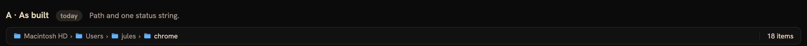
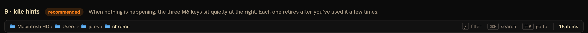
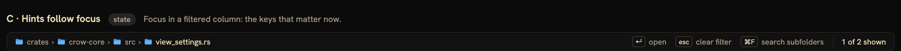
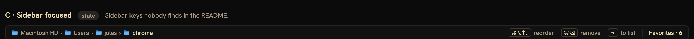
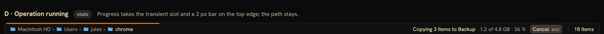
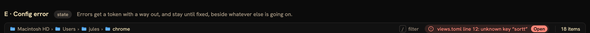

# U5 Bottom bar

Audience: an implementing agent. Follow `.claude/skills/execute-plan/SKILL.md`; read `AGENTS.md` and `docs/plans/ui-overhaul/README.md` first.
Needs: U1 merged to `main` (keys from the live keymap I1, `Keycap` I2, `with_tooltip` I3, `icons::glyph(name, size, role)` + `Assets` I5).
Branch: `ui-u5-bottom-bar` from `main`.
Progress file: `docs/plans/ui-overhaul/u5-bottom-bar.progress.md`.
PR title: "UI U5: Bottom bar with path, hints, progress, errors and counts".
Design reference: canvas boards "Bottom bar" B (idle hints), C (hints follow focus), D (operation running), E (config error); "Overhaul" and "OverhaulSearch" (assembled). https://claude.ai/artifact/EbZ7gFCy24MaccdpbSsFtE

## Why
Finding 7 of "Today, annotated": one status slot shows "18 items", Vim hints, progress, operation messages and config errors by priority, so one hides the other. A broken `views.toml` is invisible while an operation runs, and a finished operation's message replaces the item count until the next operation. Finding 8: the path bar itself is good and stays. Nothing on screen mentions `/`, ⌘F or ⌘K (the overhaul's main complaint); the bottom bar is where idle key hints go, and where the sidebar's reorder/remove keys become findable.

## Decided
- Scope (from the combined draft (since folded into these plans) §U5): three slots, **path** (unchanged look) · **transient** (hints, operation progress with Cancel esc, op messages, errors) · **counts**. "Errors no longer lose to hints: show the error token *and* drop hints." Up to three Outline-keycap hints chosen by focus; Vim mark pending keeps its text; hints drop first when the window is narrow (path wins). Progress: 2 px accent bar along the top edge plus "Copying 3 items to Backup  1.2 of 4.8 GB · 26 %  Cancel esc". Error: `error`-tinted token with the message and an **Open** button that opens the config file at fault. Counts: aria says whose count ("18 items in me"); "n of N shown" while filtering; "n selected · size" with a selection.
- Q4 (index): "`hints = "auto" | "always" | "off"` in `settings.toml`, default `auto`: each idle hint retires after its key has been used 3 times (counts in `~/.local/state/crow/`)." Focus hints (filtering, sidebar, search) never retire; `off` hides all hints and, from U9, tips.
- Q7 (index): new options flat, typed and documented so a future settings page can list them.
- Q9: U9 (tips) is included and reuses this plan's key-use counter and the `hints` setting.
- Q10: path editing stays with the bottom path bar, decided in M7. U5 does not touch segment clicks.
- Keys shown come from the live keymap (U1 I1), so the Vim layer shows Vim keys and nothing is hardcoded.
- Board conflicts, plan wins: board E shows a "/ filter" hint beside the error token; the scope says drop hints, so no hints while an error shows. Board C-filter's labels "clear filter" / "search subfolders" are superseded by the scope's "clear" / "search deeper" (as in the assembled board). The assembled boards draw the path without folder icons; "unchanged look" keeps today's icons.

## Current state

Today: path segments with icons on the left, a single status string on the right.

- Render: `CrowWindow::render_path_bar` `crates/crow-app/src/window.rs:438`, called from `render` at `window.rs:1736` and placed last in the column at `window.rs:1803`. Root `div` id `path-bar` (`window.rs:470`), `Role::Navigation`, aria "Path: a, b, c", height 28 px, `px_3`, `border_t_1` `border`, 12 px text `fg-muted`.
- Path: `crow_macos::display_components(target)` where `target` is the focused folder's cursor entry or the current folder (`window.rs:443-445`). Segments are `Role::Button` with ids `("path-segment", i)` and debug selector `path-segment-{i}`, Finder icon 14 px, `›` separator, last segment `fg`; click navigates or opens (`window.rs:487-523`). Container is `flex_1 min_w_0 overflow_hidden`, so long paths already give way.
- Status priority match `window.rs:459-468`: pending Vim hint > running op ("{label} — {done} of {total} · {percent}%") > `Operations.message` > pane error or config error (error color) > "Loading…" > "{selected} of {count} selected" (only when > 1) > "{count} items" (also "1 items"). Rendered in `div` id `status`, `Role::Status`, aria = the text (`window.rs:527-536`).
- Cancel: `cancel-operation` button, `Role::Button`, aria "Cancel operation", `surface-raised` fill, text "Cancel", calls `operations::cancel_running` (`window.rs:537-552`). Esc is `CancelOperation` in `Crow` (`actions.rs:120`, handler `window.rs:1771`).
- Operations global (`crates/crow-app/src/operations.rs`): `Running { label, progress, cancel }` (`:46`), `Operations.running` and `message: Option<(SharedString, bool /*is_error*/)>` (`:60-69`). Only one operation runs at a time; `execute` refuses a second with the error message "Another operation is still running" (`:94-97`); there is no queue. Progress arrives at most ~30×/s (`:107-113`). `finish` (`:135`) sets `message` to the error, "{label}: cancelled", or `None`. The message is otherwise only replaced by later messages (undo/redo `:178`, `:212`; sidebar `window.rs:992`; marks `window.rs:1004`, `:1013`; view defaults `window.rs:1052`), never cleared by time. Labels come from `crow_fs::ops::plan` (`crates/crow-fs/src/ops.rs:263-343`): "Copy 3 items to Backup", "Move 1 item to Trash", "Duplicate 2 items", "Delete 2 items permanently", "New Folder", "Rename “a” to “b”". `Progress { done_items, total_items, done_bytes, total_bytes, current }` (`ops.rs:96`); trash and delete plans have `total_bytes = 0`.
- Pane (`crates/crow-app/src/pane.rs`): `pending_hint()` `:998` ("Mark this folder: type a letter" / "Go to mark: type a letter"); `item_count` `:306` and `selected_count` `:310` read the **focused** folder (the focused column in column view); `current_dir` `:302` is the focused column's folder; `error` `:325` (pane `status` such as "Can't open “x”: …" `:640`, or a folder's listing error); `is_loading` `:314`. Filter state is the private `filtering: Option<Filtering>` `:235` (`Filtering { input, .. }` `:196`); the filter bar shows "n of N" itself (`render_filter` `:1635-1680`, shown = `row_count`, N = `entries().len()`). Key context `FileList [ColumnView] [vim|VimPending] [Filtered]` `:1765-1781`.
- Folder (`crates/crow-app/src/folder.rs`): `entries()` `:157` carry `Entry.size` (files only; folders are 0, from `getattrlistbulk`, `crates/crow-fs/src/listing.rs:15,189`), so a selection's file bytes are known without I/O. `selected_entries` `:253` caches by `selection_generation` (`:93`) because scanning 100k rows per frame showed in the bench; reuse that pattern.
- Sidebar (`crates/crow-app/src/sidebar.rs`): `Focusable` `:160`, context `Sidebar [vim]` `:605-622`; rows are `Header | Favorite | Recent | Volume` (`:68-74`); ⌘⌫ removes a favorite or forgets a recent (`:290-300`), ⌘⌥↑↓ reorder favorites, ⌘E ejects. `SwitchFocus` is ⇥ in `Crow` (`actions.rs:146`).
- Search (`crates/crow-app/src/search.rs`): `SearchView` `:54` with `input` (TextInput, Tab → `FocusResults`, Esc → close, Return → open `:109-117`), results focus `:61` with context `SearchResults` `:720`, `selection: Selection<PathBuf>` `:71`, `results: Vec<Row>` (no sizes). While searching the window still renders the path bar from the pane behind the search (`window.rs:1735-1745`).
- Config errors: `Ui.errors: [Option<SharedString>; 4]` indexed `SETTINGS VIEWS SIDEBAR EXCLUDE` (`crates/crow-app/src/ui.rs:48,54-57`); `config_error()` returns the first (`:91`). Messages are "<full path>: <message>" (`crow-core/src/settings.rs` `SettingsError` Display; `views.rs:351-352`, `sidebar.rs:281-282`, `exclude.rs:294-296`). `apply_theme_everywhere` also stores a non-file error under `SETTINGS` (`ui.rs:361-366`). Reload: `reload_config` `ui.rs:266` → `cx.refresh_windows()`; a broken file keeps the last good values (whole-file, not per field: `load_settings` fails the file on one bad value, `settings.rs` `bad_value_is_an_error_naming_the_file`).
- State dir: `crow_core::state_dir()` (`crates/crow-core/src/config.rs:12`: `$CROW_STATE_DIR`, `$XDG_STATE_HOME/crow`, `~/.local/state/crow`), stored as `Ui.state_dir` (`ui.rs:45`); `init_for_tests` points it at a temp `root/state` (`ui.rs:233-246`). Pattern: `Recent::load` on startup (`ui.rs:60`, main thread, startup exception), `Recent::save` → `write_atomic` in `background_spawn` (`ui.rs:378-390`).
- Settings: `Settings` struct and `DEFAULT_SETTINGS` text `crates/crow-core/src/settings.rs`; test `documented_defaults_match_code_defaults` parses the text and compares with `Default`.
- Opening files: there is no `crow_macos` open function; `Pane::open_file` spawns `/usr/bin/open` (`pane.rs:637-643`).
- Tests touching the bar: only `path_bar_segments_navigate_as_history_steps` (`window.rs:2046`) and the mark test reading `pending_hint` (`window.rs:2130`). Helpers: `open` `:1821`, `settle` `:1847` (waits for `Operations.running` to clear), `write_config` `:1885`, `use_vim` `:2093`. Nothing checks status text, progress or errors on screen.

## Target

Idle: three dim hints right of the path, then a divider and the count.


Focus hints are brighter than idle ones; while filtering the count says "1 of 2 shown" (labels per the scope: "clear", "search deeper").


Sidebar focus: reorder shows one merged cap ⌘⌥↑↓; the count names the sidebar group.


Progress replaces the hints; the path stays; the line along the top edge is the percentage.


Error pill with icon, short message and a filled Open button. (Its "/ filter" hint is dropped in this plan.)


Whole-window fit: the bar is one 30 px strip under sidebar, columns and preview.


Search mode: result hints and a result count; the path shows the selected result.

### Layout (left to right, one row)
- Bar: height **30 px** (boards; today 28, ask Q12), `px(12)`, gap 14 px between slots, `border_t_1` `border`, background `bg`, 12 px text, `relative` (for the progress line), `overflow_hidden`. Root keeps id `path-bar`; it becomes `Role::Group` aria "Status bar" containing three children (the path keeps `Role::Navigation`).
- **Path slot** `id("bar-path")`: exactly today's segments (icons, `›`, hover `surface-raised`, click behavior, ids/selectors, aria "Path: …"). `flex_1 min_w_0 overflow_hidden`. Never shrinks below the width needed for the last segment while hints are visible: hints go first (see Narrow).
- **Transient slot** `id("bar-transient")`, `flex_none`, gap 14 px. Content, in this order, each part optional:
  1. *Primary*: exactly one of, by priority: Vim mark pending text (`fg`) > running operation (progress text + Cancel) > operation message (`fg-muted`; error messages go to the error token instead) > hints. Hints only when nothing else is primary and no error token shows.
  2. *Error token*: when any error exists (config error first, then pane error, then an op error message). At most one token.
- **Counts slot** `id("bar-counts")`: `flex_none`, `pl(12)`, `border_l_1` `border`, text `fg`, `Role::Status`.

### Hints
- Hint = Outline keycap (U1 I2, 18 px, 4 px radius, 1 px `surface-raised` border, 11 px) + 5 px gap + label. Focus hints: keycap text `fg`, label `fg-muted`. Idle hints: keycap text and label `fg-subtle` (board B "dim"). Gap 14 px between hints. Each hint `id(("bar-hint", i))`, debug selector `bar-hint-{i}`. Hints are not interactive and have no role of their own; they are plain text inside the transient slot, which is `Role::Status` with aria "Keys: slash filter, Command F search, Command K go to" (spoken key names from U1 I1/I2; if U1 has no spoken form, add `keys::spoken(&KeyBinding)` here).
- Keys come from U1 I1's lookup for the action **in the focused element's context** (GPUI `Window::highest_precedence_binding_for_action`, `vendor/zed/crates/gpui/src/window.rs:7193`), formatted as macOS symbols. A hint whose action has no binding in the current context is omitted (never a hardcoded key).
- Sets, by `BarFocus` (new enum, computed each render in `CrowWindow::render`):

| `BarFocus` | When | Hints (action → label) | Retire in `auto` |
| --- | --- | --- | --- |
| `List` | pane list or column has focus, no filter | `StartFilter` → "filter", `ShowSearch` → "search", `ShowCommandPalette` → "go to" | yes, each on its own |
| `FilterField` | the `/` field has focus | `text_input::Confirm` → "open", `text_input::Cancel` → "clear", `ShowSearch` → "search deeper" | no |
| `ListFiltered` | filter open, list focused | `OpenSelection` → "open" (shows ⌘O from the keymap; Return renames here), `ClearFilter` → "clear", `ShowSearch` → "search deeper" | no |
| `Sidebar` | sidebar focused | `MoveFavoriteUp`+`MoveFavoriteDown` → "reorder" (one cap: shared modifiers once, then both keys: ⌘⌥↑↓), `RemoveFromSidebar` → "remove", `SwitchFocus` → "to list" | no |
| `SearchResults` | search results focused | `OpenSelection` → "open", `SearchReveal` → "reveal", `QuickLook` → "Quick Look" | no |
| `SearchField` | search field focused | ask Q5 (recommended: `text_input::Confirm` → "open", `text_input::Complete` → "results", `text_input::Cancel` → "done") | no |
| `Overlay` | palette, Go to Folder, sheet, Why, theme picker open | none (ask Q7) | — |

- Vim layer: same actions; whatever the Vim context binds is shown (today the same keys for these actions). Mark pending: the pending text replaces hints (it is primary).
- `hints` setting: `auto` → idle hints whose key count ≥ 3 are hidden individually (`crow_core::idle_hint_visible`); focus hints always show. `always` → all show, nothing retires. `off` → no hints of any kind (pending text, progress, messages, errors and counts are not hints and still show). Counting continues in every mode.
- Narrow: hints are dropped from the right end first, all-or-nothing per hint, until the path's natural width plus the rest fits; the path only truncates once no hints remain. Pure function `fit_hints(bar: Pixels, path: Pixels, fixed: Pixels, hints: &[Pixels]) -> usize`.

### Progress (board D)
- Line: `absolute top_0 left_0 h(px(2.)) bg(accent)`, width = fraction of the bar width (`relative(f)`), id `bar-progress`. Fraction = `done_bytes / total_bytes`, or `done_items / total_items` when `total_bytes == 0`.
- Text: "{running label}" in `fg`, two spaces of gap (10 px), then `fg-muted` "{done} of {total} · {p} %": bytes as "1.2 of 4.8 GB" (one unit, the total's, via a new `crow_fs::human_size_pair(done, total)` next to `human_size` `crates/crow-fs/src/lib.rs:17`), or "{done_items} of {total_items} items" when there are no bytes. Running label: "Copy" → "Copying", "Move" → "Moving", "Duplicate" → "Duplicating", "Delete" → "Deleting", others unchanged (`operations::running_label`). Example: "Moving 2 items to Trash  1 of 2 items · 50 %".
- Cancel: 20 px tall, `px(6)`, 5 px radius, `surface-raised` fill, "Cancel" `fg` + 6 px + `CancelOperation`'s key as text keycap `fg-muted` ("esc"); hover `color_alpha(fg, 0x14)` over the fill; `Role::Button`, aria "Cancel operation, Escape", tooltip "Cancel operation" + key (U1 I3), id `bar-cancel` (rename from `cancel-operation`).
- `Role::ProgressIndicator` on the text group, aria label "Copying 3 items to Backup", `aria_numeric_value(p)`, min 0, max 100.
- Every window shows the same running operation (it is global); one op at a time. A refused second op shows its error token beside the progress.

### Error token (board E)
- Pill: height 20 px, radius 10 px, `pl(8) pr(4)`, gap 8 px, fill `color_alpha(error, 0x24)` (new named helper `style::error_soft`), text `error`, alert icon 13 px (`icon("alert-circle", 13, "error")`, add the SVG to U1's asset set with its license note). Message truncated with an ellipsis at max 420 px; full text in aria label and tooltip. id `bar-error`.
- Config errors show "<file name>: <message>" (the config dir prefix stripped; line numbers per Q9) and an **Open** button: 16 px, radius 8, `px(6)`, fill `error`, text `bg` 11 px semibold, `Role::Button`, aria "Open views.toml", id `bar-error-open`. Click opens the file at fault (see I6). Pane and operation errors show the token without Open.
- The token stays until the cause is fixed (config) or replaced (op/pane errors, see Q2). Hints are not shown while it shows.
- Role: token `Role::Group` aria "Error: {message}", inside the `Role::Status` transient slot so VoiceOver announces it once when it appears.

### Counts
Exact strings (recommended grammar; Q3 confirms):

| State | Text | Aria label |
| --- | --- | --- |
| loading, nothing listed yet | "Loading…" | "Loading {folder}" |
| default | "18 items" / "1 item" | "18 items in me" |
| one file selected | "18 items · 1.2 KB" | "18 items in me, selected item 1.2 KB" |
| ≥ 2 selected | "3 selected · 4.2 MB" | "3 of 18 selected in me, 4.2 MB" |
| filtering | "1 of 2 shown" (+ " · 1.2 KB" or " · 3 selected · 4.2 MB") | "1 of 2 shown in src, …" |
| sidebar focused | "Favorites · 6" (group of the cursor row, its row count) | "Favorites, 6 items" |
| search | "44 results"; with a selection "1 of 44 selected" | "1 of 44 results selected" |

- Folder whose count it is = `pane.current_dir()` (the focused column in column view). Tooltip (U1 I3) on the counts slot repeats the aria text (board note: "Say so on hover").
- Size = sum of `Entry.size` of the selected files; folders add nothing (sizes are not known without I/O); a selection of only folders shows no size. Cached per `selection_generation` (new `Folder::selected_bytes() -> (u64, usize /*folders*/)`).

### Focus order and keyboard
The bar takes no focus; its only interactive parts are path segments, Cancel and Open, all mouse targets (as today). No new key bindings. Esc still cancels a running operation through `CancelOperation`.

### Themes, views, tabs
Roles only: `bg border fg fg-muted fg-subtle surface-raised accent error` plus `error_soft`. Light and dark come from the theme. List and column views share the bar; the active tab's pane feeds it; switching tabs updates hints and counts on the next render.

### Performance
The bar renders with the window. Per frame it may: look up ≤ 4 bindings (dispatch-tree lookups), shape ≤ 3 short hint strings and the path segments for `fit_hints` (GPUI's line layout cache), and read cached counts. No per-frame scan of entries or selection. Bench must not regress (warm first paint, scroll p99 on the 100k fixture).

## Items

### I1 `hints` setting and the usage model (crow-core)
- *Where*: `crates/crow-core/src/settings.rs`, new `crates/crow-core/src/usage.rs`, `lib.rs` exports.
- *Change*:
  - `#[derive(Clone, Copy, Debug, Default, PartialEq, Eq, Deserialize)] #[serde(rename_all = "lowercase")] pub enum HintsMode { #[default] Auto, Always, Off }`; `Settings.hints: HintsMode`.
  - `DEFAULT_SETTINGS`, after the `keymap` block:
    ```toml
    # Key hints in the bottom bar: "auto" (default), "always" or "off".
    # "auto" retires each idle hint (/ filter, Cmd-F search, Cmd-K go to) after you
    # have used its key 3 times; hints for the focused filter, sidebar or search stay.
    # "off" hides every hint and tip.
    hints = "auto"
    ```
  - `usage.rs`: `#[derive(Clone, Debug, Default, PartialEq, Serialize, Deserialize)] pub struct Usage { counts: BTreeMap<String, u32> }` with `load(path) -> Usage` (missing or bad file → default, like `Recent::load`), `save(&self, path) -> io::Result<()>` (`write_atomic`), `record(&mut self, key: &str) -> bool` (adds 1 up to `USAGE_CAP = 99`; returns whether it changed, so callers skip saving once capped), `count(&self, key) -> u32`. `pub const RETIRE_AFTER: u32 = 3;` `pub fn idle_hint_visible(mode: HintsMode, uses: u32) -> bool` (`Auto` → `uses < RETIRE_AFTER`, `Always` → true, `Off` → false). Keys are GPUI action names (`"crow::StartFilter"`); the model doesn't care. File name constant `USAGE_FILE = "usage.json"`.
- *Edge cases*: `hints = "sometimes"` fails the whole `settings.toml` like any bad value (last good settings kept, error token shows). A missing `hints` line gives `Auto`. A corrupt `usage.json` reads as empty (counts restart; never an error token: state, not config).
- *Tests* (crow-core): `documented_defaults_match_code_defaults` still passes; `hints_values_parse` ("always", "off"; "sometimes" is an error naming `settings.toml`); `usage_counts_and_caps` (record ×100 → 99, the 100th returns false); `usage_round_trips_through_a_file`; `usage_bad_file_is_empty`; `idle_hint_visibility_per_mode` (table).
- *Done when*: crow-core tests pass; `settings.toml` written on first launch contains the `hints` block.

### I2 Key-use recorder (app)
- *Where*: new `crates/crow-app/src/usage.rs`; `ui.rs` `init` and `init_for_tests`.
- *Change*: `pub struct UsageState { usage: crow_core::Usage, path: PathBuf }` as a `Global`. `pub fn init(cx: &mut App)` loads `Ui.state_dir/usage.json` (startup read, allowed). One recording helper, **`usage::record(action: &dyn Action, cx: &mut App)`**, called at the top of each tracked action's handler, so a use counts however the action ran (key, menu, palette): `Pane::start_filter` (`pane.rs:652`, also reached from the palette via `Pane::run_command` `pane.rs:432`; count only when it opens the field, not when it re-focuses an open one), `CrowWindow::show_search` (`window.rs:1267`), `CrowWindow::show_palette` (`window.rs:1340`, action `ShowCommandPalette`). U2's menu items dispatch the same actions, so they reach the same handlers. The key is `action.name()` (e.g. `"crow::StartFilter"`). When `Usage::record` returns true, save a clone in `background_spawn` (same shape as `refresh_recent` `ui.rs:378-390`) and `cx.refresh_windows()`. Read: **`usage::uses(action: &dyn Action, cx: &App) -> u32`**. Also `usage::record_key(key: &str, cx)` / `usage::count_key(key: &str, cx)` for non-action keys (U9's dismissed tips). `#[cfg(test)] pub fn reload_from_disk(cx)` for the persistence test. Call `usage::init` at the end of `ui::init` and `ui::init_for_tests` (each test gets its temp state dir).
  - Why handlers, not a central observer: `cx.observe_keystrokes` (`vendor/zed/crates/gpui/src/app.rs:2810`) is the one central hook, but it only sees keystrokes that resolved to an action (no menu clicks, no palette runs, since the palette calls `run_command` directly, `window.rs:1426-1459`). The orchestrator wants every trigger counted (Q13 confirms against Q4's wording "its key has been used"). If the user answers Q13 "keys only", switch `record` to an `observe_keystrokes` subscription filtered by a `TRACKED` name list and drop the handler calls; `uses` stays the same.
- *Edge cases*: two windows share the global, so counts are per user, not per window. Save failures log a warning only. Vim and Finder layers count the same action names. A new tracked action = one `usage::record` call in its handler.
- *Tests* (`window.rs`): `pressing_slash_counts_filter_uses` (`/` then `escape` ×3 → `uses(&StartFilter) == 3`; `run_until_parked`, then `Usage::load(state/usage.json).count("crow::StartFilter") == 3`); `palette_and_dispatch_count_too` (run "Filter" from the palette `cmd-k` `>` … `enter`, and `window.dispatch_action(ShowSearch)` → each counted once); `refocusing_an_open_filter_does_not_count`.
- *Done when*: counts update from real keystrokes and survive a reload from disk.

### I3 Three slots and the counts
- *Where*: new `crates/crow-app/src/bottom_bar.rs` (state + render helpers); `window.rs` `render_path_bar` (becomes `render_bottom_bar(&self, window, cx)`), `render` `:1736`; `pane.rs`, `folder.rs`, `search.rs`, `sidebar.rs` accessors; `ui.rs` errors.
- *Change*:
  - `pub struct BarState { pub primary: Primary, pub error: Option<BarError>, pub count: Count }`, `pub enum Primary { None, Pending(&'static str), Running(RunningView), Message(SharedString), Hints(Vec<Hint>) }`, `pub struct BarError { pub text: SharedString, pub file: Option<PathBuf> }`, `pub struct Count { pub text: SharedString, pub spoken: SharedString }`. `CrowWindow::bar_state(&self, window, cx) -> BarState` builds it; render reads only `BarState` (tests read it too).
  - Error source order: config error (with file) > `pane.error()` > `Operations.message` when `is_error`. Non-error message → `Primary::Message`.
  - Accessors: `Pane::is_filtering()`, `Pane::filter_focus(cx) -> Option<FocusHandle>`, `Pane::selected_bytes(cx)`, `Pane::shown_count(cx)` (focused folder `row_count`); `Folder::selected_bytes()` cached by `selection_generation`; `SearchView::{result_count, selected_count, input_focused(window, cx)}`; `Sidebar::cursor_group(cx) -> Option<(String, usize)>` ("Favorites" group name, "Recent", "Locations" and their row counts); `Ui::config_error_file() -> Option<(SharedString, PathBuf)>` mapping the index to `config_dir.join({settings,views,sidebar,exclude}.toml)` and stripping `config_dir` from the message.
  - Render path slot unchanged (move the code), transient slot with message/pending/error text (progress and hints in I4/I5 may first render as plain text), counts slot per the table in Target (`crow_fs::human_size` for sizes; "1 item" singular).
- *Edge cases*: column view with a file column focused (preview) → counts of the focused folder as today. A folder listing error shows as the error token and the count still shows "0 items". Two tabs: only the active pane is read. Search with 0 results and still searching: "Searching…" (aria "Searching"). Sidebar with Recent hidden: group list from `rows()` as rendered.
- *Tests*: `counts_name_the_focused_folder` (column view, focus a column → `count.spoken == "N items in alpha"`); `counts_show_filter_and_selection` (`/` "a" → "1 of 3 shown"; escape, cmd-a → "3 selected · 6 bytes" with `notes.txt` 6 bytes; folders add nothing); `one_item_is_singular`; `error_and_running_operation_show_together` (inject `Operations.running = Some(Running { label: "Copy 1 item to x", progress: …, cancel })` with `cx.update`, then `write_config(views.toml, "[defaults]\nsort = \"colour\"\n")` → `primary` is `Running` and `error.file` ends with `views.toml`; reset `running = None` before `settle`); `message_does_not_hide_the_count`.
- *Done when*: the old priority match is gone, the bar shows three slots, existing path-bar test passes unchanged.

### I4 Hints that follow focus and retire

Idle hints at `fg-subtle`; focus hints (C) brighter.
- *Where*: `bottom_bar.rs` (`BarFocus`, `hint_set`, `render_hints`), `window.rs` `bar_state`.
- *Change*: `pub enum BarFocus { List, FilterField, ListFiltered, Sidebar, SearchResults, SearchField, Overlay }` from: any overlay open (`go_to`, `sheet`, `why`, `picker`, `palette`) → `Overlay`; `search` open → `SearchField` if its input is focused else `SearchResults`; sidebar focus handle `is_focused` → `Sidebar`; pane filtering → `FilterField` if the filter input is focused else `ListFiltered`; else `List`. `fn hint_set(focus) -> &'static [(HintAction, &'static str, bool /*idle*/)]` per the Target table. `Hint { keys: SharedString /*from U1 I1*/, spoken: SharedString, label: &'static str, idle: bool }`; omitted when unbound in context; idle ones filtered by `idle_hint_visible(settings.hints, usage::uses(..))`; all dropped when `hints = off` or an error token shows. Merged reorder cap: format both bindings, keep the shared modifier prefix once (`⌘⌥` + `↑` + `↓`). Render with U1's `Keycap::Outline`.
- *Edge cases*: Vim `VimPending` → `Primary::Pending` wins. Focus inside a rename field (`TextInput` in a row) → `List` hints would be wrong: treat a pane rename as `Overlay` (no hints) via `Pane::is_renaming()` (`pane.rs:1882`). All idle hints retired → empty slot, no gap left behind. `hints` changed in `settings.toml` applies on the next render (reload already refreshes windows).
- *Tests* (keystroke tests, read `bar_state` labels): `hints_follow_focus` (start: ["filter","search","go to"] with keys ["/","⌘F","⌘K"]; `/` → ["open","clear","search deeper"] with "↵","esc"; `escape`, `tab` → sidebar ["reorder","remove","to list"] with "⌘⌥↑↓","⌘⌫","⇥"; `tab`, `cmd-f`, type "a", `tab` → ["open","reveal","Quick Look"] with "↵","⌘R","Space"); `vim_layer_hints_use_the_vim_context` (`use_vim`; sidebar and list sets resolve; `m` → `Pending` text, no hints); `idle_hints_retire_after_three_uses` (`/` + `escape` ×3 → "filter" gone, "search" and "go to" remain; focus hints during filtering still there); `retired_hints_stay_retired_after_reload` (`usage::reload_from_disk`, and `write_config(settings.toml, "theme = \"system\"\n")` → still gone); `hints_always_never_retire`; `hints_off_hides_every_hint` (and the Vim pending text still shows); `error_drops_hints` (broken `views.toml` → no hints, token present); `overlay_hides_hints` (cmd-k → none).
- *Done when*: all above pass in both layers.

### I5 Progress and Cancel

Accent line on the top edge, progress text, Cancel with esc.
- *Where*: `bottom_bar.rs` `render_running`, `operations.rs` (`running_label`), `crow-fs/src/lib.rs` (`human_size_pair`).
- *Change*: `RunningView { label, detail, fraction: f32, percent: u8 }` built from `Running`; render line, text and Cancel per Target; Cancel click → `operations::cancel_running`. Remove the old `cancel-operation` element.
- *Edge cases*: `total_items == 0` → fraction 0, detail omitted. Done bytes > total (files grew) → clamp to 100 %. Undo/redo have no `Running` (`operations.rs:165-219`) and show nothing until their message. 30 updates/s: aria value changes are throttled to whole percents (only rebuild the label when `percent` changes).
- *Tests*: unit `running_label_uses_the_ing_form` (all request labels from `ops::plan`); unit `human_size_pair_shares_the_total_unit` ("1.2 of 4.8 GB", "512 bytes of 2.0 KB"); keystroke-free `cancel_button_sets_the_cancel_flag` (inject `Running`, `debug_bounds("bar-cancel")`, `simulate_click` → flag true); `escape_cancels_from_the_list` (inject, `escape` → flag true; already Esc's behavior, now asserted); `trash_progress_counts_items` (`total_bytes = 0` → detail "1 of 2 items").
- *Done when*: hand check "Progress and cancel" passes with the new look.

### I6 Error token with Open

Error pill with Open; stays until the file is fixed.
- *Where*: `bottom_bar.rs` `render_error`; `ui.rs` (`config_error_file`); `crates/crow-macos/src/files.rs` (new `open_path`); `style.rs` (`error_soft`); `assets/icons/alert-circle.svg`.
- *Change*: `crow_macos::open_path(path: &Path, as_text: bool) -> io::Result<()>` that runs `/usr/bin/open [-t] <path>` and waits for its status (call it inside `background_spawn`; report failure as `Operations.message` error "Can't open views.toml: …"). Open uses the default app for `.toml`, falling back to `-t` (default text editor) when `open` exits non-zero (Q10). In tests, `bottom_bar::open_config` records the path in a test-only global instead of spawning.
- *Edge cases*: the file was deleted after the error → Open recreates nothing; `open` fails → message. Theme "apply to all apps" error is not a file problem (Q11). Several broken files: the first in `SETTINGS, VIEWS, SIDEBAR, EXCLUDE` order shows; fixing it reveals the next.
- *Tests*: `config_error_token_opens_the_broken_file` (broken `sidebar.toml` → `error.file` = `config/sidebar.toml`, text starts with "sidebar.toml:"; click `bar-error-open` → recorded path); `fixing_the_file_clears_the_token` (write a good file → `error == None`, hints back); `pane_error_has_no_open_button` (navigate to an unreadable folder: `chmod 000` temp dir → token without `file`).
- *Done when*: tests pass; VoiceOver reads "Error: …" and "Open sidebar.toml, button" (hand check).

### I7 Narrow window drops hints first
- *Where*: `bottom_bar.rs` `fit_hints`, `window.rs` `bar_state`.
- *Change*: measure each path segment's text with `window.text_system().layout_line(..)` (`vendor/zed/crates/gpui/src/text_system.rs:852`) plus icon 14 px, padding and separators; measure hints, counts and primary the same way; the bar spans the full window width (`window.rs:1803`), so `bar = window.viewport_size().width − 24 px padding`. Keep the first `fit_hints(..)` hints.
- *Edge cases*: font size from `settings.font_size` (12 px bar text is fixed today; keep fixed). Very long path with no hints: path truncates as today.
- *Tests*: unit `fit_hints_drops_from_the_end` (table); `narrow_window_drops_hints_before_the_path` (`cx.simulate_resize(size(px(560.), px(500.)))` → `bar_state` hints empty, `debug_bounds("path-segment-0")` some; back to 1200 → 3 hints). If the test platform's text system gives zero widths, keep only the unit test and mark the window test "needs hand check" in the progress file (verify first).
- *Done when*: shrinking the window by hand removes hints right to left before the path clips.

## Seams with other U plans
- **U1** (required): keys lookup (I1), `Keycap::Outline` (I2), `with_tooltip` (I3), `icons::glyph(name, size, role)` + `Assets` (I5). Use U1's actual names from its merged code and progress file. If U1 lacks a spoken-key form, add it in U5 next to U1's lookup, not a second formatter. Add `alert-circle.svg` to U1's icon folder with its source and license.
- **U4** (filter): U4 moves the filter field into the column and adds the "search deeper ⌘F" footer; U5 only reads `Pane::is_filtering()` and the filter input's focus handle. If U4 lands first and renames `filtering`, adapt the accessor; don't duplicate the field's own "2 of 9".
- **U3/U6** (search): U6 adds a results footer summary; the bar's count stays ("1 of 44 selected"). If Q8 is yes, the path shows the selected result; U6 may later move that into its preview. U3's ⌘F field sits in the toolbar; `SearchField` focus detection must use whatever input U3 focuses.
- **U2** (menus): menu items dispatch the same actions, so they count through the handler calls (I2).
- **U8** (sidebar): `Sidebar::cursor_group` must survive U8's row changes; U8 owns sidebar visuals.
- **U9** (tips) plugs in here. Names, as the orchestrator asked: `crow_core::HintsMode { Auto, Always, Off }` in `Settings.hints` (same as U9 assumes); the read is **`usage::uses(&dyn Action, &App) -> u32`** in module `crate::usage` (not `hints::uses`: the module holds counts that both hints and tips read, and mirrors crow-core `usage.rs`); the recording helper is **`usage::record(&dyn Action, &mut App)`**, called inside the handlers of `StartFilter`, `ShowSearch` and `ShowCommandPalette` (the palette action's real name), so key, menu and palette uses all count. U9 adds a `usage::record` call to any other handler it needs, reads `uses(..) > 0` for "never after the key has been used", stores dismissed tips with `usage::record_key("tip:<id>", cx)` / `usage::count_key`, and hides every tip when `settings.hints == HintsMode::Off`. Tips render bottom right above this bar, not inside it.
- **U10**: compares the bar with both assembled boards.
- Leave alone: path segment click behavior and path editing (M7, Q10).

## Risks and things to measure first
- Recording in handlers: make sure the palette's filter command really goes through `Pane::start_filter` (it does today, `pane.rs:432`) and that U2/U7 don't add paths that bypass the handlers.
- Binding lookup per render uses the last rendered frame's dispatch tree (`window.rs:7185-7200`); right after a focus change the first frame may show the previous context's keys. Check by hand; if visible, compute hints in a `cx.on_next_frame` or after `window.focused()` changes.
- Text measuring per frame for `fit_hints`; check the bench and a profile of `render` while scrolling. If it costs, cache widths by (text, font size).
- VoiceOver chatter: `Role::Status` content changing 30×/s during progress. Throttle aria to percent changes; hand-check.
- Bar height change 28 → 30 px reduces the list by 2 px; bench numbers must stay within noise vs `main`.

## Questions to ASK
1. (Board vs scope, informational) Board E shows "/ filter" beside the error; the scope drops hints while an error shows. Recommended: follow the scope.
2. Op message lifetime: today a message ("Move 1 item to Trash: cancelled", "Marked as j") stays until the next one. Recommended: info messages clear after 5 s; op error messages become the error token and clear when the next operation starts or on the next navigation. Why: with separate slots a stale message would otherwise block hints forever.
3. Count grammar: confirm the Target counts table, in particular showing a single selected file's size ("18 items · 1.2 KB", as in the assembled filter board) and "1 of 44 selected" in search. Recommended: yes as tabled.
4. Folder sizes: selected folders add nothing (their size needs a disk walk). Recommended: files only, no "+ folders" marker; a folders-only selection shows no size.
5. Search field focused (not results): ↵ opens, ⌘R/Space don't work there. Recommended hints: "↵ open · ⇥ results · esc done".
6. Sidebar hints by row: reorder only works on favorites, remove on favorites and Recent, ⌘E ejects disks. Recommended: drop hints that do nothing on the cursor row and show "⌘E eject" on a disk.
7. Overlay open (palette, Go to, sheets, Why, theme picker): recommended no hints (overlays have their own key footers after U7/U1).
8. Path in search mode: the assembled board shows the selected result's path. Recommended: yes, in U5 (small: use the search selection's path when search is open).
9. Error text: show the file name instead of the full path, and add "line N" where the TOML parser gives a span (crow-core loaders). Recommended: both; "views.toml line 12: …".
10. Open button: default app for `.toml`, falling back to the default text editor (`open -t`)? Recommended: yes.
11. "Apply to All Apps" failures are stored as a `settings.toml` error, so Open would open the wrong thing. Recommended: show them as an operation error message instead.
12. Bar height 30 px as on the boards (today 28). Recommended: 30.
13. Q4 says an idle hint retires after "its key has been used 3 times". Should uses through the menu bar (U2) and the palette count too? Recommended: yes, count every use of the action (one place per action, and someone who runs Filter from a menu has found it); the orchestrator's U9 plan assumes this. If "keys only", I2 switches to a keystroke observer (described there).

## Hand checks (add to `docs/testing.md`)
| Check | How |
| --- | --- |
| Bottom bar hints | Fresh state dir (`CROW_STATE_DIR=$(mktemp -d)`): idle hints `/ filter · ⌘F search · ⌘K go to`. Press `/` and Esc three times: "filter" disappears, the others stay; relaunch: still gone. Focus the sidebar, a filter, search results: the hint set changes each time. `hints = "always"` brings them back; `"off"` hides all. Vim layer: same, and `m` shows "Mark this folder…". |
| Bottom bar progress | Copy a large folder to another disk: accent line on the bar's top edge, "Copying … · n %", Cancel esc; the path and count stay. Esc or Cancel stops it. |
| Bottom bar error | Break `views.toml` while an operation runs: progress and the red token show together, hints are gone; Open opens `views.toml`; fixing it removes the token. |
| Bottom bar counts | Column view: hover the count, the tooltip names the focused column's folder. Filter: "n of N shown". Select several files: "n selected · size". |
| Narrow window | Shrink the window: hints disappear right to left before the path is cut. |
| VoiceOver | Cmd-F5: the count reads "18 items in me"; an error reads "Error: …" once; Open and Cancel read as buttons. |

## Finish
- README: Keys (bottom bar hints, the `hints` setting), Configuration table row for `settings.toml` (add "key hints"), and that key-use counts live in `~/.local/state/crow/usage.json` next to `recent.json`.
- `docs/testing.md`: the keystroke-test list gains "the bottom bar (hints by focus, retiring hints, progress with errors, counts)"; add the hand rows above; replace the old "Progress and cancel" row's "status line" wording.
- Bench vs `main` (`--bench target/fixture-100k`; this plan is in the index's bench list); record numbers in the progress file.
- `cargo fmt --check`, `cargo clippy --workspace --all-targets -- -D warnings`, `cargo test --workspace`, `./scripts/bundle.sh`; push; open the PR (don't merge); progress file state "PR open".
