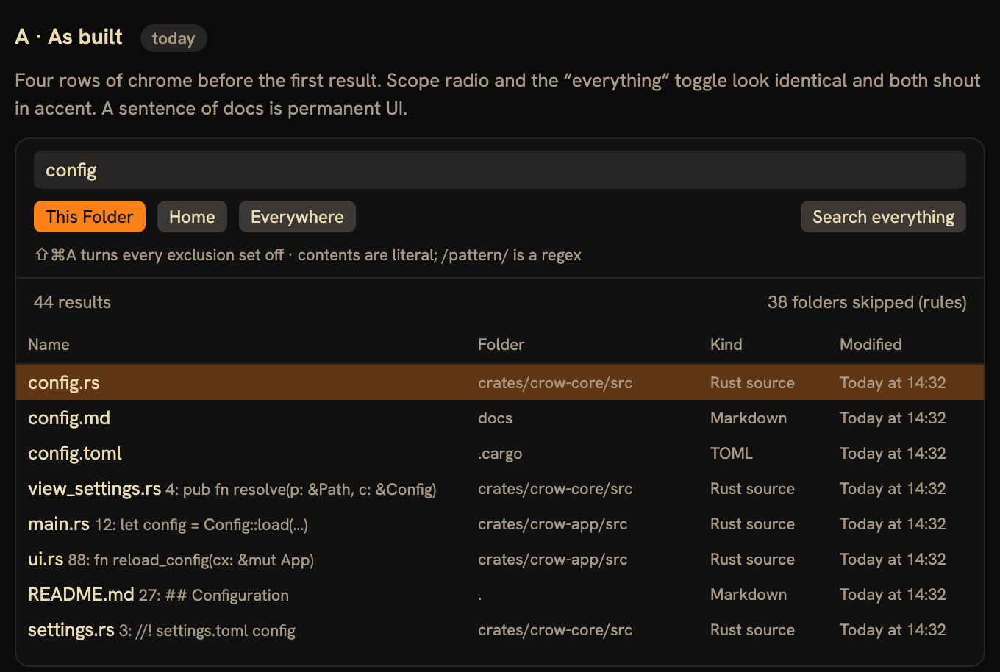
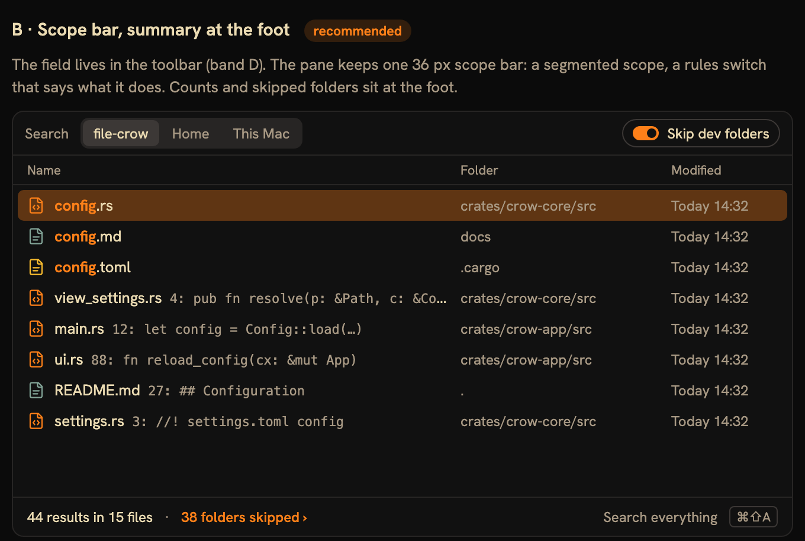
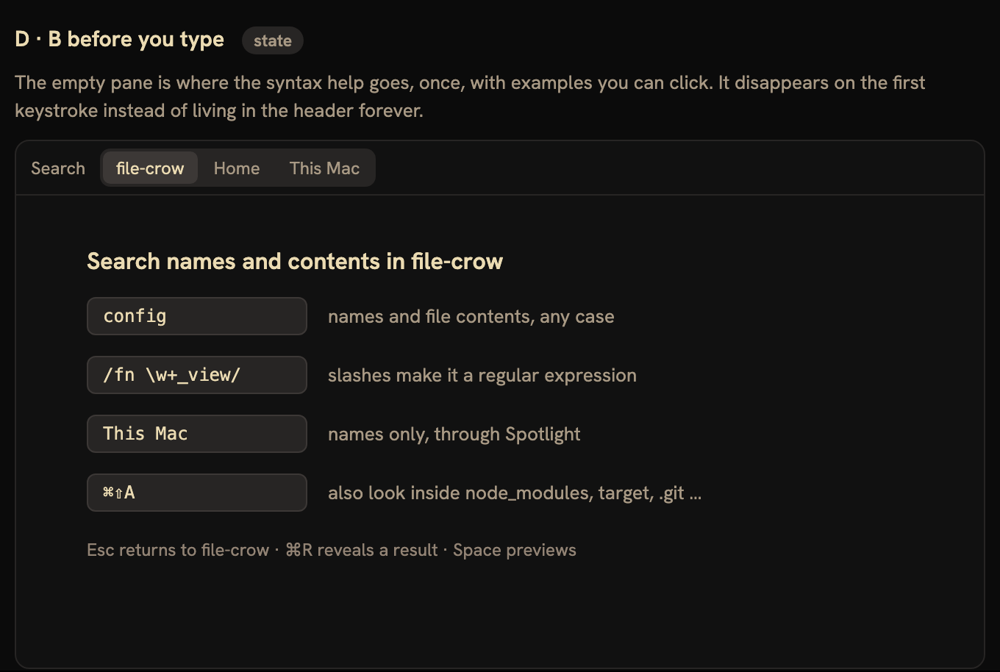
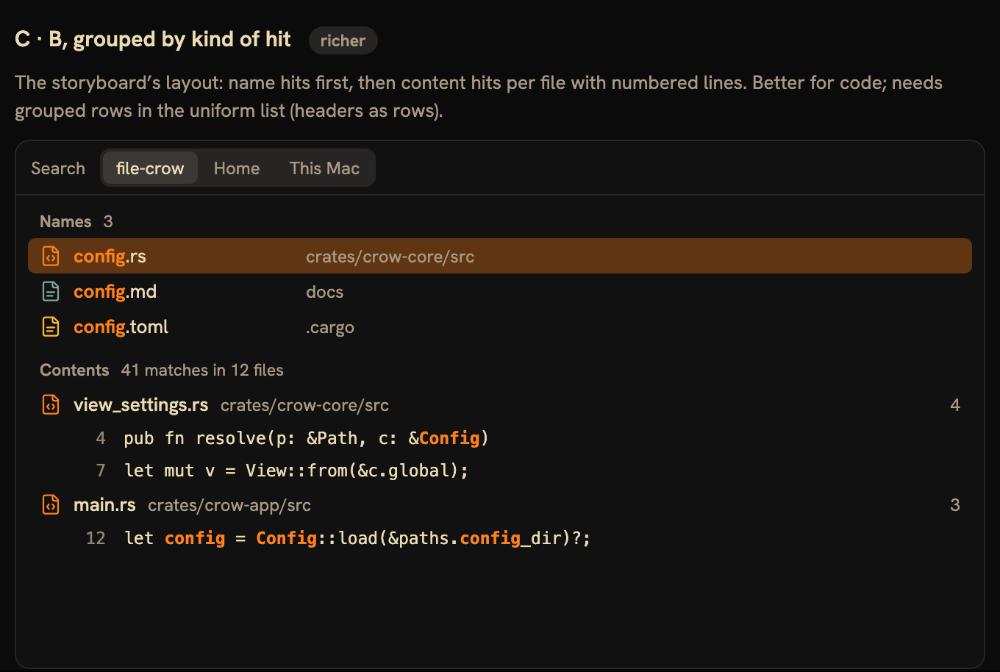

# U6 Search panel

Audience: an implementing agent. Follow `.claude/skills/execute-plan/SKILL.md`; read `AGENTS.md` and `docs/plans/ui-overhaul/README.md` first.
Needs: U3 merged to `main` (U3 moves the query field and All / Names / Contents into the toolbar; the panel no longer owns the input). U3 itself needs U1, so U1's parts are available too.
Branch: `ui-u6-search-panel` from `main`.
Progress file: `docs/plans/ui-overhaul/u6-search-panel.progress.md`.
PR title: "UI U6: Search scope bar, footer summary, idle examples and preview".
Design reference: canvas boards "Search panel" variants **B** (scope bar, summary at the foot) and **D** (B before you type); "Overhaul, search mode" (assembled). Variant C (grouped by kind of hit) was not picked. https://claude.ai/artifact/EbZ7gFCy24MaccdpbSsFtE

## Why
"Today, annotated" (the Current board, "Not on screen, from the code") says of search: three stacked header rows (field, accent-filled scope pills, a documentation sentence), then a summary row, then results. Four rows of chrome come before the first result. The scope radio and the Search everything toggle look the same and both fill with accent, so a toggle reads like a fourth scope. A sentence of syntax help is permanent UI. Skipped folders hide in a muted summary string. The Kind column takes 110 px and says little the icon doesn't. While searching, the preview pane disappears (finding 6, "dead quarter", is the same problem in column view), so you can't see what a hit is without opening it.

## Decided
From the index (`docs/plans/ui-overhaul/README.md`, answers 2026-11-12):
- Q3: "Search field gets **All / Names / Contents**, default All (= M6 behavior). Names skips reading contents; Contents hides name-only hits." U3 builds it; U6 only reads its effect (counts, empty states).
- Q5: "Rename the Everywhere scope to **This Mac**." Update README and `docs/testing.md` wording.
- Q6: "Drop the Kind column from search results." `Row.kind` and its `kind_name` call go.
- Q8: "Edit ▸ Find Everything… (⇧⌘A) with no search open: open search in the current folder with every rule set off." U2 builds the menu item; U6 keeps the `everything` flag and the `SearchEverything` action working (see Seams).

From the combined draft (since folded into these plans) § U6 (the agreed scope; this plan expands it):
- Header becomes one 36–38 px scope bar: "Search" label, segmented **<current folder name> / Home / This Mac**, and on the right a **switch** "Skip <enabled set names> folders". The switch is today's Search everything toggle, inverted; ⇧⌘A still flips it. Hidden for This Mac and replaced by "Spotlight: indexed volumes only".
- No permanent help sentence and no separate summary row. Footer bar: "n results in m files · k folders skipped ›" (accent, opens the existing skipped list) · "Search everything ⇧⌘A".
- Rows: file icon, name with the match highlighted, folder, modified; content hits show the line number and the line under the name.
- Idle (empty query): "Search names and contents in <scope>" and four clickable examples that fill the field: `config`, `/fn \w+_view/`, This Mac, ⇧⌘A; and "Esc returns to <folder> · ⌘R reveals · Space previews".
- Preview: in search mode show the window's right preview pane for the selected result. Content hits scroll the preview to the hit line if the text preview supports it; otherwise show the file's head.

Inherited constraints: theme roles only; U1 parts by name (`Keycap` Outline/Key/Text, keys from the live keymap I1, `with_tooltip` I3, SVG `glyph(name, size, role)` I5 (not to be confused with `style::icon`, the Finder file icon used by rows), `active_selection` / `inactive_selection` / `cursor_ring` I6). No disk I/O on the main thread. Every interactive element has a role and an aria label. Every new key behavior gets a keystroke test. Animations out of scope.

## Current state
As built (variant A):

Four rows of chrome; "This Folder" and "Search everything" share one pill style; content hits run inline after the name.

Line numbers are on branch `m6-filter-palette-search` (= PR #7). U1 and U3 will have moved some of this; re-read before editing.

**After U3** (from `docs/plans/ui-overhaul/u3-top-band.md`, I3, I4 and Seams): `SearchView` **keeps owning the `TextInput`** and renders it, with the All / Names / Contents control and Done, in a new `pub fn render_band(&mut self, window, cx) -> AnyElement` that the window places in the toolbar. The band's field subtree carries `key_context("Search")` with the `SearchEverything` and `CloseSearch` handlers, so ⇧⌘A works from the field. U3 also adds `Match { All, Names, Contents }` with `set_match` / `effective_match` (Names forced for Spotlight), `Scope::label(&self, folder_name)` for the placeholder ("Search <folder>", "Search Home", "Search Everywhere"), `input.set_placeholder` in `set_scope`, and the window entry point `open_search(SearchStart { folder, query, everything })` (U2's Find Everything and U4's ⌘F escalation call it). After U3, `SearchView::render` still shows `render_header` **minus the input** (scope buttons, Search everything button, help sentence), then `render_summary`, `render_results`, `render_skipped`. **U6 replaces exactly those** and must not move the input or the match control out of `render_band`.

**Dead Vim bindings** (found by U3, verified): `actions.rs:206–207` bind `j`/`k` in `SearchResults && vim`, but the results list sets a plain `key_context("SearchResults")` (`search.rs:720`) and never adds `vim`, so they never fire. The palette does it right: it builds `"Sheet Palette"` and appends `" vim"` when `ui.settings.keymap == KeymapLayer::Vim` (`window.rs:1471–1476`). No search test covers Vim, yet `docs/testing.md:27–28` says the search panel's keystroke tests cover "the Vim layer".

**State** — `crates/crow-app/src/search.rs`
- `Scope { Folder, Home, Everywhere }` at 36–41. `Everywhere` searches names through Spotlight; `Home | Everywhere` map to `home` as the walk root at 229–232 (the Everywhere arm is unreachable there because 204 branches first).
- `SearchView` fields at 54–77: `folder`, `home`, `show_hidden`, `scope`, `everything` (true = every rule set off), `input: Entity<TextInput>`, `focus` (results list), `results: Vec<Row>`, `by_path` (dedupe), `skipped: Vec<(PathBuf, String)>`, `error: Option<SharedString>`, `searching`, `capped`, `cancel`, `generation`, `exclude_generation`, `selection`, `cursor`, `scroll`, `show_skipped`.
- `Row` at 79–90: `path, name, folder (abbreviate_home of the parent), is_dir, is_package, kind, modified, score, content: Option<(line, text, ranges)>`. `Row::new` at 1009–1023 calls `crow_macos::kind_name` at 1021 (the only use in search; `style.rs:61` keeps its own use).
- `new` at 106–153: creates the `TextInput` with placeholder "Search names and contents" (107); subscribes `Changed → start_search`, `Confirmed → open_selected`, `Cancelled → SearchEvent::Close`, `CompletionRequested (Tab) → FocusResults`; observes `Ui.exclude_generation` and restarts the search when `exclude.toml` reloads (118–128).
- `start_search` at 180–269: cancels the old run, clears results/skipped/error/capped/show_skipped/selection; empty query → `searching = false` and return (196–200). This Mac (204–217) runs `crow_macos::spotlight_names` in `background_spawn`. Otherwise builds `RuleSet::from_config(&ui.exclude, &home)`; a rule error sets `self.error` and returns (220–228); then `crow_search::search` with `names` and `contents` both set to the query (233–239). Updates come back over an unbounded channel and are applied only if `generation` still matches (255–267).
- `apply` at 271–291: `Done(summary)` stores `summary.skipped` and `summary.error` (an invalid regex arrives here, `engine.rs:99–103`), clears `searching`. `summary.scanned` is never shown.
- `add_hits` at 293–328: rows cap at `MAX_RESULTS = 20_000` (33) → `capped = true` and cancel (296–300). Hits for a path already listed merge into its row: best score, earliest content line (301–310). So **one row per path, and the number of hits is not kept**. First result is auto-selected (318–324). `add_spotlight` at 330–354 does the same without merging.
- `set_scope` at 393–400 restarts the search. `search_everything` at 485–489 flips `everything` and restarts.
- Test accessors at 360–391: `result_paths`, `result_content`, `is_searching`, `skipped_count`, `everything`, `scope`.

**Rendering** — `Render for SearchView` at 973–994: `div#search-view` (Role::Group "Search", key context `Search`, handles `SearchEverything` and `CloseSearch`) → `render_header` → `render_summary` → `render_results` → `render_skipped`.
- `render_header` 553–602: the input (566); a row of three `scope_button`s (572–574) plus a "Search everything" button `#search-everything` (Role::Button, aria "Search everything, all rules off", accent fill when on, 576–594); the help sentence "⇧⌘A turns every exclusion set off · contents are literal; /pattern/ is a regex" (596–601).
- `scope_button` 604–621: Role::Button with `aria_selected`, accent fill when selected, labels "This Folder", "Home", "Everywhere".
- `render_summary` 623–674: "Search failed" / "Searching… n results" / "No results" / "n results", "(first 20000)" when capped; right side "Spotlight searches indexed volumes only" for Everywhere, else a `#search-skipped-toggle` button "k folders skipped (rules)" (655–665); "All rules off" when `everything`; the error text in `error` (670–672).
- `render_results` 676–742: empty states "Type to search names and contents" / "Searching…" / "No results" (682–697); a 26 px header Name / Folder 190 / Kind 110 / Modified 140 (700–713); the list `#search-results-list`, key context `SearchResults`, Role::ListBox, tracks `focus`, handles the row actions (714–741); `uniform_list` at 739.
- `render_rows` 744–920: row height `ROW_HEIGHT = 40` (34); selection tint accent 0x55 focused / 0x30 not (758, U1 I6 moves this to helpers); name truncated in the middle at 300 px (765–766); content line as `"{line}:"` + `highlighted` at 11 px muted under the name (767–776, 883); aria "name, in folder, kind, modified …" (794–800); drag and external drag (823–855); 16 px Finder icon (864–867); Folder 190 px `fg-subtle` (886–896); Kind (897–907); Modified 140 (908–915). **Name matches are not highlighted today.**
- `highlighted` 1026–1045: one div per segment, match background `accent` 0x66.
- `render_skipped` 922–970: when `show_skipped`, a bordered `surface` box (Role::Dialog "Skipped folders", max 220 px, scrolls) under the results with a "Close" button and one Role::ListItem per folder (path + rule).

**Window** — `crates/crow-app/src/window.rs`
- `CrowWindow.search: Option<Entity<SearchView>>` (68), one per window. `show_search` 1267–1285 (refocuses the input if open; builds `SearchView::new(folder, home, show_hidden)`), `close_search` 1287–1293, `on_search_event` 1295–1325.
- Render: `let preview = (list_view && self.search.is_none()).then(|| self.render_preview(cx));` (1735); `center` is the search view or the pane (1743–1746); layout `sidebar | center | preview` (1792).
- `render_preview` 418–436: `#preview`, Role::Group, aria `preview::spoken`, **300 px**, `p_4`, `border_l_1` `border`, contents from `preview::contents(entry, preview, theme)`. It reads `pane.cursor_entry` and `pane.preview` only.
- `folder_name(dir)` at 592 (private; uses `crow_macos::display_components`).

**Preview** — `crates/crow-app/src/preview.rs`: `fetch(entry, extensions)` (23–30, blocking, background) runs the previewers and reads tags; `contents` (47–107) draws a 220 px picture box: image, or text in a `bg-inset` Menlo 11 px box with `overflow_hidden` (57–67), or a 128 px icon. The only text previewer is `TextPreviewer` (`crates/crow-core/src/extensions.rs:182–214`): first 8192 bytes, first 40 lines, no line numbers. **It cannot show a given line: verified, there is no offset or scroll API, and the box doesn't scroll.** The pane loads previews in `Pane::load_preview` (`pane.rs:604–624`: `background_spawn(preview::fetch)`, drop if the cursor moved). Both need a `crow_fs::Entry`; `crow_fs::stat_entry(path)` (`crates/crow-fs/src/listing.rs:48`) builds one (blocking).

**Engine** — `crates/crow-search/src/engine.rs`: `Hit { path, is_dir, score, kind, modified, size }` (34–43); `HitKind::Name` (no ranges) or `Content { line, text, ranges }` (46–55); **every matching line is a separate hit** (`ContentSink::matched`, 294–319), so the number of results and the number of files are both available if the app counts hits. `Summary { scanned, skipped, error }` (58–65). Name hits use `FuzzyMatcher::score` (87–91), which returns no indices. Spotlight: `crow_macos::SpotlightHit { path, is_dir, modified, size }` (`crates/crow-macos/src/spotlight.rs:14–19`), `mdfind -name` (31–33).

**Exclusions** — `crates/crow-core/src/exclude.rs`: `SetName::ALL` = Dev, Dependencies, Media, Hidden, System (93–94), ids "dev", "dependencies", "media", "hidden", "system" (96–104); `Exclude::set(name).enabled` (215–231). Only `dev` is on by default. `Ui.exclude` and `Ui.exclude_generation` (`ui.rs:34–36`).

**Keys** — `crates/crow-app/src/actions.rs:152–166`: `cmd-f ShowSearch` (Crow), `cmd-shift-a SearchEverything` (**Search** context), and in `SearchResults`: escape, up/down, alt-up/down, enter, space, cmd-r, cmd-a, cmd-c, cmd-x, cmd-backspace, cmd-alt-backspace; Vim j/k at 206–207. No keys for scope.

**GPUI** (verified): `Role::Switch`, `Role::RadioGroup`, `Role::RadioButton`, `Role::Status`, `Role::Link` exist (accesskit 0.24.1 `src/lib.rs:101, 176, 88, 190, 69`; gpui re-exports `Role` and `Toggled`, `vendor/zed/crates/gpui/src/gpui.rs:115`); `aria_toggled(Toggled)` (`elements/div.rs:1453`), `aria_expanded` (1447). `StyledText::with_highlights` (`elements/text.rs:409`). Tests: `VisualTestContext::simulate_click` (`app/test_context.rs:991`), `debug_bounds(&'static str)` (1042).

**Tests today** — `window.rs` `mod tests`: `wait_for_search` (2168), `search_panel_streams_names_and_contents` (2182, asserts `Scope::Folder`), `search_everything_turns_the_rules_off` (2207, ⇧⌘A from the input), `search_results_copy_and_trash_the_selection` (2232), `search_result_return_navigates_and_closes` (2255), `search_result_cmd_r_reveals_the_file` (2270), `search_escape_closes_and_cancels` (2286). Engine tests in `engine.rs` from 410.

## Target
Picked variants:

One 36 px bar, no help text, highlighted name matches, summary at the foot. (The board shows content lines inline; this plan puts them under the name, as the assembled board does.)

Idle body: 16 px heading, four monospace example buttons with muted descriptions, one subtle key line.

How it fits: toolbar from U3, panel from U6, preview on the right, bottom bar hints from U5. The board's syntax colors in the preview are not in scope.

Not picked: 
Variant C (grouped, every matching line) is rejected for now; it needs header rows inside the uniform list. Maybe later; nothing here should block it (keep hit counting per file, I4).

### Layout (search view, top to bottom)
1. **Scope bar** `#search-scope-bar`, 38 px, `px 12`, gap 10, `border_b_1` `border`, 12 px text.
   - "Search" in `fg-muted` (static text, no role needed beyond the bar's group label).
   - Segmented control `#search-scope`, Role::RadioGroup, aria "Search scope": 2 px padding, 7 px radius, `surface` fill, three Role::RadioButton segments 22 px tall, `px 9`, 5 px radius: `<folder name>` (aria "Search in <folder name>"), "Home" (aria "Search in Home"), "This Mac" (aria "Search This Mac with Spotlight, names only"). Selected: `surface-raised` fill, `fg` text, `aria_selected(true)`. Others: transparent, `fg-muted`; hover `color_alpha(surface-raised, 0x80)`; pressed `surface-raised`. Folder name from `folder_name` (move it from `window.rs:592` to `style.rs` as `pub fn folder_name`), computed once in `SearchView::new` (`folder_label: SharedString`), truncated at the end beyond 160 px.
   - Flex spacer.
   - **Switch** `#search-skip-switch` (scope Folder or Home, and at least one enabled set): Role::Switch, `aria_toggled(Toggled::True)` when rules apply (`!everything`), aria label = the visible label ("Skip dev folders"), `aria_keyshortcuts("Shift+Command+A")`, tooltip via `with_tooltip(…, "Skip folders listed in exclude.toml", SearchEverything)`. 24 px tall, 12 px radius, 1 px `surface-raised` border, `px 8`, gap 7: track 22×12 radius 6 (`accent` on, `surface-raised` off), knob 8×8 `bg` at right (on) or left (off), then the label in `fg` (on) or `fg-muted` (off). Hover: `color_alpha(surface-raised, 0x60)` fill. Label truncates (`min_w_0`, ellipsis) before the segments shrink.
   - **This Mac**: no switch; "Spotlight: indexed volumes only" in `fg-muted`, plain text (Role::Label not needed; it's read through the bar).
2. **Results** (non-empty query, at least one row): 26 px column header Name (flex) / Folder 180 / Modified 100, 11.5 → 11 px `fg-muted`, `border_b_1`. Then the `uniform_list`, rows `px 8`, 5 px radius, uniform height (Q3).
   - Row: 16 px Finder icon (`style::icon`, as today) · name 13 px `fg`, match ranges in `accent` SEMIBOLD (on the active-selection row use `fg` SEMIBOLD so the match stays readable on the accent tint) · Folder 12 px `fg-muted` · Modified 12 px `fg-muted` (`format_time`). Content hits: a second line under the name, indented to the name (23 px), Menlo 11 px: line number in `fg-subtle`, two spaces, the line in `fg-muted` with ranges `accent` SEMIBOLD. No Kind column (Q6).
   - Selection: `active_selection` when the list is focused, `inactive_selection` otherwise; keyboard cursor `cursor_ring` (U1 I6).
   - aria per row: "<name>, in <folder>, modified <time>" plus ", line <n>: <text>" for content hits; position/size in set and selected as today.
3. **Skipped list** (when `show_skipped`): directly above the footer, full width, `border_t_1` `border`, `surface` fill, max 220 px, scrolls. Header row "Folders skipped by exclude.toml" 12 px `fg-muted` with a "Close" button on the right (Role::Button, aria "Close skipped folders"). Rows as today (path 12 px `fg`, rule 11 px `fg-muted`, Role::ListItem). Container Role::List, aria "Skipped folders, k" (not Dialog: it's inline, not modal).
4. **Footer** `#search-footer`, 32 px, `px 12`, gap 10, `border_t_1` `border`, 12 px. Role::Status, aria label = the visible summary (VoiceOver reads it when it changes after a search ends; while streaming, keep the aria label at "Searching" so it doesn't chatter).
   - Left: summary text (`fg`), then `·` in `fg-subtle`, then the skipped link `#search-skipped-link` "k folders skipped ›" in `accent` weight MEDIUM (Role::Button, `aria_expanded(show_skipped)`, aria "k folders skipped, show list"; hover underline; chevron becomes "⌄" when open). The link shows only when `k > 0` and the search is done.
   - Spacer; right: `#search-everything-hint`, Role::Button, "Search everything" `fg-muted` + Outline keycap for `SearchEverything` (U1 I1/I2, so it reads ⇧⌘A from the live keymap). Clicking it does what ⇧⌘A does. When `everything` is on the text reads "Skip folders again" (Q8). Hidden for This Mac and when no set is enabled.
   - Copy (pure function `footer_summary(state) -> String`, unit-tested):
     - searching: "Searching… n results in m files" (counts update as batches land; "Searching…" alone before the first hit).
     - done: "n results in m files" when n > m; "n results" when n == m (Q2). "1 result". Thousands with a thin separator via `format_num` if one exists, else plain digits (check `style.rs`).
     - capped: "First 20,000 files · refine the search" (Q11), `warning` text.
     - no results: "No results".
     - error: the error text in `error` replaces the summary (e.g. "Invalid pattern: unclosed group"); no skipped link.
5. **Idle body** (query empty after trim), replaces header+list+footer: padding 34 px top, 48 px sides, gap 14.
   - Heading 16 px SEMIBOLD `fg`: "Search names and contents in <scope label>" where scope label is the folder name or "Home"; This Mac: "Search names on this Mac" (Q9).
   - Four example rows (gap 14): a button `#search-example-<i>` min 150 px, 26 px, 1 px `surface-raised` border, 6 px radius, `surface` fill, Menlo 12 px `fg`, hover `surface-raised` fill, then the description in `fg-muted`:
     0. `config` — "names and file contents, any case" — aria "Search for config". Fills the field, runs.
     1. `/fn \w+_view/` — "slashes make it a regular expression" — aria "Search for the regular expression fn backslash w plus underscore view". Fills, runs.
     2. `This Mac` — "names only, through Spotlight" — aria "Search This Mac". Sets scope This Mac; field stays empty; focus returns to the field.
     3. ⇧⌘A (Key keycap from the live keymap) — "also look inside node_modules, target, .git …" — aria "Search everything, Shift Command A". Flips the switch (same as ⇧⌘A); focus returns to the field.
   - Last line 12 px `fg-subtle`: "Esc returns to <folder> · ⌘R reveals · Space previews" (keys from the live keymap: `CloseSearch`, `SearchReveal`, `QuickLook`).
   - The scope bar (with its switch, Q7) stays above the idle body; there is no footer in idle.
6. **Empty results** (query, done, 0 rows, no error): body text "No results for "<query>" in <scope label>" 13 px `fg-muted`, and when rules applied and `k > 0`: "k folders were skipped. Search everything ⇧⌘A" as a button. Footer shows "No results · k folders skipped ›".
7. **Error** (invalid regex from `Summary.error`, rule error from `RuleSet::from_config`, Spotlight failure): body "Can't search: <error>" in `error`, and for a pattern error a second line `fg-muted` "Slashes make it a regular expression; remove them to search literally." Footer left shows the error. The field itself is U3's (Seams).

### Preview pane in search mode
- Shown at the right of the search view whenever search is open and a result is selected, in **both** list and column view (search replaces the pane, so column view's last-column preview is gone). Same element and size as list view: 300 px, `p_4`, `border_l_1`, Role::Group with `preview::spoken`.
- Shows `preview::contents` for the cursor row. Nothing selected (idle, no results, error): pane not shown (Q6).
- Loaded off the main thread: `stat_entry` + `preview::fetch` in one `background_spawn`, applied only if the cursor row's path still matches (same pattern as `Pane::load_preview`).
- Content hits: with Q1 yes, the text box shows an excerpt around the hit line with line numbers and the hit line tinted `color_alpha(accent, 0x1a)`; otherwise the file's head (today's `TextPreviewer`).
- Quick Look (Space) unchanged.

### Keys and focus
- No new bindings. ⇧⌘A flips the switch from the field (U3's toolbar field, see Seams) and from the results list. Esc in the field or list closes search and returns focus to the pane (unchanged). Tab from the field goes to the results (unchanged).
- Clicking a scope segment, the switch, an example or the footer hint returns focus to the field (examples) or keeps it where it was (others); clicking the skipped link doesn't move focus.
- Vim layer: j/k move the cursor in the results list (fixed in I8; dead today).
- Focus order for VoiceOver: field (U3) → scope radio group → switch → results list → skipped link → Search everything → preview.

### Other states
- Light and dark themes: roles only; check the accent knob and match highlights on both FireBox and a light scheme by hand.
- Multiple tabs: search stays per window as today; the scope label is the folder at open.
- Narrow window (≤ 760 px wide): the switch label truncates first; the footer's "Search everything" text hides, keycap stays; the preview hides below 900 px window width (same rule for list view is not added; Q6).
- Performance: no new work per frame beyond visible rows; match ranges computed once per row off the render path; preview fetch and stat on a background thread; switch label cached per `exclude_generation`.

## Items

### I1 This Mac and no Kind

Scope labels and columns as in B.
- **Where**: `search.rs` `Scope`, `start_search`, `render_header`, `scope_button`, `render_summary`, `render_results` header, `render_rows`, `Row`, `Row::new`; `window.rs` tests; README.md 71–72; `docs/testing.md` 82, 84.
- **Change**: rename `Scope::Everywhere` → `Scope::ThisMac`; label "This Mac" in U3's `Scope::label` (gives the placeholder "Search This Mac" and U3's disabled-match tooltip for free) and in the segment; the Folder button label becomes the folder name (move `folder_name` to `style.rs`; add `folder_label` to `SearchView`). Delete `Row.kind`, the `kind_name` call (1021), the Kind header (712) and cell (897–907) and "kind" in the row aria label. Module doc comment (1–3): "This Folder, Home or This Mac".
- **Edge cases**: `crow_macos::kind_name` stays (used by `style.rs:61`). Root folder `/` gets its display name from `display_components`.
- **Tests**: update `search_panel_streams_names_and_contents` (unchanged scope assert). New `search_scope_buttons_switch_scope`: open search, type "notes", click `debug_bounds("search-scope-home")` → `scope() == Home`; click "search-scope-this-mac" → `ThisMac`; click "search-scope-folder" → `Folder` and results contain the fixture file.
- **Done when**: no "Everywhere" or "Kind" left in `search.rs`, README or testing.md; tests pass.

### I2 Name match ranges
- **Where**: `crates/crow-search/src/engine.rs` (`HitKind`, name branch 141–153, `FuzzyMatcher`); `search.rs` `Row`, `from_hit`, `from_spotlight`, `highlighted`; `style.rs`.
- **Change**: `HitKind::Name { ranges: Vec<Range<usize>> }` (byte ranges in the file name). Add `FuzzyMatcher::indices(&mut self, haystack) -> Option<(u32, Vec<Range<usize>>)>` using nucleo `Matcher::fuzzy_indices`, converting its indices (grapheme indices for non-ASCII text, see `u7-palette.md` I1) to byte ranges and merging adjacent ones; use it only when `score` matched, on the walker thread. Spotlight rows: `name_ranges` = every ASCII-case-insensitive occurrence of the query in the name (computed in `Row::from_spotlight`; no ranges if the query isn't ASCII). `Row.name_ranges: Vec<Range<usize>>` (content-only rows: empty). Replace `highlighted` with `style::highlight_text(text, ranges, theme, on_selection) -> StyledText` using `StyledText::with_highlights` (accent + SEMIBOLD, or `fg` + SEMIBOLD on the active selection). U4's filter highlight reuses it (Seams).
- **Edge cases**: ranges must sit on char boundaries (clamp as `highlighted` does at 1031–1032); truncated names (`truncate_middle`, 766) drop highlights when truncation happened (compare lengths) rather than misplacing them.
- **Tests**: engine `name_hits_carry_match_ranges` (query "cfg" on `config.rs` → ranges cover c, f/g merged as expected; multibyte name `résumé.txt` with "sum" gives valid byte ranges); `search.rs` unit `spotlight_ranges_are_case_insensitive` ("Config.toml", "config" → `0..6`); `highlight_text_clamps_ranges` (ranges past the end don't panic).
- **Bench**: `--bench-search target/fixture-search-200k` vs `main` (the table in testing.md: first hit 4 ms, total 4.1 s); record numbers in the progress file. Regression > 10 % on total → ASK.
- **Done when**: names render with highlights in results and tests pass.

### I3 Scope bar

The 38 px bar between toolbar and column header.
- **Where**: `search.rs` `render_header` → `render_scope_bar`, `scope_button` → `scope_segment`; new `skip_label`.
- **Change**: build the bar per Target §1. `pub fn skip_label(exclude: &Exclude) -> Option<String>`: enabled set ids in `SetName::ALL` order; 1 → "Skip dev folders"; 2 → "Skip dev and media folders"; 3+ → "Skip dev, media and system folders" (Q5); none → `None` (switch hidden). Cache it in `SearchView.skip_label` and refresh in the `exclude_generation` observer (118–128). Switch click calls `search_everything`. Remove the "Search everything" pill (576–594) and the help sentence (596–601). After U3 `render_header` holds only the scope buttons, the Search everything button and the help sentence; replace it whole with `render_scope_bar`. Don't touch `render_band`.
- **Edge cases**: This Mac hides the switch and shows the Spotlight note; switching back to Folder restores the switch with the same `everything` value. `exclude.toml` invalid → `skip_label` still computed from the parsed value; the rule error shows as an error (I4).
- **Tests**: unit `skip_label_names_enabled_sets` (default → "Skip dev folders"; dev+media; dev+media+system; none → None). Keystroke `search_switch_flips_rules`: like `search_everything_turns_the_rules_off` but clicking `debug_bounds("search-skip-switch")`; assert `everything()` and the node_modules hit appear; click again → off. `search_switch_hidden_for_this_mac`: click "search-scope-this-mac" → `debug_bounds("search-skip-switch")` is `None`. Keep `search_everything_turns_the_rules_off` (⇧⌘A) passing.
- **Done when**: bar matches the board in both themes (hand check), tests pass.

### I4 Footer, counts, errors, skipped list

Footer: counts, accent skipped link, Search everything with keycap.
- **Where**: `search.rs` `render_summary` (delete), new `render_footer`, `add_hits`, `add_spotlight`, `start_search`, `render_skipped`, `Render`.
- **Change**: add `hit_count: usize` (reset in `start_search`; `+1` per accepted hit in `add_hits`, including merged ones; `+1` per Spotlight row). Files = `results.len()`. `footer_summary(FooterState { searching, hits, files, capped, error })` per Target §4. Render order: scope bar → body (idle / empty / error / results) → skipped list → footer. Skipped list moves above the footer, Role::List. Link toggles `show_skipped`. Footer hint button calls `search_everything`. Remove "All rules off".
- **Edge cases**: `skipped` only arrives with `Done`, so no link while searching; a capped run cancels the walk, so the skipped count can be partial: append nothing, but keep the link (hand check reads it). `everything` on → `k = 0` → no link. Error with partial results can't happen (error means no walk), but a Spotlight error after hits can: keep rows, footer shows the error.
- **Tests**: unit `footer_summary_copy` (searching with 0 hits; 44 hits in 15 files; 3 in 3; capped; error). Keystroke `search_footer_counts_hits_and_files`: fixture with one file containing "needle" on 3 lines and another on 1 → done → `hit_count == 4`, `results.len() == 2`, footer text "4 results in 2 files" (add `#[cfg(test)] footer_text()`). `search_skipped_link_opens_the_list`: node_modules fixture → click `debug_bounds("search-skipped-link")` → `show_skipped` true and `debug_bounds("search-skipped-row-0")` exists; click "search-skipped-close" → closed. `search_invalid_regex_shows_the_error`: type `/(/` → done, `error` is Some, footer text starts with "Invalid pattern", no rows.
- **Done when**: no summary row, footer per spec, tests pass.

### I5 Rows

Rows: icon, highlighted name, content line under it, Folder, Modified.
- **Where**: `search.rs` `render_results` header, `render_rows`.
- **Change**: header Name / Folder 180 / Modified 100. Row per Target §2: name via `highlight_text` (I2); content line under the name, Menlo 11 px, line number `fg-subtle`, text via `highlight_text`; Folder 12 px `fg-muted`, Modified 12 px `fg-muted` 100 px. Row height per Q3 (default: keep `ROW_HEIGHT = 40`, name vertically centered on name-only rows). Aria label per Target. Keep drag, external drag, double-click, mouse selection unchanged.
- **Edge cases**: very long lines: the engine keeps the whole line; clip with `overflow_hidden` and ellipsis; if the first range starts beyond ~60 chars, start the shown text at the range start minus 20 chars with a leading "…" (compute once per row in `Row::new`, store `content_offset`). Tabs in lines render as spaces (replace in `Row::new`).
- **Tests**: `search_row_aria_reads_line`: content hit → the row's aria label (expose `#[cfg(test)] row_label(ix)`) equals "other.txt, in <folder>, modified <…>, line 1: needle in beta". Existing copy/trash/open/reveal tests stay green.
- **Done when**: rows match the assembled board's structure; tests pass.

### I6 Idle state with examples

Heading, four example buttons, key line.
- **Where**: `search.rs` `render_results` empty branch (682–697) → `render_idle`, `render_empty`, `render_error`.
- **Change**: per Target §5–7. Example click: `input.update(cx, |i, cx| i.set_text(text, window, cx))` (`text_input.rs:108`, emits `Changed` → `start_search`), then `focus_input`. Example 2 → `set_scope(ThisMac)`; example 3 → `search_everything`. Keys in the key line and example 3 come from U1's live-keymap lookup.
- **Edge cases**: the input is still `SearchView.input` after U3 (rendered by `render_band`), so `set_text` and `focus_input` work directly. Clicking `/fn \w+_view/` with scope This Mac: Spotlight can't take a regex; switch scope to Folder first? No: leave the scope; mdfind returns little. (Q9 covers This Mac idle copy.)
- **Tests**: `search_idle_example_fills_the_query`: open search, click `debug_bounds("search-example-0")` → query "config", searching starts, focus is in the field (`window.focused` == input handle). `search_idle_example_this_mac_switches_scope`: click example 2 → `scope() == ThisMac`, query still empty. `search_idle_example_everything_flips_rules`: click example 3 → `everything()`. `search_idle_shows_for_empty_query`: type "x", then backspace → `debug_bounds("search-example-0")` is Some again.
- **Done when**: the idle body replaces "Type to search names and contents"; tests pass.

### I7 Preview pane in search mode

300 px preview of the selected result on the right.
- **Where**: `search.rs` new `preview: Option<(Entry, Option<Preview>)>`, `load_preview`, called from `select_only` (402), `press` (411), the first-selection branches of `add_hits`/`add_spotlight`, `start_search` (clear); `window.rs` `render_preview` (418), Render 1735.
- **Change**: `SearchView::load_preview(cx)`: take the cursor row path; if it matches the loaded one, return; `cx.spawn` → `background_spawn(stat_entry(path) then preview::fetch(&entry, &extensions))` → apply if the cursor path still matches. Split `render_preview` into `render_preview_pane(entry, preview, theme)` used by both the pane and search. Render: `preview = if let Some(search) = &self.search { search.read(cx).preview_entry().map(render) } else if list_view { … }`.
- **Edge cases**: a hit deleted since the walk (`stat_entry` → `Ok(None)`): no preview. Packages: icon. Folders: icon. Rapid arrowing: stale fetches are dropped by the path check. Closing search drops the view and its pending task result.
- **Tests**: `search_preview_follows_the_selection`: two files match, wait, run until parked → `preview_path() == first result`; `down` (results focused via `tab`) → preview path follows the second. `search_preview_shows_in_column_view`: `cmd-3`, search, assert `debug_bounds("preview")` is Some.
- **Done when**: preview shows during search in both views; no `stat` or read on the main thread (grep the diff).

### I8 Vim j/k in the results list
- **Where**: `search.rs` `render_results` (`key_context("SearchResults")`, 720); `actions.rs:206–207` (bindings stay); `docs/testing.md:27–28`.
- **Change**: build the context like the palette (`window.rs:1471–1476`): `"SearchResults"` plus `" vim"` when `cx.global::<Ui>().settings.keymap == KeymapLayer::Vim`. The `TextInput` in the band is outside this subtree, so letters still type into the field.
- **Edge cases**: live reload of `keymap` while search is open: the context is rebuilt each render, so it follows. Do j/k in the Finder layer still type nothing in the list? (They have no binding there; unchanged.)
- **Tests**: `search_results_vim_j_k_move_the_cursor`: `use_vim` (window.rs:2094), search a fixture with two hits, `tab` to the results, `j` → cursor 1, `k` → cursor 0 (add `#[cfg(test)] cursor()`); and `j` typed in the field stays in the query (`query_text()` from U3 ends with "j").
- **Docs**: `docs/testing.md:27–28` claims search keystroke tests cover "the Vim layer" — none did. With this test it becomes true; reword to "…copy and trash, and Vim j/k in the results". If I8 is deferred, remove "and the Vim layer" from that sentence instead.
- **Done when**: the test passes in both layers.

### I9 Preview at the hit line (only if Q1 = yes)
- **Where**: `crates/crow-core/src/extensions.rs` (next to `TextPreviewer`), `preview.rs` (`Preview` gains `excerpt: Option<Excerpt>`), `search.rs` `load_preview`.
- **Change**: `pub fn text_excerpt(path, line: u64, before: usize, total: usize) -> Option<Excerpt { first_line: u64, text: String, hit: u64 }>`: read at most 1 MiB, stop after `line + total`; refuse NUL bytes like `TextPreviewer`. Search passes the content row's line; `preview::contents` draws the excerpt with right-aligned line numbers in `fg-subtle` and the hit line tinted. Beyond 1 MiB or on failure, fall back to the head.
- **Tests**: crow-core `text_excerpt_centers_on_the_line` (100-line file, line 60 → first_line 55, contains line 60); `text_excerpt_refuses_binary`; `text_excerpt_past_cap_is_none`. App: `search_preview_shows_the_hit_line` (hit on line 80 → preview excerpt contains line 80).
- **Done when**: a content hit deep in a file previews its line.

## Seams with other U plans
- **U3 (needed)**: `SearchView` keeps the `TextInput` and renders it in the toolbar via `render_band`; the field subtree has `key_context("Search")` with `SearchEverything` and `CloseSearch`, so ⇧⌘A from the field already reaches `search_everything`. U6 replaces only `render_header` (minus input), `render_summary`, `render_results` and `render_skipped`, renames via `Scope::label`, and leaves `render_band`, `Match` and `open_search` alone. Add test `search_shift_cmd_a_from_toolbar_field_flips_rules` (focus in the band field, ⇧⌘A → switch off) to pin the seam. If U3 isn't merged, stop and ASK (the README says don't stack).
- **U2 / Q8**: Find Everything with no search open calls U3's `open_search(SearchStart { everything: true, .. })`. The switch must start off in that case (it reads `!everything`); test `search_opened_with_everything_shows_switch_off`. Don't rename `SearchEverything`.
- **U1**: `Keycap`, live-keymap keys, `with_tooltip`, selection helpers. If an I1 lookup function returns nothing for an action, fall back to the literal "⇧⌘A" and note it.
- **U4**: runs after U6 in the suggested order. Leave `style::highlight_text` general (text, ranges, theme, on_selection) so U4's filter highlights reuse it; don't make it search-specific.
- **U5**: U5's bottom bar shows search hints (↵ open · ⌘R reveal · Space Quick Look). U6's idle key line and footer are inside the panel; don't touch `render_path_bar`.
- **U10**: compares against the assembled board; leave the scope bar height (38) and footer height (32) as named constants.
- Leave `DEFAULT_EXCLUDE`'s comment ("counts them in the results summary") as is; changing it changes the written default and its test. Mention the footer in README instead.

## Risks and things to measure first
- U3 is a plan at writing time; read its merged `render_band`, `Scope::label` and `open_search` before I1/I3/I6 and adjust names if they changed.
- `uniform_list` needs one row height; mixed 26/44 px rows (as on the assembled board) need GPUI `list` with measured heights. Not planned (Q3).
- `StyledText` truncation: the name cell uses `truncate_middle` today; check `StyledText` with highlights still clips cleanly inside `overflow_hidden` + `text_ellipsis`.
- Engine change (I2) touches the walker hot path: run `--bench-search` before and after; compare with `main`.
- `Role::Switch` is in accesskit 0.24.1; verify VoiceOver reads "switch, on" on macOS (accesskit_macos maps it to a checkbox-like toggle); hand check.
- Clicking a scope segment while the first search of a big Home walk runs: `start_search` cancels; no new risk.
- `display_components` in `folder_name` may touch the file system; it's already called on the main thread for the title each frame (`window.rs:1727`), so computing it once in `SearchView::new` adds nothing.

## User requests from the U5 review (2026-11-13)
Added by the user after hand-testing; fold them into this plan's items (ask where they clash with Decided):
- **Names outrank contents.** Crow is a Finder replacement first; content search is a bonus. A name match always ranks above a content-only match (searching "m5" in `file-crow` must list `m5….md` first; today content matches come first). Name matches also stand out more in the result rows than content matches.
- **Highlight name matches** in result names, as content matches are highlighted today (reuse `style::highlight_text` / `map_range`).
- **A key to switch scope** All / Names / Contents from the field and the results (U3's scope band shows the state; the key goes in the live keymap, so the band and bar hints pick it up).
- ⌥←/→ word moves in the search field were fixed in U5 (`text_input` `WordLeft`/`WordRight`).

## Questions to ASK
1. **Preview at the hit line.** The text previewer only reads the first 8 KB / 40 lines and can't scroll (`extensions.rs:182–214`, `preview.rs:57–67`), so the decided scope falls back to the head. Add a bounded `text_excerpt` (I9: up to 1 MiB, ~5 lines before the hit, line numbers, hit line tinted)? Recommended: yes; a content hit on line 300 otherwise previews unrelated text, and the assembled board shows numbered lines.
2. **"n results in m files" wording.** n counts every hit (name hit + each matching line), m counts rows (one per path, folders included). Recommended: show "n results in m files" only when n > m, "n results" when equal; keep the word "files" even if a few rows are folders.
3. **Row height.** Board rows are 26 px for names and ~44 for content hits; `uniform_list` needs one height. Recommended: keep 40 px for all rows now; variable heights later with GPUI `list` if wanted.
4. **Folder column.** Today it's `~`-abbreviated (`abbreviate_home`); the boards show paths relative to the searched folder ("crates/crow-core/src", "." for the root). Recommended: relative to the scope root for the folder scope, `~`-abbreviated for Home and This Mac.
5. **Switch label with 0 or 3+ sets.** Recommended: no enabled set → hide the switch and the footer hint; 3+ sets → "Skip dev, media and system folders", truncating with an ellipsis when narrow (aria keeps the full text).
6. **Preview when nothing is selected, and narrow windows.** Recommended: hide the preview in idle / no results / error (the idle examples need the room); hide it below 900 px window width in search mode only.
7. **Switch in the idle state.** Board D shows no switch; the plan keeps the scope bar identical in idle so example 4 visibly flips it. Recommended: keep the switch visible in idle.
8. **Footer hint when everything is on.** Recommended: "Skip folders again ⇧⌘A" when `everything` is on; hidden for This Mac.
9. **This Mac idle copy.** "Search names and contents in This Mac" would be wrong (Spotlight is names only). Recommended: "Search names on this Mac"; examples unchanged.
10. **Esc with the skipped list open.** Today Esc closes the whole search. Recommended: no new key in U6; the link toggles the list and Close stays.
11. **Capped copy.** Recommended: "First 20,000 files · refine the search" in `warning`, replacing the counts.
12. **Scope keys.** There are no keys for the three scopes (⌘1–3 are taken by views). Recommended: none in U6; the palette can list "Search Home" / "Search This Mac" in U7 if wanted.

## Hand checks
Add or change rows in `docs/testing.md` "By hand":
| Check | How |
| --- | --- |
| Search | Cmd-F, search a word in file names and in contents: name matches and content lines are highlighted, content hits show the line number and line under the name; switch <folder> / Home / This Mac; Return, Cmd-R, Space, drag-out, Cmd-C and Cmd-Delete act on results. The right pane previews the selected result in list and column view. |
| Search scope bar | One bar: "Search", the scope segments, and "Skip dev folders" on the right; click the switch and press Cmd-Shift-A: both flip it and the results change. Enable `media` in `exclude.toml`: the label becomes "Skip dev and media folders" without reopening. |
| Skipped folders | Search a folder with `node_modules`: the footer says "k folders skipped ›"; click it and check each folder is listed with the rule that skipped it, above the footer. Search everything includes them and the link goes away. |
| Spotlight | Search This Mac for a name outside the home folder: results stream in, the switch is replaced by "Spotlight: indexed volumes only". |
| Search idle | Cmd-F with nothing typed: heading and four examples; each example fills the field, switches to This Mac, or flips the switch. |
| Search errors | Type `/(/`: the footer shows the invalid pattern error in red; no rows. |
| Search themes | FireBox and a light scheme: switch knob, selected segment, match highlights on the selected row stay readable; VoiceOver reads the switch as on/off. |

## Finish
- README: the search paragraph (71–73) says "<folder> / Home / This Mac (Spotlight)", the "Skip dev folders" switch (Cmd-Shift-A), the footer counts and skipped link, and the preview while searching. Line 39: "The search footer counts skipped folders and lists the rule for each."
- `docs/testing.md`: the automated paragraph mentions scope bar, footer counts, idle examples, preview and Vim j/k in results (I8; it wrongly claimed Vim coverage before); the hand rows above (replace "Everywhere"); the Vim layer hand row adds "j/k in search results".
- Bench: `--bench-search` (I2) vs `main`, numbers in the progress file and, if they move, in the testing.md table. Main-pane rows are untouched, so `--bench` isn't required; run it once anyway if `style.rs` helpers used by pane rows changed.
- `cargo fmt --check`, `cargo clippy --workspace --all-targets -- -D warnings`, `cargo test --workspace`.
- `./scripts/bundle.sh`; hand-check the rows above in light and dark.
- Push `ui-u6-search-panel`, open the PR (body: each item, how it was verified, screenshots of B and D states beside the boards); don't merge. Progress file state "PR open".
