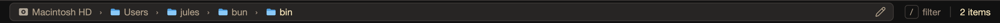
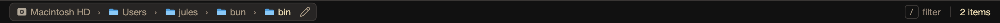
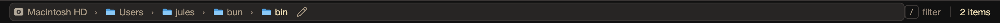
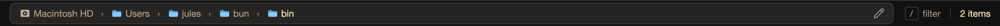
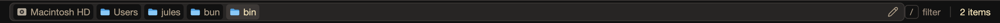
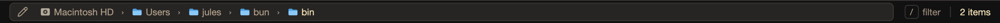
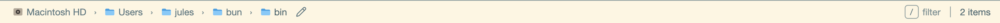
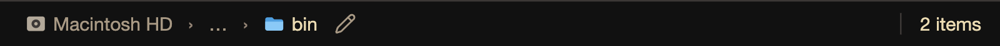

# F4 fix — path bar design

Audience: an implementing agent. Follow the `execute-plan` skill; read `AGENTS.md` and the M8 index first.
Base: branch `m8-f4-path-bar` (F4, unmerged). **Fix on that branch**; do not merge F4 until this list is built and re-reviewed.
Progress file: `docs/plans/m8/f4-fix.progress.md`.
PR title: "M8 F4 fix: path bar design".
Design reference: the mockups in `img/f4-*.png` (HTML sketches at 1.25×; the app uses the real Finder icons and text metrics). The current bar is `img/f4-current-*.png`.

## Why

The user, 2026-11-17: *"it looks pretty bad right now, to be honest, just like the editable path bar needs a lot of work"* (screenshot: the F4 hover state). The F4 work is functionally right — segments drag, the pencil edits, the tests pass — but the bar's hover and edit affordance look wrong:

- The empty space fills with `surface-raised` as one large slab with a hard left edge. It reads as a selected region, not an affordance, and hovering a segment fills it too (one `group_hover`).
- The pencil sits at the far right of the path slot, next to the counts, so it reads as a bar-level action, not "edit this path".
- A single click on the empty space edits the path, but at rest nothing says the empty space is clickable; the click target is most of the bar.
- The edit field is a 24 px, 5 px-radius, 2 px-ring input across the whole path slot; next to the 32 px, 8 px-radius search field it reads like a command line.

The user wants the shape settled before more code.

## Current state

- Render: `crates/crow-app/src/bottom_bar.rs:668-760`. `bar-path` is `flex_1`; the segments are children; `path-empty` is `flex_1` with `group_hover("path-area")` filling `surface-raised` and `justify_end` holding the pencil; `bar-path`'s `on_click` dispatches `EditPath` for any click that reaches it.
- Pencil: `bottom_bar.rs:706-735`, 18×18, `opacity(0)`, `group_hover("path-area")` shows it, 12 px `fg-muted` glyph.
- Edit field: `bottom_bar.rs:614-638`, 24 px, `border_2` `field_ring`, `rounded(px(5.))`, `px(px(6.))`, `surface`.
- Fit: `bottom_bar.rs:289-430`; segments are measured with their separator; the pencil is not measured.
- Tests: `crates/crow-app/src/window/tests.rs:5696-5840` (single click edits, segments navigate, drag payload, field no drag, folded drag, hover bounds, no layout shift).
- Drag plumbing: `pane.rs` `drag_combo`/`promote_drag` (F4); the segments use it.

## Decisions (user, 2026-11-17)

- **Shape:** V2, the hover-revealed pill: a 38 px bar, a 32 px pill around the path and pencil; on hover the pill appears; on click the field spans the left section (the path and the hints) up to the counts' divider, 32 px tall with 12 px padding and vertically centered text.
- **Pencil:** always visible at the end of the path.
- **Empty-space click:** edits the path.
- **Hover:** the pill's `surface` fill (no `surface-raised` slab); the pencil brightens.
- **Icons:** every segment keeps its Finder icon.
- **Fade/expand:** deferred (the pill appears at once; the field replaces it). Note it in the progress file; add motion later if wanted.
- **Build scope (user, 2026-11-17):** only the new path bar; stop for the user's test; no PR or critique until the test.
- The F4 drag work stays; this list changes the bar's shape, the hover and the field.

These answers rule out the earlier "quiet path with an inert empty space" draft. The open question is the bar's shape: six options, all honoring the answers.

## Design options

### B — full-width control (the user's lean)

The path slot is a 24 px `surface` control with a 1 px `border` and 6 px radius; the segments inside; the pencil at the right edge; the empty part is the click target and fills `surface-raised` on hover. It is the Explorer address-bar model: the path always looks like a control.

**Cost:** permanent chrome; the pencil is far from the path (the F4 complaint, though inside a control); it competes with the search field.

### V1 — compact pill

The control wraps only the path and the pencil, content width; the pencil at the pill's right; the empty space after the pill is background and fills `surface` on hover; clicking it edits.

**Cost:** the click target outside the pill is less obvious; the path is a pill, not a full-width field; the empty space's hover fill is the only cue.

### V2 — hover-revealed pill (chosen)

At rest the bar is quiet: the segments, the pencil at the path's end, the empty space background (`img/f4-new-rest-dark.png`). On hover a 32 px `surface` pill appears around the path and the pencil; the pencil brightens; clicking the pill's padding or the empty space edits. On click the field spans the left section (the path and the hints) up to the counts' divider, 32 px tall with 12 px padding and vertically centered text. No layout shift: the pill is inside the path slot, the segments and the pencil keep their positions.

**Cost:** the pill is invisible at rest (the always-visible pencil is the only cue); the hover state is a large pill. **Chosen by the user; the fade and the expand animation are deferred.**

### V3 — taller bar

The bottom bar grows 30 → 34 px; the control is 28 px (closer to the search field's 32 px); the path looks like a real address bar; the mockup shows the pencil at the right, and the build puts it at the path's end (Q3).

**Cost:** +4 px of chrome; the U5 board's 30 px changes; the content area loses 4 px; the tips' `bottom_bar::HEIGHT` and the bar-height tests change.

### V4 — segmented pills

The path slot is a `surface` track; each segment is a `bg` pill with 4 px gaps; the current pill is filled (`surface-raised` in dark); the pencil at the right; the empty part is the click target.

**Cost:** more chrome; the chevrons go (the pills' gaps separate); the path looks like a toolbar; the light theme needs a current-pill treatment (`surface-raised` equals `surface` in Solarized Light, so the fill disappears); the pills add width.

### V5 — leading pencil

The control fills the path slot; the pencil sits at the left, then the path; the empty part is the click target; the pencil is the first thing in the bar.

**Cost:** the path starts 24 px in; the pencil is far from the empty click target; unusual for a path bar; the path's left edge no longer aligns with the sidebar.

### Common to every option

- **Pencil:** 20×20, 4 px radius, always visible; `fg-subtle` at rest, `fg-muted` on hover, `fg` + `surface-raised` on its own hover; tooltip "Edit path" + ⌘L; `Role::Button`, aria "Edit path, Command L".
- **Empty space:** a click edits; it fills on hover (`surface` or `surface-raised` per the option); the field opens with the path selected; ⌘L and the pencil edit.
- **Segments:** every segment keeps its Finder icon, `Role::Button`, aria "Go to X"/"Open X", tooltip, click and F4 drag. A click on a segment navigates; a drag does not navigate; the folded "…" keeps its click and drag.
- **Edit field:** 32 px, 8 px radius, 2 px `field_ring`, `surface`, 12 px padding, 12 px text; it spans the left section (the path and the hints) up to the counts' divider; the hints sit inside it; the text is vertically centered.

- **Bar:** 38 px; no layout shift on hover; the hints drop first when narrow; the folded "…" is `fg-muted`; the last segment is `fg`.
- **Themes:** Firebox and Solarized Light; the control's border/fill and the pencil's three states must read in both.

## Items

### 1 The chosen shape (ui)

Build the option the user picks, honoring the common rules. The differences:

- **B:** a 24 px `surface` control fills the path slot (`flex_1`), 1 px `border`, 6 px radius, 8 px horizontal padding; the segments inside; the pencil at the control's right edge; the empty part fills `surface-raised` on hover; the control's empty part's click dispatches `EditPath`; the segments and pencil stop propagation.
- **V1:** a content-width pill (`flex_none`) with the same control style around the segments and the pencil; the empty space after the pill (`flex_1`) fills `surface` on hover and its click dispatches `EditPath`.
- **V2 (built):** the bar's `HEIGHT` 38; the path slot is `h(32)`; a 32 px pill (`flex_none`, 12 px padding, 8 px radius, 1 px transparent border, `surface` fill and `border` on hover via `group_hover("path-area")`) holds the segments and the pencil at the path's end; the empty space after the pill is `flex_1` and its click edits; the pencil is always visible; the field is 32 px, 8 px radius, 12 px padding, `surface`, `field_ring`, and spans the left section with the hints inside (the transient moves into the field); update the tips' offset, the bar-height tests and the U5 board note. The fade and the expand animation are deferred.
- **V3:** the bar's `HEIGHT` 34; the control 28 px, 7 px radius, 8 px padding; the pencil at the path's end, always visible; the empty part is the control's `surface`; the control's border and the pencil brighten on hover; the segments keep their `surface-raised` hover; the field 28 px / 7 px radius / 8 px padding.
- **V4:** a `surface` track fills the path slot; each segment is a `bg` pill (4 px radius, 4 px gaps, 4 px track padding); the current pill uses `current_location`/`surface-raised` with a 1 px `border` for Solarized Light; no chevrons; the pencil at the track's right; the empty part's click edits; the segments keep their aria/tooltip/click/drag.
- **V5:** a 24 px control fills the path slot; the pencil at the left (8 px padding, 8 px gap); the segments follow; the empty part's click edits.

**Tests:** the click behaviour (empty space edits, a segment navigates, the pencil edits, a double-click edits, ⌘L edits); the pencil is 20×20 and in the option's place (bounds); the bar's height (30, or 34 for V3); the segments' positions do not change on hover; 640 px and wide; the field has no drag; the F4 drag tests stay green. The hover fill and the control's border cannot be read through `debug_bounds`; the hand check covers them.

**Done when:** the chosen shape is on screen at rest and on hover; every click has one predictable result; the drag, the folded path and the field behave as F4; 640/wide, light/dark.

### 2 Edit field polish (ui)

**Change:** the field in `render`'s left section (`bar_children`): 32 px tall, `rounded(px(8.))`, `px(px(12.))`, `gap(px(14.))`, the 2 px `field_ring`, `surface`, 12 px text; the input and the hints inside; the field spans the path and the transient up to the counts' divider; the text is vertically centered. The counts keep their place.

**Tests:** `path_bar_field_has_no_drag` and the bar-height assertions stay green. The radius and padding are visual; the hand check covers them.

**Done when:** the field reads as the same control family as `/` and search, the hints sit inside it, and the path's text is vertically centered.

### 3 Docs, bench and hand checks

**Change:** README's bottom-bar paragraph (the pencil, the empty-space click, the double-click, ⌘L); `docs/testing.md`'s path-bar row (the chosen shape, hover, pencil, empty click, double-click, field, narrow, light/dark, drag, VoiceOver). Run the bench on `target/fixture-100k` against `main` because the bar's render path changes; record it. Build `./scripts/bundle.sh`.

**Hand checks:** hover the path (the pill appears around the path and pencil; the pencil brightens); hover each segment; hover the pencil (fill, `fg`, tooltip); click the pill's padding, the empty space, the pencil, a segment, a separator; double-click the empty space; ⌘L; the field (it spans the left section with the hints inside; all selected; Tab/Return/Esc; a missing path's error; the text vertically centered); drag a segment to Finder, a pane row and a sidebar favorite; the folded "…" (click and drag the deepest folder); 640 px and wide; Firebox and Solarized Light; VoiceOver (pencil "Edit path, Command L", segments "Go to X", field "Path"); search mode (the selected result's path; the pencil edits it). The pill's fade and the field's expand animation are deferred; check the static states.

**Done when:** the checks pass, the progress file records the bench numbers and the hand checks, and the user has tested the bundle.

## Answers (user, 2026-11-17)

1. **Shape:** V2, the hover-revealed pill: 38 px bar, 32 px pill, 32 px field across the left section.
2. **Empty fill:** `surface` (the pill's fill; the pencil brightens).
3. **Pencil place:** at the path's end.
4. **Bar height:** 38 px (more padding).
5. **Fade/expand:** deferred (the pill appears at once; the field replaces it).

The build is the V2 shape with the answers above. The user asked to build only the path bar and stop for their test; no PR or critique until then.

## Finish

- `cargo fmt --check`
- `cargo clippy --workspace --all-targets -- -D warnings`
- `cargo test --workspace`
- Bench on `target/fixture-100k` vs `main`; record the numbers (the bar renders every frame).
- `./scripts/bundle.sh`; the user tests it.
- Update README and `docs/testing.md`.
- Commit on `m8-f4-path-bar`, update `docs/plans/m8/f4-fix.progress.md`, stop at "Ready for test". Don't merge; no PR until the user has tested.
