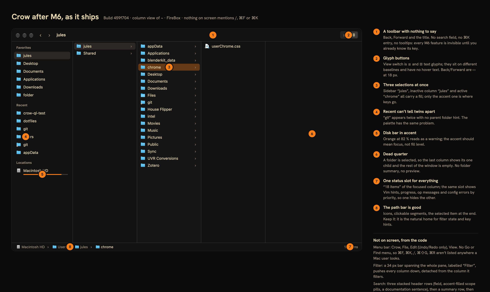
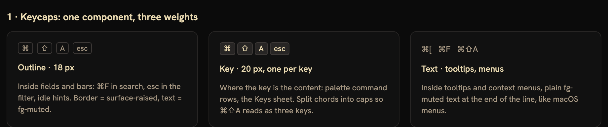
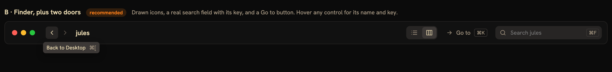
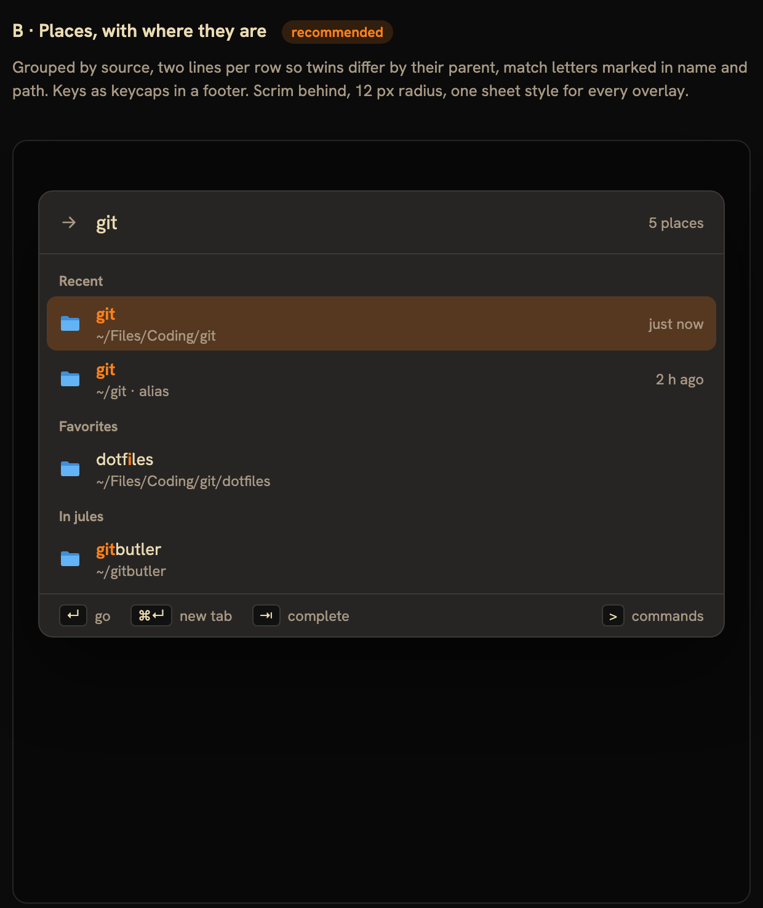

# U1 Shared parts

Audience: an implementing agent. Follow `.claude/skills/execute-plan/SKILL.md`; read `AGENTS.md` and `docs/plans/ui-overhaul/README.md` first.
Needs: PR #7 (M6) merged to `main`.
Branch: `ui-u1-shared-parts` from `main`.
Progress file: `docs/plans/ui-overhaul/u1-shared-parts.progress.md`.
PR title: "UI U1: Shared parts for hints, overlays and icons". Don't merge.
Design reference: canvas boards "Discovery kit" §1 (keycaps), "Top band" B (icons, tooltip), "Palette" B (sheet on a scrim), "Today, annotated" (findings 2 and 3). https://claude.ai/artifact/EbZ7gFCy24MaccdpbSsFtE

## Why
Every later U plan shows keys, opens overlays and draws icons, and today each surface does it by hand:
- Keys are hardcoded strings: `palette.rs:59` `Command.keys` (39 literals, `palette.rs:64-102`), the palette footer (`window.rs:1527`), the delete sheet (`window.rs:771`), the theme picker (`window.rs:1698`), the search header (`search.rs:600`). They go stale when bindings change and never show the Vim layer.
- No tooltips anywhere ("Today, annotated" finding 1: "no tooltips").
- Five overlays are separate hand-built divs with no scrim, at 360/520/560 px (`render_go_to` `window.rs:254`, `render_sheet` `:743`, `render_why` `:1060`, `render_palette` `:1464`, `render_picker` `:1592`).
- Toolbar icons are text glyphs ‹ › ☰ ▥ on different baselines (finding 2).
- Selection tints are spelled out per view with different alphas for the same meaning (finding 3: three fills at once).

Build each part once, here, and move today's surfaces onto them **without redesigning them**. The redesigns are U3–U9.

## Decided
- Q2 (index): "Icons: embedded SVGs (an `AssetSource` with `include_bytes!`, rendered with GPUI `svg()`, tinted by theme role)."
- Ground rules (index): theme roles only; "New tints go into `style.rs` as named helpers (U1) and every surface uses them"; "tooltips never replace aria labels"; plans touching rows run the bench against `main`.
- Names other plans rely on (keep them): keys from the live keymap (I1, module `keys`), `Keycap` with weights `Outline` / `Key` / `Text` (I2), `with_tooltip` (I3), `Sheet` overlay with scrim (I4), `glyph(name, size, role)` with enum `Glyph` + `Assets` (I5; renamed from the draft's `icon` because `style::icon(path, is_dir, points)` already draws Finder file icons, `style.rs:37`), `active_selection`, `inactive_selection`, `current_location`, `cursor_ring` (I6).
- From the orchestrator for U8: `cursor_ring` must never change a row's size: an inset `BoxShadow` (spread, no blur), not a border. The sidebar is 210 px wide today (`sidebar.rs:631`), not 220 as on the boards; U1 does not change that.

## Current state

Take from it: ‹ › and ☰ ▥ are text glyphs; sidebar "jules", the inactive column and the active row all carry a fill.

**Keymap.** `actions.rs:86` `finder_keymap()` and `:174` `vim_keymap()`; both are always bound (`main.rs:172-174`, tests `window.rs:1830-1832`), plus `text_input::keymap()` (`text_input.rs:48`, context `TextInput`: enter Confirm, escape Cancel, tab Complete). The layer is chosen by context only: views append `vim` when `settings.keymap == KeymapLayer::Vim` (`pane.rs:1772-1775`, `sidebar.rs:606`, palette `window.rs:1473-1476`, picker `:1638-1641`). Context nesting: `Crow` (`window.rs:1756`) > `FileList [ColumnView] [vim|VimPending] [Filtered]` (`pane.rs:1768-1778,1824`), `Sidebar [vim]` (`sidebar.rs:622`), `Search` (`search.rs:981`) > `SearchResults` (`search.rs:720`, never gets `vim`, so the `SearchResults && vim` bindings at `actions.rs:206-207` can't fire today; out of scope, see Q8), `Filter` (`pane.rs:1649`, a sibling of the list, not inside `FileList`: `pane.rs:1876`), `Sheet` (`window.rs:876,1123`), `Sheet Palette [vim]`, `Sheet ThemePicker [vim]`. Go to Folder has no context of its own; its `TextInput` handles keys.

**Palette registry.** `palette.rs:12` `CommandId`, `:55` `Command { id, label, keys }`, `:63` `COMMANDS`. `window.rs:1423` `run_command` maps ids to handlers. Rows: `render_palette_rows` `window.rs:1533`, keys drawn at `:1586` as 11 px `fg-muted` text. Today's strings use ⌘-first order ("⌘⇧G") except `⌃⌘T`.

**GPUI facts (confirmed in `vendor/zed/crates/gpui/src`).**
- `cx.key_bindings() -> Rc<RefCell<Keymap>>` (`app.rs:2849`); `Keymap::bindings_for_action(&dyn Action)` in added order (`keymap.rs:95`); `Keymap::bindings_for_input(&[impl AsKeystroke], &[KeyContext])` (`keymap.rs:165`); `KeybindingKeystroke: AsKeystroke` (`platform/keystroke.rs:713`), `.modifiers()`, `.key()` (`:359,375`); `KeyBinding::keystrokes()`, `action()`, `predicate()` (`keymap/binding.rs:127-137`); `KeyContext::parse("FileList vim")` (`keymap/context.rs:63`).
- The `Window` helpers (`window.rs:7185-7250`, `bindings_for_action_in_context`, `highest_precedence_binding_for_action_in`) read the **previous frame's** dispatch tree; `DispatchTree::highest_precedence_binding_for_action` (`key_dispatch.rs:420-445`) is "last added binding whose keystrokes, resolved in this context stack, reach this action". U1 reimplements that rule against an explicit context stack (no window or frame needed).
- GPUI's own `Keystroke::display` (`platform/keystroke.rs:725-784`) prints control as `^`, escape as `⎋`, enter as `enter` and modifiers in ^⌥⌘⇧ order: not usable as is.
- `svg().path(p)` loads `p` from the app's `AssetSource` and paints it as an alpha mask tinted with `text_color` (`elements/svg.rs:40,183-186`; `svg_renderer.rs:255-260`); a missing asset draws nothing, no error. `svg().data(bytes)` needs no asset source (`elements/svg.rs:54`).
- `Application::with_assets(impl AssetSource)` (`app.rs:266`). Tests: `TestAppContext` hard-codes `Arc::new(())` as the asset source (`app/test_context.rs:177`) and `App` has no setter, so **tests cannot register `Assets`**; icons simply don't paint there.
- `.tooltip(Fn(&mut Window, &mut App) -> AnyView)` on stateful elements, 500 ms delay (`elements/div.rs:53,1729`). `.occlude()` (`div.rs:1297`). `BoxShadow { color, offset, blur_radius, spread_radius }` with `.spread_radius()` and `.inset()` (`style.rs:349-391`). `shadow_2xl` = 0/25/50 px, black 25 % (`gpui_macros/src/styles.rs:480`). `accesskit::Role` is re-exported (`gpui.rs:115`) and has `Tooltip`.

**Overlays today** (all `div().absolute().top(px(52.)).left_0().right_0().flex().justify_center()` wrapping a panel with `rounded_lg`, `surface`, 1 px `border`, `shadow_lg`, no scrim, nothing closes on an outside click):

| Overlay | Fn | State | Width / padding | Context, focus | Esc path |
| --- | --- | --- | --- | --- | --- |
| Go to Folder | `render_go_to` `:254` | `go_to` | 520 / p_3 | none; `TextInput` focused | `close_go_to` `:248` |
| Confirm delete, conflicts | `render_sheet` `:743` | `sheet: Option<Sheet>` (`enum Sheet` `:596`) | 520 / p_4 | `Sheet`, `track_focus` | `close_sheet` `:704` |
| Why this view | `render_why` `:1060` | `why` | 560 / p_4 | `Sheet` | `close_why` `:1043` |
| Theme picker | `render_picker` `:1592` | `picker` | 360 / p_3 | `Sheet ThemePicker` | `cancel_picker` `:1242` (reverts preview) |
| Palette | `render_palette` `:1464` | `palette` | 560 / p_3 | `Sheet Palette`; input focused | `close_palette` `:1398` |

Activity (`render_activity` `:903`) is a non-modal popover, not a sheet; leave it. `Render` stacks the overlays last (`window.rs:1794-1799`).

**Icons and glyphs.** `render_title_bar` `window.rs:301`: `nav_button` 26×26, glyph 18 px, `fg-muted` / `fg-subtle` when disabled; `view_button` `:555` 28×22, glyph 13 px. `style::icon(path, is_dir, points)` (`style.rs:37`) already exists for Finder icons, so the new SVG helper is named `glyph` (enum `Glyph`) in `icons.rs`; U3, U4, U6 and U7 reference it by that name. Chevrons in list rows are drawn as paths (`pane.rs:1688`) and the sort arrows are glyphs (`pane.rs:1367-1371`); both stay.

**Tints.** `pane.rs:1714` `selection_color(active)` = accent `0x55` or `selection`, used at `:1153` (list) and `:1440` (columns); drop target accent `0x40` (`pane.rs:1154,1441`, `sidebar.rs:388`); sidebar current folder `selection` (`sidebar.rs:490`), sidebar cursor when focused accent `0x55` (`:491`); search rows accent `0x55` focused / accent `0x30` unfocused (`search.rs:758`); palette rows, picker rows and conflict choices accent `0x55` (`window.rs:1566,1632,817`). Others, not selection: list stripe surface `0x70` (`pane.rs:1152`), focused column surface `0x40` (`:1595`), content match accent `0x66` (`search.rs:1037`), text selection accent `0x40` (`text_input.rs:533`).

**Tests that cover this.** `window.rs` `mod tests` (`:1803`): `open` (`:1821`, calls `ui::init_for_tests`), `settle`, `use_vim` (`:2094`), `theme_index` (`:2149`), `sheet_open` (`:2850`); clicks via `debug_selector` + `cx.debug_bounds` + `simulate_click` (`path_bar_segments_navigate_as_history_steps` `:2045`). Overlay tests: `go_to_folder_completes_navigates_and_reveals_files` `:2630`, `permanent_delete_needs_confirmation` `:2930`, `conflicts_ask_first_and_keep_both_by_default` `:2914`, `rules_apply_live_and_why_explains` `:2064`, `theme_picker_previews_reverts_and_saves` `:2371`, the `command_palette_*` tests `:2296-2368`.

## Target

Take: three weights of one component; Key splits a chord into one cap per key.

Take: stroke icons 16 px; the tooltip is a small raised box with label in `fg` and key in `fg-muted`. U1 builds the icons and tooltip only; the band's layout is U3.

Take: the scrim darkens the window; panel radius 12, raised border, deep shadow. U1 builds the frame; the palette's sections and rows are U7.

Take: one fill per meaning (accent = where keys go, `selection` = current location), keycaps in fields and the bottom bar.

New modules in `crates/crow-app/src/`: `keys.rs` (I1), `chrome.rs` (Keycap I2, tooltip I3, Sheet I4), `icons.rs` (I5). Tints and scrim colors in `style.rs` (I4, I6). Register the modules in `main.rs:11-24`.

**Key text (I1).** Apple order and symbols. Modifiers ⌃ ⌥ ⇧ ⌘, in that order. Keys: letters upper-case after a modifier (`⌘F`); `backspace` ⌫, `delete` ⌦, `enter` ↩ (Q1), `escape` `esc`, `tab` ⇥, `space` `Space`, arrows ↑ ↓ ← →, `home` ↖, `end` ↘, `pageup` ⇞, `pagedown` ⇟, anything else as written (`/`, `[`, `.`, `'`, `-`). Vim-style keys (no ⌃⌥⌘): a bare letter stays lower-case (`j`), `shift-<letter>` is the upper-case letter without ⇧ (`G`), and a sequence is glued (`g g` → `gg`, `c w` → `cw`). Spoken form for aria labels: "Command F", "Shift Command A", "Option Up Arrow", "Escape", "Return".

**Keycap (I2).** `Outline`: one cap per chord, height 18, min width 18, padding x 5, radius 4, 1 px `surface-raised` border, no fill, `fg-muted`, 11 px. `Key`: one cap per key, gap 3 px, height 20, min width 20, padding x 5, radius 4, 1 px `surface-raised` border with a 2 px bottom border, fill per Q4, `fg`, 11.5 px. `Text`: plain `fg-muted`, inherits size. Keycaps are decorative (no role, no aria); the enclosing control carries the key in words where it matters.

**Tooltip (I3).** Padding 8×5, radius 6, `surface-raised` fill, `shadow_lg`, row with 8 px gap: label in `fg` 12 px, then a `Text` keycap. Font family and size set explicitly (tooltips are drawn outside the root element and don't inherit `font_family`). Role `Tooltip`, aria label = label plus spoken key. GPUI's default 500 ms delay and placement. Copy, applied in U1:

| Element | Label | Key (scope) |
| --- | --- | --- |
| `back` | "Back to <folder>" or "Back" when there's no history | `GoBack` (Window) ⌘[ |
| `forward` | "Forward to <folder>" or "Forward" | `GoForward` (Window) ⌘] |
| `view-list` / `view-columns` | "View as List" / "View as Columns" | ⌘2 / ⌘3 |
| path segment | its existing aria label, "Go to <name>" / "Open <name>" | none |
| sidebar volume row | "<free> free of <total>" (same `human_bytes` text as its aria label) | none |
| `search-everything` | "Search everything, all rules off" | `SearchEverything` (Search) ⇧⌘A |
| `cancel-operation` | "Cancel operation" | `CancelOperation` (Window) esc |

**Sheet (I4).** A full-window scrim layer (`absolute`, inset 0, `occlude`), panel centered at top 52 px. Panel: radius 12, `surface` fill, 1 px `surface-raised` border, `shadow_2xl`, `overflow_hidden`. Widths: `SheetWidth::Compact` 360, `Narrow` 520, `Wide` 620 (Q3). Scrim colors (Q2): dark themes `color_alpha(bg, 0x8c)`, light themes `color_alpha(fg, 0x40)` (the board darkens #fdf6e3 to #d9d3c2; `fg` at 25 % matches; a `bg` scrim would lighten a light window). A left mouse-down on the scrim (outside the panel) runs the overlay's own cancel path, exactly what Esc does: it never confirms. Mapping, no other behavior change:

| Overlay | Width | On scrim click |
| --- | --- | --- |
| Go to Folder | Narrow | `close_go_to` |
| Confirm delete / conflicts | Narrow | `close_sheet` (cancel; nothing runs) |
| Why this view | Wide (was 560) | `close_why` |
| Theme picker | Compact | `cancel_picker` (reverts the preview) |
| Palette | Wide (was 560; U7 restyles) | `close_palette` |

Key contexts, `track_focus`, actions, padding, ids, roles and aria labels stay as today. Focus after closing goes back to the pane (each close fn already does).

**Icons (I5).** Lucide stroke icons (Q5), 24×24 viewBox, `stroke="currentColor"`. `Glyph`: `Back` (chevron-left), `Forward` (chevron-right), `List` (list), `Columns` (columns-3), `Search` (search), `GoTo` (arrow-right), `Close` (x), `ChevronDown` (chevron-down), `ChevronRight` (chevron-right). Title bar in U1: back/forward 16 px icons in the existing 26×26 buttons, `fg-muted` enabled, `fg-subtle` disabled (U3 changes disabled to 40 % opacity); view buttons 16 px icons in the existing 28×22 buttons, `fg` selected, `fg-muted` otherwise. Same positions and sizes as today.

**Tints (I6).** `active_selection` = accent `0x55` (where keys go); `inactive_selection` = `selection` (a selection without focus); `current_location` = `selection` (the folder you are in, sidebar); `cursor_ring` = inset 1.5 px accent `0x99` ring (keyboard cursor without a fill; used from U8); `drop_target` = accent `0x40`. Visible change in U1: only the unfocused search selection (accent `0x30` → `selection`), listed in Q6.

Performance: no change to warm first paint or scroll p99 on the 100k fixture beyond run-to-run noise. Key lookups don't run in file rows. Light and dark, Finder and Vim layers, list and column views, multiple tabs: all parts read the theme and settings at render, so they follow live reloads.

## Items

### I1 Keys from the live keymap

- *Where:* new `keys.rs`; `palette.rs`; `window.rs` (`render_palette_rows` `:1533`, footer `:1527`, `render_sheet` `:771`, `render_picker` `:1698`); `search.rs:600`; `actions.rs:99-100`.
- *Change:*
  - `pub enum KeyScope { Window, List, Columns, Sidebar, Filter, Search, SearchResults, Palette, ThemePicker, Sheet }` and `pub fn context_stack(scope, layer: KeymapLayer) -> Vec<KeyContext>` mirroring the real nesting: Window `[Crow]`; List `[Crow, "FileList"+v]`; Columns `[Crow, "FileList ColumnView"+v]`; Sidebar `[Crow, "Sidebar"+v]`; Filter `[Crow, Filter, TextInput]`; Search `[Crow, Search, TextInput]`; SearchResults `[Crow, Search, SearchResults]`; Palette `[Crow, "Sheet Palette"+v, TextInput]`; ThemePicker `[Crow, "Sheet ThemePicker"+v]`; Sheet `[Crow, Sheet]`; `+v` = " vim" in the Vim layer. Put a comment at each view's `key_context` call pointing at `keys::context_stack` so the two stay in step.
  - `pub fn binding_for(action: &dyn Action, scope: KeyScope, cx: &App) -> Option<KeyBinding>`: layer from `cx.global::<Ui>().settings.keymap`; walk `keymap.bindings_for_action(action).rev()`, return the first whose `keymap.bindings_for_input(binding.keystrokes(), &stack).0.first()` is this action (`partial_eq`). Same rule as `key_dispatch.rs:435-445`, so shadowed bindings (escape → `ClearFilter` only while `Filtered`) come out right.
  - `pub fn caps(binding: &KeyBinding) -> Vec<SharedString>` (one per key, modifiers first in Apple order), `pub fn chord_text(binding) -> SharedString` (glued), `pub fn spoken(binding) -> String`, and the shortcuts `pub fn text(action, scope, cx) -> Option<SharedString>` / `spoken_for(action, scope, cx) -> Option<String>`. Format from `KeybindingKeystroke::modifiers()` / `key()` with the table in Target; don't use GPUI's `display`.
  - Registry: `Command { id, label, action: &'static dyn Action, scope: KeyScope }`; delete `keys`. Map each id to its action (`Open` → `OpenSelection`, `Copy` → `CopyFiles`, `Cut` → `CutFiles`, `Paste` → `PasteFiles`, `PasteMove` → `PasteMoveFiles`, the rest same name) and scope: List for Open, QuickLook, Rename, NewFolder, Duplicate, MoveToTrash, DeletePermanently, Copy, Cut, Paste, PasteMove, SelectAll, StartFilter; Sidebar for RemoveFromSidebar, MoveFavoriteUp/Down, Eject; Window for the rest. Verify first that `&NewTab as &'static dyn Action` compiles in the `const`; if not, add `fn action(self) -> Box<dyn Action>` on `CommandId` and record it.
  - `render_palette_rows` draws `keys::text(command.action, command.scope, cx)` (still plain 11 px `fg-muted` text here; U7 switches to `Key` caps). Replace the literal keys in the footer (`:1527`), delete sheet (`:771`), picker (`:1698`) and search header (`search.rs:600`) with `keys::text(...)`, keeping the sentences. If a lookup returns `None`, leave the key out of the sentence.
  - `actions.rs:99-100`: put `cmd-o` before `cmd-down` so ⌘↓ stays the shown key for Open (last added wins). Same keystrokes, no behavior change.
- *Edge cases:* Vim layer shows Vim keys where they exist (Copy → `yy`, Undo stays ⌘Z because its scope is Window); `VimPending` is not a scope; `NewWindow`/`Quit` have no context (match any stack); commands without bindings (UseViewAsDefaults, ResetFolderView) show nothing.
- *Tests* (`keys.rs` unit tests use `#[gpui::test]` with `ui::init_for_tests` and the three keymaps bound):
  - `formats_mac_symbols_in_apple_order`: `cmd-shift-a` ⇧⌘A, `ctrl-cmd-t` ⌃⌘T, `cmd-alt-backspace` ⌥⌘⌫, `ctrl-shift-tab` ⌃⇧⇥, `cmd-shift-.` ⇧⌘., `cmd-up` ⌘↑, `escape` esc, `space` Space, `enter` ↩, `/` /, `shift-g` G, `g g` gg; `caps` of `cmd-shift-a` is `["⇧","⌘","A"]`; `spoken` of `cmd-f` is "Command F".
  - `finds_bindings_by_scope`: ShowSearch/Window ⌘F; StartFilter/List `/`; StartFilter/Window none; MoveToTrash/List ⌘⌫ and RemoveFromSidebar/Sidebar ⌘⌫; CancelOperation/List esc; SheetCancel/Sheet esc; OpenSelection/List ⌘↓.
  - `vim_layer_shows_vim_keys`: after setting `keymap = "vim"`: MoveToFirst/List gg (Finder: ⌥↑), CopyFiles/List yy, MoveDown/Sidebar j, Undo/Window ⌘Z.
  - `palette_keys_match_the_old_strings`: for every `COMMANDS` entry, Finder layer, the looked-up text equals a table copied from today's `keys` strings, rewritten in Apple order (⌘⇧G → ⇧⌘G, ⌘⌥⌫ → ⌥⌘⌫, ⌘⇧N → ⇧⌘N, ⌘⌥V → ⌥⌘V, ⌘⌥T → ⌥⌘T, ⌘⌥L → ⌥⌘L, ⌘⌥↑/↓ → ⌥⌘↑/↓, ⌘⇧Z → ⇧⌘Z, ⌘⇧. → ⇧⌘., ↩ per Q1). Write this test before deleting `keys`.
  - `window.rs` keystroke test `command_palette_keys_follow_the_layer`: `cmd-k`, type `>copy`, read the palette's row text via a test accessor `Palette::row_keys(i, cx)` (shares the code path with `render_palette_rows`): ⌘C; `use_vim`, reopen: yy.
- *Done when:* no key literal is left in `crow-app/src` outside `keys.rs` and tests (`grep -n "⌘\|⇧\|⌥\|⌃" crates/crow-app/src` shows only those and the sort arrow `pane.rs:1369`), and the tests pass.

### I2 Keycap element

- *Where:* `chrome.rs`.
- *Change:* `pub enum KeycapWeight { Outline, Key, Text }`; `#[derive(IntoElement)] pub struct Keycap { caps: Vec<SharedString>, weight: KeycapWeight }` with `Keycap::text(s, weight)` (one literal chord, e.g. "esc"), `Keycap::from_binding(&KeyBinding, weight)` and `Keycap::for_action(action, scope, weight, cx) -> Option<Keycap>`. `RenderOnce` per the Target sizes; theme from `cx.global::<Ui>()`. `Outline`/`Text` render one chord string; `Key` renders `caps`. Nothing in U1 uses `Outline`/`Key` yet except the tooltip (`Text`); U3–U7 do.
- *Edge cases:* empty caps render nothing; long caps (`Space`) widen with padding, never clip; caps use `flex_none` so they don't shrink in tight rows.
- *Tests:* `keycap_splits_a_chord_into_keys` (unit: `Keycap::from_binding(⇧⌘A, Key).caps == ["⇧","⌘","A"]`; `Outline` holds one chord "⇧⌘A"). Render smoke test: a test-only window renders all three weights without panicking.
- *Done when:* the element exists with the three weights and tests pass; record in the progress file how it looks on FireBox and Paper (hand check).

### I3 Tooltip

- *Where:* `chrome.rs`; `window.rs` `render_title_bar` `:301`, `view_button` `:555`, path segments `:494`, `cancel-operation` `:540`; `sidebar.rs` volume rows (`:461-466` spoken text); `search.rs:578`; `crow-core/src/history.rs`.
- *Change:* `struct Tooltip { label, keys: Option<SharedString>, spoken }` implementing `Render`. `pub fn tooltip_text(label: &str, keys: Option<&str>) -> String` ("Back to Desktop ⌘["), `pub fn with_tooltip<E: StatefulInteractiveElement>(element: E, label: impl Into<SharedString>, keys: Option<SharedString>) -> E` (resolve keys at render with `keys::text`; the closure builds `cx.new(|_| Tooltip{..}).into()`), and `with_action_tooltip(element, label, action, scope, cx)`. Add `History::back_target()` / `forward_target() -> Option<&Path>` (peek, no move) and `Pane::back_target`/`forward_target` for the "Back to <folder>" labels (folder name via `folder_name`). Apply to the table in Target.
- *Edge cases:* tooltip text never replaces the element's aria label; disabled back/forward still show "Back"/"Forward" with the key; labels update on navigation because they're built at render.
- *Tests:* `tooltip_text_joins_label_and_key` (unit: with and without keys); `history_peeks_without_moving` (crow-core unit test); `back_button_tooltip_names_the_folder` (window test: `cmd-down` into alpha, then read `Pane::back_target` → root; plus a hover test: `simulate_mouse_move` over `cx.debug_bounds("back")`, `cx.executor().advance_clock(600 ms)`, `run_until_parked`, assert `cx.debug_bounds("tooltip")` is `Some`; give the tooltip root `debug_selector("tooltip")`. Verify first that the test platform shows tooltips; if not, drop only the hover part and say so in the progress file).
- *Done when:* every element in the Target table has a tooltip; hand check in the bundle.

### I4 Sheet overlay

- *Where:* `chrome.rs`, `style.rs`, the five `render_*` fns in `window.rs`.
- *Change:*
  - `style.rs`: `pub fn scrim(theme: &Theme) -> Rgba` (by `theme.variant`, values per Target and Q2).
  - `chrome.rs`: `pub enum SheetWidth { Compact, Narrow, Wide }` with `fn px(self)`. `pub fn sheet_panel(id: impl Into<ElementId>, width: SheetWidth, theme: &Theme) -> Stateful
`: role `Dialog`, `debug_selector("sheet-panel")`, the Target styling, and `on_mouse_down(Left, |_, _, cx| cx.stop_propagation())` so clicks inside never reach the scrim. `pub fn sheet(panel: impl IntoElement, theme: &Theme, on_dismiss: impl Fn(&MouseDownEvent, &mut Window, &mut App) + 'static) -> Stateful
`: id `"sheet-scrim"`, `debug_selector("sheet-scrim")`, absolute inset 0, `bg(scrim(theme))`, `occlude()`, flex column, `items_center`, `pt(52)`, `on_mouse_down(Left, on_dismiss)`, child panel. (`window.rs` keeps its private `enum Sheet`; refer to the new one as `chrome::sheet` / `chrome::SheetWidth`.)
  - Rewrite each overlay as `chrome::sheet(chrome::sheet_panel(<old id>, width, &theme).<old aria, key_context, track_focus, on_action, padding, gap, children>, &theme, cx.listener(|this, _, window, cx| this.<cancel>(window, cx)))` per the Target mapping. Keep ids (`go-to-folder`, `sheet`, `why-this-view`, `theme-picker`, `palette`).
- *Edge cases:* only one overlay is open at a time in practice (`show_search` `:1272`, `show_palette` `:1341` refuse to open over others; Go to Folder, Why and the picker don't guard: leave as is, but if two ever stack, each has its own scrim and the top one closes first). Mouse-down, not click, so a drag that starts on the scrim can't leave a half state. Scroll over the scrim does nothing (occluded). The scrim also covers the title bar: check window dragging by hand (Risks).
- *Tests:* `clicking_the_scrim_closes_every_overlay` (table-driven in `window.rs`): for each opener: `cmd-shift-g`; `down down cmd-alt-backspace`; `cmd-j`; `cmd-alt-t` (call `theme_index()` first, then `down` to preview); `cmd-k`: settle, click at `debug_bounds("sheet-scrim")` bottom-left + (10, -10), settle; assert the overlay's state is `None`, the pane's focus handle is focused, `notes.txt` still exists, and the theme name equals the start. `clicking_inside_a_sheet_keeps_it_open`: `cmd-j`, click the center of `sheet-panel`, `why` still `Some`. Existing overlay tests (listed in Current state) must pass unchanged.
- *Done when:* the five overlays use the one frame, both tests pass, light and dark scrims checked by hand.

### I5 Icons

- *Where:* new `crates/crow-app/assets/icons/*.svg` + `LICENSE`; `icons.rs`; `main.rs:168`; `window.rs` `render_title_bar`, `view_button`.
- *Change:* files `chevron-left.svg`, `chevron-right.svg`, `list.svg`, `columns-3.svg`, `search.svg`, `arrow-right.svg`, `x.svg`, `chevron-down.svg` from one pinned Lucide release (Q5; downloading needs the user's OK, ask with file names, source URL and size), unmodified except stripping the `class` attribute; `LICENSE` holds Lucide's license text verbatim. `pub enum Glyph` (Target list) with `const ALL: &[Glyph]` and `fn path(self) -> &'static str` ("icons/chevron-left.svg"). `pub struct Assets;` with a `const FILES: &[(&str, &[u8])]` of `include_bytes!` entries; `impl AssetSource`: `load` returns `Cow::Borrowed`, `list` filters by prefix. `pub fn glyph(name: Glyph, size: f32, role: &str, theme: &Theme) -> Svg` = `svg().path(name.path()).size(px(size)).flex_none().text_color(color(theme.role(role)))`. Register: `gpui_platform::application().with_assets(icons::Assets).run(...)`. Replace the glyphs in `nav_button` and `view_button` (the `glyph: &'static str` params become `Glyph`) keeping button sizes.
- *Edge cases:* tests can't register assets (`test_context.rs:177`), so icons don't paint in tests; that's fine, nothing asserts pixels. Don't switch to `svg().data()` unless the user asks (Q5 note). The eject "⏏" glyph (`sidebar.rs:585`) and row chevrons stay for now.
- *Tests:* `every_glyph_resolves`: for each `Glyph::ALL`, `Assets.load(name.path())` is `Ok(Some(bytes))`, bytes are valid UTF-8 containing `<svg` and `viewBox="0 0 24 24"`; `assets_list_icons`: `Assets.list("icons/")` contains every path.
- *Done when:* title bar shows drawn icons in the bundle at the old positions; tests pass; progress file lists each file's upstream name, Lucide version and license.

### I6 Selection tints

- *Where:* `style.rs`; `pane.rs:1153,1154,1440,1441,1714`; `sidebar.rs:388,490,491`; `search.rs:758`; `window.rs:817,1566,1632`.
- *Change:* add `pub fn active_selection(theme) -> Rgba`, `inactive_selection`, `current_location`, `drop_target`, and `pub fn cursor_ring(theme) -> Vec<BoxShadow>` = `vec![BoxShadow { color: color_alpha(accent, 0x99).into(), offset: point(0,0), blur_radius: px(0.), spread_radius: px(1.5), .. }.inset()]` (inset so it never changes size and isn't clipped by list overflow; verify first that GPUI paints an inset zero-blur shadow as a crisp ring at 1× and 2×; if not, fall back to an absolutely positioned 1.5 px accent border overlay child, still no layout change, and record it). Replace `selection_color` with `if active { active_selection } else { inactive_selection }` and delete it; sidebar `here` → `current_location`, sidebar focused cursor → `active_selection` (U8 swaps it for `cursor_ring`); search focused → `active_selection`, unfocused → `inactive_selection` (Q6); palette/picker/conflict choice → `active_selection`; the three drop tints → `drop_target`. Leave stripe, focused column, match highlight and text selection inline (one use each, not selections).
- *Edge cases:* the theme fade (`reload_theme`) keeps working because helpers read the current theme each render.
- *Tests:* unit `tints_follow_roles`: with `crow_theme::fallback()`, `active_selection` = accent with alpha 0x55, `inactive_selection == current_location == color(selection)`, `cursor_ring` has one inset shadow, spread 1.5, zero blur. Existing keystroke tests cover focus switching.
- *Done when:* `grep -n "0x55\|0x30" crates/crow-app/src` shows only `style.rs`; bench run (see Finish) within noise of `main`.

## Seams with other U plans
- U2 (menu bar) runs beside U1 and doesn't need it; U2's menus show keys through macOS, U1's `keys` formatting should match them (same order and glyphs, Q1).
- U3 uses `icon`, `with_tooltip`, `Keycap::Outline` (⌘F, ⌘K) and restyles the band (40 % opacity disabled, 28×28 / 32×26 targets). U1 must not move or resize title-bar buttons.
- U4 uses `Keycap::Outline` (esc, ⌘F), `KeyScope::Filter`, `active_selection`. U5 uses `Keycap::Outline` and `keys::text` for hints. U3, U4 and U6 use `glyph(Glyph::Search, …)` and the other `Glyph`s; U6 also uses `keys` and decides the search-row tints on top of I6. U7 builds on `chrome::sheet` with `SheetWidth::Wide` and `Keycap::Key`; the `Command.action`/`scope` fields are what its menu names and chips read. U8 uses `cursor_ring`, `current_location`, `active_selection`. U9 uses `Keycap::Key` and `keys`.
- Leave alone: sidebar layout and its 210 px width (U8), search header layout (U6), palette contents (U7), status line (U5), the `/` filter bar (U4).

## Risks and things to measure first
- Verify first: the `&'static dyn Action` const (I1), tooltips under the test platform (I3), the scrim's `stop_propagation` order (I4: a click on a panel button must still fire its `on_click`; the existing `conflicts`/`delete` tests click by keys only, so add a click on `sheet-cancel` to the inside-click test), inset zero-blur shadow rendering (I6).
- The scrim covers the transparent title bar. Check by hand that the window can still be dragged and the traffic lights work while a sheet is open; if dragging breaks, ASK whether to start the scrim below the 44 px band.
- `binding_for` scans the keymap (~130 bindings) per lookup. Palette rows call it for ≤14 visible rows per frame, fine; no lookups in file rows. If profiling shows it, cache by `Keymap` version.
- Bench: I6 touches list and column row rendering (same cost: one call per render, not per row). Run `cargo run --release -p crow-app -- --bench target/fixture-100k` on this branch and on `main`, same machine, and record both in the progress file and `docs/testing.md`.

## Questions to ASK
1. Return glyph: ↩ (macOS menus, which U2 shows natively) or ↵ (the boards)? Recommended: ↩, so menus, palette and hints match.
2. Scrim colors: `bg` at 0x8c in dark themes and `fg` at 0x40 in light themes (a `bg` scrim lightens a light window, the opposite of the board)? Recommended: yes.
3. Sheet widths Compact 360 / Narrow 520 / Wide 620; Why this view and the palette grow from 560 to 620. Recommended: yes (the palette goes to 600–640 in U7 anyway).
4. `Key` keycap fill: `surface` (draft) is invisible on a `surface` sheet; use `bg` (as Palette B's footer shows)? Recommended: `bg`.
5. Icons: Lucide at a pinned version, ISC license text in `assets/icons/LICENSE`; also copy that file into `Crow.app/Contents/Resources/` in `scripts/bundle.sh` so the notice ships with the binary? Recommended: Lucide, and yes to the bundle copy. Downloading the SVGs needs your OK (source: the `lucide-icons/lucide` GitHub release tag).
6. Unfocused search selection changes from accent 0x30 to `selection`, the same as the file list. Recommended: yes (one fill per meaning).
7. Tooltip labels "Back to <folder>" / "Forward to <folder>" need a small `History` peek in crow-core. OK to add in U1? Recommended: yes.
8. Found while reading: `SearchResults` never gets the `vim` context (`search.rs:720`), so the Vim j/k bindings for search results (`actions.rs:206-207`) never fire. Fix in U6, or leave? Recommended: U6, which owns search.

## Hand checks
Add to `docs/testing.md` "By hand":
| Tooltips | Hover back, forward, both view buttons, a path segment, the disk row, Search everything and Cancel during a copy: each shows its name, and its key where it has one ("Back to Desktop ⌘["). VoiceOver still reads the old labels. |
| Sheets | Open Go to Folder, Cmd-J, the theme picker, Cmd-K and a permanent delete: each sits on a darkened window (check a dark and a light theme); clicking outside closes it like Esc (picker reverts, delete does nothing), clicking inside doesn't. The window can still be dragged. |
| Keys follow the layer | Cmd-K, `>`: rows show ⇧⌘G style keys; set `keymap = "vim"`: Copy shows `yy`. |
| Icons | Title-bar back/forward and view buttons are drawn icons, crisp at 1× and 2×, in both themes. |

## Finish
- README: under Keys, say that the palette, tooltips and hints show keys from the live keymap (including the Vim layer); mention tooltips and that clicking outside a sheet cancels it. Lucide credit with the license file path.
- `docs/testing.md`: the hand rows above; bench numbers for U1 next to M6.
- Bench vs `main` (I6 touches rows). `cargo fmt --check`, `cargo clippy --workspace --all-targets -- -D warnings`, `cargo test --workspace`, `./scripts/bundle.sh` and the hand checks.
- Push, open the PR (body: each item, approach, how verified; the attribution the environment requires). Don't merge. Progress file state "PR open".
