# U11 Finish: whole-window pass, docs, bench

Audience: an implementing agent. Follow `.claude/skills/execute-plan/SKILL.md`; read `AGENTS.md` and `docs/plans/ui-overhaul/README.md` first.
Needs: U1–U10 **merged to `main`** (check `git log main` for each U PR; ASK before stacking on an unmerged branch).
Branch: `ui-u11-finish` from `main`. Progress file: `docs/plans/ui-overhaul/u11-finish.progress.md`.
PR title: "UI U11: Whole-window pass, docs and bench". Don't merge.
Design reference: canvas boards "Overhaul" and "OverhaulSearch" (the two assembled 1280×800 windows), "Today, annotated" (Current), and every picked variant: Top band B, D · Filter B, D · Bottom bar B, C, D, E · Search panel B, D · Palette B, C · Discovery kit §1–§4. https://claude.ai/artifact/EbZ7gFCy24MaccdpbSsFtE

This plan builds almost nothing new. It checks that nine PRs built by different sessions add up to the two assembled boards, fixes the drift between them, closes the twelve findings, writes the docs once for the whole overhaul, measures, and records what is left for later.

## Why
"Today, annotated" lists eight findings on screen and four "not on screen, from the code". U1–U10 each fix part of them, in separate PRs, against separate boards. Nobody has yet looked at the whole window: band heights, keycap weights, focus rings and selection fills were each chosen in a different PR, and README/testing.md were each edited in pieces. Finding 6 ("Dead quarter") is not owned by any U plan (see Questions, Q2).

The as-built window (column view of ~, FireBox): toolbar with only back/forward/title (1), glyph view switch (2), three fills (3), twin "git" (4), orange disk bar (5), empty right quarter (6), one status slot (7), good path bar (8).

## Decided
From the index (`docs/plans/ui-overhaul/README.md`, answers 2026-11-12), the ones U11 checks:
- Q2 "Icons: embedded SVGs (an `AssetSource` with `include_bytes!`, rendered with GPUI `svg()`, tinted by theme role)."
- Q3 "Search field gets **All / Names / Contents**, default All (= M6 behavior)."
- Q4 "`hints = "auto" | "always" | "off"` in `settings.toml`, default `auto`: each idle hint retires after its key has been used 3 times (counts in `~/.local/state/crow/`)."
- Q5 "Rename the Everywhere scope to **This Mac**." Q6 "Drop the Kind column from search results."
- Q7 "Palette: add **⇥ completion**; **remember recent commands across launches** (state dir), hidable with `palette_recent_commands` in `settings.toml`. The user wants an in-app **settings page** eventually (not in these plans): keep new options flat, typed and documented so a page can list them."
- Q8 Find Everything… (⇧⌘A) with no search open opens search in the current folder with every rule off. Q9 Contextual tips included (U9).
- Q10 "Path editing stays with the bottom path bar and is decided in M7."
- Index ground rules: "When a board and the plan disagree, the plan wins; when the plan is silent, ASK." So copy and sizes come from the U plans as merged; boards settle only what no plan says. "Animations are out of scope (a later plan)." That plan is now U10 (motion and sound, inserted 2026-11-14): U11 checks the window with motion on but does not tune it (durations live in the motion lab).
- AGENTS.md: theme roles only; every interactive element has a role and an aria label; every new key behavior gets a keystroke test; bench must not regress vs `main`.
- Inherited from U1–U10: the shared parts by U1's names (`Keycap` Outline/Key/Text, `with_tooltip`, Sheet, SVG icons, `active_selection` / `inactive_selection` / `current_location` / `cursor_ring`), keys from the live keymap (U1 I1). U11 uses them and does not add parallel versions.

## Current state
Read on `m6-filter-palette-search` (= PR #7). U1–U10 will have changed most of this; re-read the merged code at I1 and update this section's facts in the progress file.
- Window: `crates/crow-app/src/window.rs:32-50` `open()` sizes every new window from `settings.window` (`crates/crow-core/src/settings.rs:29-32`, default 1200×760), transparent title bar, traffic lights at (14,16). `CrowWindow::render` (`window.rs:1723-1802`) stacks title bar, tab bar (only with >1 tab), `sidebar | center | preview`, path bar, then the overlays. The list-view preview pane is hidden while searching (`window.rs:1735`).
- Measures today vs boards: title bar 44 px (`window.rs:322`; board 52), sidebar 210 px (`sidebar.rs:631`; board 220), path bar 28 px (`window.rs:473`; board 30), row 24 px (`pane.rs:43`; board 24), column width 220–360 by longest name (`pane.rs:50-51`, `pane.rs:1722`; board 196, filtered column 250), preview column 300 px fixed (`pane.rs:52`, `pane.rs:1616-1630`; board: the rest of the window), focused column tint `surface` at 0x40 (`pane.rs:1594`).
- Status: one slot by priority (`window.rs:459-467`: Vim hint > progress > op message > error > loading > counts), `Role::Status` with the status text as label (`window.rs:532-533`).
- Menus: `crates/crow-app/src/main.rs:180-208` (Crow, File, Edit with Undo/Redo, View). U2 replaces this with a menu builder.
- Keymaps: `crates/crow-app/src/actions.rs:86-172` (Finder), `:174-209` (Vim: adds j/k, u, ctrl-r, yy, dd, p, m, ' on top of the Finder keys in `vim` contexts). Undo has two bindings in the Vim layer (`cmd-z` in `Crow`, `u` in `FileList && vim`).
- Bench: `main.rs:153` `--bench`; `pane.rs:1100-1137` scrolls 600 frames, prints `BENCH items=… cold_first_paint=… p99=… warm_first_paint=…`. Fixture: `--make-fixture DIR N` (`main.rs:102-118`). Budgets and history in `docs/testing.md` ("Performance").
- Config/state dirs: `CROW_CONFIG_DIR` (`settings.rs:115-123`), `CROW_STATE_DIR` (`crates/crow-core/src/config.rs:13-21`), theme index `THEMES_DIR` / `THEMES_STATE_DIR` (used by tests, `window.rs:2148-2165`). Recent merges zoxide when `zoxide` is on `PATH` (`crates/crow-core/src/recent.rs:104`). Theme ids in the user's index: `firebox`, `solarized-light`.
- Accessibility API (GPUI): `.role()` `div.rs:1357`, `.aria_label()` `:1379`, `.aria_description()` `:1388`, `.aria_keyshortcuts()` `:1398`, `.aria_toggled()` `:1453`, `.aria_selected()` `:1441` (`vendor/zed/crates/gpui/src/elements/div.rs`). No live-region setter on `div`; accesskit 0.25 has `Node::set_live` (`Live::Polite`). `Window::debug_a11y_tree_json()` (`vendor/zed/crates/gpui/src/window.rs:7439`) returns the last frame's tree, but only when a11y is active (`window/a11y.rs:211-221`: needs an assistive client); verify first whether tests can turn it on. GPUI logs "focused element … has no accessibility node" (`window/a11y.rs:189-200`) when focus lands on an element without id+role.
- Layout tests: `VisualTestContext::debug_bounds(selector)` (`vendor/zed/crates/gpui/src/app/test_context.rs:1042`) with `.debug_selector(...)` (used at `pane.rs:1204`, `search.rs:812`, `sidebar.rs:408`). Test windows open with default options (`window.rs:1837`); a layout test needs explicit 1280×800 bounds.
- Name clash to watch: `style::icon(path, is_dir, points)` already exists (`crates/crow-app/src/style.rs:36`, Finder file icons). U1's plan names its SVG helper `icons::glyph(name, size, role)` to avoid this clash; confirm the merged name.

## Target
The finished window equals the assembled boards wherever a U plan doesn't say otherwise.

Column view of `crates/crow-core/src` filtering "vi": 52 px band (back/forward icons, title, view switch, "Go to ⌘K", "Search src ⌘F"), 220 px sidebar with twin "src crow-core / crow-app" and neutral disk bar, filter field inside the focused column with "2 of 9" and esc, footer "“vi” in all of crow-core ⌘F", preview filling the rest, bottom bar "↵ open · esc clear · ⌘F search deeper | 1 of 2 shown · 1.2 KB".

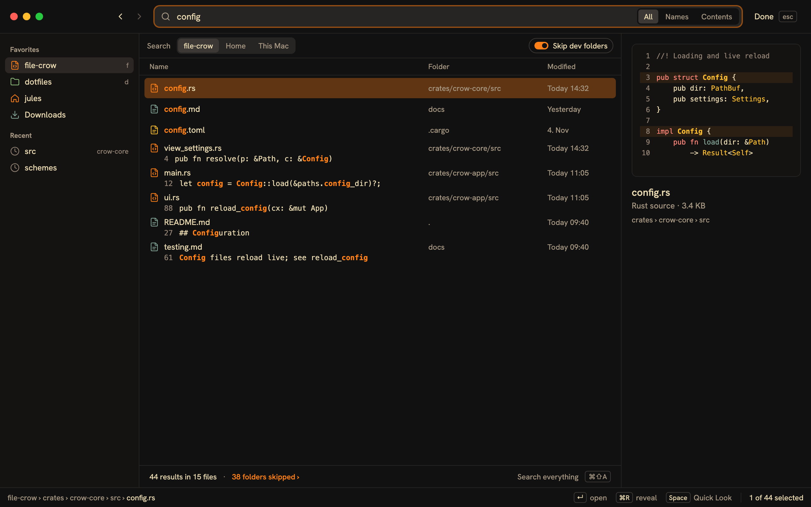
Search mode: field grown over the title with accent ring and All/Names/Contents, "Done esc"; scope bar "Search file-crow / Home / This Mac" with "Skip dev folders" switch; Name/Folder/Modified (no Kind); content hits with line numbers; footer "44 results in 15 files · 38 folders skipped › … Search everything ⌘⇧A"; preview with the hit lines; bottom bar "↵ open · ⌘R reveal · Space Quick Look | 1 of 44 selected".

Gallery of the picked variants (check every one against the app in I4):

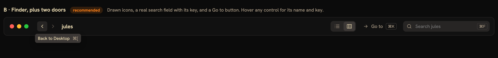
Band B: drawn chevrons, title, segmented list/columns, "Go to ⌘K", search field "Search jules ⌘F"; tooltip "Back to Desktop ⌘[" under the back button.

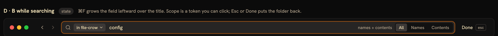
Band D: field with accent ring across the band, All/Names/Contents, "Done esc". It also shows a scope token "in file-crow ⌄" and "names + contents" inside the field, which the assembled board and U3 do not; follow U3.

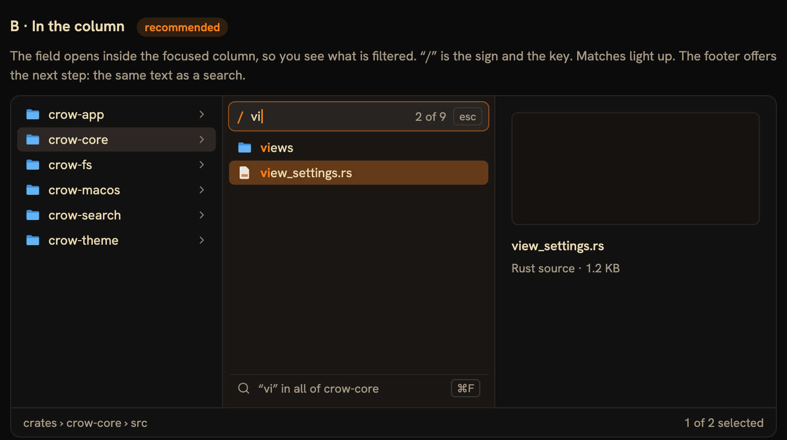
Filter B: field as the first row of the focused column, accent "/", "2 of 9", esc keycap, matched letters in accent, footer row with ⌘F.

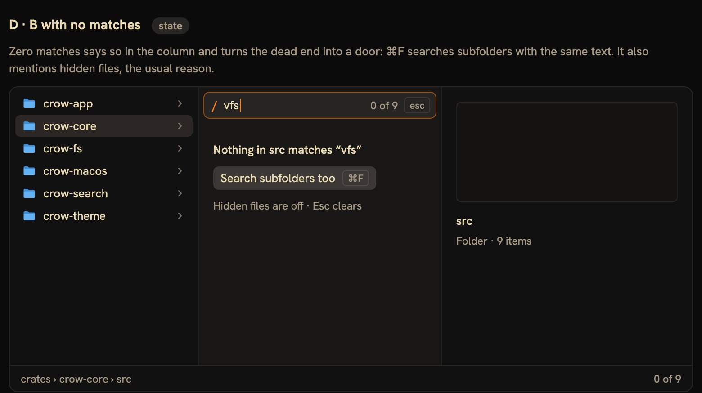
Filter D: "Nothing in src matches “vfs”", button "Search subfolders too ⌘F", "Hidden files are off · Esc clears"; the preview area shows a folder summary "src · Folder · 9 items" (relevant to Q2).

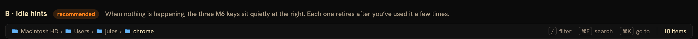
Idle hints "/ filter · ⌘F search · ⌘K go to" right of the path, counts last after a divider.

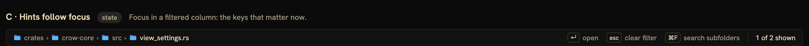
Filtering hints; the board says "clear filter / search subfolders", the assembled board and U5 say "clear / search deeper". U5's copy wins.

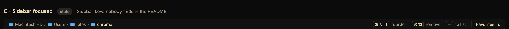
Sidebar hints "⌘⌥↑↓ reorder · ⌘⌫ remove · ⇥ to list", counts "Favorites · 6".

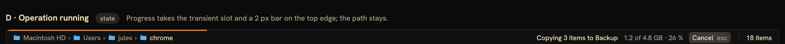
Progress: 2 px accent bar on the top edge, "Copying 3 items to Backup 1.2 of 4.8 GB · 26 %", "Cancel esc"; path stays.

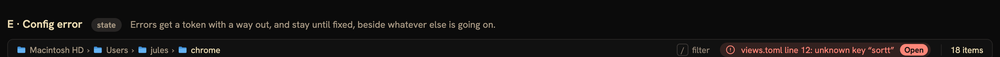
Config error token in `error` with "Open", beside a hint and the counts.

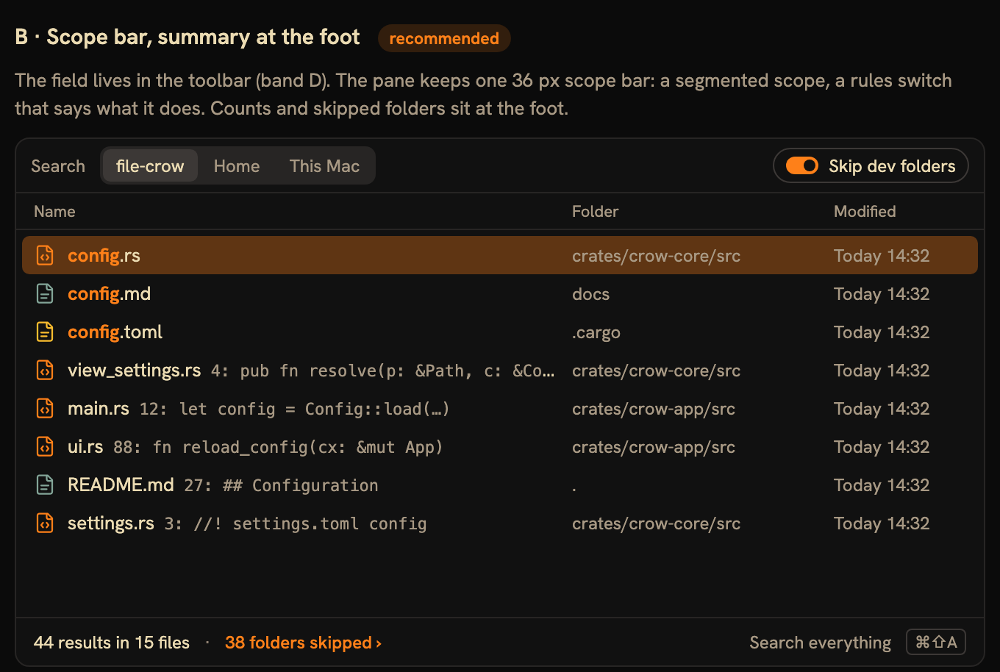
Scope bar, rules switch, rows with icon / highlighted name / folder / modified, footer summary.

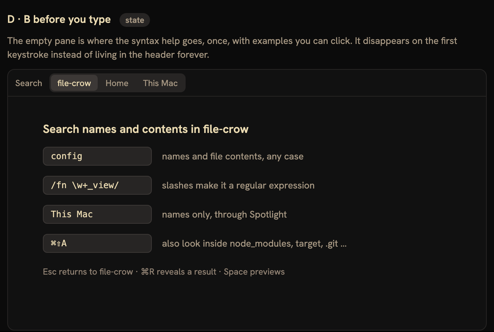
Idle pane: "Search names and contents in file-crow", four example chips with explanations, foot line "Esc returns to file-crow · ⌘R reveals a result · Space previews".

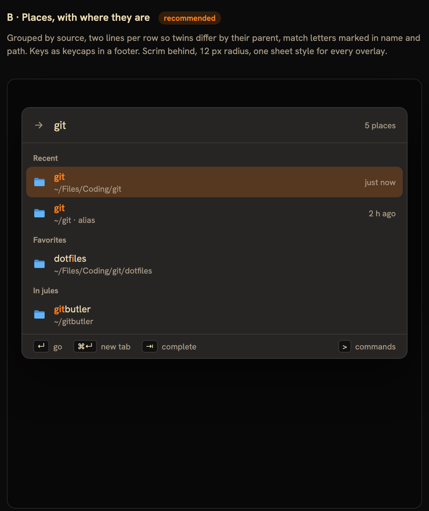
Sheet with scrim, "5 places", sections Recent / Favorites / In jules, two-line rows, "just now / 2 h ago", footer keycaps go / new tab / complete / commands.

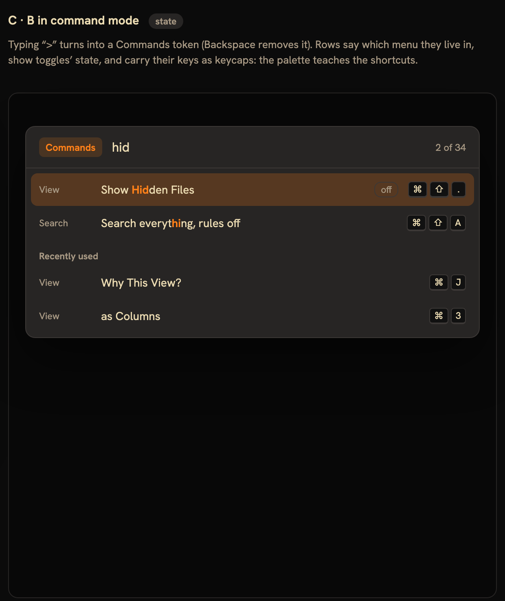
"Commands" token, "2 of 34", menu column, on/off chip, Key-weight caps, "Recently used". Its menu column says "Search" for Search everything; U2 has no Search menu, so the app must show U2's menu name.

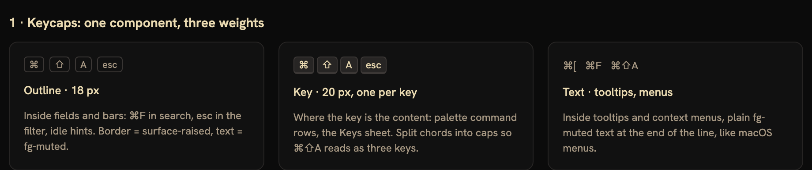
Outline 18 px (fields, bars), Key 20 px one cap per key (palette rows), Text (tooltips, menus).

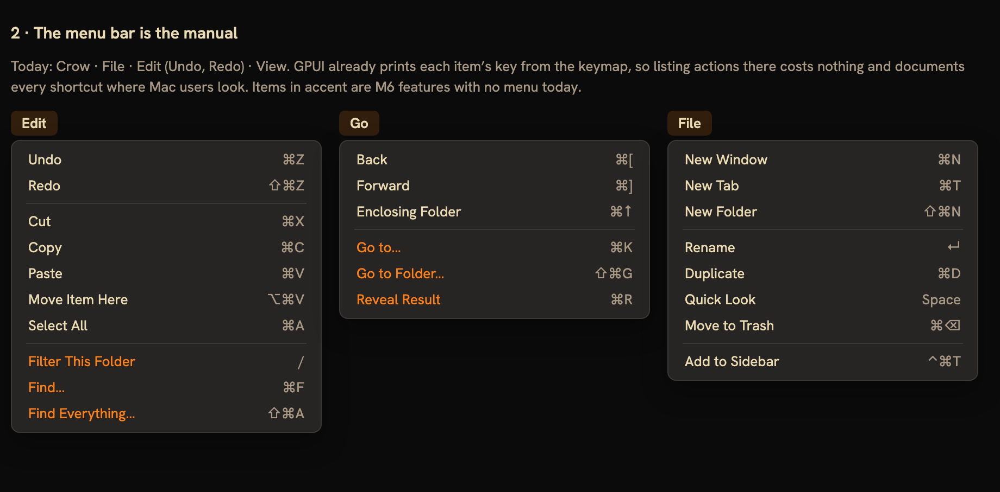
Edit / Go / File as U2 builds them; "Reveal Result ⌘R" under Go is board-only unless U2 added it.

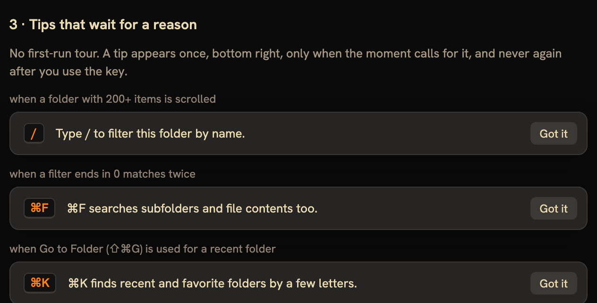
Three tips with an accent keycap and "Got it".

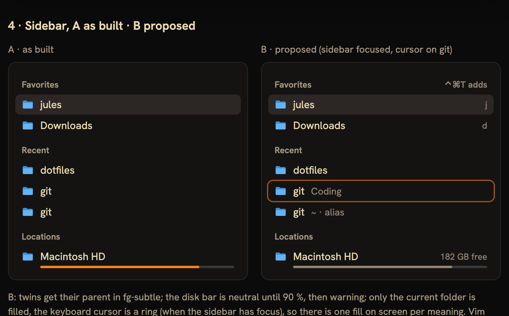
Sidebar B: one fill for the current folder, accent ring for the keyboard cursor, twins with parent in `fg-subtle`, neutral disk bar, mark letters.

### Whole-window measures (dark FireBox and light Solarized Light, 1280×800)
| Part | Target | Source |
| --- | --- | --- |
| Top band | 52 px; buttons 28×28; view switch 32×26 in a 2 px-padded `surface` group; Go to 30 px; search field 220–240×30, radius 8 | Overhaul, U3 |
| Sidebar | as U8 shipped: U8 recommends keeping 210 px and today's padding (board 220 px); `bg-inset`, section heads 11 px semibold `fg-muted` | U8 (its Q8), Overhaul |
| Rows | 24 px everywhere (list, columns, filter matches); radius 5 | `pane.rs:43`, boards |
| Filter field | 28 px, radius 6, 1 px accent ring, Outline esc; footer row 26 px | U4 |
| Search scope bar | 36–38 px; column header row; footer ~36 px | U6 |
| Bottom bar | 30 px, 12 px text, `fg-muted`; hints as Outline caps; counts after a 1 px `border` divider | U5 |
| Sheet | radius 12, Narrow 520 / Wide 620, top offset 52, scrim per theme | U1 I4, U7 |
| Keycaps | Outline 18 / Key 20 / Text; one keycap weight per place (fields and bars Outline, palette rows Key, tooltips and menus Text) | U1 I2 |
| Focus | rows and sidebar cursor: `cursor_ring`; text fields: accent ring; never a second fill | U1 I6, U8 |
| Fills | exactly one `active_selection` (accent) per window: where keys go | finding 3 |
| Disabled | 40 % opacity, same role as enabled | U3 |
The board's 196 px columns, 220 px sidebar, 17 px bottom-bar caps, line icons per favorite and the syntax-colored code preview are not in any plan: don't build them here (Q3).

### Accessibility target
Every control added by U1–U10 has an id, a role and an aria label; tooltips never replace labels; keyed controls carry `aria_keyshortcuts` or the key in words. VoiceOver announces, once per change: the filter count ("2 of 9 shown"), the search result count when a search settles ("44 results in 15 files, 38 folders skipped"), and a tip when it appears. Mechanism: Q7.

## Items

### I1 Start: baseline, inherited list, bench on `main`
- *Where*: progress file; `git log main`; every `docs/plans/ui-overhaul/u*.progress.md`.
- *Change*: create the branch and progress file. Confirm U1–U10 are merged (list each PR/commit). Copy into the progress file, as an "Inherited" table, every item another U plan marked "needs hand check", deferred, or left as an open question. Re-read the merged code and correct the "Current state" facts above in the progress file (heights, names of U1's helpers, the actual hint copy).
- Bench before any U11 change: on `main` (U9 merged) and on the M6 merge commit (PR #7), each three runs, with the same temp config (I2's `[window] width = 1280, height = 800`, theme `firebox`) so window size doesn't skew rows per frame: `cargo run --release -p crow-app -- --make-fixture target/fixture-100k 100000` once, then `CROW_CONFIG_DIR=… CROW_STATE_DIR=… cargo run --release -p crow-app -- --bench target/fixture-100k`. Use a worktree for the M6 commit (`git worktree add target/m6-wt <sha>`, run `./scripts/fetch-gpui.sh` there if `vendor/` is missing). Record all `BENCH` lines.
- *Done when*: progress file lists merged PRs, inherited items and six bench lines.

### I2 Reproducible window screenshots (ASK first: Q1)
- *Where*: new `scripts/shot.sh` and `scripts/window-id.swift` (only after the user says yes).
- *Change*:
  - `window-id.swift <pid>`: `CGWindowListCopyWindowInfo([.optionOnScreenOnly, .excludeDesktopElements], kCGNullWindowID)`, pick the entry whose `kCGWindowOwnerPID` is `pid` and `kCGWindowLayer == 0`, print `kCGWindowNumber` and the `kCGWindowBounds` width×height (points). Run with `swift scripts/window-id.swift <pid>` (Xcode command line tools, already needed to build).
  - `shot.sh <state-name> <start-dir> [theme] [keymap]`: make a temp dir; write `config/settings.toml` (`theme`, `keymap`, `hints = "always"` so hints show regardless of counts, `[window] width = 1280 height = 800`), `config/views.toml` (`[defaults] view = "columns"` for the filter state), `config/sidebar.toml` (favorites inside the repo or `~`, nothing private); launch `target/bundle/Crow.app/Contents/MacOS/crow <start-dir>` with `CROW_CONFIG_DIR`, `CROW_STATE_DIR` and `PATH=/usr/bin:/bin` (no zoxide, so Recent holds only what the script visits; private folders don't leak into PR images); wait until `window-id.swift` finds the window and reports 1280×800; then pause for the operator to set up the state (or send keys with `osascript -e 'tell application "System Events" to keystroke …'` if the user allows it); then `screencapture -x -o -l <id> target/shots/<state>-<theme>.png` (`-o` drops the shadow, `-x` no sound). Output is 2560×1600 on a Retina display, the same as the board renders.
  - Needs macOS Screen Recording permission for the terminal (and Accessibility for System Events keys). The user grants these; the agent never changes privacy settings.
- *States to shoot*, each in `firebox` and `solarized-light`: `filter` (column view of `crates/crow-core/src`, `/vi`, cursor on `view_settings.rs`), `search` (⌘F `config` in the repo root, first row selected), `idle` (column view, nothing pending: idle hints), `palette-folders` (⌘K `git`), `palette-commands` (⌘K `>hid`), `search-idle` (⌘F, empty query), `filter-none` (`/vfs`), `tip` (scroll a 200+ item folder), plus `filter` and `search` once more with `keymap = "vim"`.
- *Tests*: none (script). Run it twice; the two `filter-firebox.png` files must have the same pixel size and window bounds.
- *Done when*: `target/shots/` holds every state; the progress file records the commands.

### I3 Findings checklist: every finding fixed or deferred

- *Where*: the table below, copied into the progress file and filled with what was seen (screenshot name) and the test that covers it.
- *Change*: walk each row in the bundled app. If a row fails and the owning U plan clearly specified it, fix it here as a small commit ("U11: <finding> — <fix>"). If the fix would change behavior a plan didn't specify, ASK.

| # | Finding | Fixed by | Verify |
| --- | --- | --- | --- |
| 1 | Toolbar with nothing to say | U3 (band B/D), U1 I3 (tooltips) | Shot `idle`: search field with ⌘F and "Go to ⌘K" visible; hover each band control: tooltip with name and key; keystroke tests from U3 (click Go to opens palette, click field opens search) pass |
| 2 | Glyph buttons | U1 I5 (SVG icons), U3 | No text glyph (‹ › ☰ ▥) left: `grep -n '‹\|›\|☰\|▥' crates/crow-app/src` finds only path-bar separators if U5 kept them; icons share one baseline in the shot |
| 3 | Three selections at once | U1 I6, U8 | Shot `filter`: exactly one accent fill (the focused column's cursor); sidebar current folder and inactive columns use `selection`; sidebar focused shows a ring, not a fill |
| 4 | Recent can't tell twins apart | U8 (sidebar), U7 (palette two-line rows) | Sidebar shows "src crow-core / src crow-app"; palette shows the path line; U8 aria test ("git, in Coding") passes |
| 5 | Disk bar in accent | U8 | Bar is `fg-subtle` below 90 %, `warning` above; "182 GB free" text; no accent |
| 6 | Dead quarter | **none** (Q2) | If Q2 = build here: I5. Otherwise list under Follow-ups |
| 7 | One status slot for everything | U5 | Start a copy to another disk with a broken `views.toml`: progress, error token and counts all visible; U5's test "an error and a running operation show together" passes |
| 8 | The path bar is good | U5 (keeps it) | Segments still click (path-bar hand row); the path never yields width to hints (narrow the window to 700 px: hints drop first) |
| H1 | No Go/Find menu | U2 | Every menu item lists its key; Go menu exists; U2's menu-builder test passes |
| H2 | Filter is a full-width bar | U4 | Shot `filter`: field inside the focused column, other columns don't move; list view: field inside the list frame |
| H3 | Search has three header rows | U3 (field to band), U6 | Shot `search`: one 36–38 px scope bar, no help sentence, summary at the foot |
| H4 | Four hand-made overlays, no scrim | U1 I4, U7 | Each overlay (palette, Go to Folder, Why, theme picker, conflict sheet) uses the Sheet: same radius, border, scrim; click on scrim closes it (U1 test passes) |

- *Done when*: every row has a screenshot or test name in the progress file and is "ok", "fixed in <commit>" or "deferred (user, Q…)".

### I4 Visual drift sweep

- *Where*: wherever the drift lives; shared constants in `crates/crow-app/src/style.rs`.
- *Change*: compare the shots from I2 with the boards side by side (same 2560×1600 size) and with the "Whole-window measures" table. For each measure, find every place it's spelled (`grep -n 'px(28\.\|px(30\.\|px(52\.\|h_7\|rounded_' crates/crow-app/src`). Where the same meaning has two literals (e.g. a bar 28 px in one PR and 30 in another, keycaps 17 and 18, field rings 1 and 2 px), move it to one named constant or helper in `style.rs` (`BAND_HEIGHT`, `BAR_HEIGHT`, `FIELD_HEIGHT`, `ROW_RADIUS`, `field_ring`, …; only constants that end up used in two or more places) and use it everywhere. Check, per row of the table:
  - spacing and heights (band, bars, rows, fields, sheet offsets);
  - colors: only theme roles and U1 helpers (`grep -n 'rgb(0x\|rgba(0x\|#[0-9a-f]\{6\}' crates/crow-app/src` returns only Finder icon colors and `style.rs` internals);
  - keycap weights per place (Outline in fields and bars, Key in palette rows, Text in tooltips and menus), one glyph order for chords everywhere (Q6);
  - focus rings: one ring for rows/sidebar cursor, one for text fields; the filter field and the search field look the same when focused (Q5);
  - disabled controls: 40 % opacity of the enabled role;
  - light theme: repeat every shot in `solarized-light`; scrim, selection fills, accent text on `surface`, the error token and the disk bar warning must stay readable (check with Digital Color Meter: body text ≥ 4.5:1 against its background, hints ≥ 3:1). Record any role that fails; fixing a role's color belongs to the theme index, not Crow (note it, don't hex-patch);
  - Vim layer: with `keymap = "vim"`, hints, tooltips, palette keycaps and tips show the same key for the same action as the menus do, and Vim-only states (mark pending) still show their text in the transient slot. Verify which binding GPUI's menus show for actions bound in both layers (Undo: `cmd-z` and `u`): the menu must show ⌘Z. If it shows `u`, ASK (fix belongs to U1 I1's lookup or U2's menu builder);
  - narrow window (700 px) and multiple tabs (tab bar present): band, filter field and bottom bar don't overlap or clip;
  - edge-case content (user, 2026-11-14: "edge cases like long names or huge directories … could also be tackled with tests"): a 255-byte file name, an NFD name next to its NFC twin, an emoji/RTL name, a path 20 levels deep, and the 100k fixture. Shown in list and column view, the sidebar (as a favorite), the bottom path bar, search results, the palette (two-line row) and the Why/rename sheets. Nothing overflows its row or pushes a neighbour off screen; middle or end truncation applies where the plans say. The random-input fuzzer for the same edge cases is `docs/plans/after-ui-overhaul.md` D1, not U11.
- *Tests* (`window.rs` `mod tests`):
  - `assembled_layout_matches_boards`: open a window at 1280×800 (explicit `WindowBounds`), column view on a temp tree; `debug_bounds` for the band, sidebar, a column row, the bottom bar; start a filter (`simulate_keystrokes("/ v i")`) and check the filter field height; ⌘F and check the scope bar height. Assert the table's values (±1 px). Add `.debug_selector` ids where missing (`"top-band"`, `"bottom-bar"`, `"filter-field"`, `"scope-bar"`).
  - `same_key_everywhere`: for ShowSearch, ShowCommandPalette, StartFilter, GoToFolder, SearchReveal: the palette row's keys, the hint for that action and U1's key lookup return the same string, in Finder and in Vim layer (switch via `settings.toml` write and reload, as existing Vim tests do).
  - `long_names_stay_in_their_rows`: the edge-case tree above at 1280×800 and 700 px; for list rows, column rows, the sidebar favorite, the path bar and a palette row, `debug_bounds` of the text stays inside its row's bounds.
  - `one_accent_fill_in_column_view`: column view three levels deep, sidebar on the current folder: count rows whose background is `active_selection` (expose a test accessor if needed): exactly 1; with the sidebar focused: 0 in the pane's inactive columns and a ring on the sidebar cursor.
- *Done when*: every drift found is fixed or listed; the three tests pass; shots retaken.

### I5 (only if Q2 = "build here") Preview fills the rest; folder summary

- *Where*: `pane.rs` `render_columns` (`:1567-1633`), `preview.rs`.
- *Seam (U7-fix X5)*: the preview can be hidden (View ▸ Hide Preview, `show_preview`). When hidden, nothing fills the rest with a preview; the columns keep their widths. Test both states.
- *Change*: the last strip child takes the remaining width (`flex_1`, min 300 px) instead of `PREVIEW_COLUMN_WIDTH` when the strip is narrower than the pane. When the cursor is a folder, show a summary there: folder icon, name, "Folder · n items" (the count of the child column already loaded; no extra disk I/O on the main thread), modified. Verify first that `flex_1` works inside the `overflow_x_scroll` strip (`pane.rs:1571`); if not, compute the width from the pane's bounds.
- *Tests*: `column_preview_fills_the_rest` (1280×800, two columns + file cursor: preview width = pane width − columns); `folder_cursor_shows_summary` (aria label "src, Folder, 9 items").
- *Bench*: required (row rendering's neighbor). *Done when*: tests pass; bench within noise of I1.

### I6 Accessibility sweep
- *Where*: every element added by U1–U10.
- *Change*: list each new control in the progress file with its expected role and label, then check it: band buttons (Back, Forward, "as List", "as Columns" in a `RadioGroup` "View", "Go to, Command K", search field `TextInput` "Search <folder>", All/Names/Contents radiogroup "Match", "Done"), filter field and its footer button and zero-match button, bottom bar hints (decorative inside a `Status`) and the error "Open" button, Cancel, scope segmented control, rules switch (`Switch` with `aria_toggled`), skipped-folders link, idle example chips, palette input, section headers, rows, Commands token, toggle chip, tips and "Got it", sidebar twins and disk row, every Sheet (dialog role, label = title). Method:
  1. Verify first whether `debug_a11y_tree_json` can be made active in the test platform. If yes, add `every_control_has_role_and_label`: render idle, filtering, search, palette and a tip; walk the JSON; every node with a click/key handler has a role other than generic and a non-empty label.
  2. Otherwise (and in addition): hand sweep with VoiceOver (⌘F5) and Accessibility Inspector on the bundle; watch `~/Library/Logs/Crow/crow.log` for GPUI's "has no accessibility node" line while tabbing through every state.
- Announcements: filter count, search results count (once, when the search settles, not per streamed batch), tips (once). Implement per Q7. Throttle: announce the filter count at most once per keystroke burst (after 300 ms idle) so fast typing doesn't queue speech.
- *Tests*: `filter_count_is_announced` and `search_count_is_announced`: assert the `Status` element's label (or live node's label) after typing / after `wait_for_search` (`window.rs:2167`) equals the expected sentence. Tip announcement: U9's test covers role status; extend it to the label text.
- *Done when*: progress file table all "ok"; VoiceOver hand check recorded.

### I7 Docs pass
- *Where*: `README.md`, `docs/testing.md`. Don't touch generated `openwiki/` pages.
- *Change*, README:
  - Status line (`README.md:6`): Q11.
  - New short sections, each one paragraph, from the merged behavior (not from the boards): **Toolbar** (back/forward, view switch, Go to ⌘K, search field ⌘F, tooltips); **Menus** (Edit, Go, File, View list every key; Find Everything ⇧⌘A with no search open); **Hints and tips** (bottom bar slots; `hints = "auto" | "always" | "off"`, retire after 3 uses, counts in the state dir; tips once per trigger); **Palette** (sections, two-line rows, `>` Commands token, ⇥ completion, Recently used, `palette_recent_commands`); **Search** (field in the toolbar, All/Names/Contents, scopes current folder / Home / This Mac, the rules switch, summary and skipped list, preview, idle examples).
  - Configuration table: `settings.toml` row gains `hints` and `palette_recent_commands`; the state-dir sentence lists recent folders, key-use counts, tips seen and recent commands.
  - Keys section: replace "Everywhere" with "This Mac"; remove sentences now covered by the new sections so nothing is said twice.
- testing.md:
  - "Automated" paragraph: add what U1–U11 test (keymap lookup, Sheet scrim, menu builder, band, filter in column, bottom-bar slots and hints, search scope bar and examples, palette sections/token/completion/recent, sidebar twins, tips, layout and key-consistency tests).
  - "By hand": one consolidated table (see Hand checks): merge the rows each U PR added, drop duplicates, order by window region (band, sidebar, pane, filter, search, palette, sheets, bottom bar, tips, themes, VoiceOver), fix stale wording ("Everywhere", "This Folder", the old Filter and Search rows).
  - Performance table: append the U11 numbers (I8).
- *Done when*: every README sentence about the UI matches the app (read it next to the shots); no "Everywhere" left (`grep -rn Everywhere README.md docs/testing.md`).

### I8 Bench vs `main`
- Rerun I1's procedure on the branch head: three runs, same temp config, same fixture. Compare warm first paint (< 50 ms budget) and scroll p99 (< 1.5 × frame time) with `main` and with the M6 commit. Runs vary by a few ms; a regression is a consistent shift beyond the spread of the `main` runs. If the overhaul as a whole (M6 → head) regressed beyond budget, stop and ASK before optimizing.
- Append "UI overhaul: …" to both budget cells in `docs/testing.md`.
- *Done when*: numbers in the progress file and testing.md.

### I9 Follow-ups recorded
- Add a "Follow-ups (not in the overhaul)" list to the progress file and the PR body, and a short "Later" note at the end of `docs/plans/ui-overhaul/README.md` only if the user agrees (it's the index; Q10). Items:
  - Animations plan (band growing into search mode, sheet and tip fades, hint retirement), honoring Reduce Motion like the theme fade.
  - In-app settings page (Q7): lists the flat typed options in `settings.toml` (`theme`, `keymap`, `font_*`, `show_hidden_files`, `hints`, `palette_recent_commands`, `[window]`).
  - M7: editable path bar (Q10).
  - Finding 6 if Q2 = defer. Board-only details from Q3 (line icons per favorite and clock icons in Recent, syntax-colored text preview with line numbers, 196 px columns, focused-column tint). "Reveal Result ⌘R" in Go if U2 left it out. Scope token inside the search field (Top band D).
  - Any inherited item from I1 the user deferred; any theme-role contrast issue from I4 (theme index, not Crow).
  - Already collected for after the overhaul: `docs/plans/after-ui-overhaul.md` (D1 UI fuzzing, plus anything U7-fix moved there). Link it rather than repeating its items.
- *Done when*: the list is in the progress file and PR body.

### I10 PR
- PR body: the findings table (I3) with status; per item what changed and how it was verified; the bench table (main, M6, head); screenshots side by side with the boards: for each of `filter` and `search`, a two-column Markdown table "Board | Crow" with `img/assembled-filter.png` / `assembled-search.png` and the shot, both at 1280×800 (2×), FireBox, then the Solarized Light and Vim shots below. How images get into the PR: Q8. Follow-ups list. End with the attribution line the environment requires.

## Seams with other U plans
- Assumes merged: U1 (Keycap, `with_tooltip`, Sheet, SVG icons, tint helpers, live-keymap lookup), U2 (menu builder), U3 (band, field, All/Names/Contents), U4 (filter in column), U5 (bottom-bar slots, `hints`, key-use counts), U6 (scope bar, footer, idle, preview in search), U7 (palette sections, token, ⇥, recent commands), U8 (sidebar B), U9 (tips), U10 (motion modes, sounds, `--motion-lab`). If one isn't merged, stop and ASK; U11 doesn't build another plan's scope.
- Leaves alone: anything a U plan decided differently from the boards (the plan wins); M7's path editing; motion durations and sounds (U10 and its lab).
- Fixes it may make in other plans' code: drift only (constants, helpers, wrong role, missing label), each as its own commit naming the plan ("U11 (U5): …"), never a redesign.

## Risks and things to measure first
- GPUI menus and dual bindings: which key a menu shows for an action bound in both layers is unknown (verify first; I4).
- No live-region API in GPUI `div` (Q7). Announcing via a changing `Status` label may or may not be spoken by VoiceOver on macOS; test by hand before relying on it.
- `debug_a11y_tree_json` may be unavailable in tests (a11y inactive without a client); fallback is the hand sweep.
- `flex_1` inside a horizontally scrolling strip (I5) may not size as hoped.
- Screenshots: Screen Recording permission, Retina scale (shots are 2×; boards are 2×), window shadow (`-o`), zoxide leaking private folders into Recent (`PATH` without zoxide), live theme following macOS appearance (`theme` set to an id, not `system`).
- Bench noise: same machine, same power state, same window size, three runs each; a different window size changes rows per frame.

## Questions to ASK
1. **May I add `scripts/shot.sh` and `scripts/window-id.swift`?** Recommended: yes. Screenshots at a fixed size from a clean config are the only way to compare against the boards and to repeat the comparison later (M7, theme changes); `screencapture -l` with an id from `CGWindowListCopyWindowInfo` is the reproducible way to capture only Crow's window.
2. **Finding 6 (Dead quarter) is not in any U plan. Build it in U11 (I5: preview takes the rest of the window, folder summary when the cursor is a folder) or defer?** Recommended: build in U11. The assembled board and Filter B/D show the preview filling the rest, it is the only finding without an owner, and it is small; the bench guards it. Defer if you'd rather keep U11 to checks only.
3. **Board details no plan owns (line icons per favorite and clock icons in Recent, syntax-colored preview with line numbers, 196 px columns, a darker focused-column tint): build or defer?** Recommended: defer all to follow-ups; each is a design change of its own and the U plans didn't take them.
4. **Copy conflicts between boards and plans** (bottom bar "clear filter" vs "clear", palette menu column "Search" vs U2's "Edit"): the index says the plan wins; no question unless the user wants otherwise. Listed so the user sees them in the PR.
5. **Focus ring widths: boards use 1 px for the filter field, 2 px for the search field, U1 uses 1.5 px for the row cursor. Unify text fields on one ring?** Recommended: one `field_ring` (2 px, accent at the ring alpha) for both text fields, `cursor_ring` (1.5 px) for rows and sidebar. Two fields that do the same job should look the same when focused.
6. **Chord order: boards write ⌘⇧A, macOS menus write ⇧⌘A.** Recommended: macOS order (⌃⌥⇧⌘) everywhere, since GPUI's menus already print it and hints should match the menu. Only ask if U1 didn't settle it (check its progress file).
7. **VoiceOver announcements: GPUI has no live-region setter.** Options: (a) a small patch under `patches/` exposing `aria_live(Live::Polite)` on `div` (accesskit 0.25 supports it); (b) rely on the `Status` role's label changing; (c) an `NSAccessibilityPostNotification` announcement in `crow-macos` (U9's fallback, its Risks). Recommended: try (b) by hand first; if VoiceOver doesn't speak it, (c), since it keeps `vendor/` unpatched and AppKit code already lives in `crow-macos`. Use whatever U5/U6/U9 already shipped if one of them settled this; U11 then only extends it to the counts.
8. **How do the screenshots reach the PR?** Options: commit them as `docs/plans/ui-overhaul/img/built-*.png` and link them at the branch commit, or the user drags them into the PR. Recommended: commit them (about 0.5–1 MB each, ten files), so the comparison stays with the plans; skip if you'd rather keep binaries out of the repo.
9. **Bench baseline: compare with `main` only (AGENTS.md) or also with the M6 merge commit?** Recommended: both; `main` checks U11, M6 shows what the whole overhaul cost.
10. **May I add a "Later" list to `docs/plans/ui-overhaul/README.md`?** Recommended: yes, five lines, so the follow-ups live where the overhaul is indexed.
11. **README status line.** Recommended: "Status: Phase 1 (the "daily driver" MVP): M6 and the UI overhaul are done; next is M7 (hardening)."

## Hand checks
The consolidated `docs/testing.md` "By hand" table replaces the per-plan rows with these (plus the existing non-UI rows unchanged):

| Check | How |
| --- | --- |
| Toolbar | Hover back, forward, both view buttons, Go to, search field: each tooltip names the control and its key. Disabled forward is the same icon at 40 %. |
| Menus | Edit, Go, File, View list every action with its key; with the Vim layer on they still show the Finder keys. Find Everything with no search open searches the current folder with every rule off. |
| Filter | `/` in column view: the field is the first row of the focused column, no column moves; matches highlighted; "n of N"; footer ⌘F searches the same text in that folder. In list view the field sits inside the list. Zero matches: message, Search subfolders too, hidden-files note. |
| Search | ⌘F: the field grows over the title with a ring; All / Names / Contents; scopes current folder / Home / This Mac; Skip dev folders switch (⇧⌘A flips it); summary and skipped list at the foot; preview of the selected result; empty query shows the examples. |
| Palette | ⌘K: sections Recent, Favorites, In <folder>; twins differ by path; ⇥ completes; `>` turns into the Commands token, Backspace removes it; Recently used survives a relaunch and hides with `palette_recent_commands = false`. |
| Sheets | Palette, Go to Folder, Why This View, theme picker, a conflict: same sheet look and scrim; clicking outside closes. |
| Bottom bar | Idle hints follow focus (list, filter, sidebar, search); each idle hint retires after 3 uses with `hints = "auto"`; `always`/`off` work live; progress bar and Cancel; a config error token with Open beside progress and counts; at 700 px wide hints drop before the path. |
| Sidebar | Twins show their parent; disk bar neutral until 90 %; one fill (current folder), a ring for the keyboard cursor; mark letters with the Vim layer. |
| Tips | Each of the three triggers shows its tip once; Got it or using the key retires it; `hints = "off"` shows none. |
| Whole window | `scripts/shot.sh` (if added) for filter and search in FireBox and Solarized Light: compare with the assembled boards; one accent fill on screen. |
| VoiceOver | Rows read name, details, "n of N"; the filter count, the search result count and a tip are announced once; every toolbar, filter, search, palette and sheet control reads a role and a label. |

## Finish
- README and `docs/testing.md` per I7; bench numbers per I8.
- `cargo fmt --check` · `cargo clippy --workspace --all-targets -- -D warnings` · `cargo test --workspace`.
- `./scripts/bundle.sh`; retake the shots from the bundle; hand checks above, recorded in the progress file (what was checked by hand, what wasn't).
- Push `ui-u11-finish`, open the PR (I10), progress file state "PR open". Don't merge.
