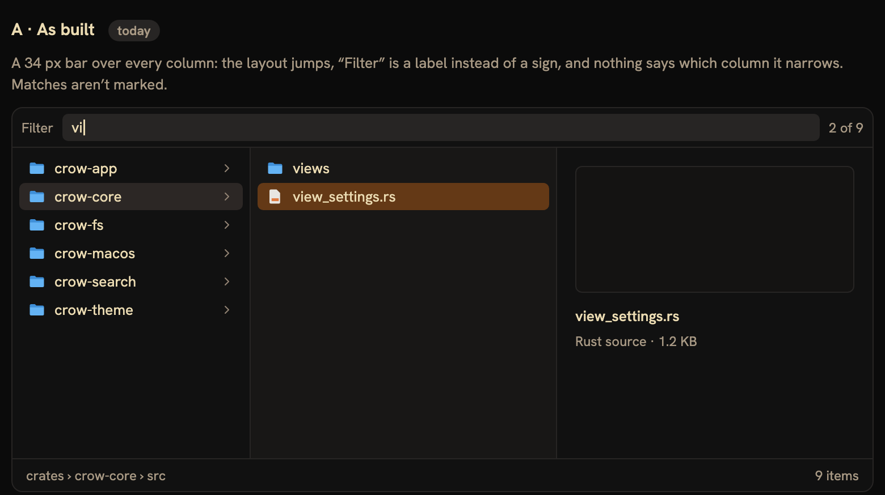
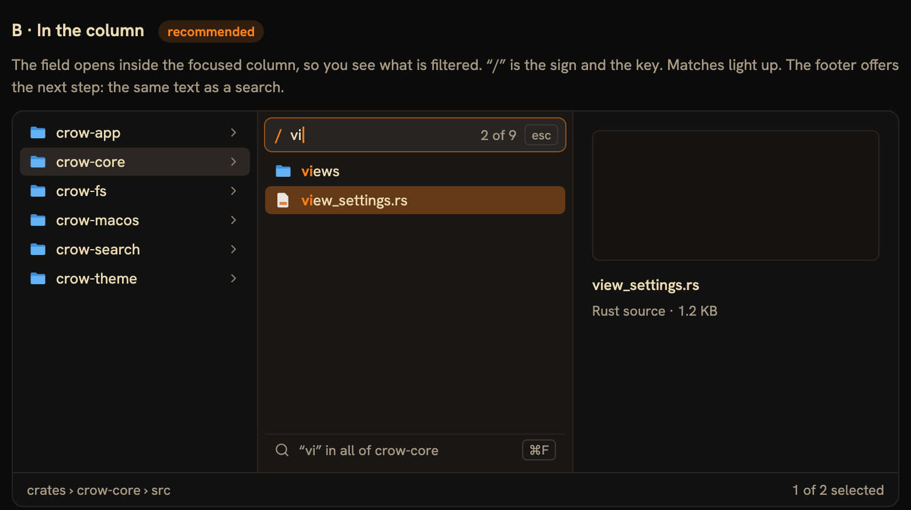
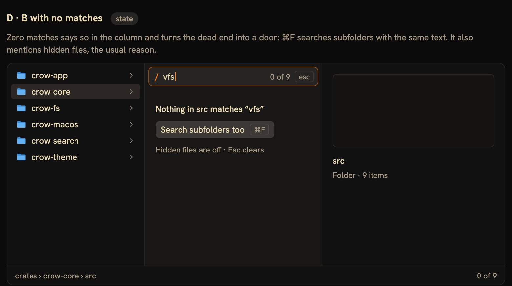

# U4 Filter in the focused column

Audience: an implementing agent. Follow `.claude/skills/execute-plan/SKILL.md`; read `AGENTS.md` and `docs/plans/ui-overhaul/README.md` first.
Needs: U1 merged to `main` (Keycap `Outline`, `glyph(name, size, role)` with `search`, selection tint helpers). U3 may or may not be merged; see "Seams".
Branch: `ui-u4-filter` from `main`. Progress file: `docs/plans/ui-overhaul/u4-filter.progress.md`.
PR title: "UI U4: Filter inside the focused column".
Design reference: canvas boards "Filter" variants **B** (in the column) and **D** (B with no matches), plus "Overhaul" (assembled, column view while filtering). https://claude.ai/artifact/EbZ7gFCy24MaccdpbSsFtE

## Why
"Today, annotated" (`img/today-annotated.png`), notes under "Not on screen, from the code": the filter is a 34 px bar across the whole pane, labelled "Filter". It pushes every column down and says nothing about which column it narrows. Finding 1 applies too: nothing hints that ⌘F can carry the same text deeper. Matches are not marked in the rows, and a filter with no matches is a dead end: an empty column and "0 of N".

## Decided
- Picked variants (index, "Picked variants"): Filter **B** and **D**.
- Combined draft (the combined draft (since folded into these plans) §U4), kept in full: the field moves out of the full-width bar. In **column view** it is the first row inside the focused column. In **list view** it sits above the list rows, inside the list's frame, 28 px tall. It shows an accent `/`, the query, "n of N" and an Outline `esc` keycap, with an accent ring while focused. Other columns never move. Matched substrings are highlighted (accent, semibold), and match ranges come from `Folder`; render does not recompute them. A footer row in the filtered column shows a search icon, `“<query>” in all of <folder>` and a ⌘F keycap. ⌘F while filtering opens search **pre-filled with the filter text, scoped to the focused folder**, and clears the filter. D: zero matches shows `Nothing in <folder> matches “<query>”`, a **Search subfolders too ⌘F** button, and `Hidden files are off · Esc clears` when hidden files are off.
- Kept from M6: case-insensitive substring; Esc clears; arrows move; Return opens; the filter clears on navigation; matches are flat and ignore inline expansions; selection, drag and copy act on visible rows.
- Ground rules (index): theme roles only, roles and aria labels on everything interactive, a keystroke test for every key behavior, bench vs `main` because row rendering changes.
- Inherited from U1: `Keycap::Outline` (18 px, 4 px radius, 1 px `surface-raised` border, `fg-muted` 11 px), keys come from the live keymap (I1), `glyph("search", 13, "fg-muted")` (U1 I5, `icons::glyph`), `active_selection`/`inactive_selection` replace `selection_color` (I6).
- Hints in the bottom bar (`↵ open · esc clear · ⌘F search deeper`, "n of N shown") belong to U5. Not here.

## Current state


As built: a full-width bar with a "Filter" label, plain query field and "2 of 9". The columns move down and matches are not marked.

**State** (`crates/crow-app/src/pane.rs`)
- `struct Filtering { input: Entity<TextInput>, _subscription }` (`pane.rs:195-199`). `Pane.filtering: Option<Filtering>` and `focus_list_after_filter: bool` (`pane.rs:234-237`).
- `start_filter` (`pane.rs:652-680`): if a filter is already open, it focuses the field. Otherwise it creates `TextInput::new("", "Filter")` and subscribes: `Changed` → `focused_folder().set_filter(Some(query))`; `Confirmed` → `open_selected`, then focuses the list if navigation closed the filter; `Cancelled` → `close_filter`. It then focuses the field.
- `close_filter` (`pane.rs:686-696`) clears the filter on **every** folder and focuses the list. `drop_filter` (`pane.rs:700-708`) does the same without a window and sets `focus_list_after_filter`; the root render defers the focus (`pane.rs:1872-1875`).
- The filter closes on navigation in these places: `apply_mode` (`pane.rs:513`), `enter` (`pane.rs:533`), `move_right` into the next column (`pane.rs:750`), `move_left` (`pane.rs:803`, `810`), and `press` on a row in another column (`pane.rs:1011`). In list view, Right while filtering navigates into the folder instead of expanding it (`pane.rs:763-766`).
- The palette's `CommandId::StartFilter` calls `start_filter` (`pane.rs:432`).

**Folder** (`crates/crow-app/src/folder.rs`)
- `filter: Option<String>` (`folder.rs:85-86`). `set_filter` (`folder.rs:302-313`) drops empty queries, then calls `rebuild_rows`, `prune_selection` and `settle_cursor`, and emits `Changed`.
- With a filter, `rebuild_rows` (`folder.rs:485-497`) makes `rows` the flat `FlatRow::Own(i)` list of entries for which `name_matches` holds. `name_matches` (`folder.rs:779-790`) does an ASCII `eq_ignore_ascii_case` window scan and otherwise compares `to_lowercase` strings. No match position is kept.
- `row_count()` is the number of rows shown and `entries().len()` is the total (`folder.rs:195-205`, `157`). Live updates go through `replace_entries` → `rebuild_rows` (`folder.rs:430-433`), so the filter re-applies automatically. `type_char` searches the shown rows (`folder.rs:732-743`).

**Render**
- `render_filter` (`pane.rs:1635-1678`) builds `div#filter-bar` with `Role::Group`, aria "Filter", `key_context("Filter")`, 34 px, a bottom border, and `on_action(move_up/move_down)`. Clicking it focuses the input. Children: the "Filter" label, `TextInput`, and `#filter-count` (`Role::Label`, "n of N shown").
- `Render for Pane` (`pane.rs:1741-1877`) returns `div(col) > [render_filter?, div#file-list]`. `#file-list` carries `key_context("FileList [ColumnView] [vim|VimPending] [Filtered]")` (`pane.rs:1768-1778`), `track_focus(&self.focus)`, every list action, and `on_key_down(Self::key_down)` (type-to-select, `pane.rs:957-984`). **The filter bar is a sibling of `#file-list`**, so keys typed in the field never pass through `FileList` bindings or `key_down`. That is why `filter_letters_stay_in_the_field_in_the_vim_layer` passes today.
- List view body (`pane.rs:1780-1812`): `render_table_header` (28 px, `pane.rs:1351`), then a `flex_1` wrapper whose `on_children_prepainted` stores the `uniform_list` bounds in `list_bounds` (`pane.rs:1790-1801`). Rows come from `render_table_rows` (`pane.rs:1142-1347`). The name is `truncate_middle(&entry.name, name_room, …)` (`pane.rs:1176`) and is drawn as plain text (`pane.rs:1325`).
- Column view: `render_columns` (`pane.rs:1572-1633`) builds `div#column-view-k` (`Role::ListBox`, aria "<title>, N items", width `column_width(entries)`, focused column tinted `surface` 0x40). Its only child is `uniform_list` with `h_full`. `on_children_prepainted` stores **`children.first()`** as the column's list bounds (`pane.rs:1580-1587`). Rows come from `render_column_rows` (`pane.rs:1428-1570`), which also truncates the name (`pane.rs:1455`). `column_width` uses all entries, not the shown rows (`pane.rs:1714-1717`), so width does not change while filtering. `column_row_at` compares against `entries().len()` rather than `row_count()` (`pane.rs:1068`); that is wrong while a filter is on.
- Selection tint: `selection_color(active)`, where `active` includes `self.filtering.is_some()` because the field, not the list, has focus (`pane.rs:1153`, `1439`).

**Keys** (`crates/crow-app/src/actions.rs`)
- `/` → `StartFilter` in `FileList` (`:95`). `escape` → `ClearFilter` in `FileList && Filtered` (`:96`). `up`/`down` → `MoveUp`/`MoveDown` in `Filter` (`:97-98`). `cmd-f` → `ShowSearch` in `Crow` (`:152`). The Vim layer binds `FileList && vim` keys (j k h l - g g G y y d d p u c w m ') (`:174-208`).
- `TextInput` (`text_input.rs:48-69`) binds editing keys, enter/escape/tab in context `TextInput`. It has **no** binding for space, `/`, cmd-backspace, cmd-d, cmd-o, letters or `cmd-f`.
- GPUI resolves bindings from every context on the focus path, deepest first (`vendor/zed/crates/gpui/src/keymap.rs:192-218`). `!X` is false when **any** context on the path contains `X` (`keymap/context.rs:289-296`).
- ⌘F today: nothing in the filter bar's path binds `cmd-f`, so it reaches `CrowWindow::show_search` (`window.rs:1267-1285`). That opens `SearchView::new(pane.current_dir() /* focused column */, home, show_hidden)` with an empty query and leaves the pane's filter open behind it.

**Search** (`crates/crow-app/src/search.rs`): `SearchView::new(folder, home, show_hidden)` (`:106`) starts with `scope: Scope::Folder`. The query `TextInput`'s `Changed` runs `start_search` (`:110-113`). `TextInput::set_text` (`text_input.rs:108-116`) emits `Changed`. There is no public way to set the query.

**TextInput** draws its own `bg` fill, accent border and `px_2 py_1` padding (`text_input.rs:661-668`). It does not scroll horizontally: `TextElement` paints the line at `bounds.origin` with no clip (`text_input.rs:600-612`), so long text overflows its box.

**Tests** (`window.rs` `mod tests`, from `:1804`): `filter_narrows_rows_and_escape_restores_focus` (`:2491`), `filter_arrows_and_return_act_on_matching_rows` (`:2509`), `filter_commands_and_escape_work_with_the_list_focused` (`:2531`), `filter_ignores_inline_children_until_cleared` (`:2549`), `filter_letters_stay_in_the_field_in_the_vim_layer` (`:2567`), `filter_narrows_the_focused_column` (`:2583`). Helpers: `fixture`, `open`, `settle`, `pane`, `rows`, `selected`, `use_vim`, `wait_for_search`. `cx.debug_bounds(selector)` and `cx.simulate_click` exist (`vendor/zed/crates/gpui/src/app/test_context.rs:991`, `:1042`).

## Target


B: an accent-ringed field (`/ vi`, "2 of 9", `esc`) inside the middle column only. The left column stays at the top. "vi" is accent and semibold in `views` and `view_settings.rs`. The footer reads `“vi” in all of crow-core ⌘F`.


D: the same field with "0 of 9". Below it: `Nothing in src matches “vfs”`, a raised "Search subfolders too ⌘F" button and the muted line "Hidden files are off · Esc clears". There is no footer.


The whole window. Only the focused (third) column holds the field and the footer. The columns to its left are untouched. The bottom-bar hints come from U5.

### Layout, column view (focused column `k`, filter open)
```
div#column-view-k  (Role::ListBox, aria "<title>, <shown> of <total> items", w = column_width(entries) unchanged,
                    flex flex_col, py_1, border_r border, focused tint as today, debug_selector "column-k")
├─ div#filter-field  (only in column k; key_context "Filter"; Role::Group; aria "Filter <folder>"; debug "filter-field")
│    h 28, mx 4 (matches the list's px_1), mb 4, rounded 6, bg surface, pl 9 pr 6, gap 7, flex items_center
│    border 1 px: color_alpha(accent, 0x8c) while the input is focused, else transparent (no layout shift)
│    ├─ "/"            accent, SEMIBOLD, 13 px (UI font size)
│    ├─ TextInput      chromeless (I2), flex_1 min_w_0, caret accent, placeholder "Filter <folder>" fg-subtle
│    ├─ #filter-count  12 px fg-muted, "2 of 9", Role::Status, aria "2 of 9 shown", flex_none
│    └─ Keycap::Outline(ClearFilter → "esc"), flex_none, decorative
├─ uniform_list (rows; flex_1 min_h_0 instead of h_full)  OR  div#filter-no-matches (D, below)
└─ div#filter-search-footer  (shown when shown > 0 and the query is not empty; Role::Button;
     aria "Search “vi” in all of crow-core, Command F"; debug "filter-search-footer")
     h 26, flex_none, mx 4, px 8, gap 8, border_t 1 border, 12 px fg-muted, hover bg surface, cursor pointer
     ├─ glyph("search", 13, "fg-muted")
     ├─ "“vi” in all of crow-core"   flex_1, single line, text_ellipsis
     └─ Keycap::Outline(ShowSearch → "⌘F")
```
Other columns render exactly as today: no field, no footer, no spacer. The focused column's rows start 32 px lower (28 + 4), and its own height does not change. A column that is not focused never holds the field. The filter only lives in the focused column, and changing the focused column closes it (M6).

### Layout, list view
```
#file-list > body (flex col)
├─ table header (28 px, unchanged)
├─ div#filter-field  (same element as above; mx_2 to line up with rows' mx_2, my 4, h 28)
├─ list wrapper (flex_1; on_children_prepainted → list_bounds, unchanged) > uniform_list  OR  #filter-no-matches
└─ #filter-search-footer (mx_2, same content)
```
The field goes below the header and above the rows; see Q2. The preview pane on the right is unchanged.

### Zero matches (D), in place of the list
`div#filter-no-matches` (Role::Group, aria "No matches", debug "filter-no-matches"), padding 22 px top and 10 px sides, flex col, gap 10, items start:
- `Nothing in src matches “vfs”`: fg, `FontWeight::MEDIUM`, wraps. Role::Status with the same text, so it is announced when it appears.
- Button `#filter-search-subfolders` (Role::Button, aria "Search subfolders too, Command F"): h 26, px 8, gap 8, rounded 6, bg `surface-raised`, text fg. Hover bg `color_alpha(accent, 0x33)`; pressed `color_alpha(accent, 0x55)`. Add both to `style.rs` as named helpers unless U1 already has button tints. Then `Keycap::Outline(ShowSearch)`. Its border is `surface-raised`, the same as the button fill. If it disappears there, pass a `fg-subtle`-based border if U1's Keycap allows an override; otherwise note it for a hand check and ask.
- `#filter-hidden-note`: 12 px fg-muted, `Hidden files are off · Esc clears` when `show_hidden` is false. When hidden files are shown, see Q3.
- It is shown only when `row_count() == 0`, the query is not empty, the folder is not loading (`!is_loading()`) and the folder has no `error()`. While loading, the area stays empty; on error, the existing status error stays.

### Highlights
- In each shown row of the filtered folder, the first case-insensitive occurrence of the query in the name is drawn with `style::highlight_text(text, ranges, theme, on_selection)`, the shared helper from U6 (accent + SEMIBOLD through `StyledText::with_highlights`, `vendor/zed/crates/gpui/src/elements/text.rs:409`). This applies in both views. On the active selection the board keeps accent text, but U6's helper switches to `fg` + SEMIBOLD there; see Q8.
- The range comes from `Folder::row_match(ix)`. Render maps it through `truncate_middle`. When the middle is cut, the visible parts of the range stay highlighted and the `…` is not.
- Inline-expanded rows cannot appear while filtering, because rows are flat.

### Keys (both layers)
| Focus | Key | Effect |
| --- | --- | --- |
| list | `/` | opens the field in the focused column; focuses it if already open |
| field | letters, digits, space, `/`, `-`, `'` | typed into the query (Finder and Vim) |
| field | ↑ ↓ | move the selection in the matches (focus stays in the field) |
| field | ↵ | opens the selection (`open_selected`), as M6 |
| field | esc | clears the filter, focuses the list |
| field / list while filtering | ⌘F | opens search with the query, scoped to the focused folder; clears the filter |
| field | ⌘A ⌘C ⌘X ⌘V ← → ⌫ ⇥ | text editing (TextInput, as today) |
| field | ⌘⌫, ⌘D, ⌘O, ⌘↓, ⇧⌘N, Space | nothing (they are list keys; today's bar ignores them too) |
| list while filtering | everything | as M6 (type-to-select within matches, ⌘A selects matches, esc clears) |
| either | ⌘2/⌘3, ← → between columns, click a row in another column, navigation | filter closes (M6) |

Focus order: ⇥ in the field is TextInput `Complete` (ignored, as today). ⇥ from the list switches to the sidebar (`SwitchFocus`). Clicking the field focuses the input. Clicking a row of the filtered column focuses the list and keeps the filter; the ring goes transparent (Q4).

### States
- Default and focused: as above. List focused while filtering: the field stays and the ring is transparent. Hover: footer and button only. Disabled: none.
- Loading: the field works; the count grows as partial listings arrive; no D state.
- Live updates: rows, ranges and the count follow file changes (`replace_entries` → `rebuild_rows`). D appears or disappears live. The cursor settles as M6.
- Light and dark: roles only. Check accent text on `active_selection` in Solarized Light and FireBox by hand.
- Vim: same field and keys. Letters never reach Vim bindings from the field.
- Multiple tabs: each `Pane` keeps its own filter; ⌘F acts on the active tab's pane.
- Narrow window: column width is fixed (220–360 px), so the field fits: at 220 px there is about 56 px of query room. In list view the field spans the list frame. Count and keycap are `flex_none`; the query shrinks and scrolls (I2). The footer label ellipsizes.
- Long query: the text scrolls so the caret stays visible and is clipped to the field (I2).

### VoiceOver
- Field: TextInput role `TextInput`, label = placeholder "Filter <folder>", value = query. The group is labelled "Filter <folder>".
- Count: `Role::Status`, "n of N shown". Announced on change if AppKit treats AXStatus as a live region; verify first (Risks).
- Column or list aria: "<title>, n of N items" while filtered (today only the root list says so, `pane.rs:1819-1823`; the focused column gets the same).
- Zero matches: `Role::Status` "Nothing in src matches vfs". Button: "Search subfolders too, Command F". Footer: "Search “vi” in all of crow-core, Command F".
- Keycaps are decorative (U1 I2).

### Performance
- Match ranges are computed in `rebuild_rows` in the same pass as matching, so once per filter change or listing change, never per frame.
- Render only looks up ranges for the rows `uniform_list` asks for. No string work beyond today's `truncate_middle` plus a range mapping on visible rows.
- Unfiltered rows pay one `Option` check: `row_match` returns `None` when no filter is set.
- Budgets (AGENTS.md): warm first paint < 50 ms and scroll p99 < 1.5 × frame time on the 100k fixture, compared with `main`.

## Items

### I1 Match ranges from `Folder`
- *Where:* `folder.rs` (`rebuild_rows`, `name_matches`, new accessors).
- *Change:* Add `fn name_match(name: &str, query: &str, lower_query: &str) -> Option<Range<usize>>`. It returns byte offsets into `name` of the first match. ASCII path: the index of the first window that matches `eq_ignore_ascii_case`. Non-ASCII: keep `name_matches` as the predicate, so the set of shown rows is exactly as today. For the range, lowercase `name` char by char, keep a map from lowered chars to original byte starts, find `lower_query`'s chars and map back to original byte boundaries. If the mapping fails (e.g. the Greek final sigma, where `str::to_lowercase` differs from char-wise lowercasing), return `None`: the row is shown with no highlight. Add a field `match_ranges: Arc<Vec<(u32, u32)>>`, aligned with `rows` while a filter is set and empty otherwise, built in the filtered branch of `rebuild_rows`. Accessor: `pub fn row_match(&self, ix: usize) -> Option<Range<usize>>`.
- *Edge cases:* an empty query never reaches here (`set_filter` drops it). A query longer than the name gives no match. Names with combining marks: ranges must sit on char boundaries (`debug_assert` in `with_highlights`); a test covers it.
- *Tests:* new `#[cfg(test)] mod tests` in `folder.rs`: `name_match_finds_the_first_ascii_occurrence` ("View_vi", "VI" → 0..2); `name_match_maps_non_ascii_to_original_bytes` ("Ärger.txt", "rg" → 2..4 in bytes; "Grüße", "ÜSS" → None, same as `name_matches`); `name_match_agrees_with_name_matches` (a small corpus: every name where `name_matches` is true either has `Some` range or is in the known sigma case). In `window.rs`: `filter_exposes_match_ranges_per_row` (`/`, input "PH" → the single row `alpha` has `row_match(0) == Some(2..4)`). Add the test-only `Pane::row_matches(cx) -> Vec<Option<Range<usize>>>`.
- *Done when:* the tests pass and nothing visible changes.

### I2 Chromeless `TextInput` that scrolls to the caret
- *Where:* `text_input.rs` (`TextInput`, `Render`, `TextElement::prepaint/paint`).
- *Change:* Add `chromeless: bool` and a builder `TextInput::chromeless(mut self) -> Self`. When it is set, render drops `bg`, `border_1` and the accent border, and `px_2 py_1`. Add `scroll_x: Pixels` to `TextInput`. In `prepaint`, compute the caret x and update `scroll_x` with a pure helper `fn scroll_for_caret(caret: f32, width: f32, current: f32) -> f32` (keep the caret inside `[0, width - 2]` and never scroll past the text's end). Shift the line, caret and selection quads by `-scroll_x`, and paint inside `window.with_content_mask(Some(ContentMask { bounds }), …)`. `last_bounds` and `character_index_for_point` must account for the shift (subtract `scroll_x` from bounds origin, add it to the local x), so clicks still land on the right character. This applies to every TextInput (Go to Folder, rename, search, palette), which all overflow today. Record that in the progress file.
- *Edge cases:* IME marked text; a selection wider than the field; deleting back to a short text resets the offset to 0.
- *Tests:* unit `scroll_for_caret_keeps_the_caret_visible` (caret beyond the right edge scrolls; caret back at 0 returns to 0; short text never scrolls). Existing Go to Folder, rename and search tests stay green.
- *Done when:* tests pass; a hand check shows that a 60-character query in a 220 px column stays inside the field with the caret visible.

### I3 Keep list keys out of the field
- *Where:* `actions.rs` (`finder_keymap`, `vim_keymap`), `pane.rs` `key_down`.
- *Change:* The field moves inside `#file-list` in I4, so every binding whose context names `FileList` or `ColumnView` gets `&& !Filter`. Use consts: `const LIST: &str = "FileList && !Filter"`, `"FileList && Filtered && !Filter"` for Escape → `ClearFilter`, `"ColumnView && !Filter"`, `"FileList && !ColumnView && !Filter"`, and in `vim_keymap` add `&& !Filter` to `LIST`, `COLUMNS` and `ANY`. Leave the `Filter` up/down bindings, `Crow`, `Sidebar`, `Sheet`, `ThemePicker`, `Palette`, `Search*` and `TextInput` bindings unchanged. In `Pane::key_down`, return early when the filter input is focused (`filtering.input.read(cx).focus_handle(cx).is_focused(window)`; rename the `_: &mut Window` parameter to use it). That stops type-to-select from taking letters.
- *Edge cases:* `!Filter` must not match `Filtered`: GPUI contexts are identifier sets, so `contains("Filter")` is false for "Filtered". The unit test pins this. U1's live-keymap lookup must still find `/` for `StartFilter` in `FileList`; re-run U1's key test.
- *Tests:* `actions.rs` `#[cfg(test)] mod tests`: `filter_field_context_disables_list_keys`. Build `gpui::Keymap::new(finder_keymap() + vim_keymap() + text_input::keymap())`. For the stack `[Crow, FileList ColumnView vim Filtered, Filter, TextInput]`, `bindings_for_input` returns no binding for `j`, `l`, `/`, `space`, `cmd-backspace`, `cmd-d`, and returns `MoveUp` for `up`, `ShowSearch` for `cmd-f`, `Cancel` for `escape`. For `[Crow, FileList vim Filtered]` (list focused), `/`, `j` and `escape` (`ClearFilter`) still resolve.
- *Done when:* the unit test passes and every existing keystroke test is green. Nothing visible changes yet.

### I4 The field inside the focused column and the list frame


The field is a 28 px row inside the focused column only; the left column does not move.

- *Where:* `pane.rs`: `Render for Pane`, `render_columns`, the list-view body, `render_filter` (replaced), `column_row_at`. A new module `crates/crow-app/src/pane_filter.rs` with `impl Pane { fn render_filter_field, fn render_filter_footer, fn render_no_matches }` keeps `pane.rs` from growing; it is `mod pane_filter;` in `main.rs`, the same pattern as other modules.
- *Change:*
  - Delete the top bar: the root becomes `div.size_full().child(list)`. Keep the deferred focus.
  - `start_filter`: `TextInput::new("", format!("Filter {folder}")).chromeless()`, where `{folder}` is `folder_name`-style display text. Move `folder_name` from `window.rs:592` to `style.rs` as `pub fn display_name(dir)` so both use it.
  - `render_filter_field(&self, window, cx) -> Option<AnyElement>` builds the tree in Target with `id("filter-field")`, `key_context("Filter")`, `on_action(move_up/move_down)`, and `on_click` focusing the input (as today). It also calls `on_mouse_down(Left, |_, _, cx| cx.stop_propagation())` so the press never reaches the column. The ring uses `input.focus_handle.is_focused(window)`. The keycap uses U1 `Keycap::Outline` for `ClearFilter`.
  - Column view: the column div becomes `flex flex_col`. Its children are `[field if k == focused && filtering] + [uniform_list.flex_1().min_h_0() or no-matches (I7)] + [footer (I6)]`. Fix the bounds capture: store the list child at index `field_present as usize`, not `children.first()`. Add `.debug_selector(|| format!("column-{k}"))`. The aria label says "n of N items" while filtered.
  - List view: insert the field between `render_table_header` and the list wrapper (`mx_2`, `my_1`). Leave the wrapper and `list_bounds` as they are.
  - `column_row_at`: compare with `row_count()`, not `entries().len()`. This fixes the drop target while filtered.
  - Add a test-only `Pane::is_filtering()` and `Pane::filter_query(cx)`. Make `filter_query` `pub` (not test-only), because I6 and U5 read it.
- *Edge cases:* the field inside the strip scrolls with its column (`strip_scroll` already brings the focused column into view). Drops onto the field land on the column (`drop_files(k)`), as anywhere in the column. Renaming while filtering: the rename input lives in a row, not in the `Filter` context, so it is unaffected. Selection tint: keep `active = … || filtering.is_some()`, using U1's `active_selection`.
- *Tests* (`window.rs`):
  - `filter_field_opens_in_the_focused_column`: `cmd-3`, `right` (focus column 1). Record `debug_bounds("column-0")` and `("column-1")`, press `/`. The field's bounds lie inside column 1's. Column 0's bounds are unchanged (rows did not move), and both widths are unchanged. `folder_count` and `focused_index` are unchanged.
  - `filter_field_opens_above_the_list_rows`: list view, `/`. The field's top is at or below `debug_bounds("table-header")`'s bottom and above `row-alpha`'s top.
  - `filter_vim_letters_stay_in_the_column_field`: `cmd-3`, `use_vim`, `/`, `simulate_input("hl-")`. The query is "hl-", the focused index and folder are unchanged, and rows are empty.
  - `filter_field_takes_space_slash_and_list_keys_as_text`: `/`, `simulate_keystrokes("a space /")`. The query is "a /", `notes.txt` still exists after `cmd-backspace`, and no Quick Look was requested (no `QuickLook` handled).
  - `filter_closes_when_the_focused_column_changes`: `cmd-3`, `right`, `/`, input "x", `left`. `is_filtering()` is false, the field is gone, column 1 shows all rows.
  - `filter_follows_live_changes`: `/` input "al", write `alpine.txt`, settle until the rows include it. The count is 2 and `row_matches` covers both.
  - Existing filter tests stay unchanged and green.
- *Done when:* the tests pass; by hand, the field sits in the focused column and list frame as in the image.

### I5 Highlighted names


"vi" is accent and semibold in `views` and `view_settings.rs`, including on the selected row.

- *Where:* `style.rs` (`truncate_middle`), `pane.rs` `render_table_rows` and `render_column_rows`.
- *Change:* Split `truncate_middle` into `truncate_middle_parts(...) -> Truncated { text: SharedString, cut: Option<(usize /*head bytes*/, usize /*tail start in original*/)> }`, and keep `truncate_middle` as a wrapper for other callers. Add a pure `fn map_range(t: &Truncated, r: Range<usize>) -> SmallVec<[Range<usize>; 2]>`: head and tail parts map directly; the part under the `…` is dropped. In both row renderers, when `folder.row_match(ix)` is `Some`, draw `style::highlight_text(text, &ranges, theme, selected && active)`. Otherwise draw today's plain child. If U6 is merged, use its helper as is. If not, add `style::highlight_text(text: impl Into<SharedString>, ranges: &[Range<usize>], theme: &Theme, on_selection: bool) -> StyledText` here with exactly that signature and U6's behavior (accent + SEMIBOLD; `fg` + SEMIBOLD when `on_selection`; ranges clamped to char boundaries and the text length), plus U6's unit test `highlight_text_clamps_ranges`. U6 then reuses it.
- *Edge cases:* semibold glyphs are a little wider than the measured regular text, and the name cell already has `overflow_hidden`/`whitespace_nowrap`. Check by hand that the last character is not clipped; if it is, measure with 1 px of slack. The match can be entirely inside the cut. Renaming a row shows the input, not the highlight.
- *Tests:* `style.rs` `#[cfg(test)]`: `map_range_through_truncation` (range in head, in tail, spanning the `…`, fully hidden, uncut text). The GPUI render of highlights is a hand check.
- *Done when:* tests pass; bench run (Finish) shows no regression.

### I6 Footer and ⌘F escalation


Footer: search icon, `“vi” in all of crow-core`, ⌘F. Q1 settles which folder name goes there.

- *Where:* `pane_filter.rs` (`render_filter_footer`), `pane.rs` (new `take_filter`), `window.rs` (`show_search`, `open_search`), `search.rs`.
- *Change:*
  - `Pane::take_filter(&mut self, cx) -> Option<String>`: clears the filter on every folder like `close_filter`, but does not focus the list (search takes focus), and returns the query. Returns `None` when not filtering.
  - Use U3's entry point `CrowWindow::open_search(&mut self, start: SearchStart, window, cx)` with `pub struct SearchStart { folder: PathBuf, query: String, everything: bool }` (U3 I3). If U3 is not merged, add it here with **exactly** that signature: move today's `show_search` body after the guards into it; `SearchView::new` takes the `SearchStart` and, when `query` is not empty, sets the input text (`TextInput::set_text` emits `Changed` → `start_search`) and `everything` sets the existing flag. U3 then reuses it.
  - `show_search`: with no search open and none of the other overlays open, read `folder = pane.current_dir(cx)` (the focused column) **before** `take_filter`, then `let query = pane.update(|p, cx| p.take_filter(cx)).unwrap_or_default()`, then `open_search(SearchStart { folder, query, everything: false })`. Without a filter this is today's ⌘F.
  - Add test-only `SearchView::query(cx)` and `folder()` accessors if U3 has not.
  - Footer and D button click: `window.dispatch_action(Box::new(ShowSearch), cx)`. Focus is always inside `Crow` while the pane shows, so it reaches `show_search`. The binding check in I3 proves ⌘F from the field reaches `Crow`.
  - A query like `/x/` is passed as is. Search treats `/…/` as a regex (`crow-search/src/engine.rs:234`), but file names cannot contain `/`, so such a filter matched nothing anyway.
- *Edge cases:* ⌘F with an empty field closes the filter and opens an empty search. ⌘F while the palette, Go to or a sheet is open does nothing, as today. Esc from search returns focus to the list with all rows. Multiple tabs: only the active pane's filter is taken.
- *Tests* (`window.rs`):
  - `cmd_f_while_filtering_searches_the_focused_folder_with_the_query`: `cmd-3`, `right` (into `alpha`), write `alpha/needle.txt`, `/`, input "nee", `cmd-f`, `wait_for_search`. Search is open with `query == "nee"`, `folder() == root/alpha`, `scope == Folder`, results contain `alpha/needle.txt`, and `pane.is_filtering()` is false. `escape` closes search, the focused column shows all rows, and focus is on the list (`n` type-selects in Finder).
  - `cmd_f_from_the_list_while_filtering_also_escalates`: `/`, input "a", focus the list (as in `filter_commands_and_escape_work_with_the_list_focused`), `cmd-f`. The query is "a".
  - `filter_footer_click_opens_search`: `/`, input "al", `simulate_click(center of debug_bounds("filter-search-footer"))`. Search is open with "al".
  - `filter_footer_hides_for_an_empty_query`: `/` alone. `debug_bounds("filter-search-footer")` is `None`.
- *Done when:* tests pass; with U3 merged, the same tests pass against U3's search field (see Seams).

### I7 No-matches state (D)


"Nothing in src matches “vfs”", the raised button with ⌘F, and the hidden-files note.

- *Where:* `pane_filter.rs` `render_no_matches`; `render_columns` and the list-view body pick it instead of `uniform_list`.
- *Change:* Build the tree in Target ("Zero matches"). The condition is `filtering && !query.is_empty() && row_count == 0 && !is_loading() && error().is_none()`. The hidden note uses `self.show_hidden`. Copy uses the focused folder's display name and the raw query in curly quotes.
- *Edge cases:* toggling hidden files (⌘⇧.) while in D relists. The match may appear (D goes away), or the note updates. A long folder name or query wraps; the block is `w_full` with `overflow_hidden`.
- *Tests* (`window.rs`):
  - `filter_with_no_matches_offers_search`: `/`, input "zzz". `debug_bounds("filter-no-matches")` is `Some` and the footer is `None`. Click `filter-search-subfolders`: search opens with "zzz", and the filter is closed.
  - `filter_no_match_note_follows_hidden_files`: input "zzz". `filter-hidden-note` is present. `cmd-shift-.`, settle: the note shows the Q3 text (or is absent, per Q3).
  - `filter_no_matches_waits_for_the_listing`: start a filter on a folder still loading (use a fresh pane on a large temp folder, or assert through a test hook that `is_loading()` suppresses the block). Verify first whether a loading state can be held in tests; otherwise make this a unit test of the condition function `fn shows_no_matches(...) -> bool`.
- *Done when:* tests pass; hand check in both themes.

## Seams with other U plans
- **U1 (required):** `Keycap::Outline`, live-keymap key text for `ClearFilter` ("esc") and `ShowSearch` ("⌘F"), `glyph("search")`, `active_selection`/`inactive_selection`. If U1 is not merged, stop and ask; don't build stand-ins. U1's key lookup test (`/` for `StartFilter` in `FileList`) must still pass after I3 changes the predicates.
- **U3 (optional):** ⌘F → search must work with or without it. The entry point is U3's `CrowWindow::open_search(SearchStart { folder, query, everything })`. If U3 is merged, call it. If not, U4 adds it with that exact signature (I6) and U3 reuses it. Either way the query goes into the `TextInput` owned by `SearchView`. Today that input is drawn in `SearchView::render_header`; with U3 it is drawn in the toolbar band D, so the same call fills the toolbar field. Because the footer and the D button dispatch `ShowSearch`, U3's field click path and U4's escalation meet in `show_search`. The I6 tests assert on `SearchView::query()`, not on where the field is drawn.
- **U6 (optional):** `style::highlight_text(text, ranges, theme, on_selection)` is shared. If U6 is merged, use it. If not, U4 adds it with that signature and behavior (I5) and U6 reuses it; U6 keeps it general.
- **U5:** owns the bottom bar. It shows "n of N shown" and the filtering hints (`↵ open · esc clear · ⌘F search deeper`), as in `img/bottom-bar-c-filter.png`. U4 provides `Pane::filter_query(cx) -> Option<String>` and leaves `render_path_bar` alone. Today it says "N items" while filtering; that stays until U5.
- **U6:** its scope bar names the current folder. The folder passed by `open_search` is the focused column's, so U6 shows that name.
- **U7:** the palette's `StartFilter` command keeps working (`pane.rs:432`).
- **U9:** the tip "two zero-match filters in a row → ⌘F" needs a signal. If U9 is planned, add a `PaneEvent::FilterNoMatches` emitted once per transition into D. Ask before adding it here (Q6).
- Leave alone: the type-to-select rules, `Folder::set_filter` semantics, the inline-expansion rules, and search internals.

## Risks and things to measure first
1. **Key gating (verify first):** before moving any UI, land I3's unit test and run every keystroke test. The `!Filter` semantics come from `keymap/context.rs:289-296`. Also confirm that a plain character with no binding left still reaches the TextInput through `simulate_input` and `simulate_keystrokes` (the test in I4).
2. **`key_down` bubbling:** the pane's `on_key_down` is on `#file-list`, an ancestor of the field after I4. Confirm that the early return in I3 is enough and that `stop_propagation` no longer runs for field keys; otherwise letters vanish.
3. **Live announcements:** check that `Role::Status` changes are spoken by VoiceOver (AXStatus). If not, record it and keep the labels; don't invent an API.
4. **TextInput scroll (I2):** it touches every text field. Run the Go to Folder, rename, search and palette tests, and hand-check IME (e.g. Japanese input) in one field.
5. **Bench:** rows now build `StyledText` only when filtered, and the unfiltered path adds one `Option` check. Run `--bench target/fixture-100k` on `main` and on the branch, three runs each, and record warm first paint and p99 in the progress file. The plain bench never filters, so a filtered measurement needs Q5.
6. **Filtering 100k rows on the main thread** is unchanged from M6. I1 adds a range per match, at most 8 bytes × matches. Measure `set_filter` on the 100k fixture with a broad query ("e") with a temporary `tracing::debug!` timing, and record it. The budget is that typing stays under one frame per keystroke on that fixture; if it doesn't, ask before moving matching off the main thread.
7. **Contrast:** accent semibold text on `active_selection` (accent 0x55) in light themes. Hand check; if it is hard to read, ask (don't change the tint here).

## Questions to ASK
1. **Which folder name in the footer?** Board B says `“vi” in all of crow-core` while D says `Nothing in src matches` for the same focused column (`src`). ⌘F is scoped to the focused folder. **Recommended:** the focused folder's name in both (`“vi” in all of src`), because that is exactly what ⌘F searches.
2. **List view: field below or above the table header?** The draft says "above the list rows, inside the list's frame". **Recommended:** below the header, directly above the rows. The header stays in place like the column view's rows, and the field reads as part of the rows it narrows.
3. **D's third line when hidden files are shown.** The board only covers "off". **Recommended:** show `Esc clears` alone.
4. **Ring when the list has focus but the filter is open** (after clicking a row). **Recommended:** no ring (transparent border), with the `/` still in accent, so only the place keys go is accented, matching U1's tint rules.
5. **A filtered bench.** `--bench` never filters, so highlighted rows are not measured. **Recommended:** add an optional `--bench-filter <query>` that applies the filter before scrolling and prints the same BENCH line, documented in `docs/testing.md`. The alternative is a hand timing only.
6. **U9 hook:** add `PaneEvent::FilterNoMatches` now or leave it to U9? **Recommended:** leave it to U9 (no unused API).
7. **Rename has the same key leak** (verify first): the rename `TextInput` sits inside `#file-list`, so Space (Quick Look) and Vim letters may fire while renaming. Should I3 gate on `!TextInput` instead of `!Filter`, which fixes both? **Recommended:** yes, if a quick test confirms the leak, as a separate commit with its own test (`rename_keeps_space_and_vim_letters_in_the_field`). Otherwise keep `!Filter`.

8. **Highlight on the selected row.** Board B keeps accent text on the accent-tinted selected row; U6's shared `highlight_text` switches to `fg` + SEMIBOLD on the active selection (for contrast). **Recommended:** follow U6 (`on_selection = true` for selected rows in the focused column) so filter and search rows agree; the match stays visible through the weight.

## Hand checks
Rows to add to `docs/testing.md` (replace the current "Filter" row):

| Check | How |
| --- | --- |
| Filter | Press `/` in a folder: an accent-ringed field with `/`, the query, "n of N" and `esc` opens as the list's first row (below the header in list view). Typing narrows the rows and the matching letters turn accent and semibold. Arrows move within matches, Return opens, Esc restores focus and rows. |
| Filter in columns | Cmd-3, move into a middle column, `/`: only that column gets the field and footer; no other column moves or changes width. Left or Right closes the filter. Type a 60-character query: the caret stays visible inside the field. |
| Filter to search | Filter a column, then press Cmd-F (or click the footer): search opens with the same text in that folder, and Esc returns to the unfiltered column. Filter something with no matches: "Nothing in … matches", the button opens search, and the hidden-files note shows when hidden files are off. |
| Filter look | In a light and a dark theme, accent text on the selected row is readable; in the Vim layer, letters typed in the field stay there. VoiceOver reads "Filter <folder>", the count, and the no-match line. |

## Finish
- README "Keys": rewrite the `/` sentence: the field opens inside the focused column, matches are highlighted, Cmd-F carries the filter text into a search of that folder.
- `docs/testing.md`: the rows above. Name the new keystroke tests in the "Automated" paragraph ("the `/` filter, its field in the focused column and its Cmd-F hand-off"). Add bench numbers for U4 to the budget table (and the `--bench-filter` line if Q5 is yes).
- Bench vs `main` (rows render differently): `cargo run --release -p crow-app -- --bench target/fixture-100k` on both, recorded in the progress file.
- `cargo fmt --check` · `cargo clippy --workspace --all-targets -- -D warnings` · `cargo test --workspace`.
- `./scripts/bundle.sh`, then the hand checks above. Push `ui-u4-filter` and open the PR "UI U4: Filter inside the focused column" (body: each item, approach, how verified, bench numbers; attribution per environment). Don't merge. Set the progress file to "PR open".
