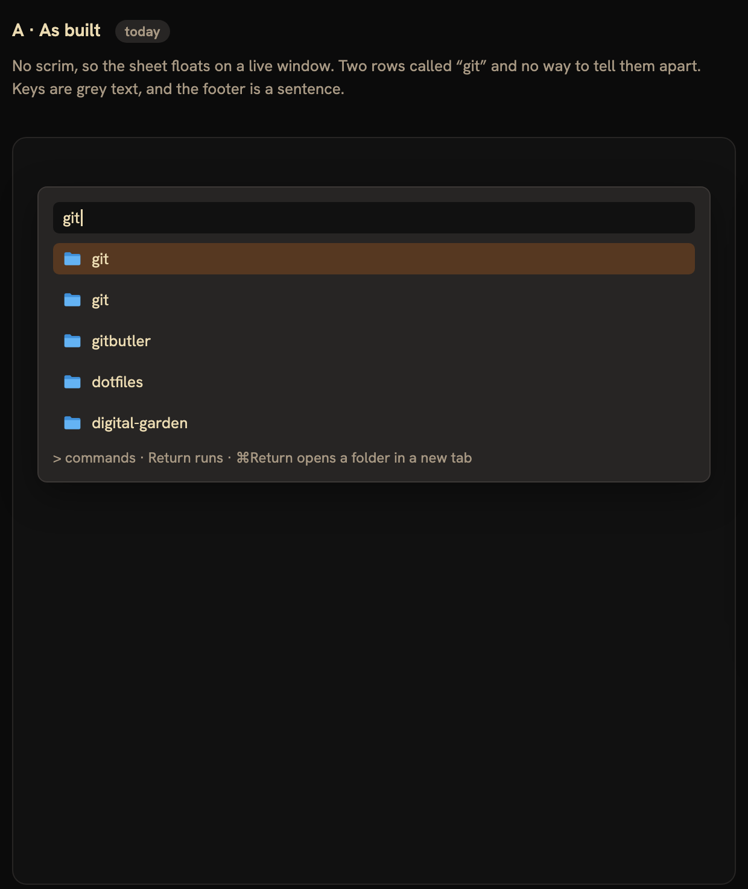
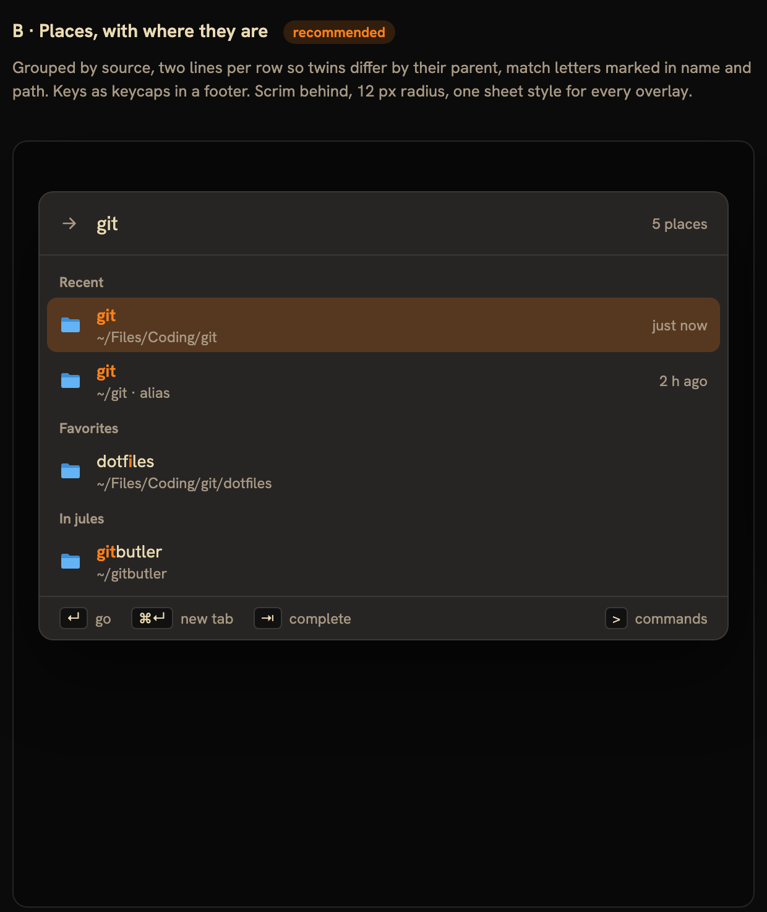
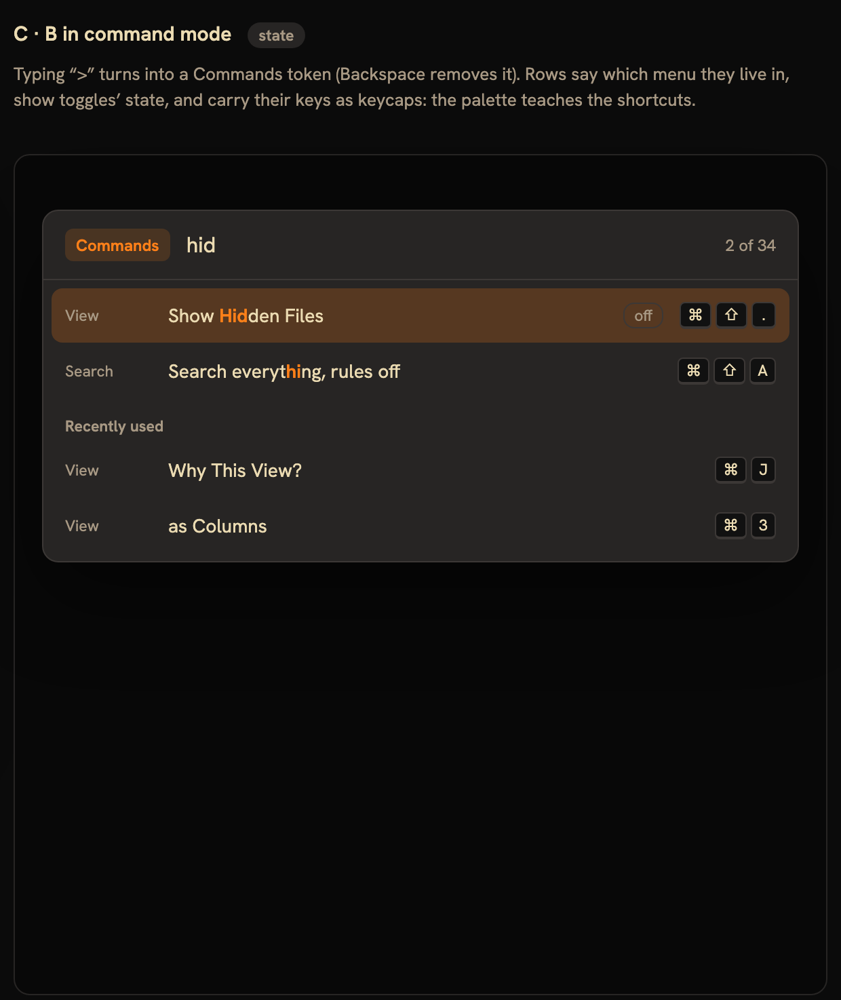

# U7 Palette

Audience: an implementing agent. Follow `.claude/skills/execute-plan/SKILL.md`; read `AGENTS.md` and `docs/plans/ui-overhaul/README.md` first.
Needs: U1 (Sheet, Keycap, icons, selection tints, keys from the live keymap) and U2 (command registry with a `menu` field) merged to `main`.
Branch: `ui-u7-palette` from `main`. Progress file: `docs/plans/ui-overhaul/u7-palette.progress.md`.
PR title: "UI U7: Palette sections, two-line rows, Commands token, Tab completion, recent commands".
Design reference: canvas boards "Palette variants" (PaletteCompare) **B** (folder mode) and **C** (command mode), older storyboard "Palette", and "Assembled · filter" for the overall look. https://claude.ai/artifact/EbZ7gFCy24MaccdpbSsFtE

## Why
⌘K works but explains nothing (finding 4 on "Today, annotated": "Recent can't tell twins apart … The palette has the same problem"; and the hidden finding "Overlays: four hand-made sheets, 520 or 560 wide, no scrim, keys as 11 px grey text").
- Two folders called `git` look the same; the palette doesn't say where a hit came from (favorite, recent, here).
- `>` is an invisible mode: the field just holds `>hid`.
- Keys are grey text from a hardcoded table; the footer is a sentence.
- There is no way to drill into a folder from the palette, and no memory of commands used.

## Decided
- Q7 (index): "Palette: add **⇥ completion**; **remember recent commands across launches** (state dir), hidable with `palette_recent_commands` in `settings.toml`. The user wants an in-app **settings page** eventually (not in these plans): keep new options flat, typed and documented so a page can list them."
- From the orchestrator's brief for this plan: the "Recently used" section shows **when the query is empty**; `palette_recent_commands = true|false`, documented default `true`, live reload; `false` hides the section **and stops recording**. ⇥ in folder mode replaces the query with the highlighted folder's abbreviated path plus `/` so the next letters search inside it (reuse Go to Folder's completion where possible); **Tab does nothing in command mode**. Footer keycaps: `↵ go · ⌘↵ new tab · ⇥ complete · > commands`.
- Combined draft U7 (the combined draft (since folded into these plans)): U1 Sheet with scrim; width 600–640; 50 px input row with a go-to icon and a count ("5 places", "2 of 34"); sections **Recent, Favorites, In <current folder>**; `Item::Folder` gains its source; 44 px two-line rows, matched letters in accent in name and path; last visit on Recent rows ("2 h ago"); `>` becomes an accent **Commands** token, Backspace on an empty query removes it; command rows show menu name (U2), highlighted label, on/off chip for toggles (hidden files, activity), `Key` keycaps.
- Inherited: theme roles only; every interactive element has a role and an aria label; every new key behavior has a keystroke test; no disk I/O on the main thread (startup loads excepted); config via documented default / live reload / errors in the status line; state (not config) lives in `~/.local/state/crow/`.
- Board vs plan: board C shows "Recently used" under matches while a query is typed. The plan (empty query only) wins; see Q1.

## Current state


Take from it: what goes away. One-line rows, no source, no scrim, footer as a sentence.

Model, `crates/crow-app/src/palette.rs`:
- `CommandId` (11–52), `Command { id, label, keys }` (54–60) and `COMMANDS` (63–103): 39 commands, `keys` hardcoded Finder strings. U1 I1 replaces `keys` with a live-keymap lookup; U2 adds `menu` and probably renames labels (e.g. "Toggle Hidden Files" → "Show Hidden Files"). Verify both on `main` before starting.
- `FolderCandidate { path, label, frecency }` (105–111); `label` is the **whole abbreviated path** (`abbreviate_home`), not the name.
- `Item::{Command(Command), Folder { path, label }}` (113–117). No source.
- `folder_candidates(favorites, recents, subfolders, home)` (121–150): favorites first, then recents (frecency = rank position, a recent favorite takes the frecency), then subfolders; dedup by path.
- `items(query, folders)` (154–185): `>` prefix → commands scored with `FuzzyMatcher` on `label`, sorted by score; else folders scored on `label` (full path), sorted by score, then frecency, then label; `take(50)`. Empty query keeps candidate order.

Matcher, `crates/crow-search/src/engine.rs:68–92`: `FuzzyMatcher::score` wraps `nucleo_matcher::Matcher::fuzzy_match`; it returns **no indices**. nucleo-matcher 0.3.1 has `fuzzy_indices(haystack, needle, &mut Vec<u32>)` (`~/.cargo/registry/src/*/nucleo-matcher-0.3.1/src/lib.rs:202`); indices are positions in the `Utf32Str`, i.e. **grapheme indices** for non-ASCII text (`chars::graphemes` takes the first char of each grapheme; default feature `unicode-segmentation`), byte indices for ASCII.

Window, `crates/crow-app/src/window.rs`:
- `struct Palette { input, items, cursor, folders, scroll: UniformListScrollHandle, _subscription }` (90–98); `CrowWindow.palette: Option<Palette>` (66).
- `show_palette` (1340–1379): refuses while picker, Go to, sheet or search is open; favorites from `ui.favorites()`, recents from `ui.palette_recents`, subfolders from `Pane::subfolders` (`pane.rs:407–415`: dirs of the **focused** folder, packages excluded; the focused column in column view, same as `Pane::current_dir`, `pane.rs:301–304`). Builds a `TextInput` with placeholder "Go to Folder or > for Commands"; `CompletionRequested` (Tab) is ignored (1368).
- `refresh_palette` (1381–1388) recomputes items, cursor 0. `move_palette` (1390–1396) clamps, `scroll_to_item(Center)`. `close_palette` (1398–1404) focuses the pane. `palette_open_in_tab` (1406) → `confirm_palette(true)` (1410–1421): command → `run_command` (1423–1462), folder → `open_tab_at` or `pane.navigate`.
- `run_command`: `ToggleHiddenFiles` → `toggle_hidden` (state `CrowWindow.show_hidden`, 55); `ToggleActivity` flips `CrowWindow.show_activity` (59).
- `render_palette` (1464–1531): absolute div at top 52 px, 560 px wide, `p_3`, `surface` fill, `border` role, no scrim; key context `"Sheet Palette"` (+ `" vim"`); list is `uniform_list` of 26 px rows, height `min(count,14) × 26`; footer sentence; dialog aria "Command Palette", listbox "Commands and folders"; empty → "No matches".
- `render_palette_rows` (1533–1590): 26 px row, `ListBoxOption`, aria label = label, position/size in set, `aria_selected`, `aria_active_descendant` on the cursor row, selected fill `color_alpha(accent, 0x55)`, Finder icon 16 px for folders, keys as 11 px `fg-muted` text, `debug_selector("palette-row-{i}")`, click confirms.
- Placed in `Render` at 1742/1799 next to `go_to`, `sheet`, `why`, `picker`.

Keys, `crates/crow-app/src/actions.rs`: `cmd-k` → `ShowCommandPalette` in `Crow` (151); `up`/`down` → `MoveUp`/`MoveDown` and `cmd-enter` → `PaletteOpenInTab` in `Palette` (167–169); Vim `j`/`k` in `Palette && vim` (204–205). `tab` → `SwitchFocus` in `Crow` (138), but the field's `TextInput` context binds `tab` → `Complete` (`text_input.rs:68`), which wins because it is deeper.

Go to Folder (⇧⌘G), `window.rs:213–246`: Tab → `crow_core::complete_typed(typed, cwd, home)` (`crates/crow-core/src/paths.rs:34–62`: completes the last component to the shared prefix, `/` after a unique folder, hidden names only when the partial starts with `.`). It runs `read_dir` **on the main thread** inside the subscription (existing; this plan does not repeat that). `resolve_typed` (`paths.rs:7–29`) turns text into an absolute path.

Text field, `crates/crow-app/src/text_input.rs`: events `Changed | Confirmed | Cancelled | CompletionRequested` (40–46). `backspace` (176–186) at offset 0 with an empty selection plays the bell and emits nothing. `render` (629–670) always draws its own `bg` fill, accent border, `px_2 py_1`, and uses the placeholder as aria label. `set_text` (108–116) emits `Changed`.

Recent folders: `crow_core::Recent { visits: HashMap<PathBuf, Visit { rank, last }> }` (`crates/crow-core/src/recent.rs:17–27`). `last` is seconds since the epoch, **stored per entry**, but private and not exposed. zoxide entries (`parse_zoxide`, 90–99) have a score only, no time. `Ui.recent` (ui.rs:37), `Ui.palette_recents` (41–42, best-first, favorites included, up to `max(sidebar count, 50)`, computed off the main thread in `refresh_recent`, 378–410), `Ui.state_dir` (45), `recent.json` loaded in `Ui::new` (60, startup exception). `init_for_tests` (233–246) gives each test a temp config **and** state dir.

Settings: `crates/crow-core/src/settings.rs` `DEFAULT_SETTINGS` (10–33, flat top-level keys + `[window]`), `Settings` (65–87), test `documented_defaults_match_code_defaults` (160–164). Reload: `ui::reload_config` (266–279) → `refresh_windows`.

Tests today (`window.rs`): `command_palette_runs_a_command` (2296, types `>toggle hidden`), `command_palette_goes_to_a_recent_folder` (2316), `command_palette_cmd_return_opens_a_new_tab` (2339), `command_palette_vim_keys_move_the_cursor` (2354), `go_to_folder_completes_navigates_and_reveals_files` (2630). Helpers `fixture` (`root/{alpha/inner/, beta/, notes.txt}`), `open`, `settle`, `write_config`, `use_vim`, `favorites_toml`.

## Target


Take from it: 50 px input row (arrow icon, query, "5 places"), section headers, 44 px two-line rows with last visit on the right, footer of keycaps with "> commands" on the right.


Take from it: accent "Commands" token before the query, "2 of 34", 40 px rows with menu name, label with highlights, chip, keycaps. (Its "Recently used" under a typed query is overridden by the plan: empty query only.)


Take from it: the palette's sheet should read as part of this window (same row fills, keycap style, `surface` panels).

### Sheet
- U1 Sheet, scrim on, top offset 52 px, 12 px radius, `surface` fill, `surface-raised` border, shadow; width preset Wide (620 px). Narrow window: `min(620, window width − 32)`.
- Key context unchanged: `"Sheet Palette"` plus `" vim"` in the Vim layer. Scrim click closes like Escape (U1).
- Vertical: input row 50 + 1 px divider + list (padding 6 px) + 1 px divider + footer 34. List max height `min(440, window height − 52 − 50 − 34 − 2 − 24)`, at least one row; shorter lists shrink to fit.

### Input row (50 px, `px 16`, gap 12, bottom border `surface-raised`)
- Left: U1 `icon("go-to", 16, "fg-muted")` in folder mode; in command mode the **Commands token** instead: 24 px tall, `px 8`, 6 px radius, fill `color_alpha(accent, 0x29)` (U1 helper if it has an accent-soft one; otherwise add `accent_soft` to `style.rs`), text "Commands" 12 px semibold `accent`.
- Field: `TextInput` in a new bare style (no fill, no border, no padding), text 15 px (board 16; the app's UI font is 13 pt, 15 keeps the field dominant), `fg`, caret `fg`.
- Placeholder: folder mode "Go to a folder, or > for commands"; command mode "Run a command".
- Right: count, 12 px `fg-muted`. Folder mode: "1 place", "n places", "No places". Command mode: empty query "n commands"; with a query "m of n" (n = all commands listed by the registry).

### Folder mode (variant B)
- Sections in fixed order: **Recent**, **Favorites**, **In <name>** where `<name>` is the file name of `Pane::current_dir` (focused column), "/" shown as the volume name if `crow_macos` has it, else "/". Empty sections are omitted (header too).
- Each path appears once. Precedence when a folder is in several sources: **Favorites > Recent > In** (matches the sidebar, whose Recent already drops favorites, `ui.rs:399–400`). See Q2. A favorite that is also recent keeps its frecency for tie-breaks (as today).
- Order inside a section: with a query, score desc, then frecency desc, then label; empty query: Recent by frecency, Favorites in sidebar order, In by the pane's listing order.
- Limits (Q3): empty query Recent 8, Favorites all, In 20; with a query up to 20 per section; total ≤ 50 (today's cap).
- Section header: 26 px, `px 10`, text 11.5 → 12 px semibold `fg-muted`, top padding 8. Not selectable.
- Folder row, 44 px, 8 px radius, `px 10`, gap 12: Finder folder icon 22 px (today's `style::icon`, 16 px → 22 px point size); text column: line 1 the **name** (last component of the abbreviated path; `~` for home, `/` for root), 14 px `fg`; line 2 the **abbreviated path**, 12 px `fg-muted`, middle-truncated. Matched letters in both lines: `accent`, semibold. Right: Recent rows show the last visit, 12 px `fg-muted` ("just now" < 1 min, "n min ago" < 1 h, "n h ago" < 24 h, "yesterday", "n days ago" < 7 d, else "12 Oct"); entries known only from zoxide show nothing.
- Cursor row: U1 `active_selection` fill. Hover: `surface-raised` fill. Pressed: same as cursor. The cursor starts on the first item of the first section and skips headers.
- Empty states (one 44 px `Role::Label` row, `fg-muted`): query with no hits: `No folders match "<query>"`; empty query and no candidates: "Type a folder name, or > for commands".
- Footer (34 px, `px 16`, gap 16, top border `surface-raised`, 12 px `fg-muted`): U1 `Keycap::Outline` + label pairs `↵ go`, `⌘↵ new tab`, `⇥ complete`; right-aligned `> commands`. Keys come from the live keymap where an action exists (`↵` = TextInput `Confirm`, `⌘↵` = `PaletteOpenInTab`, `⇥` = TextInput `Complete`); `>` is literal.

### Path mode (inside folder mode, after ⇥)
- Active when the query starts with `/` or `~/` (or is exactly `~`). The text before the last `/` is the parent (`crow_core::resolve_typed`), the rest is the partial.
- One section "In <parent name>": the parent's subfolders (packages excluded, hidden only when the partial starts with `.` or hidden files are on), listed off the main thread with `crow_fs::list_dir`, cached per parent in `Palette`; fuzzy-matched on the name with the partial (empty partial: listing order); up to 50.
- When the partial is empty, the first row is the parent itself with right text "this folder", so ↵ goes there (Q4).
- Parent doesn't exist or isn't a folder: `No folder at "<parent>"`. While listing: the section shows "Loading…" (`fg-muted`) without a spinner.

### Command mode (variant C)
- Entering: typing `>` as the first character of an empty field in folder mode (also pasting text that starts with `>`): the `>` is removed from the text and the token appears; the rest of the pasted text stays as the query. `>` anywhere else is literal.
- Leaving: Backspace with the caret at 0 and an empty query removes the token (back to folder mode, folder list for an empty query). Backspace at 0 with text: bell, token stays. Escape closes the palette in either mode (as today).
- Rows, 40 px, `px 10`, gap 12: menu name (U2 `menu`, 64 px column, 12 px `fg-muted`; blank for commands in no menu), label 14 px `fg` with matched letters `accent` semibold, then for toggles a chip "on"/"off" (12 px `fg-muted`, `px 7`, 8 px radius, 1 px `surface-raised` border; "on" uses `fg` text), then U1 `Keycap::Key` caps (one per key, gap 3) or nothing if unbound in the current layer.
- Toggles: `ToggleHiddenFiles` (state `CrowWindow.show_hidden`) and `ToggleActivity` (`CrowWindow.show_activity`).
- Empty query: when `palette_recent_commands = true` and at least one is remembered: header "Recently used" (up to 5, most recent first) then header "All commands" with the rest in registry order, without the ones already listed (Q5). Otherwise every command, registry order, no header.
- With a query: matches only, score desc, no headers. No hits: `No commands match "<query>"`.
- ⇥ does nothing (no bell). Footer (Q6, recommended): `↵ run`, `⌫ folders` on the left, nothing on the right.

### Keyboard
- ↑/↓ (Finder), j/k (Vim layer; context `Palette && vim`, unchanged) move over items, skipping headers; clamp at the ends (as today); the cursor row is scrolled into view.
- ↵ confirms the cursor row; ⌘↵ opens a folder row in a new tab (commands ignore `new_tab`, as today); Esc closes; ⇥ completes (folder mode); Backspace removes the token (command mode, empty query).
- Focus stays in the field the whole time; the pane gets focus back on close (`focus_pane`).

### VoiceOver
- Dialog "Go to or Command Palette" (`Role::Dialog`). Field label: folder mode "Go to folder", command mode "Search commands" (pass an explicit aria label to `TextInput`, not the placeholder).
- List: `Role::ListBox`, label "Places" / "Commands". Each section: `Role::Group` with `aria_label` = header text; header text itself `Role::Label`.
- Folder option label: "<name>, <abbreviated path>, <section>[, visited <age>]", e.g. "git, ~/Files/Coding/git, Recent, visited 2 h ago". Twins therefore differ.
- Command option label: "<label>, <menu> menu[, on|off]"; `aria_keyshortcuts` with the key string; `aria_toggled` for toggles.
- Options keep `aria_position_in_set`/`aria_size_of_set` over items (not headers), `aria_selected`, `aria_active_descendant` on the cursor row.
- Count text is `Role::Status` so changes are announced.

### Themes, layers, views, tabs
- Light and dark: roles only, no new hex. Check FireBox (dark) and Solarized Light (light) by hand.
- Finder and Vim layers: keycaps come from the live keymap, so Vim-only bindings show in the Vim layer.
- List and column view: "In <name>" uses the focused column's folder.
- Multiple tabs: the palette belongs to the window and uses the active tab's pane.

### Performance
- Fuzzy scoring stays over all candidates per keystroke; indices are computed only for rows kept for display (≤ 50).
- Measure `refresh_palette` in a folder with 10 000 subfolders (debug log of elapsed time, release build): keep it under 4 ms. No bench change needed (no pane row rendering changes).

## Items

### I1 Match ranges from the fuzzy matcher
- *Owner note (orchestrator):* U6 (I2, `u6-search-panel.md`) also adds `FuzzyMatcher::indices` with this same signature, and U6 lands first in the suggested order. If it is on `main`, reuse it and its tests and keep only this plan's grapheme test if U6 lacks one; if not, add it here exactly as below and U6 reuses it. Either way there is one implementation.

- *Where*: `crates/crow-search/src/engine.rs` `FuzzyMatcher`; `crates/crow-search/Cargo.toml`.
- *Change*: add `pub fn indices(&mut self, haystack: &str) -> Option<(u32, Vec<Range<usize>>)>`: calls `Matcher::fuzzy_indices`, sorts and dedups indices (nucleo may leave them unsorted), maps each index to the **byte range** of that grapheme (`unicode_segmentation::UnicodeSegmentation::grapheme_indices(true)`; for ASCII the index is the byte), and merges adjacent ranges. Add `unicode-segmentation = "1"` to crow-search (already in the lock file through nucleo and crow-app; ask if the version differs). `score` stays for the search walk.
- *Edge cases*: empty needle → `Some((0, vec![]))`; combining accents (`é` as e + U+0301) count as one grapheme; a needle longer than the haystack → `None`.
- *Tests* (`engine.rs` tests): `fuzzy_indices_are_byte_ranges` ("git" in "~/Files/Coding/git" → the last three bytes, merged into one range); `fuzzy_indices_handle_graphemes` (needle "ub" in "Über/ub" gives ranges on char boundaries, a combining-accent case); `fuzzy_indices_score_matches_score` (same score as `score`).
- *Done when*: tests pass; nothing else changed.

### I2 Folder model: sources, sections, highlights, last visit
- *Where*: `crates/crow-app/src/palette.rs`; `crates/crow-core/src/recent.rs`; `crates/crow-app/src/window.rs` `show_palette`.
- *Change*:
  - `Recent::last_visit(&self, dir: &Path) -> Option<u64>`.
  - `pub enum Source { Recent, Favorite, Here }` (declaration order = section order).
  - `FolderCandidate { path, label, name_start: usize, source: Source, frecency: f64, last_visit: Option<u64> }`; `name_start` = byte offset of the name in `label`.
  - `folder_candidates(favorites, recents, subfolders, home, last_visit: impl Fn(&Path) -> Option<u64>)` with Favorites > Recent > Here precedence.
  - `Item::Folder { path, label, name_start, source, last_visit, matched: Vec<Range<usize>> }` (`matched` in `label` bytes). Helper `Item::name_ranges()` keeps ranges at or after `name_start`, shifted by `-name_start`, clipping a range that straddles it.
  - `pub enum Row { Header(SharedString), Item(usize) }` and `pub struct Listing { rows: Vec<Row>, items: Vec<Item>, count: SharedString }`. `fn folder_listing(query, folders, here: &str) -> Listing` replaces the folder half of `items`: score all, keep per-section caps (Q3), then compute indices for kept rows only.
  - `pub fn relative_age(now: u64, then: u64) -> String` with the strings in Target.
  - `show_palette` passes `|p| ui.recent.last_visit(p)` and the focused folder's name.
- *Edge cases*: home (`label` "~", name "~"); root ("/"); a label with no `/`; a favorite outside home (absolute label); the same folder as favorite and recent (one row, Favorites); clock skew (`then > now` → "just now").
- *Tests* (`palette.rs` unit tests, new `mod tests`): `sections_follow_source_order_and_skip_empty`; `a_favorite_that_is_recent_shows_once_under_favorites`; `section_caps_apply`; `name_ranges_are_the_part_inside_the_name` ("git" vs "~/Files/Coding/git": name gets 0..3, path gets 15..18); `relative_age_strings` (boundaries 59 s, 1 h, 23 h 59 m, 1 day, 6 days, 8 days); `count_text` ("1 place", "5 places", "No places"). `recent.rs`: `last_visit_is_the_latest_visit`.
- *Done when*: the existing palette keystroke tests pass unchanged (the UI still renders the old way, reading `Listing.items`).

### I3 Folder mode on the Sheet: input row, sections, two-line rows, footer

- *Where*: `window.rs` `Palette`, `show_palette`, `refresh_palette`, `move_palette`, `confirm_palette`, `render_palette`, `render_palette_rows`; `text_input.rs`; `style.rs` (only if a helper is missing from U1).
- *Change*:
  - `Palette` gets `listing: Listing`, `cursor` over `listing.items`, `scroll: ScrollHandle` (replaces `UniformListScrollHandle`).
  - Render with the U1 Sheet (Wide) and the layout in Target. Rows are plain children of a scrolling div (`overflow_y_scroll().track_scroll(&scroll)`), not `uniform_list`: heights now differ (26/44/40) and the list is at most ~55 rows, so virtualization buys nothing. `move_palette` computes the cursor row's y from the fixed heights and calls `ScrollHandle::set_offset` (exists, `vendor/zed/crates/gpui/src/elements/div.rs:4494`) only when the row is outside the visible band. Sections are `Role::Group` wrappers, so `ScrollHandle::scroll_to_item` (child index) does not apply. If this is janky, fall back to GPUI `list()` + `ListState::scroll_to_reveal_item` (`elements/list.rs:680`) and record why.
  - Highlighted text: `StyledText::new(text).with_highlights(ranges.map(|r| (r, HighlightStyle { color: accent, font_weight: SEMIBOLD, .. })))` (`elements/text.rs:409`).
  - Middle truncation for the path line: add `style::truncate_middle_with_ranges(text, ranges, max, font_size, window) -> (SharedString, Vec<Range<usize>>)` built on `truncate_middle` (style.rs:66): ranges inside the cut are dropped, ranges after it are shifted. Only long paths are measured more than once.
  - `TextInput`: add `pub fn bare(mut self) -> Self` (no fill, border, padding) and `pub fn with_aria_label(mut self, label) -> Self`; keep the existing look as default for Go to Folder and rename.
  - Keycap footer with U1 `Keycap::Outline`; count in the input row.
  - Debug selectors: `palette-header-{k}`, `palette-row-{i}` (i = item index, as today).
  - Test helper (cfg(test)): `fn palette_rows(&self) -> Vec<String>` like `["# Recent", "~/x/alpha", "# In root", "~/x/beta"]`.
- *Edge cases*: cursor clamps over items; a click sets the cursor and confirms (as today); the window resizing while open recomputes the max height; empty states; the palette opened in column view after moving focus to a parent column ("In" follows `current_dir`).
- *Tests* (`window.rs`):
  - `palette_lists_sections_in_order`: favorite `beta` (via `favorites_toml`), visit `alpha` (so it's Recent), fixture subfolders; `cmd-k`; rows start `# Recent`, then `# Favorites`, then `# In <root name>`; `beta` only under Favorites.
  - `palette_twins_get_distinct_labels`: two folders named `twin` (`root/a/twin`, `root/b/twin`), both visited; type `twin`; two rows whose aria labels differ by path.
  - `palette_count_says_places`: `cmd-k`, type `alpha` → count "1 place".
  - `palette_cursor_skips_headers`: `down` from the last Recent row lands on the first Favorites row; `up` at the top stays.
  - `command_palette_vim_keys_move_the_cursor` (existing) still passes; extend: `j` crosses a section header.
  - Existing `command_palette_goes_to_a_recent_folder`, `command_palette_cmd_return_opens_a_new_tab` unchanged and passing.
  - U1's scrim-click test covers the palette.
- *Done when*: tests pass; a hand look in both themes matches Palette B.

### I4 Command mode: token, rows, chips, keycaps

- *Where*: `window.rs` palette functions; `palette.rs`; `text_input.rs`.
- *Change*:
  - `enum PaletteMode { Folders, Commands }` in `Palette`. In the `Changed` handler: in `Folders`, if the text starts with `>`, switch to `Commands` and `set_text(rest)` (guard against handling the nested `Changed` twice; `set_text` emits `Changed` again).
  - `TextInputEvent::BackspaceAtStart`, emitted by `backspace` at offset 0 with an empty selection **instead of** the bell when the input was built with `.report_backspace_at_start()`; other users keep the bell. Palette: empty query → `Folders`, refresh; text → `window.play_system_bell()`.
  - `palette::command_listing(query, recent: &[CommandId], show_recent: bool) -> Listing` replaces the `>` half of `items` (headers "Recently used"/"All commands" only for an empty query with recents). Indices for highlights via I1.
  - Row render per Target: menu from U2 (`command.menu`, verify the field name), chip from `fn toggle_state(&self, id: CommandId) -> Option<bool>` on `CrowWindow`, keys via U1's keymap lookup rendered as `Keycap::Key`.
  - Footer per command mode (Q6). Field aria label switches with the mode.
- *Edge cases*: pasting `>>x` (one token, query `>x`); typing `>` after other text (literal); switching mode resets cursor to 0 and scroll to top; a command with no binding in the current layer (no caps); U2 labels changed, so update `command_palette_runs_a_command`'s query to one that matches the new label (e.g. `hidden`).
- *Tests*:
  - `palette_gt_becomes_commands_token`: `cmd-k`, input `>`; mode is `Commands`, field text is empty, rows are commands; input `hid` → first row is the hidden-files command, count "m of n".
  - `palette_backspace_on_empty_query_removes_token`: `cmd-k`, input `>`, `backspace` → mode `Folders`, field empty, folder rows back.
  - `palette_backspace_with_text_keeps_token`: `>` then `ab`, `left left backspace` → still `Commands`, text `ab`.
  - `palette_toggle_chip_shows_state`: `>hidden` → row's toggle state `Some(false)`; run it; reopen → `Some(true)`.
  - `command_palette_runs_a_command` (existing, query updated).
- *Done when*: tests pass; Palette C matches by hand.

### I5 ⇥ completion and path mode

- *Where*: `window.rs` palette subscription (`CompletionRequested` branch, today a no-op at 1368), `refresh_palette`; `palette.rs`; `crow-core/src/paths.rs` (reuse only).
- *Change*:
  - Folder mode Tab with a cursor row: `set_text(label + "/")` (no double slash for `/`; `~` → `~/`). Command mode Tab: nothing. Folder mode Tab with no rows in path mode: run `crow_core::complete_typed` in `background_spawn` and apply its result on the main thread if the query is unchanged (this is the "reuse Go to Folder's completion" part; do not move Go to Folder itself off the main thread in this plan, record it as a follow-up). Tab with no rows outside path mode: bell.
  - `fn path_query(query, cwd, home) -> Option<(PathBuf /*parent*/, String /*partial*/)>` in `palette.rs` (uses `resolve_typed`).
  - `Palette.path_listing: Option<(PathBuf, Task<…>|Vec<PathBuf>)>`: when the parent changes, list it with `crow_fs::list_dir(parent, show_hidden_or_dot_partial, …)` in `background_spawn`, keep dirs that aren't packages, then refresh. Stale results (parent changed meanwhile) are dropped.
  - `palette::path_listing(parent, partial, children) -> Listing` with the "this folder" row (Q4) and the "In <parent name>" section.
- *Edge cases*: a parent that is a file or missing; permission denied (show `No folder at …`); very large parents (cap 50 rows, scoring all names is fine); the user typing `/` by hand (same mode, no Tab needed); ⌘↵ on a path-mode row opens a tab.
- *Tests*:
  - `palette_tab_completes_highlighted_folder`: visit `alpha`, `cmd-k`, input `alpha`, `tab` → field is `<abbrev root>/alpha/`; after `settle`, rows include `…/alpha/inner`; input `inn`, `enter` → pane in `alpha/inner`.
  - `palette_tab_does_nothing_in_command_mode`: `>` then `tab` → field still empty, mode `Commands`, palette open.
  - `palette_path_mode_lists_children_off_main_thread`: `cmd-k`, input `<root>/` → after `settle` rows are `this folder`, `alpha`, `beta` (no `notes.txt`).
  - `palette_path_mode_hides_dot_folders_until_typed`: fixture `.hidden/` → absent for `<root>/`, present for `<root>/.h`.
- *Done when*: tests pass; no `read_dir`/`list_dir` call on the main thread from the palette (grep the diff).

### I6 Recently used commands and `palette_recent_commands`

- *Where*: new `crates/crow-core/src/recent_commands.rs` (export in `lib.rs`); `settings.rs`; `crates/crow-app/src/ui.rs`; `palette.rs`; `window.rs` `confirm_palette`; README.
- *Change*:
  - `CommandId::key(self) -> &'static str` (kebab-case, stable, e.g. `"toggle-hidden-files"`) and `CommandId::from_key(&str) -> Option<CommandId>`; persisted ids are these strings, so renaming a variant never breaks the file.
  - crow-core `RecentCommands { ids: Vec<String> }` with `push(key, max)` (move to front, dedup, cap 5, Q5), `load(path)` (missing or broken → empty, like `Recent::load`), `save(path)` via `config::write_atomic`. File: `state_dir/palette-commands.json`.
  - `Settings.palette_recent_commands: bool`, default `true`; in `DEFAULT_SETTINGS` after `show_hidden_files`:
    ```toml
    # Cmd-K: list the commands you ran from the palette under "Recently used"
    # (kept in ~/.local/state/crow/palette-commands.json). false hides the list and stops recording.
    palette_recent_commands = true
    ```
    Existing files lack the line and get the default (serde `default`); don't rewrite them.
  - `Ui.recent_commands: RecentCommands`, loaded in `Ui::new` next to `recent.json` (startup exception). `ui::record_command(id, cx)`: if the setting is true, push and save in `background_spawn`; else do nothing.
  - `confirm_palette`: after running a command, `ui::record_command`. Commands run by their keys or menus are not recorded (Q7).
  - Test-only `ui::reload_state_for_tests(cx)` that re-reads `palette-commands.json` into `Ui` the way `Ui::new` does (a stand-in for relaunch).
- *Edge cases*: unknown ids in the file (removed commands) are skipped on display and dropped on the next save; setting flipped to `false` while the palette is open: the next refresh hides the section; flipped back: the old list reappears (the file is kept); broken JSON: start empty, no error token (state, not config).
- *Tests*:
  - crow-core: `recent_commands_move_to_front_and_cap`; `recent_commands_round_trip`; `broken_file_loads_empty`; `documented_defaults_match_code_defaults` (existing) covers the new key.
  - `palette_lists_recently_used_commands`: run "View as Columns" then "Why This View?" from the palette (Escape out of Why); `cmd-k`, input `>` → rows start `# Recently used`, Why This View, View as Columns, `# All commands`, and neither appears again below.
  - `palette_recent_commands_survive_relaunch`: run a command, `settle`, assert `palette-commands.json` contains its key; clear `Ui.recent_commands` in memory, `reload_state_for_tests`; `cmd-k`, `>` → it is under Recently used.
  - `palette_recent_commands_setting_false_hides_and_stops_recording`: `write_config(settings.toml, "palette_recent_commands = false\n")`; run a command; `cmd-k`, `>` → no `# Recently used` header, file absent or unchanged; set back to `true` via `write_config` → section shows only what was recorded before.
- *Done when*: tests pass; README and the settings default document the key.

## Seams with other U plans
- **U1** (needed): Sheet (Wide, scrim, scrim-click close), `Keycap::{Outline, Key}`, `icon("go-to", …)`, `active_selection`, keys-from-keymap function. If a name differs on `main`, use what U1 shipped and note it in the progress file. If U1 dropped `Command.keys` or kept it as fallback, follow U1's decision. Don't restyle other overlays here.
- **U2** (needed): the registry's `menu` field, labels, and whatever maps a `CommandId` to its action (for the keycaps). Menu-less commands show an empty menu column. If U2 renamed labels, update test queries, not labels.
- **U3**: its "Go to ⌘K" button calls `show_palette`; unchanged.
- **U5/U9**: they also write files to `~/.local/state/crow/` (key-use counts, tips) and add top-level keys to `settings.toml` (`hints`). Use a separate file (`palette-commands.json`) and append the new key in its own comment block so merges are trivial. U9's "⇧⌘G used for a folder in Recent → ⌘K" tip doesn't touch the palette.
- **U8**: twin labels in the sidebar ("git, in Coding"). The palette shows the full path instead, which is enough; no shared code needed. If U8 adds a twin-detection helper, don't duplicate it.
- **U10**: compares the assembled boards; leave the palette's footer/keycap spacing in named constants so U10 can tune.
- Leave alone: Go to Folder's own sheet and its main-thread completion (record as follow-up), `Pane::subfolders`, the Vim `j`/`k` palette bindings.

## Risks and things to measure first
- Verify first: U1/U2 names on `main`; that `StyledText::with_highlights` takes the semibold weight inside a row with ellipsis (else use `with_default_highlights` with the row's `TextStyle`).
- Variable row heights: the plain scrolling div + `set_offset` is simple but untested in Crow; check scrolling with the trackpad and with ↓ held over 50 rows. Fallback `list()`.
- `TextInput` inside the token row: confirm the caret and IME marked text still lay out with the bare style (text size comes from the parent's text style).
- Re-entrant `Changed` when stripping `>`: GPUI queues emitted events; make the handler idempotent rather than relying on order.
- Large "In" folder: scoring 10k+ subfolders per keystroke; measure (Target, Performance). If over 4 ms, cap Here candidates at 2 000 (ASK).
- Existing behavior kept: in the Vim layer `j` and `k` move the cursor, so they can't be typed into the palette (`actions.rs:204–205`). Not changed here; mention in the PR.
- The Go to Folder completion runs `read_dir` on the main thread today (`window.rs:223`); the palette must not copy that.

## Questions to ASK
1. Board C shows "Recently used" below the matches while a query is typed; the decided scope says empty query only. Keep empty-only? **Recommended: yes** (the decided answer; typed queries should show only matches).
2. A folder that is both a favorite and recent: which section? **Recommended: Favorites** (the sidebar already drops favorites from Recent; keeps one place per folder).
3. Section limits: empty query Recent 8 / Favorites all / In 20; with a query 20 per section, 50 total. **Recommended: these**; they keep the empty palette to about one screen and keep today's 50 cap.
4. Path mode: with a trailing `/` (after ⇥), show the typed folder itself as the first row ("this folder") so ↵ goes there? **Recommended: yes**; otherwise ↵ after ⇥ would jump into the first child.
5. Recently used: how many, and listed again under "All commands"? **Recommended: 5, not repeated below.**
6. Command-mode footer (board C has none): **Recommended: `↵ run · ⌫ folders`**, so the way back is visible; alternative: no footer.
7. Record only commands run from the palette, or also those run by key/menu? **Recommended: palette only** (the list is about the palette; key users don't need it, and it keeps the hook in one place).
8. Board B shows "~/git · alias" (a symlink/alias marker) on a Recent row. Not in the agreed scope. Add later? **Recommended: not in U7**; record as a follow-up.
9. zoxide-only Recent entries have no visit time. Show nothing on the right, or "zoxide"? **Recommended: nothing.**

## Hand checks
Add to `docs/testing.md` (replace the "Command palette" row):

| Area | Check |
| --- | --- |
| Command palette | ⌘K over a scrim; sections Recent / Favorites / In <folder>; two folders with the same name show different paths; matched letters accented in name and path; Recent rows show "2 h ago"-style times; ↵ goes, ⌘↵ opens a tab; Vim j/k move across headers. |
| Palette ⇥ | ⇥ on a row puts its path and `/` in the field; typing narrows to its subfolders; ↵ on "this folder" goes there; `.` shows hidden folders. |
| Palette commands | `>` turns into the Commands token; Backspace on an empty field removes it; rows show menu, on/off chip for Show Hidden Files and Show Activity, and keycaps (switch to the Vim layer: keycaps follow). |
| Recently used | Run two commands from the palette, quit, relaunch: `>` lists them under Recently used. Set `palette_recent_commands = false`: the section disappears without a restart, and new runs aren't recorded. |
| Palette themes | FireBox and Solarized Light: token, highlights, chip and keycaps readable; narrow window keeps the sheet inside with 16 px margins. |

## Finish
- README: rewrite the ⌘K paragraph (README.md:69–70): sections, two-line rows, `>` token and Backspace, ⇥ completion, Recently used and `palette_recent_commands`, and add `palette-commands.json` next to the `recent.json` line (README.md:43).
- `docs/testing.md`: the rows above.
- No pane row rendering changes, so no bench run is required; still log the `refresh_palette` timing from Performance in the progress file.
- `cargo fmt --check`, `cargo clippy --workspace --all-targets -- -D warnings`, `cargo test --workspace`.
- `./scripts/bundle.sh` and the hand checks above; record results in the progress file.
- Push `ui-u7-palette`, open the PR with the title above (body: each item, how it was verified, the Vim j/k note, the follow-ups from Q8 and the Go to Folder main-thread completion). Don't merge. Progress file state: "PR open".
