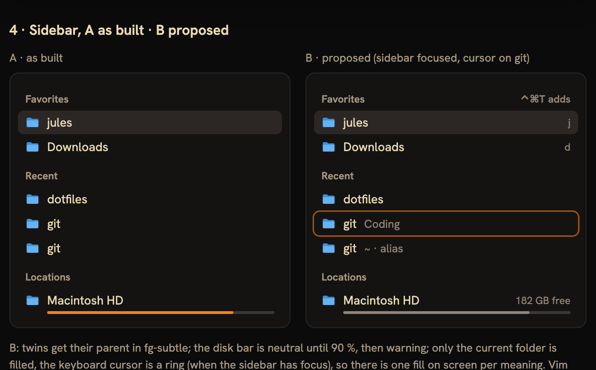

# U8 Sidebar

Audience: an implementing agent. Follow `.claude/skills/execute-plan/SKILL.md`; read `AGENTS.md` and `docs/plans/ui-overhaul/README.md` first.
Needs: U1 (`ui-u1-shared-parts`) merged to `main` (uses its `current_location` and `cursor_ring` helpers in `style.rs`, and `Keycap`/I1 keys only if Q7 is answered yes).
Branch: `ui-u8-sidebar` from `main`.
Progress file: `docs/plans/ui-overhaul/u8-sidebar.progress.md`.
PR title: "UI U8: Sidebar twins, neutral disk bar, one fill per meaning, mark letters". Don't merge.
Design reference: canvas board "Discovery kit" §4, variant **B** (A is as built); the sidebar in the assembled boards "Overhaul" and "OverhaulSearch". https://claude.ai/artifact/EbZ7gFCy24MaccdpbSsFtE

## Why
"Today, annotated" finds three sidebar problems:
- **3 Three selections at once.** The sidebar's current folder, the inactive column and the active column all carry a fill. In the sidebar itself, when it has focus, the keyboard cursor is a second, stronger fill (`accent` 0x55) on top of the current-folder fill (`selection`), so two fills mean two different things.
- **4 Recent can't tell twins apart.** "git" appears twice with nothing to tell which is which (one of them is a symlink; only the tiny alias arrow in Finder's icon hints at it).
- **5 Disk bar in accent.** An 82 % full disk draws in orange accent and reads as a warning; accent should mean focus, not fill level. Free space is only in the aria label.

Also: Vim marks (`key` in `sidebar.toml`) are invisible; you have to remember which favorite is `'j`.

## Decided
- Scope (from the combined draft (since folded into these plans) § U8, unchanged): Recent/Favorites names that occur twice get their parent folder name in `fg-subtle` after the name; the disk bar is `fg-subtle` until 90 % used, then `warning`, with "182 GB free" on the right; only the current folder is filled (`selection`), the keyboard cursor when the sidebar has focus is an accent ring instead of a second fill; favorites with a Vim mark show the letter on the right when the Vim layer is on. Tests: twins get distinct aria labels ("git, in Coding"); the disk row's aria label still reports free space.
- Index ground rules: theme roles only; every interactive element has a role and aria label, tooltips never replace aria labels; new key behavior gets a keystroke test; plans that touch row rendering run the bench (U8 is listed, see Q9).
- From U1 (I6): `style.rs` gets `current_location` (the `selection` role) and `cursor_ring` (accent outline, 1.5 px). U1 I6 already replaces the inline tints in `sidebar.rs` with those helpers *without visible change*; U8 makes the visible change (ring instead of fill). U1 I3 puts a tooltip (free/total) on the disk row; keep it.
- Animations are out of scope.

## Current state

Take from it: the Recent list with two bare "git" rows (one with Finder's alias badge in its icon), the orange disk bar, and the sidebar "jules" fill competing with two column fills.

All in `crates/crow-app/src/sidebar.rs` unless noted.
- **Model.** `enum Row { Header(String, Option<usize>), Favorite(Slot, Favorite), Recent(PathBuf), Volume(crow_macos::Volume) }` (:67-74). `rows(ui)` (:87-102) builds, in order: each favorites group (header with `Some(g)` + its favorites), then "Recent" if `ui.sidebar.recent.show` and `ui.recent_list` is non-empty, then "Locations" if shown and `ui.volumes` non-empty. It is rebuilt on every render.
- `crow_core::Favorite { path, name: Option<String>, icon, color, key: Option<char> }` (`crates/crow-core/src/sidebar.rs:94-103`); `name` is the configured label. `find_key` (:131-134) finds a mark. Recent never contains favorites: `ui::refresh_recent` filters them out (`crates/crow-app/src/ui.rs:398-400`), so a path is in at most one of Favorites/Recent (but can be in two favorites groups).
- **Names.** `display_name(path)` (:104-107) calls `crow_macos::display_components(path)` and takes the last component. `display_components` (`crates/crow-macos/src/names.rs:9-22`) returns Finder's localized name for **every ancestor** (volume first, `/Volumes` skipped) via `NSFileManager.displayNameAtPath` on the main thread, and plain file names off the main thread (so tests, which are not on the main thread, get plain names). It is called per row per render; the ancestors it computes are thrown away.
- **Aliases/symlinks.** Crow does not know whether a sidebar row is a symlink or alias. Nothing in `rows()`, `Ui` or `Recent` records it; `record_visit` (`ui.rs:370`) stores the path as navigated, so `~/git` (symlink) and its target are two Recent entries. Only the Finder icon (`style::icon`, :559) shows the badge.
- **Volumes.** `crow_macos::Volume { name, path, total_bytes, free_bytes, ejectable }` (`crates/crow-macos/src/volumes.rs:24-34`); free is "available for important usage" (includes purgeable, as Finder shows), :79-81. `ui::refresh_volumes` (`ui.rs:425-438`) reads them in the background; called at startup, on mount/unmount/rename notifications (`poll`, :248-262), every 60 s (:211-224) and after an eject (sidebar.rs:355). Not after file operations. `init_for_tests` (`ui.rs:233-246`) leaves `volumes` empty.
- **Render** (:378-645). Per selectable row `i`: `here = path == self.current` (:450), `cursor = i == self.cursor` (:451). Label (:452-460): favorite `name` or `display_name`; volume `v.name`. Aria (:461-473): volume "`{label}, {free} free of {total}[, ejectable]`" with `human_bytes` (one decimal, powers of 1000, :129-139); favorite with key and Vim layer "`{label}, mark {k}`"; else the label. Element: `div` id/debug selector `sidebar-{i}`, `Role::ListBoxOption`, aria label, position/size in set, `aria_selected(cursor)`, `aria_active_descendant` on the cursor (:475-483); `px_2 py(3) rounded_md flex_col relative` (:484-489). Fills, last wins: `here` → `selection` (:490); `focused && cursor` → `accent` 0x55 (:491); drop target (not while reordering a favorite) → `accent` 0x40 (`drop_bg`, :388, :492-494).
  - Line (:562-567): 16 px icon (favorite `icon` text in its tint, else Finder icon via `style::icon`), gap 8, label `flex_1 min_w_0 overflow_hidden whitespace_nowrap` in `fg` (no ellipsis), then a 7 px color dot for favorites with `color` and no `icon`.
  - Ejectable volumes: a "⏏" `Role::Button` "Eject {name}" in `fg-muted`, hover `fg` (:568-587).
  - Disk bar (:589-601): `ml(24) mt(2) h(3)` track in `border`, fill width `used`, `warning` if `used > 0.9` else `accent`.
  - Favorite reorder: `on_drag` + the 2 px accent insertion line (:511-548). Headers (:405-440): 11 px semibold `fg-muted`, `Role::Heading` level 2, debug selector `sidebar-header-{title}`, group headers take drops (fill `drop_bg`).
  - Container (:605-643): key context `Sidebar` (+ ` vim`), `Role::ListBox` "Sidebar", `w(210)`, `px_2 pb_2`, `bg-inset`, right border, `gap(1)`.
- **Focus and keys.** Tab toggles focus between sidebar and pane (`window.rs:192-200`, `SwitchFocus`). Sidebar bindings (`crates/crow-app/src/actions.rs`): up/down, enter and cmd-down open (:123-126), cmd-backspace remove, cmd-alt-up/down reorder, cmd-e eject (:142-145); Vim j/k/l (:199-201). ctrl-cmd-t `AddToSidebar` is in the `Crow` context (:141). The sidebar has no key of its own for focus; the cursor starts at 0 and is invisible while the sidebar is unfocused. `set_current` (:178-183) is fed by the window (`window.rs:623`, `:1733`). Vim `m x` sets a mark through `SidebarEdit::SetKey` (`window.rs:999-1005`).
- **Tests.** `window.rs` `mod tests`: helpers `fixture` (:1811), `open`, `settle`, `write_config` (:1885), `favorites_toml` (:1893), `sidebar_paths` (:1898), `use_vim` (:2094). Sidebar tests: `same_keys_mean_different_things_in_sidebar_and_list` (:1903), `favorites_reorder_remove_and_add_from_the_keyboard` (:1929), `dragging_a_favorite_down_inserts_below_the_row` (:1958), `dropping_on_a_favorite_moves_into_it` (:1991), `recent_lists_visited_folders_that_are_not_favorites` (:2007), `vim_marks_set_favorites_and_jump` (:2124), `sidebar_drop_highlight_is_steady_while_the_pointer_stays_on_a_row` (:3024), `dragging_a_row_onto_a_sidebar_favorite_moves_it` (:3058). Unit tests in sidebar.rs (:647-666): `sizes_read_like_finder`, `colors_by_name_role_or_hex`. Nothing asserts fills or aria labels today.

## Target

Take from B: "jules" (current folder) is the only fill; the cursor on "git" is an accent ring with no fill; twins carry "Coding" / "~ · alias" in `fg-subtle` right after the name; marks "j", "d" sit at the right edge; the disk row shows "182 GB free" right-aligned and a neutral bar. "⌃⌘T adds" in the Favorites header is a question (Q7), not scope.

Take from it: the sidebar in context; one fill (the current folder) next to the column views' own selections; twin hints after the name. Its line icons (clock, home, download) are not U8 scope (Q8).

Take from it: the sidebar is unchanged in search mode. It shows "crow-core" right-aligned on a single "src" row; that disagrees with Discovery B and the filter board. This plan follows Discovery B (hint right after the name, only on twins); see Q2.

### Layout (sidebar width stays 210 px, Q8)
Row (unchanged box): `px_2`, `py(3)`, `rounded_md`, 20 px line, icon 16 px, gap 8. Line content, left to right:
1. Icon (unchanged).
2. **Name**: 13 px `fg`, `flex_shrink_1 min_w_0`, single line, `text_ellipsis()`. Takes its full width first.
3. **Twin hint** (only on twins): 12 px `fg-subtle`, `ml(6)`, `flex_1 min_w_0 flex_basis(0)`, `text_ellipsis()`. Basis 0 means it gets only what the name leaves; it truncates first and disappears entirely before the name truncates. Rows without a hint get an empty `flex_1` spacer so the right slot stays right-aligned.
4. Color dot (favorites with `color` and no `icon`, unchanged, 7 px).
5. **Right slot**: 11 px `fg-subtle`, `flex_shrink_0`, `ml(6)`: the mark letter (favorites with `key`, Vim layer only) or "`<short free> free`" (volumes with `total_bytes > 0`).
6. Eject button (ejectable volumes, unchanged), after the free text.

In 210 px the line has about 154 px for items 2–5 (210 − 2×8 container padding − 2×8 row padding − 16 icon − 8 gap). "Macintosh HD" + "182 GB free" fits; a long volume name truncates with an ellipsis while the free text stays.

### Twins
A **twin** is a Favorites or Recent row whose shown label equals another Favorites or Recent row's shown label while their paths differ. Rules (recommended answers to Q1, implement as written unless the user answers otherwise):
- Compared across all favorites groups and Recent together (they sit in one column; the eye compares them all). Volumes are not considered.
- The shown label is compared, so a favorite with a custom `name` is a twin by its custom name.
- Comparison is case-insensitive (`to_lowercase`), since APFS and the eye both treat "Git" and "git" as the same.
- The same path twice (a favorite in two groups) is not a twin of itself; it gets a hint only if a different path shares the label.
- The **hint** for a twin is the display name of its nearest ancestor that differs from every other twin's ancestor at the same distance: compare parents (distance 1); for each twin whose parent name is unique among the twins' parents, show it; for the rest, go up one more level and repeat. A path that runs out of ancestors uses its volume name ("Macintosh HD"). If no level separates two rows (e.g. two volumes with the same name), fall back to the abbreviated parent path (`crow_core::abbreviate_home`).
- Shown ancestor that is the home folder: "~" (as on the board). Spoken: the home folder's display name ("jules").
- Spoken label of a twin: "`{label}, in {ancestor}`", e.g. "git, in Coding". With a mark and the Vim layer: "`git, in Coding, mark g`".
- Alias marker: depends on Q3. If yes: a twin row whose path is a symlink shows "`{hint} · alias`" ("~ · alias") and speaks "`git, in jules, alias`".

### Fills and ring (one fill per meaning)
- **Current folder** (`path == self.current`): `style::current_location(theme)` fill (the `selection` role). Whether or not the sidebar has focus.
- **Cursor** (sidebar focused, `i == self.cursor`): `style::cursor_ring(theme)` — an accent ring drawn **inside** the row's rounded box (no layout change, not clipped by the scroll container, not hidden under the neighbor row's 1 px gap). No fill. If U1's `cursor_ring` returns a border instead of an inset ring, see Risks. When the cursor is on the current folder, both show (fill + ring).
- Sidebar not focused: no ring anywhere. `aria_selected` still follows the cursor (unchanged).
- **Drop target** (a file drag over a row): `drop_bg` (`accent` 0x40) replaces the row's fill (including the current-folder fill); the ring stays if present. Group header drop fill unchanged. Favorite reordering: insertion line only (unchanged). Move `drop_bg` into `style.rs` as `drop_highlight(theme)` only if U1 did not already add an equivalent; otherwise use U1's.
- Hover: none (as today; Finder's sidebar has no hover fill).
- Light and dark themes: roles only; check the ring's contrast on `bg-inset` and on the `selection` fill in both (hand check).

### Disk row
- Bar: `ml(24) mt(2) h(3) rounded_full`, track `surface-raised` (board: `raised`; today `border`), fill width = used fraction, fill `fg-subtle` while `used < DISK_WARNING_USED`, `warning` from `DISK_WARNING_USED` (`const DISK_WARNING_USED: f32 = 0.9;` in sidebar.rs, `>=`, so exactly 90 % warns).
- Right slot: `short_bytes(free) + " free"`: powers of 1000 like `human_bytes`, no decimal at 10 and above ("182 GB"), one decimal below 10 ("4.2 GB", "980 MB"), "0 bytes" at zero. Volumes with `total_bytes == 0` (unknown): no bar, no free text (as today: no bar).
- Aria label unchanged in content: "`Macintosh HD, 182.4 GB free of 494.4 GB[, ejectable]`" (full `human_bytes` precision). Q5: append ", almost full" at warning level.
- Refresh: unchanged (startup, mount events, 60 s, after eject). Q6: also refresh after a file operation finishes.

### Mark letters
- Favorites with `key = Some(k)` show `k` in the right slot only when `ui.settings.keymap == Vim`. Finder layer: nothing (the aria label also only says "mark k" in Vim, as today). Lower-case as stored.
- Updates live: `m x` writes `sidebar.toml` → reload → the letter moves (a mark taken from another favorite disappears there).

### Keys, focus, VoiceOver
- No new keys. Tab, Cmd-Delete, Cmd-Option-Up/Down, Cmd-E unchanged; the ring follows the cursor on every key. What arrows, Return and → do changes with I8 (the center follows the cursor).
- Roles unchanged: `ListBox` "Sidebar", `ListBoxOption` rows, `Heading` titles, eject `Button`. The hint and the right slot are part of the row's aria label, not separate nodes (mark them as plain text children; they are not interactive).
- Multiple windows and tabs: each window has its own `Sidebar` and `current`; twins and marks come from the shared `Ui` global, so every window shows the same hints.
- List and column views: no difference (the sidebar does not depend on the view mode).

### Performance
- No list-row change in the pane; the file list bench is unaffected. Sidebar render must not add disk I/O: ancestor names are cached per path (I1), so `displayNameAtPath` runs once per new path instead of once per row per render as today.

## Items

### I1 Row model and name cache (no visible change)

- *Where*: `sidebar.rs` render (:404-602), new types in `sidebar.rs`.
- *Change*: split what each selectable row shows from how it is drawn:
  - `struct RowLook { label: String, hint: Option<String>, right: Option<String>, spoken: String, current: bool, ring: bool, drop: bool, bar: Option<(f32, BarTone)> }` with `enum BarTone { Neutral, Warning }`.
  - `fn looks(&self, rows: &[Row], focused: bool, ui: &Ui) -> Vec<RowLook>` (selectable rows only, same order as `selectable`). Render zips `rows` with `looks`; element code reads only `RowLook` (plus `Row` for drag/drop/eject wiring).
  - `#[cfg(test)] pub fn looks_for_test(&self, window: &Window, cx: &App) -> Vec<RowLook>` (computes `focused` from the window).
  - Name cache: `names: RefCell<HashMap<PathBuf, Rc<[String]>>>` on `Sidebar` holding `display_components` names per path (volume first). `display_name` reads the last entry from it. Prune entries whose path is no longer in `rows()` when the set of paths changes (compare with a stored `Vec<PathBuf>`).
  - In this item `RowLook` reproduces today exactly: `hint: None`, `right: None`, `ring: false`, current and cursor fills as today (keep a temporary `cursor_fill: bool` or map today's cursor fill through `ring` with the old fill; remove in I3), bar tone as today.
- *Edge cases*: a folder renamed while listed keeps its cached name until it leaves the sidebar (acceptable; `ui::refresh_recent` drops vanished folders). Record that in the progress file.
- *Tests*: all existing sidebar tests pass. New `sidebar_looks_follow_rows` (window.rs): favorites alpha, beta → `looks_for_test` labels `["alpha","beta"]`, spoken equal to labels.
- *Done when*: no visible change (hand-compare a screenshot), tests green.

### I2 Twin hints

- *Where*: `crates/crow-core/src/sidebar.rs` (pure logic), `sidebar.rs` `looks`.
- *Change*:
  - `pub fn twin_hints(rows: &[TwinInput]) -> Vec<Option<usize>>` in crow-core, where `TwinInput { label: &str, path: &Path, ancestors: &[String] }` (`ancestors` = display names nearest first, ending with the volume name) and the result is, per row, the distance of the chosen ancestor (or `None` if not a twin; `Some(usize::MAX)` meaning "fall back to the abbreviated parent path"). Implements the rules in Target › Twins. Keep it UI-free and unit-tested (AGENTS: crow-core is pure Rust).
  - `looks` builds `TwinInput` from Favorites and Recent rows (from the name cache), calls `twin_hints`, and fills `hint` (home ancestor shown as "~") and `spoken` ("`{label}, in {name}`", home spoken by its display name, mark suffix after it).
  - Render the hint per Target › Layout (name `text_ellipsis`, hint `flex_1 flex_basis(0) min_w_0 text_ellipsis`).
- *Edge cases*: three twins where two share a parent ("a/x/git", "b/x/git", "c/git": "c/git" shows "c" at distance 1, the other two go up and show "a"/"b"); case-differing labels; same path in two groups plus a different path (both copies of the first get the same hint); custom-named favorite equal to a Recent folder name; a Recent folder named like a volume (volumes ignored); paths at the volume root ("/git" → "Macintosh HD"); localized names (compare display names, not file names).
- *Tests*:
  - crow-core unit: `twins_need_two_paths` (one row, and one path twice → no hints); `twin_hint_is_the_parent`; `twin_hints_walk_up_until_parents_differ`; `twins_mix_levels` (the three-row case above); `twins_compare_shown_names_case_insensitively` (custom `name`, "Git"/"git"); `twin_at_volume_root_uses_volume_name`; `indistinguishable_twins_fall_back_to_parent_path`.
  - window.rs: `sidebar_twins_get_their_parent_in_label_and_aria`: fixture with `root/one/git`, `root/two/git`; favorites both → `looks_for_test` hints `[Some("one"), Some("two")]`, spoken `"git, in one"`, `"git, in two"` (distinct). `sidebar_twins_span_favorites_and_recent`: favorite `root/one/git`, visit `root/two/git` (Recent shown, `cmd-down`/navigate then back) → both rows hinted. `sidebar_twins_walk_up`: `root/x/a/git`, `root/y/a/git` → "x", "y".
- *Done when*: tests green; hand check with two real "git" folders in Recent.

### I3 One fill per meaning: current folder filled, cursor as a ring

- *Where*: `sidebar.rs` `looks` and the row element (:490-494).
- *Change*: `current = path == self.current`; `ring = focused && i == self.cursor`; `drop` as today. Element: `.when(current && !drop, bg(current_location))`, `.when(drop, bg(drop_highlight))`, `.when(ring, cursor_ring)`. Remove the `accent` 0x55 cursor fill and any temporary I1 field.
- *Edge cases*: cursor on the current row (fill + ring); sidebar loses focus by Tab, by clicking the list, by opening an overlay (ring disappears: `focused` is read every render; the window re-renders on focus change — verify, else `cx.notify()` the sidebar from `switch_focus`/focus-out with `on_focus_out`); file drag over the current row (drop fill replaces current fill); favorite reordering (only the insertion line); a click on a row sets the cursor and opens it (focus moves to the list, so no ring afterwards — as today).
- *Tests* (window.rs, keystrokes):
  - `sidebar_cursor_is_a_ring_and_only_the_current_folder_is_filled`: open `root/alpha`, favorites alpha, beta. Unfocused: alpha `current && !ring`, beta neither. `tab`: alpha `current && ring` (cursor 0). `down`: alpha `current && !ring`, beta `ring && !current`. `tab` (back to list): no ring anywhere, alpha still current.
  - Extend `sidebar_drop_highlight_is_steady_while_the_pointer_stays_on_a_row`: while hovering the first row, its look has `drop`; after the drop ends, `drop` is false on every row.
  - Vim: in `vim_marks_set_favorites_and_jump`, or a new small test, `tab j` moves the ring (`ring` index 1).
- *Done when*: tests green; hand check light and dark: one fill, ring visible on `bg-inset` and on the fill.

### I4 Disk row: neutral bar, warning at 90 %, free space on the right

- *Where*: `sidebar.rs` (:568-601), `human_bytes` neighbors.
- *Change*: `const DISK_WARNING_USED: f32 = 0.9;` `fn bar_tone(used: f32) -> BarTone` (`>=`). `fn short_bytes(bytes: u64) -> String` per Target. `looks` sets `right = Some(format!("{} free", short_bytes(v.free_bytes)))` and `bar` for volumes with `total_bytes > 0`. Render the bar with track `surface-raised`, fill `fg-subtle` / `warning`. Free text before the eject button. Spoken label unchanged (plus Q5 if yes).
- *Edge cases*: `free > total` (clamp used to 0); `total == 0` (no bar, no text); network volumes with stale numbers (refresh unchanged); exactly 90 %; long volume name with eject (name truncates, free and ⏏ stay).
- *Tests*: unit `short_sizes_for_the_sidebar` ("182 GB" for 182_400_000_000, "4.2 GB" for 4_200_000_000, "980 MB" for 980_000_000, "1.0 TB" for 1_000_000_000_000 (below 10 in the chosen unit keeps one decimal), "0 bytes"), `disk_turns_warning_at_ninety_percent` (0.899 Neutral, 0.9 Warning). window.rs `disk_row_shows_free_space_and_keeps_its_aria_label`: set `ui.volumes` to one fake `Volume { name: "Test HD", path: root, total 494_384_795_648, free 182_400_000_000, ejectable: true }` via `cx.update`, Locations shown → that row's look: `right == Some("182 GB free")`, `bar == Some((~0.63, Neutral))`, spoken `"Test HD, 182.4 GB free of 494.4 GB, ejectable"`; set free to 5 % → `Warning`.
- *Done when*: tests green; hand check with a nearly full disk image (create a small DMG and fill it).

### I5 Mark letters in the Vim layer

- *Where*: `sidebar.rs` `looks`.
- *Change*: for `Row::Favorite(_, f)` with `f.key = Some(k)` and `vim`, `right = Some(k.to_string())`. Spoken unchanged ("`{label}, mark k`", twin hint before the mark).
- *Edge cases*: Finder layer (no letter); switching layer live in `settings.toml` (re-render through `reload_config`); a mark moved by `m x` (old row loses it); favorite with mark and color dot (dot, then letter); favorite in two groups with a mark (the key belongs to the item that has it in `sidebar.toml`, only that row shows it).
- *Tests*: window.rs `vim_marks_show_as_letters_in_the_sidebar`: favorites alpha (`key = "a"`), beta. Finder layer: `right` all `None`. `use_vim`: alpha `right == Some("a")`. Open beta, `m a`: beta shows "a", alpha `None` (keystroke test).
- *Done when*: tests green; hand check both layers.

### I6 Alias marker (only if Q3 = yes)

- *Where*: `ui.rs` `refresh_recent` (:378-410) and `load_sidebar` (:129), new `Ui.aliases: HashSet<PathBuf>`; `sidebar.rs` `looks`.
- *Change*: in the existing background task of `refresh_recent`, collect `path.symlink_metadata().is_ok_and(|m| m.file_type().is_symlink())` for the sidebar Recent list and all favorites; store in `Ui.aliases` on the main thread. `looks` appends " · alias" to a twin's hint and ", alias" to its spoken label. No main-thread I/O.
- *Edge cases*: symlink to a symlink; dangling symlink (already filtered by `is_dir` for Recent; a dangling favorite still lists); Finder alias files are files, not folders, so they cannot be sidebar rows — symlinks only (record).
- *Tests*: window.rs `symlinked_twin_says_alias`: `root/real/git` and a symlink `root/link/git -> root/real/git`; both favorites → hints "real", "link · alias"; spoken "git, in link, alias".
- *Done when*: tests green.

### I7 Favorites header hint (only if Q7 = yes)

- *Where*: header element (:405-422).
- *Change*: on the first favorites group's header only, a right-aligned 11 px `fg-subtle` "`<keys> adds`", keys from U1 I1 for `AddToSidebar` (live keymap; hide if unbound). Header aria label stays the title; add `aria_description("Control Command T adds the selected folder")` if GPUI's description reaches VoiceOver, else nothing. Hidden when `hints = "off"` (U5 setting; if U5 isn't merged, always shown and note it).
- *Tests*: `favorites_header_shows_the_add_key`: header text contains "⌃⌘T" with the Finder keymap.
- *Done when*: tests green.

### I8 The center follows the sidebar cursor (added 2026-11-13, user request)
- *Why*: today Up/Down (Vim j/k) in the sidebar only move a cursor (`sidebar.rs:276`, `:281`); the folder shows only after Return/Cmd-Down/`l` (`OpenSelection` → `SidebarEvent::Open` → `window.rs` `on_sidebar_event`, which navigates **and** focuses the center). The user wants Finder's feel: moving the cursor shows that folder in the main window right away, while focus stays in the sidebar, so arrowing through favorites previews each one.
- *Where*: `sidebar.rs` `move_up`/`move_down` (and the Vim `j`/`k` that map to them), new event; `window.rs` `on_sidebar_event`; `actions.rs` Sidebar bindings; `crow-core/src/history.rs` if Q12 picks "replace".
- *Change*:
  - New `SidebarEvent::Show(PathBuf)`, emitted after every cursor move that lands on a folder row (favorite, recent, volume). The window navigates the active pane there and **keeps focus in the sidebar** (no `focus_center`). Missing folders (a favorite whose path is gone) show the pane's usual error, focus stays.
  - `SidebarEvent::Open` (Return, Cmd-Down, `l`, click) unchanged: navigate if needed, then focus the center. Per Q13, also bind `right` in `Sidebar` to `OpenSelection` (focus the center without navigating again when the pane already shows the cursor's folder).
  - Tab from the sidebar (`SwitchFocus`) focuses the center as today; the center already shows the cursor's folder, so Tab and → land in the same place.
  - While search is open: the first `Show` closes search (`close_search`) and then navigates, as Back/Forward do via `PaneEvent::Entered`. Tabbing into the sidebar alone never navigates. (Agreed in U3 review: Finder leaves search when a sidebar item is picked.)
  - Clicking a row is unchanged (navigate + focus center).
  - History per Q12.
- *Edge cases*: the cursor moving onto a header (not selectable, skipped today) never emits; the cursor starting at 0 when the sidebar first gets focus does not navigate (only a move does); rapid Up/Down on a slow folder (network volume): each move starts a listing, the last one wins (pane listing is already generation-checked; verify); column view navigates the root column; the sidebar's own current-folder fill moves with the pane, so after a move the fill and the ring sit on the same row.
- *Tests* (window.rs, keystroke):
  - `sidebar_arrows_show_the_folder_and_keep_focus`: favorites alpha, beta; Tab to the sidebar; `down` → pane dir is beta, sidebar still focused; `up` → alpha; `tab` → pane focused, dir alpha.
  - `sidebar_return_and_right_focus_the_center`: Tab, `down`, `enter` → pane focused on beta; again with `right` (if Q13 yes).
  - `sidebar_arrow_closes_search`: cmd-f, type, `tab tab` (field → results → sidebar), `down` → `search.is_none()`, pane dir is the new row, sidebar focused.
  - `sidebar_tab_in_does_not_navigate`: dir before Tab into the sidebar == dir after.
  - Vim: `j`/`k` behave like `down`/`up` (`same_keys_mean_different_things_in_sidebar_and_list` must still pass).
  - History per Q12: after `down down down`, Cmd-[ goes to the folder before the sidebar walk (replace) or one step back (push).
- *Done when*: tests pass; hand check in list and column view, with and without search open.

## Seams with other U plans
- **U1** (required): `current_location`, `cursor_ring`, and any drop tint helper in `style.rs`; U1 I3's tooltip on the disk row stays. If U1 I6 landed the helpers under other names, use those and record it. If `cursor_ring` is a 1.5 px border (layout-affecting), wrap it as an inset `BoxShadow` here and tell the user (Risks).
- **U5** (bottom bar): owns the sidebar-focus hints ("⌘⌥↑↓ reorder · ⌘⌫ remove · ⇥ to list") and the `hints` setting. U8 adds no bottom-bar text. I7 reads `hints` only if U5 is merged.
- **U7** (palette): tells twins apart with a second line (abbreviated path), not with `twin_hints`. Don't change the palette. `twin_hints` lives in crow-core and could be reused later.
- **U2** (menus): Add to Sidebar is in File; nothing here.
- **U10**: compares the whole window with the assembled boards; leave the sidebar width, row height and icons as they are so U10's comparison sees only the changes listed here.

## Risks and things to measure first
- **Ring drawing.** GPUI has `BoxShadow` with `spread_radius` and `inset` (`vendor/zed/crates/gpui/src/style.rs:349-393`) and `.shadow(vec![…])` (`gpui_macros/src/styles.rs:384`). Verify an inset, zero-blur, 1.5 px spread shadow renders as a crisp ring with the row's radius (if `inset` shadows render oddly, use an absolutely positioned child with `border_1` + `rounded_md` + `inset_0` over the row, as the insertion line already does). A plain border would change the row's size by 1–2 px and shift the list on focus: don't.
- **Focus repaint.** The ring depends on `self.focus.is_focused(window)` in render. Verify the sidebar re-renders when focus leaves it (click in the list, overlay opens); today the cursor fill has the same dependency, so it probably does.
- **Main-thread I/O.** `display_components` already does a filesystem call per ancestor per render; I1's cache reduces it. Don't add any new `stat` in render (I6 goes through the background task).
- **Text measurement in 210 px.** `text_ellipsis()` on a `flex_basis(0)` child: verify GPUI truncates rather than wrapping or overflowing (pane.rs:1336 uses `text_ellipsis` in a sized column).
- **Bench.** The pane's rows don't change, so the 100k bench can't move; run it once anyway as the index asks (Q9) and record the numbers.

## Questions to ASK
1. **Twin rules.** Twins compared across all favorites groups and Recent together (not volumes), by the shown label (custom `name` included), case-insensitively; the same path twice is not a twin. *Recommended: yes as written* — the user sees one column and compares what is shown.
2. **Hint placement and only-on-twins.** Discovery B puts the hint right after the name and only on twins; the assembled search board shows "crow-core" right-aligned on a lone "src". *Recommended: Discovery B* (after the name, twins only); the right edge is for marks and free space.
3. **Aliases.** Crow doesn't know a row is a symlink today; the board shows "~ · alias". Add I6 (background symlink check, " · alias" on twins)? And should Recent instead merge a symlink with its target? *Recommended: I6 yes, no merging in U8* (merging changes Recent's data; leave it for M7 if wanted).
4. **When two twins can't be told apart by any single ancestor** (same names all the way up): fall back to the abbreviated parent path. When the distinguishing ancestor is not the parent ("a/x/git" vs "b/x/git"), show just "a" or "a/…/x"? *Recommended: just the distinguishing name ("a")*; short, and the tooltip/aria could say more later.
5. **Disk aria at warning level.** Append ", almost full" to the spoken label when the bar is in `warning`? *Recommended: yes*; the color alone isn't spoken.
6. **Free-space refresh.** Today: startup, mount events, every 60 s, after eject. Also refresh after a file operation finishes (`operations.rs:126-130`)? *Recommended: yes*; one background call per operation, and copying a large folder visibly changes free space.
7. **"⌃⌘T adds" in the Favorites header** (on the board, not in scope). *Recommended: no* — it is permanent text for a rarely used key; Add to Sidebar is in File (U2) and the palette, and U5's sidebar-focus hints are the place for keys. If yes: I7, first group only, live key, hidden with `hints = "off"`.
8. **Out-of-scope differences in the assembled boards:** width 220 px (today 210), drawn line icons per row (clock for Recent, home, download, disk) instead of Finder's icons, board row padding 4 px (today 3 px). *Recommended: keep 210 px, Finder icons and today's padding in U8*; raise the icons as a later plan if wanted.
9. **Bench.** The index says U8 runs the bench, but U8 doesn't touch the pane's rows. *Recommended: run it once and record the numbers, no comparison needed unless they move.*
10. **Current folder spoken.** Add an aria description "current folder" on the filled row? *Recommended: yes* (`aria_description`), so VoiceOver users get what the fill tells sighted users.

11. **(I8) Scope.** Should arrows in the sidebar show the folder in the center, focus staying in the sidebar? *Answered 2026-11-13: yes, as in I8.*
12. **(I8) History while arrowing.** Each sidebar move a separate Back step (Finder), or replace the history entry while the walk continues so Back returns to where you were before entering the sidebar? *Recommended: replace* — arrowing past five favorites shouldn't cost five Cmd-[ presses; needs `History::replace_current` (or "visit, but collapse consecutive sidebar visits").
13. **(I8) → and Return.** Bind `right` in `Sidebar` to focus the center (same as Return)? *Recommended: yes*; it matches the column view's → into a folder and the user's "→ focuses that page".

## Hand checks
Add to `docs/testing.md` (By hand), replacing nothing:
| Check | How |
| --- | --- |
| Sidebar twins | Visit two folders with the same name (e.g. `~/a/git`, `~/b/git`): Recent shows "git a" and "git b" with the hint dimmer; a narrow window truncates the hint before the name. VoiceOver reads "git, in a". |
| Sidebar follows the cursor (I8) | Tab into the sidebar: nothing navigates. Arrow down through favorites: each shows in the center, focus stays in the sidebar (ring moves, the list has no focus). Tab or → (or Return): the list has focus on that folder. With a search open, Tab to the sidebar and arrow: search closes, the folder shows. Back after an arrow walk follows Q12. List and column view. |
| Sidebar fills | Open a favorite: only it is filled. Tab into the sidebar and arrow: an accent ring moves, no second fill; Tab out: the ring goes. Drag a file over the current row: the drop highlight shows. Check in a light and a dark theme. |
| Disk row | Locations shows "<n> GB free" right-aligned and a grey bar; fill a disk image past 90 %: the bar turns to the warning color. VoiceOver still reads free and total. |
| Mark letters | With `keymap = "vim"`, favorites with a `key` show the letter on the right; `m x` on another folder moves it; Finder layer shows none. |

Update the existing "Locations" row ("with a free-space bar") to "with free space and a bar".

## Finish
- README: in the sidebar paragraph (README.md:55-57) say that same-named folders show their parent, marks show in the Vim layer, and Locations shows free space.
- `docs/testing.md`: the hand rows above; mention twins, fills and marks in the keystroke-test summary paragraph.
- Bench: run `cargo run --release -p crow-app -- --bench target/fixture-100k` once (Q9) and record in the progress file.
- `cargo fmt --check`, `cargo clippy --workspace --all-targets -- -D warnings`, `cargo test --workspace`.
- `./scripts/bundle.sh`, hand checks above, push `ui-u8-sidebar`, open the PR (don't merge), set the progress file to "PR open".
