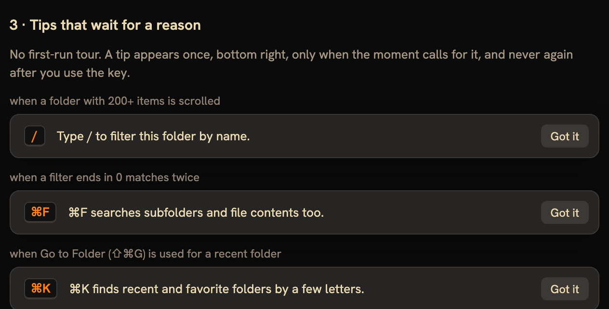

# U9 Contextual tips

Audience: an implementing agent. Follow `.claude/skills/execute-plan/SKILL.md`; read `AGENTS.md` and `docs/plans/ui-overhaul/README.md` first.
Needs: U5 merged to `main` (the `hints` setting and the key-use counter in the state dir), and through it U1 (keys from the live keymap, `Keycap`). ASK before stacking on an unmerged branch.
Branch: `ui-u9-tips` from `main`.
Progress file: `docs/plans/ui-overhaul/u9-tips.progress.md`.
PR title: "UI U9: One-time contextual tips".
Design reference: canvas board "Discovery kit" §3 "Tips that wait for a reason" (source `target/ui-overhaul-boards/Discovery.dc.html:65-79`, data at `:125-129`); position checked against "Overhaul" (assembled, filter state). https://claude.ai/artifact/EbZ7gFCy24MaccdpbSsFtE

## Why
"Today, annotated" finding 1: nothing on screen mentions `/`, ⌘F or ⌘K; every M6 feature is invisible until you already know its key. U2 (menus), U3 (toolbar), U4 (filter footer) and U5 (bottom-bar hints) make the keys findable when you look. U9 covers the moments when the user is visibly doing something the slow way: scrolling a long folder instead of filtering, filtering twice for something that isn't in this folder, typing a path for a folder Crow already knows. A tip appears then, once, and never again after the key has been used. No first-run tour.

## Decided
- Q9 (index): "Contextual tips: included (U9)."
- Q4 (index): "`hints = "auto" | "always" | "off"` in `settings.toml`, default `auto`: each idle hint retires after its key has been used 3 times (counts in `~/.local/state/crow/`)." The combined draft (the combined draft (since folded into these plans), U5) adds: "`off` hides all hints and tips." So `hints = "off"` suppresses tips; `auto` and `always` both allow them.
- Scope from the combined draft (since folded into these plans) U9: a tip appears once, bottom right, only when its trigger fires, and never after the key has been used: scrolling a 200+ item folder → `/`; two zero-match filters in a row → ⌘F; ⇧⌘G used for a folder that is in Recent → ⌘K. "Got it" or using the key dismisses it for good. State lives in `~/.local/state/crow/` (not config). VoiceOver: role status, announced once.
- Ground rules (index): theme roles only; every interactive element has a role and aria label; every new key behavior gets a keystroke test; no animation (a later plan).
- Inherited: keys shown come from the live keymap (U1 I1), drawn as a `Keycap` (U1 I2). The key-use counter and `hints` setting come from U5; reuse them, don't build a second counter.

## Current state

Take from it: finding 1 (no key is mentioned anywhere) and finding 7 (one status slot at the bottom right, `"18 items"`): the tip floats above that corner.

No tip code exists. The parts the plan builds on:

**Window and overlays.** `CrowWindow` (`crates/crow-app/src/window.rs:51-70`) holds every overlay as an `Option`: `go_to` (`:58`), `sheet` (`:60`), `show_activity` (`:61`), `why` (`:63`), `picker` (`:64`), `palette` (`:66`), `search` (`:68`). `Render for CrowWindow` (`:1722`) builds them (`:1736-1745`) and stacks them after the path bar in this order: `path_bar` (`:1793`), `go_to`, `sheet`, `activity`, `why`, `picker`, `palette` (`:1794-1799`). Later children draw on top. The ToggleActivity listener flips `show_activity` (`:1779-1782`).

**Floating panel example.** `render_activity` (`:903-981`): `div().id("activity").role(Role::List).aria_label("Activity").absolute().top(px(52.)).right(px(12.)).w(px(360.)).max_h(px(420.))`, `surface` fill, `border` border, `rounded_lg`, `shadow_lg`, `p_3`; buttons are `div().id(..).role(Role::Button).aria_label("Undo").on_click(cx.listener(..))` (`:966-976`). So the activity panel occupies the top right, from y = 52 to at most y = 472.

**Bottom bar.** `render_path_bar` (`:438-552`): `h(px(28.))` (`:473`), top border, the status slot at the right with `role(Role::Status)` (`:528-536`). U5 rebuilds it into three slots; its height is whatever U5 settles (assume 28 px unless U5 exports a constant).

**Go to Folder (⇧⌘G).** `go_to_folder` (`:213-246`): `TextInputEvent::Confirmed` (`:228-241`) resolves the typed text with `crow_core::resolve_typed` (lexical normalization, `crates/crow-core/src/paths.rs:7-27`; no symlink resolution), then `pane.navigate(target)` if `target.is_dir()`, `pane.reveal` if a file exists, else the bell; then `close_go_to` (`:248-252`) refocuses the pane. Binding `cmd-shift-g` → `GoToFolder` in `Crow` (`crates/crow-app/src/actions.rs:130`). Test `go_to_folder_completes_navigates_and_reveals_files` (`window.rs:2630`).

**Recent.** `Ui` (`crates/crow-app/src/ui.rs:18-49`) has `recent_list` (`:40`, the sidebar's Recent rows, favorites removed) and `palette_recents` (`:42`, up to 50 folders, favorites included: what ⌘K finds). Both are recomputed off the main thread by `refresh_recent` (`:378-410`) after `record_visit` (`:370`). `CrowWindow::on_pane_event` calls `record_visit` on `PaneEvent::Entered` (`window.rs:615-624`), so by the time Go to Folder confirms, `palette_recents` reflects earlier visits, not this one.

**State dir.** `crow_core::state_dir()` (`crates/crow-core/src/config.rs:13-21`): `$CROW_STATE_DIR`, else `$XDG_STATE_HOME/crow`, else `~/.local/state/crow`. `Ui.state_dir` (`ui.rs:45`). `Ui::new` loads `recent.json` synchronously at startup (`:60`, the allowed startup-load exception); saves go through `cx.background_spawn` and `crow_core::write_atomic` (`config.rs:46`, re-exported `lib.rs:17`). `init_for_tests` (`ui.rs:233-246`) gives each test its own `…/state` dir.

**Filter.** `Pane.filtering: Option<Filtering>` (`crates/crow-app/src/pane.rs:235`, struct `:195-198`). `start_filter` (`:652-680`) opens the field; each change calls `Folder::set_filter` (`folder.rs:302-314`) on the focused folder. It closes through `close_filter` (`:686-696`, Esc) or `drop_filter` (`:700-708`, navigation, ⌘F escalation in U4). Before either clears the folder's filter, `focused_folder().read(cx).filter()` (`folder.rs:296`) is the query and `row_count()` (`folder.rs:195`) the matches. `/` → `StartFilter` in `FileList` (`actions.rs:95`); palette `CommandId::StartFilter` calls the same handler (`pane.rs:432`).

**Scrolling.** Rows are `ROW_HEIGHT = 24.0` (`pane.rs:43`). List view: one `uniform_list("entries", …)` tracked by the root folder's `UniformListScrollHandle` (`pane.rs:1800-1802`). Column view: one `uniform_list(("column-list", k), …)` per column (`:1605-1611`), each with its folder's handle (`folder.rs:182`). `drag_row_at` (`pane.rs:1031-1048`) already reads `scroll().0.borrow().base_handle.offset().y`. There is no scroll listener today. GPUI has `InteractiveElement::on_scroll(listener: Fn(&ScrollEvent, &mut Window, &mut App))` (`vendor/zed/crates/gpui/src/elements/div.rs:1084`; `on_scroll_wheel` is deprecated), `ScrollEvent { position, delta, modifiers, touch_phase, source }` (`interactive.rs:522-538`), and tests can send one with `VisualTestContext::simulate_event` (`app/test_context.rs:1079`).

**Other blocking states.** Rename: `Pane::is_renaming` (`pane.rs:1882`). Drags: `cx.has_active_drag()` (used at `window.rs:1752`). Search: `CrowWindow.search.is_some()`; ⌘F handler `show_search` (`:1267`); ⌘K handler `show_palette` (`:1340`) refuses while another overlay is open (`:1341-1348`).

**Accessibility.** GPUI exposes `role`, `aria_label`, `aria_description` (`div.rs:1357-1392`) but no live-region API (`grep live` in `window/a11y.rs`: none). A node with a stable id appearing once is reported once (`vendor/zed/crates/gpui/src/_accessibility.rs:80-100`). The path bar's status already uses `Role::Status` (`window.rs:532`).

**Keys.** ⌘F `ShowSearch` and ⌘K `ShowCommandPalette` in `Crow` (`actions.rs:151-152`); `escape` → `CancelOperation` in `Crow` (`:113`), so Esc is taken. The Vim layer (`:174-209`) does not rebind `/`, ⌘F or ⌘K. Palette rows still carry hardcoded key strings (`palette.rs:74`, `:89`) until U1 I1 replaces them.

**Tests.** Keystroke tests live in `window.rs` `mod tests` (`:1808`); helpers `open`, `settle`, `pane`, `dir`, `rows`, `write_config` (`:1821-1891`); clicks use `cx.debug_bounds("<selector>")` + `simulate_mouse_down/up` (`:1963-1972`).

## Target

Take from it: the card (surface fill, raised border, shadow, 10 px radius), the accent keycap on the left, one line of `fg` text, the small "Got it" button on the right, and the exact copy of the three tips.


Take from it: the bottom bar is one 28 px row with the path left and hints plus counts right; a tip sits above that row's right end, inside the window, over the preview or the rightmost column. No tip is drawn in this board; the position follows the Discovery kit text "bottom right".

### The three tips
| Id (`TipId`) | Key action | Trigger | Text (key from the live keymap) |
| --- | --- | --- | --- |
| `Filter` (`"filter"`) | `StartFilter` | Long-folder scroll (below) | "Type {key} to filter this folder by name." |
| `Search` (`"search"`) | `ShowSearch` | Two zero-match filters in a row | "{key} searches subfolders and file contents too." |
| `GoTo` (`"go-to"`) | `ShowCommandPalette` | ⇧⌘G confirmed for a known folder | "{key} finds recent and favorite folders by a few letters." |

`{key}` is the U1 I1 text for the action in the current layer and the context where it fires (`FileList` for `StartFilter`, `Crow` for the others), e.g. `/`, `⌘F`, `⌘K`. If the action has no binding in the live keymap, the tip is not shown (and not retired).

### Triggers (exact, testable)
- **Long-folder scroll.** A pointer or touch `ScrollEvent` over a file list (list view's list, or any column in column view) after which that list's first visible row is ≥ `TIP_SCROLL_ROWS` (= 30, see Q2), in a folder whose `entries().len()` ≥ `TIP_SCROLL_ENTRIES` (= 200). First visible row = `floor(-offset.y / ROW_HEIGHT)` (verify the sign: `drag_row_at` `pane.rs:1043` adds `offset.y`; check which sign GPUI uses before writing the comparison). Keyboard moves and programmatic scrolls (reveal, select-where-you-came-from, `scroll_to_item`) do not count (Q3). Not while the filter is open.
- **Two zero-match filters in a row.** A "filter session" is one `start_filter` … `close_filter`/`drop_filter`. It ends with zero matches when, at close, the focused folder's filter is non-empty and its `row_count()` is 0. A session that ends with ≥ 1 match resets the streak to 0; a session closed with an empty query leaves the streak unchanged. The tip fires when a second consecutive zero-match session ends. The streak is per window, in memory, reset when the app quits. A session that ends because the user pressed ⌘F (U4's escalation) is a key use, which retires `Search` instead.
- **Go to Folder for a known folder.** `go_to_folder`'s `Confirmed` resolves to a directory, the target differs from the pane's current folder, and the target is in `Ui.palette_recents` at confirm time (Recent plus favorites: exactly what ⌘K would offer; Q4). Comparison is lexical on `resolve_typed`'s output (symlinked spellings like `/tmp` vs `/private/tmp` don't match; accepted). Checked before `navigate`, shown after `close_go_to`.

### When a tip may show (`TipBook::may_show`)
All of:
1. `hints` is not `off` (U5's setting, read live).
2. The tip is not retired (persisted set, below).
3. U5's key-use count for its action is 0 (the user already knows the key; this also covers uses before U9 shipped).
4. No tip is on screen in any window (at most one app-wide).
5. Cooldown: at least `TIP_COOLDOWN` (= 10 min, Q5) since the last tip was shown, app-wide, in memory (a fresh launch has no cooldown).
6. The window is not busy: no `go_to`, `sheet`, `why`, `picker`, `palette`, `search`; activity panel closed; `!cx.has_active_drag()`; `!pane.is_renaming()`; no filter open (for the scroll trigger).
A trigger that fails any check is dropped, not queued.

### Retiring and closing
- A tip is **retired the moment it is shown** (it "appears once", Q1). Retired ids are written to the state file in the background.
- It **closes** when: "Got it" is clicked; its key action runs in any window (`StartFilter`, `ShowSearch`, `ShowCommandPalette`, from a key, menu or palette); the pane's folder changes (`PaneEvent::Entered`) or the active tab changes; a blocking state starts (overlay opens, drag starts, rename starts, search opens, activity opens); `hints` turns `off`; the window closes.
- Running a tip's key action also retires that tip even if it was never shown (so a later trigger does nothing).
- No timeout; no animation.

### State file
`<state_dir>/tips.json`, written with `crow_core::write_atomic`:
```json
{"retired":["filter","go-to"]}
```
Migration-free: one field, a list of string ids. Unknown ids are kept on load and written back unchanged (a newer Crow's tips survive an older Crow), missing field or file = empty set, unparsable file = empty set plus a `tracing::warn!` (the next save replaces it; it is state, not config, so no status-line error). New tips in later plans just add ids.

### Layout (px; app UI font 13 pt)
- Container: `absolute`, `right(12)`, `bottom(BOTTOM_BAR_HEIGHT + 8)` (36 with today's 28 px bar), `min_w(280)`, `max_w(min(440, window_width - 24))`, `flex items_center gap(12)`, padding `10 10 10 14`, radius 10, `surface` fill, 1 px `surface-raised` border, `shadow_lg`. Text wraps to two lines at narrow widths; no truncation.
- Keycap: U1 `Keycap` `Key` weight (board: 22 px tall, min width 22, 6 px horizontal padding, 5 px radius, 1 px `surface-raised` border with 2 px bottom, `bg` fill, `accent` semibold text). U1's `Key` is 20 px, `surface` fill, `fg` text; use it with an accent text role if U1 allows a role override, else ASK (Q6).
- Sentence: `flex_1`, `fg`, 13 px, line height ~1.4. The key inside the sentence is plain text (not a second keycap), as on the board.
- "Got it": 24 px tall, `px(10)`, radius 6, `surface-raised` fill, `fg` 12 px text. Hover: `border` fill. Pressed (`.active`): `selection` fill. No focus ring (not in the Tab order; see Focus).
- Stacking: rendered after `path_bar` and before `go_to` in `Render` (so every sheet would cover it; they also close it).
- Activity panel: opening it closes the tip, and an open panel blocks tips, so the two never overlap even in a short window.
- Light and dark themes: roles only; check FireBox and Solarized Light by hand.
- Multiple tabs: the tip belongs to the window; switching tabs closes it. Two windows: only one tip app-wide; it shows in the window whose trigger fired.
- List and column views: same position. In list view it floats over the preview pane's bottom right; in column view over the rightmost column or preview.

### Keyboard and focus
- Showing a tip never moves focus. The tip has no key of its own: Esc stays with `CancelOperation`/filter/sheets. Keyboard users dismiss it by using the key it teaches, or it closes on the next folder change.
- "Got it" is a mouse and VoiceOver control (`Role::Button`, `on_click`); verify by hand that VoiceOver's press action reaches `on_click` (Risks).

### VoiceOver
- Container: `id("tip")` (stable), `role(Role::Status)`, `aria_label("Tip: <sentence>")`, e.g. "Tip: ⌘F searches subfolders and file contents too." The label never changes while shown, so it is reported once.
- Button: `id("tip-got-it")`, `debug_selector("tip-got-it")`, `role(Role::Button)`, `aria_label("Got it")`, `aria_description("Don't show this tip again")`.
- Keycap: decorative (no role), per U1 I2.

### Performance
- The scroll trigger runs only on `ScrollEvent`, does an early return when `Filter` is retired or not allowed (one global lookup), and otherwise reads one scroll offset and one `entries().len()`. Nothing is added to row rendering or to `Pane::render`. No bench change expected; run it anyway because `Pane::render` gets a listener (Finish).

## Items

### I1 Tip model in `crow-core`
- *Where:* new `crates/crow-core/src/tips.rs`; export from `crates/crow-core/src/lib.rs`.
- *Change:*
  - `pub enum TipId { Filter, Search, GoTo }` with `fn key(self) -> &'static str` (`"filter"`, `"search"`, `"go-to"`) and `fn all()`.
  - `#[derive(Serialize, Deserialize, Default)] pub struct TipState { #[serde(default)] retired: BTreeSet<String> }` with `load(path) -> TipState` (warn on parse error, as `Recent::load` does but logging), `save(&self, path) -> io::Result<()>` via `write_atomic`, `is_retired(TipId)`, `retire(TipId) -> bool` (true if it changed).
  - `pub struct TipBook { state: TipState, on_screen: bool, last_shown: Option<Instant> }` with `may_show(&self, id, now: Instant, uses: u32, hints_off: bool) -> bool` (checks 1–5 above; the window checks 6), `show(&mut self, id, now)` (retires, sets `on_screen`, `last_shown`), `closed(&mut self)`.
  - `pub struct ZeroMatchStreak(u8)` with `end_session(&mut self, query_empty: bool, matches: usize) -> bool` (true when the streak reaches 2; then resets to 0).
  - Constants `TIP_SCROLL_ENTRIES = 200`, `TIP_SCROLL_ROWS = 30`, `TIP_COOLDOWN = Duration::from_secs(600)`, each with a doc comment pointing at the Q that set it.
- *Edge cases:* unknown ids round-trip; empty/missing file; `retire` twice is a no-op; `Instant` injected, never read inside the model.
- *Tests (unit, `crow-core`):* `tip_state_round_trips_and_keeps_unknown_ids`; `tip_state_missing_or_broken_file_is_empty`; `tip_book_shows_once_then_retired`; `tip_book_refuses_when_key_used_or_hints_off`; `tip_book_one_on_screen_and_cooldown` (second id refused while on screen and until `last_shown + TIP_COOLDOWN`, allowed after); `zero_match_streak_needs_two_in_a_row` (0,0 → fires; 0,3,0 → no; 0, empty, 0 → fires).
- *Done when:* tests pass; no UI types in the module.

### I2 App glue: the `Tips` global, persistence, key uses
- *Where:* new `crates/crow-app/src/tips.rs` (keep it under ~250 lines with I3's render function); `ui.rs` `init` and `init_for_tests`; the handlers of the three key actions.
- *Change:*
  - `pub struct Tips { book: TipBook, file: PathBuf, owner: Option<EntityId> }`, `impl Global`. `tips::init(state_dir, cx)` loads `tips.json` synchronously (startup exception, like `recent.json` at `ui.rs:60`); called from `ui::init` (`ui.rs:173`) and `ui::init_for_tests` (`:233`) after `Ui` is set.
  - `tips::request(id, owner: EntityId, cx) -> bool`: reads `hints` (U5) and U5's use count for the tip's action, calls `may_show`, and on success `show` + `owner = Some(owner)` + `save_in_background`. The window still checks its own blocking states (check 6) before calling.
  - `tips::closed(owner, cx)`: clears `on_screen`/`owner` if `owner` matches.
  - `tips::key_used(action: TipId, cx)`: retire (save if changed); if that tip is on screen, close it and `cx.refresh_windows()`.
  - `save_in_background`: clone `TipState`, `cx.background_spawn` → `save`; log errors with `tracing::warn!`.
  - Call `tips::key_used` from `Pane::start_filter` (`pane.rs:652`, after the field opens), `CrowWindow::show_search` (`window.rs:1267`, after the early-return guards, so only when search opens or refocuses) and `CrowWindow::show_palette` (`:1340`, after its guard). If U5 already records key uses in these handlers through one helper, call `tips::key_used` from that helper instead (one place; record which in the progress file).
  - `#[cfg(test)] pub fn reload_for_tests(cx)`: re-reads `tips.json` into a fresh `TipBook` (simulates a relaunch: clears `on_screen` and `last_shown`).
- *Edge cases:* no disk I/O on the main thread except the startup load; two quick saves race: both write the full set atomically, last wins, and the set only grows, so no loss within one process.
- *Tests:* covered with I3–I6 (`tip_state_survives_reload`).
- *Done when:* the global loads in the app and in tests; key uses retire tips (unit-checked through I3's tests).

### I3 Showing and closing the tip in the window

- *Where:* `window.rs`: `CrowWindow` gains `tip: Option<TipId>`; `render_tip` lives in `tips.rs` as `pub fn render_tip(id, theme, key_text, on_got_it) -> impl IntoElement`; `Render for CrowWindow` (`:1722`) adds `.children(tip)` between `.child(path_bar)` (`:1793`) and `.children(go_to)` (`:1794`).
- *Change:*
  - `CrowWindow::offer_tip(&mut self, id, window, cx)`: returns early if any blocking state (check 6) holds or the key text for the action is `None`; else `tips::request(id, cx.entity_id(), cx)` and on success `self.tip = Some(id)`, `cx.notify()`.
  - `CrowWindow::close_tip(&mut self, cx)`: `self.tip.take()` then `tips::closed`.
  - Close on: Got it (`on_click` → `close_tip`, the tip is already retired); `PaneEvent::Entered` (`on_pane_event`, `:615`); `cycle_tab`, `new_tab`, `close_tab`, `open_tab_at`; opening `go_to`, sheet, why, picker, palette, search, activity (each opener calls `close_tip`; the ToggleActivity listener at `:1779` too); `Pane::begin_rename` and drag start (simplest: in `render`, if `self.tip.is_some()` and a blocking state holds, `close_tip`). In `render`, also close if `hints` is `off` or the `Tips` global no longer names this window as owner (key used elsewhere).
  - Window close: `cx.on_release` (or the window's `Drop`-time subscription GPUI offers; verify which `CrowWindow` can use) calls `tips::closed`.
  - Sentence from `tips::text(id, key)` (the three strings in Target). Key text from U1 I1 for the action and context.
- *Edge cases:* window narrower than 304 px: `max_w` keeps 12 px margins, text wraps; a tip shown in window A when window B uses the key: B's handler calls `key_used`, A closes on its next render (`refresh_windows`).
- *Tests (window.rs, `#[gpui::test]`):*
  - `tip_got_it_retires_it`: trigger the Filter tip (I4 helper), click `tip-got-it` via `debug_bounds` + mouse down/up; assert `tip` is `None`, `tips.json` lists `"filter"` after `settle`, and scrolling again shows nothing.
  - `tip_closes_when_the_folder_changes`: trigger, `cmd-down` into `alpha`… (or path-bar navigation), assert closed, and that coming back and re-triggering shows nothing (shown once).
  - `tip_hints_off_suppresses_and_hides`: `write_config("settings.toml", "hints = \"off\"\n")` (U5's key name), trigger → no tip; set `auto`, trigger → tip; set `off` again → tip gone.
  - `tip_never_shows_while_busy`: on the 250-file fixture, start a rename (`enter` on a row) and send the I4 scroll event → no tip; `escape`. Then, for each of: search open (`cmd-f`), palette open (`cmd-k`), activity open (`cmd-alt-l`), call `offer_tip(TipId::Filter)` directly through `view.update` → `tip` stays `None` and the tip is not retired (scrolling after closing each one shows it).
  - `tip_only_one_on_screen`: show the Filter tip, then fire the Go to trigger → still the Filter tip only.
- *Done when:* tests pass; the tip renders bottom right in both views (hand check).

### I4 Trigger: scrolling a long folder → `/`

- *Where:* `pane.rs`: new `PaneEvent::LongFolderScrolled`; listeners on the list body (`:1782-1806`, the `div` wrapping `uniform_list("entries")`) and on each column container (`:1580-1612`).
- *Change:* `.on_scroll(cx.listener(move |this, event: &ScrollEvent, _, cx| this.on_list_scroll(k, cx)))` (k = 0 in list view). `on_list_scroll(k)`: return if `self.filtering.is_some()`, or `tips::wants(TipId::Filter, cx)` is false (cheap: not retired and hints not off); read folder `k`'s `entries().len()` and first visible row; if ≥ the constants, `cx.emit(PaneEvent::LongFolderScrolled)`. `CrowWindow::on_pane_event` maps it to `offer_tip(TipId::Filter)`. The listener runs in the bubble phase after the `uniform_list` applied the delta (children's listeners run first); verify, and if the offset isn't updated yet, defer the check with `cx.defer` (record which in the progress file).
- *Edge cases:* a column in column view with ≥ 200 entries while another column is focused still counts (the scroll is in that column); a folder still loading with < 200 entries doesn't count yet; scrolling back up never closes the tip.
- *Tests:* fixture helper `long_fixture(name, n)` (root with `n` files `f000…`); `tip_scrolling_a_long_folder_suggests_the_filter_once`: open on 250 files, `simulate_event(ScrollEvent { position: center of "file-list" bounds, delta: ScrollDelta::Lines(point(0., -40.)), source: Pointer, .. })`, settle; assert `tip == Some(Filter)`; scroll again after closing → `None`. `tip_short_folder_scroll_does_nothing`: the 3-entry fixture, same event → `None`. `tip_using_the_key_retires_it`: trigger, `simulate_keystrokes("/")` → tip `None` and `"filter"` retired. `tip_scroll_in_column_view`: `cmd-3`, scroll over `column-view-0` with 250 entries → tip.
- *Done when:* tests pass; scroll p99 unchanged (bench).

### I5 Trigger: two zero-match filters → ⌘F
- *Where:* `pane.rs` `close_filter` (`:686`) and `drop_filter` (`:700`); new `PaneEvent::FilterEnded { empty: bool, matches: usize }`; `CrowWindow` gains `zero_streak: ZeroMatchStreak`.
- *Change:* before clearing the folders' filters, read the focused folder's `filter()` and `row_count()` and emit `FilterEnded`. `on_pane_event` feeds `zero_streak.end_session(..)`; on true, `offer_tip(TipId::Search)` (after the filter closes, so check 6 sees no filter). If U4 has moved these functions (filter inside the focused column), hook the same two exit points under their new names.
- *Edge cases:* a filter dropped by navigation counts like Esc; the streak lives per window, not per tab; a filter that ends with matches resets the streak.
- *Tests:* `tip_two_zero_match_filters_suggest_search`: `/` `zzz` `escape`, `/` `qqq` `escape` → tip `Search`; key text is `⌘F`. `tip_zero_match_streak_resets_on_a_match`: `/ zzz esc`, `/ al esc`, `/ qqq esc` → no tip. `tip_search_key_retires_it`: trigger, `cmd-f` → closed and retired, then `escape` closes search; two more zero-match filters → no tip.
- *Done when:* tests pass.

### I6 Trigger: Go to Folder for a known folder → ⌘K
- *Where:* `window.rs` `go_to_folder`, `Confirmed` branch (`:228-241`).
- *Change:* before `navigate`, compute `known = target != current && ui.palette_recents.contains(&target)`; after `close_go_to`, `if known { self.offer_tip(TipId::GoTo, window, cx) }`.
- *Edge cases:* file targets (reveal) don't count; `palette_recents` not yet computed at launch (empty) means no tip; Recent hidden in `sidebar.toml` still counts (the palette still offers it, Q4).
- *Tests:* `tip_go_to_folder_for_a_recent_folder_suggests_the_palette`: visit `alpha` (`cmd-down` on it), `cmd-up`, settle (Recent refresh), `cmd-shift-g cmd-a`, type the absolute `alpha` path, `enter` → tip `GoTo`, key text `⌘K`. `tip_go_to_folder_for_a_new_folder_does_nothing`: same to `beta` without visiting first → none. `tip_palette_key_retires_it`: trigger, `cmd-k` → tip gone, retired.
- *Done when:* tests pass.

### I7 Persistence across launches
- *Where:* tests only (behavior built in I1–I2).
- *Tests:* `tip_state_survives_reload`: trigger the Filter tip, click Got it, settle; `tips::reload_for_tests`; assert `tips.json` contains `"filter"` and a new scroll trigger shows nothing; and a never-shown `Search` tip still can show after reload (cooldown cleared by the relaunch).
- *Done when:* passes; `tips.json` written only off the main thread (read the code path once more).

## Seams with other U plans
- **U5 (required).** U5's plan (`u5-bottom-bar.md`) defines what U9 uses: `crow_core::HintsMode { Auto, Always, Off }` as `Settings.hints`; the app-side module `crate::usage` with `usage::uses(&dyn Action, &App) -> u32` (read) and `usage::record(&dyn Action, &mut App)` (called inside the `StartFilter`, `ShowSearch` and `ShowCommandPalette` handlers, so key, menu and palette uses all count), plus `usage::record_key` / `usage::count_key` for named, non-action counters (use these for dismissed tips if that is simpler than `tips.json`; record the choice). If U5 merged under other names, use those and record the mapping in the progress file. U9 needs exactly: (a) read `hints` live, (b) read the use count of `StartFilter`, `ShowSearch`, `ShowCommandPalette`, (c) a single place where uses are recorded, to call `tips::key_used` from. If U5 doesn't count one of these three actions (e.g. U5 counts only idle hints shown in the list), ASK whether U5's counter should add it or U9 should rely on its own retired set alone. U5 proposes a 30 px bottom bar (its Q12); use U5's exported height for the tip's `bottom`, else 28 px (today's).
- **U1.** Key text from the live keymap (I1) and `Keycap` (I2). If the `Key` weight can't take an accent text role, see Q6. The U1 Sheet (I4) and scrim draw above the tip; openers close it anyway.
- **U4.** Moves the filter into the focused column and adds ⌘F escalation; I5 hooks the filter's two exit points wherever U4 left them. U4's zero-match state D already shows "Search subfolders too ⌘F"; the ⌘F tip comes after the filter closes, so they don't show together.
- **U2/U7.** Menu or palette runs of the three actions count as key uses (Q7); no change needed if they call the same handlers (today they do: `pane.rs:432`, `window.rs:1423`).
- **U10.** Adds the tips row to the whole-window check; leave animation (fade-in) to the later animation plan: no transitions here.
- Leave alone: `render_activity`'s position, the path bar's contents, Recent's ranking.

## Risks and things to measure first
- Scroll offset sign and timing: confirm by reading `uniform_list`'s scroll handling (`vendor/zed/crates/gpui/src/elements/uniform_list.rs`) before I4; write the conversion once as `first_visible_row(handle) -> usize`.
- `simulate_event(ScrollEvent)` in the test platform: confirm it reaches `on_scroll` and moves the `uniform_list` (the window needs a real size; `open` uses `Default::default()` window options, check the test window's height lets 250 rows overflow).
- VoiceOver: GPUI has no live-region or announcement API. Hand-check that a new `Role::Status` node is read once. If it isn't, ASK before adding an `NSAccessibilityPostNotification` announcement in `crow-macos` (new AppKit code).
- VoiceOver press on "Got it": confirm accesskit's default action reaches `on_click`.
- Window close hook: confirm the API to clear `Tips.owner` when a `CrowWindow` is released.
- Perf: `on_scroll` listeners on each column add closures per frame; negligible, but bench and compare with `main` (AGENTS.md rules).

## Questions to ASK
1. Is a tip retired the moment it is shown (it "appears once"), or only by Got it / using the key (so an ignored tip may show again on the next trigger)? Recommended: retired when shown. The board says "appears once"; showing it again risks nagging, and "Got it" then only closes it.
2. How far is "scrolled"? Recommended: first visible row ≥ 30 in a folder of ≥ 200 entries (a bit more than one screen of 24 px rows in a 760 px window), any number of times per session until shown. Alternative: any scroll at all in such a folder (fires too eagerly).
3. Do keyboard moves that scroll the list (arrows, `j`/`k`, Page Down) count as scrolling? Recommended: no, pointer and touch scrolls only, so reveals and history restores never fire it; keyboard users get the bottom-bar hint (U5).
4. "In Recent" for ⇧⌘G: the sidebar's Recent rows (`recent_list`) or everything ⌘K would find (`palette_recents`, Recent plus favorites)? Recommended: `palette_recents`, because the tip promises "recent and favorite folders".
5. Cooldown between tips? Recommended: 10 minutes after a tip was shown, in memory (a relaunch clears it). With three tips that each show once, this only stops two tips landing back to back.
6. Keycap style: the board uses accent text on a `bg` fill with a 22 px cap; U1's `Key` weight is 20 px, `surface` fill, `fg` text. Recommended: U1 `Key` with an accent text role (add a role parameter to `Keycap` if U1 lacks one), keeping one keycap family.
7. Does running the action from the menu or palette (not the key) retire its tip? Recommended: yes; the user has found the feature, which is what the tip is for.
8. Should `hints = "always"` also show tips? Recommended: yes, same as `auto`; only `off` suppresses tips (the agreed U5 text says "`off` hides all hints and tips").
9. Should a tip have a keyboard dismissal (it isn't in the Tab order and Esc is taken)? Recommended: no new key; using the taught key or changing folder closes it, and VoiceOver can press Got it.

## Hand checks
Add to `docs/testing.md` "By hand":
| Check | How |
| --- | --- |
| Tips | With a fresh `CROW_STATE_DIR`: scroll a 200+ item folder → "Type / to filter this folder by name." bottom right above the bottom bar, in list and column view, FireBox and Solarized Light; Got it closes it and it never returns after relaunch. Two zero-match filters in a row → the ⌘F tip; ⇧⌘G to a recent folder → the ⌘K tip. Using the key closes and retires a tip. `hints = "off"` shows none. Opening Activity closes a tip; a narrow window wraps the text inside 12 px margins. |
| Tips with VoiceOver | The tip is read once when it appears ("Tip: …"); "Got it" is a button that VoiceOver can press. |

## Finish
- README: a short "Tips" paragraph next to the `hints` setting (what triggers each tip, that it shows once, `tips.json` in the state dir, `hints = "off"` turns them off). `docs/testing.md`: mention tips in the keystroke-test list and add the hand rows above.
- Bench (`cargo run --release -p crow-app -- --bench target/fixture-100k`) vs `main`: scroll p99 and first paint within run-to-run noise.
- `cargo fmt --check` · `cargo clippy --workspace --all-targets -- -D warnings` · `cargo test --workspace` · `./scripts/bundle.sh` and the hand checks.
- Push `ui-u9-tips`, open the PR "UI U9: One-time contextual tips" (each item, approach, how verified). Don't merge. Set the progress file to "PR open".
